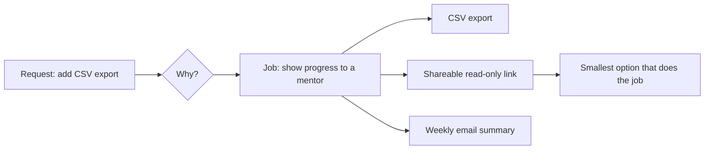
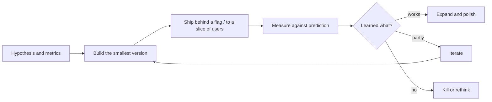

A ticket says "add a CSV export button". A task-focused engineer adds the button, merges, and
moves on. An engineer with a **product mindset** first asks who needs the export and why, ships
the smallest version that answers that need, checks whether people use it, and changes it based
on what they learn. That is **end-to-end ownership**: you own the outcome, not just the code.
Gergely Orosz's writing on [The Pragmatic Engineer](https://blog.pragmaticengineer.com/) calls
these people **product-minded engineers**, and companies value them highly because they need far
less direction. This session covers understanding users and the business, defining success
metrics, and the ship-measure-iterate loop, then you apply it to a YouCanDoIt feature.

## Understanding users and business goals

Think of a carpenter asked to build a shelf. A good one asks what will go on it: books, plants, a
television? The answer changes the wood, the brackets and the depth. Code is the same: the request
is a guess at a solution; your job is to understand the **problem** behind it.

Questions to ask before you start:

- **Who** is the user? A new learner, an admin, an internal team, another service?
- **What job** are they trying to get done? ("Export to CSV" might really be "show my manager my
  progress", which a shareable link would solve better.)
- **What happens today** without this feature? Workarounds tell you how much it matters.
- **Why now?** What business goal does it serve: acquisition, retention, revenue, cost, risk?
- **How will we know it worked?** (Next section.)

Places to find answers: talk to users directly, read support tickets, sit in on sales or support
calls, read the analytics, and ask the product manager for the reasoning, not just the spec.

> [!NOTE]
> Understanding the business doesn't mean becoming a product manager. It means knowing enough to
> make the hundreds of small decisions a spec never covers (what to do on an empty state, which
> edge case can wait, what error message to show) in the direction the business actually needs.

Product-minded engineers also **push back**. If a feature will take three weeks and a simpler
version gets 80% of the value in three days, saying so is part of the job. So is pointing out when
an engineering constraint opens a product opportunity ("we already store every completion with a
timestamp; we could show a streak calendar almost for free").



## Defining success metrics

If you can't say what success looks like before you ship, you can't tell afterwards whether you
succeeded. Write it down first.

A useful structure is three layers:

- **Goal**: the change in user behaviour or business result you want. ("Learners return more
  often.")
- **Signal**: what would indicate the goal is happening. ("They complete subchapters on more days
  per week.")
- **Metric**: a precise, measurable number. ("Median active days per week among learners active in
  the last 30 days, from 2.1 to 2.5 within six weeks.")

Kinds of metrics to consider:

| Kind | Example | Watch out for |
| --- | --- | --- |
| Adoption | % of active users who used the feature at least once | Novelty spikes in week one |
| Engagement | Uses per user per week | Vanity: more clicks isn't always better |
| Outcome | Retention, conversion, task completion time | Slow to move, many causes |
| Guardrail | Error rate, latency, support tickets, unsubscribe rate | Must not get worse |

Always pair a success metric with at least one **guardrail**: a metric that should *not* move.
A notification feature that raises engagement but also doubles unsubscribes is not a win.

> [!WARNING]
> Watch for **vanity metrics**: numbers that only go up (total sign-ups, total page views) and feel
> good but don't help you decide anything. A good metric is one where a bad result would change
> what you do next.

> [!TIP]
> Before release, write down your **prediction**: "I expect 30% of active learners to try it in the
> first two weeks." Comparing the prediction with reality trains your product judgement faster
> than anything else.

## Shipping, measuring and iterating

Ownership doesn't end at merge. The loop looks like this:



Practical habits:

- **Instrument as part of the feature.** The analytics event, the log line and the dashboard are
  in the same PR as the button, not a follow-up ticket that never happens.
- **Ship small and early.** A feature flag or a staged rollout (internal users, 5%, 50%, 100%)
  lets you learn before you have bet everything.
- **Watch it land.** Check errors and guardrails in the first hours, usage in the first days,
  outcomes over weeks. Put a reminder in your calendar.
- **Close the loop in writing.** A short note to the team: what we shipped, what we expected,
  what happened, what we'll do next. This builds trust and makes your impact visible (useful for
  your brag document in 10.4.3).
- **Be willing to kill features.** Removing something that didn't work is a good outcome. Unused
  features still cost maintenance.

The guides on [StaffEng](https://staffeng.com/guides/) make a related point about senior work in
general: impact is measured by outcomes for the business and the people around you, not by the
amount of code you produced.

> [!EXAMPLE]
> You ship a "daily goal" setting. Prediction: 25% of active learners set one within two weeks,
> and those who do have more active days. Reality: 40% set one, but active days don't change, and
> most goals are set to the maximum. Learning: people like the idea but pick unrealistic goals.
> Iteration: suggest a default based on their last two weeks. That insight was only available
> because you measured.

## Practice: define metrics for a YouCanDoIt feature and review them after release

Pick a YouCanDoIt feature you will build or recently built: the streak display, the tutor, "ask
your reading list", daily news, or a new idea from `toDo.md`. Allow about an hour now and 30
minutes after release.

### Step 1: Write the one-pager of intent

```md
## Feature: tutor suggestions on session pages

Users: me (and future learners) studying a session.
Job: get unstuck on a subchapter without leaving the page.
Today: I open another tab and search, and often lose focus.
Goal: more subchapters completed per study session.
```

### Step 2: Define metrics

Write one success metric, one adoption metric and one guardrail, each with a number and a time
window. For a personal app with one user, metrics can be personal: "tutor questions per week",
"subchapters completed per session", "p95 tutor response time under 8 seconds".

### Step 3: Check you can measure it

Find where the data lives. Completions are in the database with timestamps; tutor calls could be
logged by the API. If a metric needs data you don't collect, add the instrumentation to the plan.

### Step 4: Predict

Write your expected numbers and why.

### Step 5: Ship and review

After two to four weeks, query the data, compare with your prediction, and write a five-line
review: expected, actual, surprise, decision (expand, iterate, kill). Keep it next to the feature's
ADR or in the PR description.
