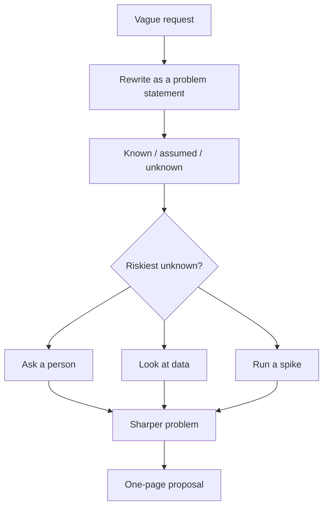

As a junior you mostly get well-defined tickets: the problem is known, the solution is roughly
known, you implement it. The higher you go, the fuzzier the input becomes: "onboarding feels
slow", "we need to do something about costs", "can we use AI for this?". Nobody hands you a spec,
because nobody knows the answer yet. Turning that fog into a clear plan, and making progress before
all the facts are in, is one of the clearest markers of senior and staff engineers in the
[StaffEng guides](https://staffeng.com/guides/). This session covers framing the problem, buying
information cheaply with spikes and prototypes, and writing a one-page proposal, then you write one.

## Framing problems and asking the right questions

Imagine a doctor whose patient says "I feel bad". A bad doctor prescribes something immediately. A
good one asks: since when, where, how much, what changed? Ambiguous requests deserve the same
diagnosis before treatment.

**Separate problem from solution.** Requests usually arrive as solutions ("add caching", "move to
microservices"). Rewind to the problem: what is going wrong, for whom, and how do we know? Often
the problem is real and the proposed solution isn't the best one.

**Questions that reduce ambiguity fastest:**

- **Who is affected, and how badly?** One customer or all? Annoying or blocking?
- **What does "done" look like?** If we succeed, what is observably different?
- **What are the constraints?** Deadline, budget, people, compliance, things we can't change.
- **What has been tried before?** And why didn't it work?
- **What is out of scope?** Saying it explicitly avoids scope creep later.
- **What is the cost of doing nothing?** Sometimes the honest answer is "not much".
- **Who decides?** Know who has to say yes before you invest.

**Write down what you know, what you assume, and what you don't know.** That list is the
backbone of everything that follows.

| Known | Assumed | Unknown |
| --- | --- | --- |
| Sign-up to first lesson takes a median of 9 minutes | Most drop-off is in the profile form | Whether mobile users behave differently |
| 40% of sign-ups never open a lesson | Users want to start immediately | Which fields in the form people abandon on |

> [!TIP]
> Restate the problem in one sentence and send it to whoever asked: "So the problem is that 40% of
> new users never reach a lesson, and we want to halve that this quarter. Is that right?" Half the
> time the answer is "not quite", and you just saved weeks.

Will Larson writes on [lethain.com](https://lethain.com/) about how much senior work is choosing
which problem to work on at all. Part of framing is checking that this problem matters enough to
be worth solving now.



## Spikes and prototypes

When questions can't be answered by asking or by data, you **build something small to learn**.
The key word is *learn*: the output is knowledge, not production code.

**Spike**: a time-boxed technical investigation that answers one specific question. The name comes
from Extreme Programming. Examples:

- "Can pgvector handle 1 million embeddings with p95 search under 100 ms on our hardware?"
- "Does the payment provider's SDK support our refund flow?"
- "How hard is it to upgrade to the next major version of the framework?"

**Prototype**: a rough version of the user-facing thing, to learn whether it is the *right* thing.
A clickable mock, a hard-coded page, a script someone runs by hand. Shown to users or stakeholders,
not shipped.

Rules that keep them useful:

1. **One question per spike**, written down before you start.
2. **A strict time box**: hours or a couple of days, not weeks. If the time runs out, that itself
   is an answer ("it's harder than we thought").
3. **Throw the code away**, or at least never merge it as-is. Spike code skips tests, errors and
   edge cases by design.
4. **Write up the result**: the question, what you tried, the answer, the confidence, the next step.

> [!WARNING]
> The most common failure is the prototype that becomes production. It demoed well, a deadline
> appeared, and now a hard-coded hack serves real users. Make the throwaway nature explicit up
> front ("this will not ship"), and keep prototypes in a separate branch or repo.

> [!EXAMPLE]
> Question: "Can we run the tutor locally on a laptop with acceptable speed?" Time box: half a day.
> You run three model sizes through Ollama on ten real questions and time them. Answer: the small
> model answers in about 3 seconds with acceptable quality, the big one takes 40 seconds. Decision
> input: default to the small model, offer the hosted one as an option. One paragraph, half a day,
> and a design question is settled with evidence instead of opinion.

**Make progress anyway.** You will rarely remove all ambiguity. Identify the decisions that are
reversible (session 10.1.2), make them quickly, and focus the investigation on the one or two that
aren't.

## Writing a one-page proposal

Once the problem is clear and the riskiest unknowns are reduced, write a **one-page proposal**. It
is shorter and earlier than a full design doc (session 10.3.3): its job is to get agreement on the
problem and direction before anyone invests in the details.

A structure that works:

```md
## Problem
One paragraph. Who is affected, how, and the evidence.

## Goal and non-goals
What success looks like (with a metric). What we are explicitly not doing.

## Proposal
The approach in a few sentences or bullets. Enough to judge, not to implement.

## Alternatives considered
Two or three, with one line each on why not.

## Risks and open questions
What could go wrong. What we still don't know and how we'll find out.

## Plan and ask
Milestones, rough effort, and exactly what you need from the reader
(a decision, people, a deadline).
```

Writing tips:

- **Lead with the problem**, not the solution. Readers who agree on the problem forgive a lot in
  the proposal.
- **Make the ask explicit**: "I need a yes/no by Friday" beats "thoughts?".
- **Quantify** wherever you can, and say where numbers are estimates.
- **One page means one page.** If it doesn't fit, you probably haven't decided what matters.
  Link to appendices (spike results, data) for the curious.

> [!NOTE]
> A proposal that gets rejected is not wasted. It turned an ambiguous situation into a clear
> decision, quickly and cheaply. That is exactly the job.

## Practice: write a proposal for an ambiguous feature request

Take this deliberately vague request for YouCanDoIt (or one from your own work): **"The app should
help me remember what I've learned."** Allow about two hours.

### Step 1: Reframe

Write one sentence for the problem behind it. Is it that you forget content weeks later? That you
can't find what you studied? That you never revisit completed sessions? Pick one and say why.

### Step 2: Known, assumed, unknown

Fill the three-column table. Use real data where you can: query completions to see how often you
revisit old sessions.

### Step 3: Run one spike

Choose the riskiest unknown and time-box two hours. For example: "Can the existing LLM layer
generate decent review questions from a lesson file?" Try it on three lessons with the tutor or a
small script, and write a four-line result.

### Step 4: Write the one-pager

Use the template above. Include at least two alternatives (spaced-repetition review cards, a
weekly "revisit" email, search over your own notes) and one non-goal.

### Step 5: Get a decision

Share it with someone and ask for a decision, not just feedback. If you're the only stakeholder,
put it away for a day, reread it as a sceptic, and decide. Record the decision at the top of the
document.

> [!TIP]
> Keep every proposal you write, accepted or not, in one folder. In a year it is a portfolio of
> your judgement, and great material for interviews (10.4.1).
