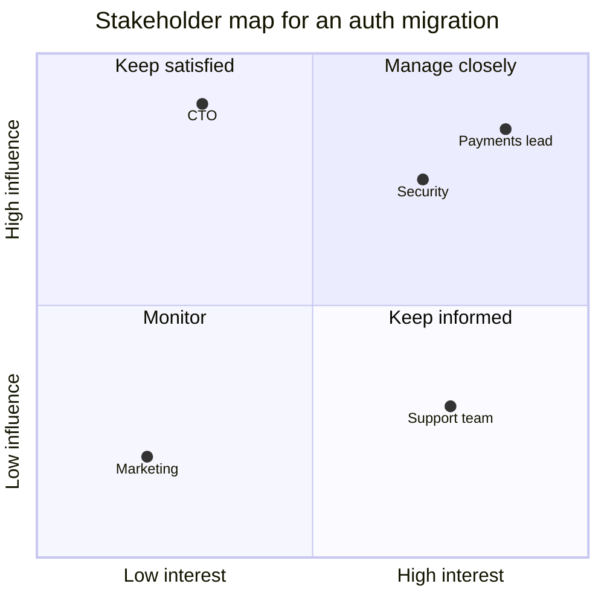

The hardest problems in a company rarely fit inside one team. A migration touches five services
owned by four teams; a new platform needs every product team to adopt it; an incident fix requires
someone else's roadmap to change. You have no authority over those people, and you still need them
to agree and act. Senior and staff engineers do this through **influence**: understanding who
matters, earning trust, and running communication so well that alignment becomes the easy path.
This is a recurring theme in the [StaffEng guides](https://staffeng.com/guides/) and in Will
Larson's writing on [lethain.com](https://lethain.com/). This session covers stakeholder mapping,
building trust, running meetings and async communication, then you lead a decision in writing.

## Stakeholder mapping

A **stakeholder** is anyone affected by, or able to affect, your project. Before a cross-team
effort, list them explicitly. The ones you forget are the ones who block you in week six.

Start broad: owning teams of every system you touch, their managers, product managers, security,
legal, support, SRE/platform, finance if cost changes, and the users themselves.

Then place each on a **power/interest grid**:



- **Manage closely** (high influence, high interest): involve early, co-design, check in often.
- **Keep satisfied** (high influence, low interest): short, crisp updates; no surprises; escalate
  only with a clear ask.
- **Keep informed** (low influence, high interest): regular updates, a channel to ask questions.
  These people are often the most affected; treat them well.
- **Monitor**: a line in the changelog may be enough.

For the key ones, also write down **what they care about**. The payments lead cares about
downtime during peak hours; security cares about token lifetimes; support cares about what to tell
customers. Your proposal should answer each of those concerns before they raise it.

> [!TIP]
> Have the important conversations **one-to-one before the group meeting**. People rarely change
> their minds in public, and nobody likes being surprised in front of their peers. By the time the
> meeting happens, it should mostly confirm agreements you've already reached.

## Building trust and influence

Influence without authority runs on **trust**, and trust is earned in small deposits long before
you need to make a withdrawal.

Where trust comes from:

- **Reliability.** Do what you said, when you said. If you can't, say so early. Nothing builds
  credibility faster than a track record of delivering.
- **Competence that's visible.** Good design docs, helpful code reviews, calm incident handling.
  People follow those they've seen be right, and honest when wrong.
- **Generosity.** Help other teams with their problems before you need anything. Review their
  PRs, answer questions in their channel, credit them publicly.
- **Understanding their goals.** Every team has its own roadmap and pressures. Proposals that help
  them hit *their* goals get adopted; proposals that only help you get deprioritised.
- **Honesty about trade-offs.** If your proposal costs them something, say it plainly and say what
  you'll do to reduce it.

Practical influence tactics:

- **Lead with the shared problem**, not your solution. Agreement on the problem is easier and
  makes the rest a joint effort.
- **Make it easy to say yes.** Offer to do the work in their codebase, write the migration script,
  pair with their engineers.
- **Bring data.** "Auth errors caused 30% of last quarter's support tickets" beats "auth is a
  mess".
- **Find allies and a sponsor.** A respected engineer on another team, or a director who cares,
  amplifies your voice.
- **Disagree and commit.** When a decision goes against you after a fair process, support it
  fully. People remember who is a good partner when they lose.

> [!NOTE]
> Larson describes "staying aligned with authority" as a core staff skill: even without formal
> power, you need your work to match what your leadership believes is important. Influence that
> fights the organisation's priorities rarely lasts.

## Running effective meetings and async communication

Most cross-team work happens in meetings and messages, so doing both well is a superpower.

### Meetings

Before calling one, ask whether it should be a document instead. Meetings are good for decisions
with disagreement, brainstorming and relationship building; bad for status updates and information
that one person broadcasts.

When you do run one:

1. **Purpose and desired outcome in the invite.** "Decide between options A and B for the token
   format" is a meeting; "sync on auth" is not.
2. **Pre-read** sent at least a day before. Some teams start with ten silent minutes reading the
   doc together so everyone has actually read it.
3. **Only the people needed.** Everyone else gets the notes.
4. **Facilitate**: keep time, bring in quiet voices ("Priya, you know the token service best, what
   do you think?"), park off-topic discussions.
5. **End with decisions, owners and dates**, out loud: "So we're going with B; Marco updates the
   SDK by the 15th; I'll write the migration guide."
6. **Notes within the hour**, sent to attendees and stakeholders.

### Async communication

Distributed teams across timezones work mostly in writing. Good async messages are
**self-contained**: the reader can act without asking a follow-up question.

```md
**Decision needed by Thu 12:00 CET: token lifetime for the new auth service**

Context: we're replacing session cookies with short-lived access tokens (doc link).
Options:
1. 15 min access + 14 day refresh (recommended: smaller exposure if a token leaks, minor UX cost)
2. 60 min access + 30 day refresh (fewer refreshes, longer exposure if stolen)

What I need from you: a thumbs-up for option 1, or a comment with concerns.
If no objections by Thursday, I'll go with option 1.
```

Habits that make async work:

- **Bottom line up front**: the ask or the decision first, details after.
- **Set a deadline and a default** ("if no objections by Thursday, we go with option 1"). Silence
  then becomes a decision instead of a stall.
- **Use threads** and keep one topic per thread.
- **Write decisions down where people will find them**: the design doc, an ADR, the project page,
  not buried in chat.

> [!WARNING]
> "Any thoughts?" is the weakest message in engineering. It has no deadline, no ask and no
> default, so it gets no answer. Always say what you need, from whom, by when.

## Practice: lead a cross-team decision in writing

Lead a real decision that involves at least two other people or teams, entirely or mostly in
writing. At work, pick something modest: a shared library convention, a deprecation, an API change.
On a personal project, use an open-source project you contribute to (an issue or RFC), or recruit
two friends to play the other teams. Allow a week of elapsed time, a few hours of effort.

### Step 1: Map stakeholders

List everyone affected, place them on the grid, and write one line on what each cares about.

### Step 2: Pre-wire

Talk to the one or two "manage closely" stakeholders individually. Ask about their concerns,
adjust your plan, and tell them you'll write it up.

### Step 3: Write the decision document

One page: problem, options (at least two, with honest trade-offs), recommendation, what you need
from each stakeholder, deadline and default. Answer the concerns you heard in step 2 explicitly.

### Step 4: Run the async process

Post it where stakeholders will see it, tag the people whose input you need, and answer questions
in the thread. If a real disagreement emerges that writing can't resolve, hold a short meeting with
a clear outcome and post the result back in writing.

### Step 5: Close it

Announce the decision, owners and dates, record it (ADR or project page), and thank people by name.
Then write a short reflection: who did you forget, what objection surprised you, what would you do
differently?
