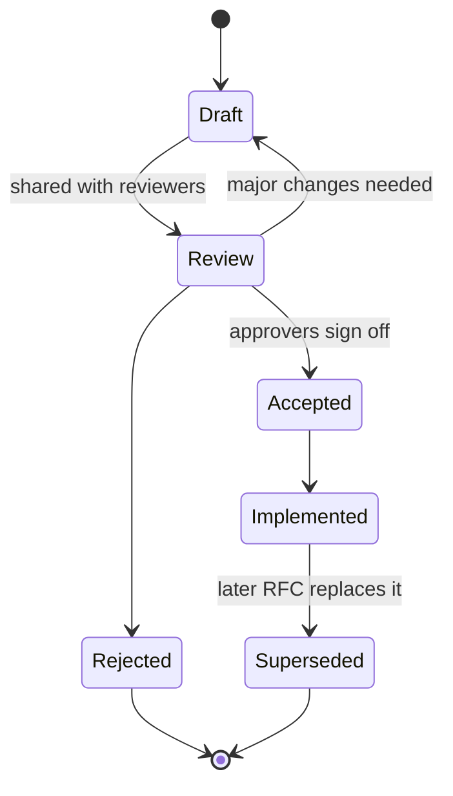
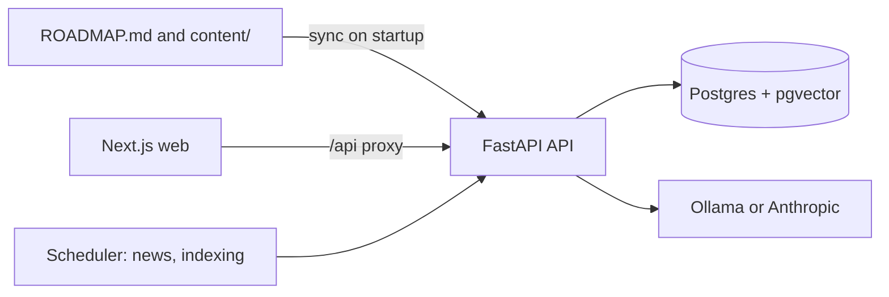

Senior engineers write more and code less. Not because writing is more important than code, but
because a good document can save a team weeks of building the wrong thing, and it reaches people
you'll never meet in person. Design docs, RFCs, postmortems and presentations are how your
technical judgement leaves your head. This session covers writing for people who must decide,
design docs and the RFC process, presenting to different audiences, and then you present the
YouCanDoIt architecture in ten minutes.

## Writing for decision makers

A director reading your document is like a busy traveller scanning a departures board: they want
the one line that matters to them, now. If they have to read three paragraphs of background to
find it, many won't.

**Bottom line up front (BLUF).** Start with the conclusion or the ask. Then the reasoning. Then the
details for those who want them.

> [!EXAMPLE]
> Weak opening: "Over the past few months the team has been investigating various aspects of our
> infrastructure costs, and we have looked at several options..."
>
> Strong opening: "**Recommendation:** move the embedding workers to spot instances, saving about
> €4,000/month with no user-visible impact. **Decision needed** by 30 October. Risks and
> alternatives below."

Google's free [Technical Writing courses](https://developers.google.com/tech-writing) teach the
sentence-level habits that make this possible:

- **Know your audience.** Define who reads the document and what they already know, then write
  for exactly that. Leaders need impact, risk and cost; engineers need mechanisms and edge cases.
- **Short sentences, one idea each.** Cut words that add nothing ("in order to" → "to").
- **Active voice.** "The scheduler retries the job" beats "the job is retried".
- **Define terms** the first time, and use the same term every time afterwards.
- **Use lists and tables** for steps, options and comparisons.
- **Paragraphs start with their point.** Readers skim the first sentence of each paragraph.

For decision documents specifically:

- **Make options comparable.** A table with the same criteria for each option.
- **Say what you recommend** and why. Leaders want your judgement, not a neutral menu.
- **Quantify** cost, time and risk, and give ranges when uncertain.
- **State the decision you need**, from whom, by when.

> [!TIP]
> Test a doc with the "**elevator check**": cover everything except the title and first
> paragraph. Could a reader make the decision from that alone? If not, rewrite the opening.

## Design docs and RFC process

A **design doc** describes how you plan to build something significant *before* you build it, so
others can find problems while they're cheap to fix. An **RFC** (Request For Comments) is the
process around it: a structured, usually written, way to propose a change and collect feedback
from a wider group. The name comes from the internet standards process; many companies use it for
cross-team technical changes.

A common design doc outline:

```md
## Context and problem
## Goals and non-goals
## Proposed design
   (architecture diagram, data model, APIs, key flows)
## Alternatives considered
## Cross-cutting concerns
   (security, privacy, observability, cost, migration, rollback)
## Risks and open questions
## Rollout plan and milestones
```

**Non-goals** and **alternatives considered** are the sections juniors skip and seniors write
first. They show you understood the trade-offs (session 10.1.2), and they pre-empt the comment
"why didn't you just use X?".

A typical RFC lifecycle:



Tips for the process:

- **Share early drafts with one or two people** before the wide review. Fix the obvious gaps
  privately.
- **Name the approvers** and a **deadline** for comments up front.
- **Respond to every comment**: accept, push back with reasoning, or move it to open questions.
- **Record the outcome** at the top of the document, so later readers know whether it was
  accepted, changed or abandoned.
- **Keep docs findable.** [Write the Docs](https://www.writethedocs.org/guide/) promotes
  "docs as code": store them in version control next to the code, review them like code, and
  keep them up to date as part of the work.

### Postmortems

A **postmortem** is the design doc's counterpart after something went wrong. Blameless format:
summary, impact, timeline, root cause and contributing factors (your feedback loop map from
10.1.1), what went well, what went badly, where we got lucky, and action items with owners. Its
purpose is learning, so it describes systems and decisions, never "Bob broke it".

## Presenting to technical and non-technical audiences

Presentations follow the same rule as writing: **start from the audience**. The same architecture
needs a very different talk for an engineering guild and for a leadership review.

| | Technical audience | Non-technical audience |
| --- | --- | --- |
| Wants | How it works, why it's built this way, the trade-offs | What it does for users/the business, cost, risk, timeline |
| Level of detail | Components, data flows, failure modes | One diagram with three or four boxes, plain words |
| Questions to expect | "What happens when X fails?" | "When will it be ready? What do you need?" |
| Language | Precise terms | Analogies, no jargon, outcomes |

A structure that works for both:

1. **Hook**: the problem in one sentence, ideally with a number or a user story.
2. **The answer**: what you built or propose, at the highest level.
3. **How**: two or three key points, no more. Each with one visual.
4. **Trade-offs and risks**: what you gave up and why.
5. **Ask or takeaway**: what you want the audience to do or remember.

Slide and delivery habits:

- **One idea per slide**, with a headline that states it ("Embeddings are computed nightly, not
  on request") rather than a topic ("Embeddings").
- **Diagrams over bullet points.** Build complex diagrams up step by step.
- **Rehearse aloud** with a timer, at least twice. Talks always run longer than you think.
- **Prepare for questions**: list the five hardest ones and your answers. "I don't know, I'll
  find out and follow up" is a perfectly good answer.

> [!WARNING]
> The most common mistake in technical presentations is giving the non-technical audience the
> technical talk. If you hear yourself saying "and then the HNSW index...", check who is in the room.

## Practice: present your YouCanDoIt architecture in 10 minutes

You'll prepare and give a ten-minute talk about YouCanDoIt's architecture, then a two-minute
version for a non-technical listener. Allow about three hours including rehearsal.

### Step 1: Define audience and takeaway

Write one sentence: "After this talk, a mid-level engineer will understand why ROADMAP.md is the
single source of truth and how lessons reach the tutor."

### Step 2: Draw the main diagram



### Step 3: Outline five slides

1. Problem: a personal, gamified learning platform driven by a Markdown curriculum.
2. Architecture overview (the diagram).
3. One decision in depth: e.g. gamification derived from completions instead of stored.
4. The RAG pipeline: fetch, chunk, embed, search.
5. Trade-offs and what you'd change next.

### Step 4: Rehearse and record

Present aloud with a timer and record yourself. Watch it back once: cut anything that ran long,
remove filler words, check every slide has a clear headline.

### Step 5: The two-minute version

Explain the same system to a non-technical friend in two minutes, with no jargon. Ask them to
explain it back. Whatever they get wrong shows you where the explanation was unclear.

> [!TIP]
> Turn the talk into a short design doc afterwards. You'll reuse both for your portfolio write-up
> (10.4.2) and for system design interviews (10.4.1).
