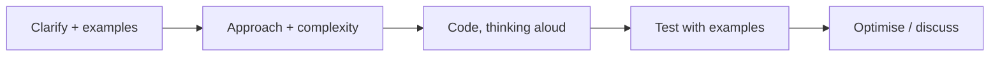
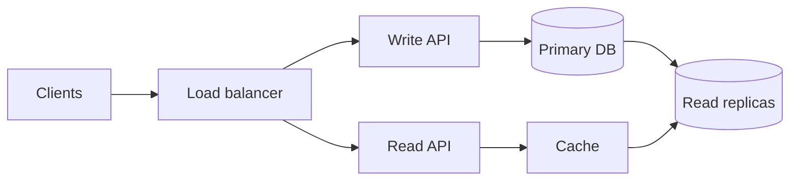

Technical interviews are a skill separate from engineering. Plenty of strong engineers fail them
because they never practised the format, and the format is learnable. Most processes for mid to
senior roles combine three kinds of interview: **coding**, **system design** and **behavioural**.
At senior level, system design and behavioural rounds often weigh as much as coding or more,
because they show judgement and scope. This session covers each kind, using the
[Tech Interview Handbook](https://www.techinterviewhandbook.org/), the
[System Design Primer](https://github.com/donnemartin/system-design-primer) and the
[NeetCode Roadmap](https://neetcode.io/roadmap), then you run three mock interviews.

## Coding interviews: patterns and communication

A coding interview is less like an exam and more like a pair-programming session where the
interviewer watches *how* you think. A correct solution delivered in silence can score lower than a
slightly incomplete one explained clearly.

### Learn patterns, not problems

There are thousands of practice problems but a few dozen recurring **patterns**. The NeetCode
roadmap groups problems by pattern so you learn the technique once and recognise it everywhere:

| Pattern | Recognise it when... | Typical example |
| --- | --- | --- |
| Arrays and hashing | You need fast lookup or counting | Two sum, group anagrams |
| Two pointers | Sorted input, pairs, palindromes | Valid palindrome, container with most water |
| Sliding window | Contiguous subarray/substring with a condition | Longest substring without repeats |
| Stack | Matching, nesting, "next greater" | Valid parentheses |
| Binary search | Sorted data, or "minimum value that satisfies X" | Search in rotated array |
| Trees (DFS/BFS) | Hierarchies, levels, paths | Max depth, level order traversal |
| Heap / priority queue | "Top k", streaming medians, scheduling | K closest points |
| Graphs | Grids, dependencies, connectivity | Number of islands, course schedule |
| Backtracking | "All combinations/permutations" | Subsets |
| Dynamic programming | Overlapping subproblems, "number of ways", "min cost" | Climbing stairs, coin change |

You met most of these in Track 1's data structures and algorithms sessions. For interview prep,
practise a few problems per pattern until you can recognise the pattern within a couple of minutes.

### A process to follow every time

The Tech Interview Handbook recommends a consistent structure. Roughly:

1. **Clarify.** Restate the problem, ask about input size, edge cases (empty input, duplicates,
   negatives), and expected output. Write one or two examples.
2. **Propose an approach** before coding, starting with brute force and its complexity. Then
   improve it. Get the interviewer's agreement.
3. **Code** cleanly, with good names, talking as you go.
4. **Test** by walking through your examples and edge cases by hand. Fix bugs calmly.
5. **Analyse** time and space complexity, and mention trade-offs or follow-ups.

> [!TIP]
> When stuck, say what you're thinking: "I'm considering a hash map to avoid the inner loop, but
> I'm not sure how to handle duplicates." Interviewers give hints to people who talk; they can't
> help silence.

## System design interviews

"Design a URL shortener", "design a news feed", "design a chat app": a 45 to 60 minute open-ended
conversation about building a large system. There is no single right answer; the interviewer
assesses how you handle ambiguity, how you reason about trade-offs, and how much you know about the
building blocks. Session 10.2.2 (ambiguity) and 10.1.2 (trade-offs) are practice for exactly this.

The System Design Primer suggests a four-step approach:

1. **Outline use cases, constraints and assumptions.** Who uses it, what are the main features,
   how many users, how many reads vs writes, how much data. Do quick **back-of-the-envelope**
   estimates (requests per second, storage per year).
2. **Create a high-level design.** Sketch the main components: clients, load balancer, services,
   databases, caches, queues.
3. **Design the core components.** Go deep on the most interesting parts: the data model, the API,
   the algorithm (for example, how short codes are generated).
4. **Scale the design.** Find bottlenecks and address them: caching, replication, sharding,
   asynchronous processing, CDNs. Discuss trade-offs (consistency vs availability, cost vs latency).

> [!EXAMPLE]
> URL shortener estimate: 100 million new URLs per month is about 40 writes per second. With a
> 100:1 read ratio, about 4,000 reads per second, mostly cacheable. At ~500 bytes per record that
> is ~50 GB per month, ~600 GB per year. Two minutes of arithmetic and you already know a single
> database plus a cache handles writes, and storage growth is the long-term concern.

> [!WARNING]
> The biggest mistake is jumping straight into a detailed design ("We'll use Cassandra and
> Kafka") without clarifying requirements. The second biggest is never committing to anything.
> Ask, then decide, then say what you'd revisit.

Your own projects are excellent material: interviewers often ask "tell me about a system you
designed". YouCanDoIt's RAG pipeline and scheduler are a ready answer if you can explain the
trade-offs.

## Behavioural interviews and the STAR method

Behavioural interviews ask about your past: "Tell me about a time you disagreed with a teammate",
"...a project that failed", "...when you influenced without authority". The premise is that past
behaviour predicts future behaviour. At senior level these rounds carry real weight: they test
the skills from this whole track.

Answer with **STAR**, as the Tech Interview Handbook describes:

- **Situation**: the context, briefly. Where, when, what was at stake.
- **Task**: what *you* were responsible for.
- **Action**: what *you* did, step by step. This is the largest part. Say "I", not "we".
- **Result**: the outcome, quantified if possible, and what you learned.

> [!EXAMPLE]
> "Tell me about a time you dealt with technical debt."
>
> **S:** Our billing module caused three of five incidents in a quarter, and every change took
> twice as long as estimated. **T:** As the most senior engineer on the team, I was asked to
> propose a plan without stopping feature work. **A:** I measured change frequency and incident
> links to find the hotspots, wrote a one-page proposal for a strangler-fig migration in four
> slices, agreed 15% capacity with my manager, and paired with a junior engineer on the first slice
> so the knowledge spread. **R:** After two slices, billing incidents dropped to zero for the next
> quarter, and lead time for billing changes halved. I learned to sell debt work as risk
> reduction, not code quality.

Prepare a **story bank**: six to ten stories from your experience, each written in STAR form,
covering common themes: conflict, failure, leadership, ambiguity, mentoring, a hard technical
problem, a decision you'd make differently. One good story can answer several questions.

> [!TIP]
> Have at least one honest failure story where you take real responsibility and explain what you
> changed afterwards. Answers like "I work too hard" signal low self-awareness.

## Practice: three mock interviews

You'll do one of each type, with a person if at all possible. Allow about four hours across a week.

### Step 1: Prepare

- **Coding**: pick two problems from different NeetCode patterns you haven't seen.
- **System design**: pick one prompt from the System Design Primer's list, for example "Design
  Pastebin" or "Design a web crawler".
- **Behavioural**: write five STAR stories, using projects from this roadmap and your job.

### Step 2: Find a partner

A colleague, a friend preparing for interviews, or a peer mock-interview platform. Swap roles:
being the interviewer teaches you what interviewers see. If you truly can't find anyone, record
yourself on video and use the YouCanDoIt tutor to play interviewer and ask follow-ups.

### Step 3: Run the mocks under real conditions

- Coding: 45 minutes, shared editor, no autocomplete, talk throughout.
- System design: 45 minutes on a whiteboard tool, interviewer plays a product manager answering
  clarifying questions.
- Behavioural: 30 minutes, five questions, interviewer asks "and what did *you* do?" follow-ups.

### Step 4: Debrief

After each, write down: what went well, where you got stuck, the feedback received, one thing to
practise. Use a simple scorecard (communication, problem solving, technical depth, trade-offs) from
1 to 4.

### Step 5: Plan the gaps

Turn the weakest scores into a two-week practice plan: more problems in a weak pattern, another
design prompt, or rewriting a story that came out vague.
