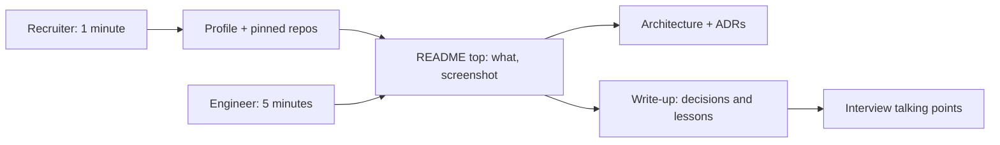

A recruiter spends a minute or two on your profile; a hiring engineer maybe five minutes on your
GitHub. In that time they need to see not "can write code" but "thinks like a senior": makes
trade-offs, ships complete things, explains them clearly. Your portfolio and public presence are
how you show that before the first interview, and long after it, they compound: every write-up and
talk keeps working for you. This session covers which projects show senior skills, how to present
them with READMEs, demos and write-ups, how to write and speak publicly, and then you publish a
write-up about YouCanDoIt.

## Portfolio projects that show senior skills

Think of a portfolio like an architect's: one finished building with photos, drawings and the
story of the hard decisions says more than twenty sketches. Ten half-finished tutorial clones say
"I follow tutorials". One or two **complete, deployed, well-explained** projects say "I ship".

What makes a project signal seniority:

- **It solves a real problem**, ideally yours or someone's you know. The story of why it exists
  is part of its value.
- **It goes beyond the happy path**: authentication, error handling, tests, migrations, logging,
  background jobs, a CI pipeline, deployment. These are exactly the things tutorials skip and real
  jobs require.
- **It shows decisions**: ADRs, a design doc, a "trade-offs" section. Interviewers love asking
  "why did you choose X?", and a written answer proves you thought about it.
- **It's maintained**: recent commits, an issue tracker, a changelog, dependencies not years old.
- **It's runnable**: one command to start it (`docker compose up`), or a live demo link.

YouCanDoIt already ticks many boxes: FastAPI and Next.js, Postgres with pgvector, RAG, a pluggable
LLM layer, a scheduler, Alembic migrations, unit and Playwright tests, CI, and a strict content
format enforced by tests.

**Open source contributions** are another strong signal, because they show you can work in someone
else's codebase and process. The [Open Source Guides](https://opensource.guide/) explain how to find
a project, read its contributing guidelines, start with small issues and communicate with
maintainers. A handful of merged, non-trivial PRs to a known project are worth a lot.

> [!WARNING]
> Quantity hurts. Pin your two to four best repositories and archive or hide the rest. A recruiter
> who clicks a random half-finished repo forms an impression from it.

## READMEs, demos and write-ups

The README is the front door. Most visitors read only the top of it, so structure it for skimmers:

```md
# Project name

One sentence: what it is and who it's for.


## Why
Two or three sentences on the problem.

## Features
- Short bullets, user-facing.

## Architecture
A diagram and a paragraph. Link to ADRs / design doc.

## Running locally
docker compose up -d --build

## Tests
How to run them; CI badge.

## What I'd do next / known limitations
```

The [Open Source Guides](https://opensource.guide/) make the same point for open-source projects:
a README should say what the project does, why it is useful, how to get started and where to get
help, plus a licence and contributing guidelines if you want contributions.

**Demos.** A 20-second GIF or a two-minute video of the main flow reaches people who will never
run your code. Record a real use, not a feature tour: "I open a session, read the lesson, ask the
tutor a question, mark a subchapter complete and level up."

**Write-ups.** A technical write-up is the story behind the code: the problem, the approach, the
decisions and their trade-offs, what went wrong, what you learned. It is where seniority becomes
visible, because it shows judgement, not just output.



> [!TIP]
> Write a "Known limitations" section. It feels counter-intuitive, but naming weaknesses yourself
> ("single-user; no rate limiting on the tutor yet") shows senior self-awareness, and pre-empts the
> interviewer's critique.

## Writing and speaking publicly

Public writing and speaking scale your reputation beyond the people you've worked with. Gergely
Orosz's [The Pragmatic Engineer](https://blog.pragmaticengineer.com/) is an example of how far
consistent writing about engineering can take someone, but you don't need an audience to start.

**Writing.** Good topics for a first post:

- Something you learned recently and found confusing ("What I wish I'd known about JWT refresh
  tokens").
- A decision you made and its trade-offs (your ADRs are drafts already).
- A bug or incident and how you found it.
- A "how we built X" walkthrough of your project.

Keep posts focused (one idea), concrete (code, numbers, diagrams) and honest about uncertainty.
Publish where developers read: your own blog, dev.to, Hashnode, a company engineering blog, or
LinkedIn for reach. Cross-post rather than choosing.

**Speaking.** Start small and local: a team demo, a lightning talk at an internal guild, then a
local meetup, then a conference. Meetups are always looking for speakers, and a five-minute
lightning talk is a low-stakes way to begin. Everything from session 10.3.3 about knowing your
audience applies.

**Being findable.** Keep your GitHub profile, LinkedIn and personal site consistent: same name,
photo, one-line description of what you do and want ("Full-stack engineer, Python and TypeScript,
interested in developer tooling and AI applications"). Link them to each other.

> [!NOTE]
> You don't need to be an expert to write. "I'm learning X, here is what surprised me" is valuable
> to the many people one step behind you, and teaching is the best way to deepen your own
> understanding.

## Practice: publish a write-up about YouCanDoIt

Allow a weekend: half a day to write, an hour to polish, an hour for README and demo.

### Step 1: Polish the README

Apply the structure above to the YouCanDoIt repository: one-sentence summary, screenshot or GIF,
architecture diagram, `docker compose up` instructions, tests and CI badge, known limitations.

### Step 2: Record a demo

Record a 60 to 90 second screen capture of one real learning session. Convert the best 15 seconds
to a GIF for the README.

### Step 3: Choose an angle

Not "I built a learning app" but one interesting story. Options:

- "Deriving gamification from a single table: why XP and badges are never stored"
- "Using a Markdown file as the source of truth for a database"
- "A local-first RAG tutor with Ollama and pgvector"

### Step 4: Write it

Structure: hook (the problem), context, the design with one diagram, two or three decisions with
trade-offs, what went wrong or surprised you, what you'd do next. 1,000 to 1,500 words, with code
snippets only where they make a point.

### Step 5: Review and publish

Ask one person to read it for clarity. Publish it, link it from the README and your profiles, and
share it once on the networks where you're active. Add the link to your brag document (10.4.3).
