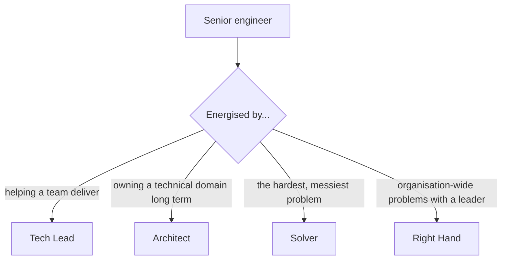

"Senior" is not a number of years. Some engineers reach it in four, some never do in fifteen. The
difference is usually not raw talent but knowing what the next level actually expects, doing that
work deliberately, and making it visible. This last session of the track puts everything together:
how career ladders describe the levels, the four staff archetypes described on
[StaffEng](https://staffeng.com/guides/), how to keep a brag document so your work is remembered,
and then you write your own one-year growth plan.

## Career ladders and expectations

A **career ladder** (or levelling framework) is a company's written description of what engineers
at each level do. Think of it as the rules of a game: you can play without reading them, but you'll
progress much faster if you do.

Ladders differ by company, but they usually describe growth along the same few axes, and the main
thing that changes from level to level is **scope**: how big a problem you can own without someone
else breaking it down for you.

| Level | Scope | Typical expectation |
| --- | --- | --- |
| Junior | A task | Completes well-defined tasks with guidance; learns the codebase and tools |
| Mid-level | A feature | Delivers features independently; reliable estimates; good code reviews |
| Senior | A project or system, a team's technical direction | Breaks down ambiguous problems; designs systems; mentors; owns outcomes and operations |
| Staff | Several teams or a critical domain | Sets technical direction across teams; solves problems nobody owns; multiplies others |
| Principal | The organisation | Shapes company-wide technical strategy |

Common axes along each level:

- **Technical skill**: quality, design, debugging, operational excellence.
- **Delivery**: scope, independence, handling ambiguity (10.2.2).
- **Impact**: on the product and the business, not just output (10.2.1).
- **Collaboration and leadership**: mentoring (10.3.1), influence (10.3.2), communication (10.3.3).

> [!NOTE]
> At most companies you get promoted when you are **already operating at the next level**, not as
> a reward for doing your current job well. The promotion recognises a change that has already
> happened. That is why you need to know what the next level looks like.

Two practical moves:

- **Find your company's ladder** (or a public one; many companies publish theirs) and read the
  next level carefully. Highlight the expectations you already meet with evidence, and the ones
  you don't.
- **Discuss it with your manager.** "Which of these do you think I'm not yet showing?" turns a vague
  wish for promotion into a concrete plan, and makes your manager an ally.

Beyond senior, the path splits into **management** (leading people) and the **staff-plus**
technical track (leading through technical work). Neither is a promotion over the other at good
companies. Will Larson's [lethain.com](https://lethain.com/) has a lot of writing on both sides,
which is useful when you're deciding which way you want to go.

## Staff archetypes: tech lead, architect, solver, right hand

"Staff engineer" means very different jobs at different companies. Will Larson's
[staff archetypes](https://staffeng.com/guides/) describe four common shapes:

- **Tech Lead**: guides the technical approach and execution of one team or a small cluster of
  teams, usually working closely with one manager. The most common archetype, and often the first
  staff role people hold.
- **Architect**: responsible for the direction and quality of a complex, central technical domain
  (APIs, storage, cloud infrastructure). Tends to appear in larger companies or those with very
  complex codebases.
- **Solver**: goes deep on complex or high-risk problems that leadership has prioritised, and stays
  with each one until it is resolved, then moves to the next.
- **Right Hand**: borrows a senior leader's scope and authority to handle essential,
  cross-functional problems in a large organisation, without managing people. The rarest
  archetype.



Tech Leads and Architects usually work with stable teams over long periods; Solvers and Right
Hands move between urgent problems. The guide stresses that this is a practical taxonomy, not a
complete one. The use for you now, as someone heading towards senior, is direction: noticing which
kind of work energises you and steering your projects that way.

> [!TIP]
> Look back at the last year: which projects gave you energy? Coordinating a team's delivery
> (tech lead), owning a system's design over time (architect), cracking the bug nobody else could
> (solver)? That pattern is a better guide than which title sounds most impressive.

## Building a brag document

Your manager won't remember what you did in February. Neither will you. A **brag document** is a
running record of your accomplishments, written as they happen. The term was popularised by Julia
Evans, and the idea is simple: when review or promotion time comes, you have evidence instead of a
vague memory.

What to record, every week or two:

- **What you shipped** and its **impact**, with numbers where possible ("cut p95 latency of the
  tutor endpoint from 9 s to 3 s").
- **Design and decision work**: docs, ADRs, proposals, even rejected ones.
- **Collaboration and leadership**: people you mentored, reviews, cross-team decisions you led,
  incidents you handled.
- **Things that aren't visible in commits**: improving onboarding docs, fixing a flaky CI,
  interviewing candidates.
- **What you learned**: new skills, courses (this roadmap counts).
- **Feedback received**: kind words from colleagues, with permission to quote.

A simple format:

```md
## 2026 Q4

### Projects
- **Tutor latency** — profiled and moved embeddings to a nightly job; p95 9 s → 3 s.
  Design doc: <link>. Impact: tutor usage up 40% in two weeks.

### Collaboration and mentoring
- Mentored Sam for 4 weeks; Sam shipped first PR to the API.
- Led the cross-team decision on token lifetimes (decision doc: <link>).

### Learning
- Completed Track 10 of my roadmap; published write-up on YouCanDoIt (<link>).
```

> [!WARNING]
> Don't wait for review season to write it. Reconstructing a year from memory loses most of the
> invisible work, which is exactly the senior-level work (mentoring, alignment, unblocking) that
> promotion committees look for.

Map entries to your ladder's axes. When an axis has nothing for months, that's the gap your growth
plan should address.

## Practice: write your one-year growth plan

Allow about two hours, then 15 minutes monthly to review it.

### Step 1: Where are you now?

Pick a ladder (your company's, or a public one) and assess yourself against your current level and
the next one, axis by axis: **meets with evidence**, **sometimes**, or **not yet**. Back each "meets"
with a brag-document entry. If you don't have a brag document, start one today with the last three
months.

### Step 2: Where do you want to be?

Write one sentence for twelve months from now: "Operating as a senior full-stack engineer, owning
the design of a system end to end, mentoring one junior." Note which staff archetype attracts you
long term, if any.

### Step 3: Choose three focus areas

From the "not yet" list, choose at most three. For each, write:

| Focus | Why it matters | Concrete actions | Evidence by month 12 |
| --- | --- | --- | --- |
| System design | Senior expectation; weakest interview round | Write 3 design docs; lead one design review; 6 mock design interviews | Docs linked in brag doc; positive review feedback |
| Mentoring | Required for senior | Mentor one person for 3 months (10.3.1) | Mentee's feedback; their shipped work |
| Visibility | Work isn't known outside team | Publish 4 write-ups; one meetup talk (10.4.2) | Links; talk recording |

### Step 4: Break it down by quarter

Assign actions to quarters so the plan doesn't all land in month eleven. Link relevant roadmap
sessions: the Capstone track is a natural place to practise design and ownership.

### Step 5: Share and review

Share the plan with your manager or a mentor and ask: "Is this what you'd expect to see for the next
level?" Put a monthly calendar reminder to update the brag document and check progress, and adjust
the plan each quarter. Plans change; the habit of reviewing them is what makes you grow.

> [!TIP]
> Track the plan inside YouCanDoIt: your completions and streaks already measure learning; your
> brag document measures impact. Together they are the evidence that you're ready.
