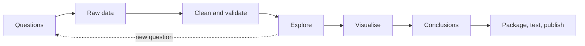
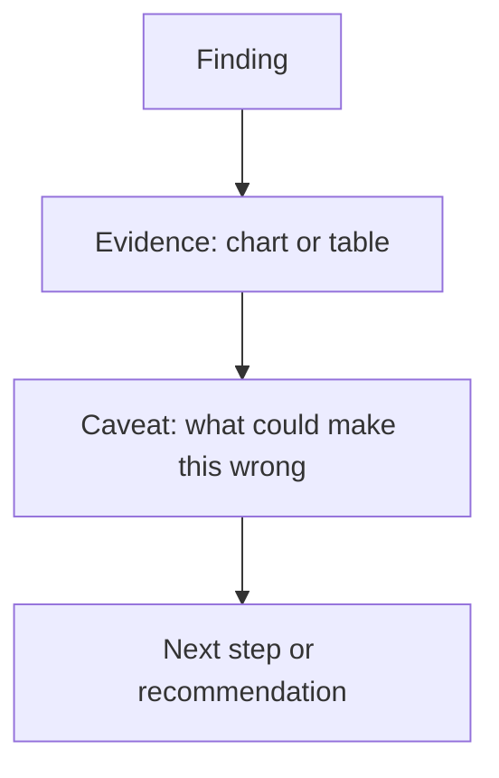

This is the first capstone. Up to now each session taught one skill in isolation; here you combine
them into something a stranger can open on GitHub and judge in five minutes. A data analysis is the
ideal first portfolio piece: it is small enough to finish in a week or two, it touches Python,
pandas, testing, Git and writing, and it shows the thing employers care most about, which is that
you can turn a vague question into a defensible answer.

Think of it like a short piece of investigative journalism. A journalist picks a question, gathers
evidence, checks it, and publishes a story with the evidence attached. Your "story" is a README and
a notebook; your "evidence" is clean, tested code that anyone can rerun.



## Choose a dataset and questions

The most common mistake is to start with a dataset and "see what's interesting". You end up with
twenty charts and no point. Start with **questions** instead, then find data that can answer them.

Good questions are:

- **Specific.** "Do Milan's bike-sharing trips drop on rainy days, and by how much?" beats "analyse
  bike sharing".
- **Answerable with the data.** If the dataset has no weather column, you need a second dataset to
  join, or a different question.
- **Interesting to someone.** A city planner, a small business, or you. A reader should care about
  the answer.
- **Limited.** Two to four questions. A focused analysis that is finished beats a sprawling one that
  is not.

Where to find data: government open-data portals (national statistics offices, the EU open data
portal, city portals), Kaggle datasets, the UCI Machine Learning Repository, and public APIs.
Prefer data with a clear licence and a documented source, because you will cite it in the README.

> [!TIP]
> Before you commit to a dataset, spend 20 minutes loading it and running `df.info()` and
> `df.head()`. If half the columns are empty or the documentation is missing, choose another one
> now rather than after three days of work.

> [!WARNING]
> Check the licence and privacy. Do not publish a dataset that contains personal data you have no
> right to share (names, emails, exact addresses). If in doubt, link to the original source in the
> README instead of committing the file.

Write your questions down in the README **before** you analyse. This is a small version of a
pre-registration: it stops you from quietly changing the question to fit whatever result appeared.

> [!EXAMPLE]
> Dataset: a city's open bike-sharing trips for one year plus daily weather.
> Questions:
> 1. How do daily trips vary by weekday and season?
> 2. How much does rain reduce trips, controlling for weekday?
> 3. Which ten stations are most often empty at 8 a.m.?

## Clean and explore with pandas

Raw data is like a second-hand car: it probably works, but you check the tyres before a long
trip. Cleaning is that check, and in real projects it takes most of the time.

The [pandas getting started guide](https://pandas.pydata.org/docs/getting_started/index.html)
covers the building blocks you need: reading files, selecting and filtering, creating columns,
reshaping and `groupby`. Organise your work so that **cleaning lives in functions, not in notebook
cells**. Notebooks are great for exploring, but functions can be tested and reused.

A sensible layout:

```text
bike-analysis/
  pyproject.toml
  README.md
  data/raw/            # downloaded files, never edited by hand
  data/processed/      # outputs of your cleaning code
  src/bikes/
    __init__.py
    load.py            # read raw files
    clean.py           # pure functions: DataFrame in, DataFrame out
    analysis.py        # aggregations that answer the questions
  notebooks/
    01-explore.ipynb
    02-report.ipynb
  tests/
    test_clean.py
```

A cleaning function should do one job and return a new DataFrame:

```python
import pandas as pd

def clean_trips(raw: pd.DataFrame) -> pd.DataFrame:
    df = raw.rename(columns=str.lower)
    df["started_at"] = pd.to_datetime(df["started_at"], errors="coerce")
    df["ended_at"] = pd.to_datetime(df["ended_at"], errors="coerce")
    df = df.dropna(subset=["started_at", "ended_at"])
    df["duration_min"] = (df["ended_at"] - df["started_at"]).dt.total_seconds() / 60
    # trips under 1 minute are mostly docking errors; over 24 h are lost bikes
    df = df[(df["duration_min"] >= 1) & (df["duration_min"] <= 24 * 60)]
    return df.drop_duplicates(subset="trip_id")
```

The usual cleaning checklist:

| Problem | How you spot it | Typical fix |
| --- | --- | --- |
| Wrong types | `df.dtypes` shows `object` for dates or numbers | `pd.to_datetime`, `pd.to_numeric(errors="coerce")` |
| Missing values | `df.isna().sum()` | Drop, fill, or keep and report |
| Duplicates | `df.duplicated(subset=...).sum()` | `drop_duplicates` |
| Impossible values | `df.describe()` shows negative durations, ages of 200 | Filter, and document the rule |
| Inconsistent categories | `df["city"].value_counts()` shows "Milano", "milano", "MILAN" | Normalise strings, map synonyms |

> [!NOTE]
> Every row you drop is a decision. Log how many rows each rule removed (for example
> `print(f"dropped {before - len(df)} short trips")`) and summarise it in the README. Reviewers
> trust analyses that are honest about what they threw away.

Then **explore**: distributions (`describe`, histograms), relationships (`groupby`, `pivot_table`,
`corr`) and time patterns (`resample("D")`). Keep a running list of observations and new questions
in the notebook. Exploration is allowed to be messy; the final report is not.

## Visualise and write conclusions

A chart is an argument. Each chart in your final report should answer one of your questions, and
its title should state the finding, not just the variables.

- Weak title: "Trips by weather".
- Strong title: "Rainy days have about 30% fewer trips than dry days".

Choose the chart by the question:

| Question type | Chart |
| --- | --- |
| Change over time | Line chart |
| Compare categories | Bar chart (sorted) |
| Distribution | Histogram or box plot |
| Relationship between two numbers | Scatter plot |
| Part of a whole | Stacked bar (avoid pie charts with many slices) |

pandas plots directly through Matplotlib (`df.plot(...)`), and Seaborn adds statistical charts with
little code. Label axes with units, start bar charts at zero, and use colour only when it carries
meaning.



Write conclusions with that four-part structure. Separate what the data **shows** from what you
**think explains it**. A correlation between rain and fewer trips is an observation; "people avoid
cycling in the rain" is a plausible explanation, and you should say how you would test it.

> [!WARNING]
> Avoid overclaiming. "Rain causes a 30% drop" is a causal claim your observational data cannot
> fully support (rainy days might also be colder or in winter). "Rainy weekdays have about 30% fewer
> trips than dry weekdays in the same month" is precise and defensible.

## Package, test and publish the repository

This step is what turns a notebook into a portfolio piece. A recruiter or senior engineer will look
at the repository structure and tests before they read a single chart.

### Packaging

Use a `pyproject.toml` so the project installs with one command and declares its dependencies:

```toml
[project]
name = "bikes"
version = "0.1.0"
requires-python = ">=3.12"
dependencies = ["pandas>=2.2", "matplotlib>=3.8", "seaborn>=0.13"]

[project.optional-dependencies]
dev = ["pytest>=8", "ruff>=0.6", "jupyter"]

[build-system]
requires = ["hatchling"]
build-backend = "hatchling.build"
```

### Testing

You do not test a chart, you test the functions behind it. Build tiny DataFrames by hand and assert
on the result:

```python
import pandas as pd
from bikes.clean import clean_trips

def test_clean_trips_drops_short_and_duplicate_trips():
    raw = pd.DataFrame({
        "trip_id": [1, 1, 2, 3],
        "started_at": ["2025-01-01 08:00"] * 4,
        "ended_at": ["2025-01-01 08:20", "2025-01-01 08:20", "2025-01-01 08:00:30", "bad"],
    })
    out = clean_trips(raw)
    assert list(out["trip_id"]) == [1]
    assert out["duration_min"].iloc[0] == 20
```

### Publishing

A complete repository has:

- A **README** with the questions, the dataset (source, licence, date downloaded), how to run it
  (`pip install -e ".[dev]"`, `pytest`, how to open the report), the key findings with one or two
  charts, and limitations.
- A **script or Makefile target** that downloads the raw data, so you do not need to commit large
  files.
- **CI**: a GitHub Actions workflow that runs `ruff check` and `pytest` on every push.
- A **rendered report**: the final notebook committed with outputs, or exported to HTML.

> [!TIP]
> Pin the data. Public datasets change. Record the download date and, if the source allows it, a
> checksum, so your results can be reproduced later.

### Project plan: analyse and publish a public dataset

Plan for one to two weeks of evenings. The deliverable is a public GitHub repository.

#### Step 1: Pick and scope (1 evening)

Choose a dataset from an open-data portal. Write `README.md` with a title, two to four questions,
and the data source. Create the folder layout shown above and run `git init`.

#### Step 2: Load and clean (2–3 evenings)

Write `load.py` and `clean.py`. For every cleaning rule, write one unit test with a hand-made
DataFrame. Run the cleaning end to end and record row counts before and after each rule.

#### Step 3: Explore (2 evenings)

In `01-explore.ipynb`, import your package (`from bikes.clean import clean_trips`), not copy-pasted
code. Produce quick charts and write bullet-point observations. Allow new questions, but write them
down separately from the original ones.

#### Step 4: Answer and visualise (2 evenings)

Move the aggregations that answer each question into `analysis.py` with tests. In
`02-report.ipynb`, create one polished chart per question, with a finding as its title.

#### Step 5: Conclusions and limitations (1 evening)

For each question write finding, evidence, caveat and next step. Add a "Limitations" section:
missing data, time period, what is correlation only.

#### Step 6: Ship it (1 evening)

Add `pyproject.toml`, a data download script, `.gitignore` for `data/raw/`, a GitHub Actions
workflow running `ruff` and `pytest`, and push. Ask someone who is not a developer to read the
README and tell you the main finding in one sentence. If they cannot, rewrite the summary.

> [!EXAMPLE]
> Definition of done: a fresh clone, `pip install -e ".[dev]"`, `python scripts/download.py`,
> `pytest` all pass, the report notebook runs top to bottom, and the README states three findings
> with charts and limitations.

This project also prepares you for the AI-oriented capstones that follow: the
[AI Engineer roadmap](https://roadmap.sh/ai-engineer) treats data handling and Python fluency as
the base everything else is built on.
