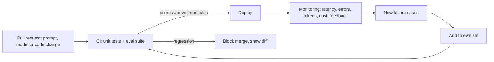
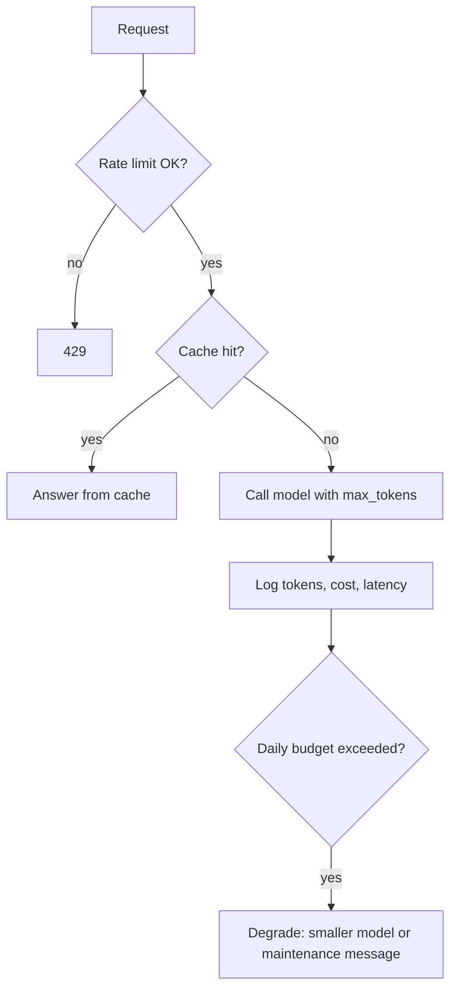

Many AI projects stop at "it worked in my notebook". This capstone takes one of your AI apps, the
RAG chatbot from 11.1.9, the agent from 11.1.10 or the fine-tuned model from 11.1.8, and makes it
behave like a product: an eval suite that guards every change, a deployment you can watch and pay
for knowingly, and a public demo with a write-up that explains what you built and how well it works.
It applies Track 9 module 9.6.

Analogy: a restaurant opening. The eval suite is the tasting panel that tries every dish before a
menu change. Monitoring and cost tracking are the kitchen display and the till. The public demo is
opening night, and the write-up is the review you write yourself, honestly, before the critics do.



## Eval suite in CI

An LLM app changes behaviour when you edit a prompt, switch model, change chunk size or upgrade a
library. Without evals, every such change is a guess. With an **eval suite in CI**, every pull
request shows a scorecard, and a regression blocks the merge just like a failing unit test.

### Build the eval set

Start from the evaluations you already wrote in the earlier capstones, and organise them:

| Slice | Purpose | Size to start |
| --- | --- | --- |
| Core cases | Typical questions with reference answers | 30–100 |
| Edge cases | Ambiguous, long, multilingual, typo-filled inputs | 10–30 |
| Refusals | Questions the app must not answer or cannot answer | 10–20 |
| Safety | Prompt injection, attempts to extract the system prompt or data | 10–20 |
| Regressions | Every real bug you fixed, added as a case | grows over time |

Store them as versioned files (JSONL) in the repository, next to the code they test.

### Choose scorers

Use the cheapest scorer that works for each check:

1. **Deterministic checks**: valid JSON, required fields, citations present, banned strings absent,
   length limits. Fast, free, exact.
2. **Reference metrics**: exact match, F1, accuracy for classification or extraction. The
   [Hugging Face Evaluate](https://huggingface.co/docs/evaluate/index) library provides many
   standard metrics behind one `load`/`compute` interface, each with a documentation card. (Its docs
   point to LightEval for newer, more actively maintained benchmark-style evaluation.)
3. **LLM as a judge**: for open-ended answers, a rubric scored by a strong model, such as
   faithfulness from Ragas in 11.1.9. Calibrate the judge against your own labels on a sample.

```python
import evaluate
from statistics import mean

exact = evaluate.load("exact_match")

def run_suite(app, cases: list[dict]) -> dict:
    preds = [app.answer(c["input"]) for c in cases]
    scores = exact.compute(predictions=[p.label for p in preds],
                           references=[c["expected_label"] for c in cases])
    scores["valid_json"] = sum(p.is_valid_json for p in preds) / len(preds)
    scores["refusal_ok"] = mean(p.refused for p, c in zip(preds, cases) if c["must_refuse"])
    return scores
```

### Wire it into CI

```yaml
eval:
  runs-on: ubuntu-latest
  if: github.event_name == 'pull_request'
  steps:
    - uses: actions/checkout@v4
    - run: pip install -e ".[eval]"
    - run: python -m evals.run --suite core,safety --out scores.json
      env: { ANTHROPIC_API_KEY: "${{ secrets.EVAL_API_KEY }}" }
    - run: python -m evals.check scores.json --baseline evals/baseline.json --max-drop 0.02
```

The `check` step compares against a committed baseline and fails if any metric drops more than the
allowed margin. Post the score table as a pull request comment so reviewers see it.

> [!TIP]
> Keep a fast **smoke suite** (10–20 cases, deterministic scorers) on every push, and the full suite
> with LLM judges on pull requests or nightly. Cache model responses by input hash so unchanged
> cases are not re-billed.

> [!WARNING]
> LLM outputs vary between runs. Set temperature to 0 where possible, use thresholds with a small
> margin rather than exact equality, and re-run suspicious failures before blaming the change.

## Deployment with monitoring and cost tracking

Deploy with the patterns from 11.1.4 and session 9.6.3: a container, secrets in the platform's
secret store, health checks, and a rollback path. AI apps add three monitoring concerns on top of
normal web metrics.

### What to monitor

| Area | Metrics | Why |
| --- | --- | --- |
| Reliability | Error rate, provider timeouts and rate-limit errors, fallback usage | LLM APIs fail more often than databases |
| Latency | Time to first token, total time, per pipeline stage | Users notice streaming delays first |
| Usage and cost | Input and output tokens per request, cost per request, per user, per day | Costs scale with usage and prompt size |
| Quality | Thumbs up/down, "no answer" rate, citation rate, sampled judge scores | Quality drifts silently |
| Safety | Blocked inputs, injection detections, output filter hits | Shows attacks and false positives |

Log one structured record per request, without personal data: model, prompt version, token counts,
latency per stage, cost, and the IDs of retrieved documents.

```python
PRICES = {"model-small": (0.25, 1.25)}   # USD per million input/output tokens; check your provider

def cost_usd(model: str, usage) -> float:
    inp, out = PRICES[model]
    return (usage.input_tokens * inp + usage.output_tokens * out) / 1_000_000

log.info("llm_call", model=model, prompt_version="v7", input_tokens=u.input_tokens,
         output_tokens=u.output_tokens, cost_usd=cost_usd(model, u), latency_ms=elapsed)
```

### Control cost

- **Budgets and alerts**: a daily spend limit at the provider plus your own alert at 50% and 80%.
- **Rate limits per user or IP** on the public demo.
- **Caching**: identical requests, and provider-side prompt caching for long, stable system prompts.
- **Right-size the model**: route easy requests to a smaller model and measure quality with your
  eval suite before and after.
- **Cap inputs and outputs**: max input length, max output tokens, max agent steps.



> [!WARNING]
> A public demo with your API key and no limits is an open wallet. Set a hard spending cap at the
> provider before you share the link.

## Public demo and write-up

A demo lets people try your work in thirty seconds. **Gradio** builds a web UI from Python in a few
lines, and Hugging Face Spaces hosts Gradio apps for free on CPU. The
[Gradio guides](https://www.gradio.app/guides) cover interfaces, chatbots, streaming and sharing.

```python
import gradio as gr

def respond(message, history):
    answer = app.chat(message, history)
    return f"{answer.text}\n\n**Sources:** " + ", ".join(answer.citations)

demo = gr.ChatInterface(
    respond,
    title="Ask the city regulations",
    examples=["Can I park a scooter on the pavement?", "What are the noise hours?"],
)
demo.launch()
```

Make the demo safe and pleasant: example inputs, a short "what this can and cannot do" note, rate
limits, a visible feedback button, and no data retention beyond what you state.

The **write-up** is where a portfolio piece becomes convincing. Structure it like a short technical
blog post (session 10.4.2):

1. **Problem**: who it is for and why it matters, in two sentences.
2. **Demo**: link and a GIF.
3. **Architecture**: one diagram, the main components and why you chose them.
4. **Evaluation**: the eval set, metrics, the experiment table, and what improved scores.
5. **Operations**: monitoring, cost per 1,000 requests, latency percentiles.
6. **Limitations and risks**: where it fails, what you would do next.

> [!TIP]
> Numbers make write-ups credible: "faithfulness rose from 0.82 to 0.91 after adding a reranker, at
> +0.4 s median latency and +0.3 cents per query". A reviewer remembers trade-offs, not adjectives.

### Project plan: ship your AI app

Allow about two weeks.

#### Step 1: Eval set and scorers

Collect your existing evaluation cases into versioned JSONL slices. Write the runner with
deterministic checks, one reference metric, and one LLM-judge metric. Commit a baseline score file.

#### Step 2: CI gate

Add the smoke suite on push and the full suite on pull requests with a regression check and a PR
comment. Make a deliberately worse prompt on a branch and watch CI block it.

#### Step 3: Deploy and monitor

Deploy the app with secrets, health checks and structured per-request logs. Build a dashboard with
latency, errors, tokens and cost per day, set a provider spending cap and a budget alert.

#### Step 4: Demo

Publish a Gradio demo (on Hugging Face Spaces or your own host) with examples, rate limiting, a
feedback button and a usage note.

#### Step 5: Write-up

Publish the six-part write-up on your blog or as the README, and link it from your portfolio.

> [!EXAMPLE]
> Definition of done: a pull request that hurts quality fails CI with a visible score diff; the
> dashboard shows cost per request; the demo is public with a spending cap; the write-up includes
> an architecture diagram, an eval table, cost and latency figures, and limitations.
