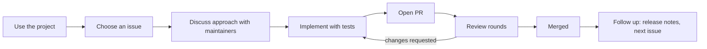
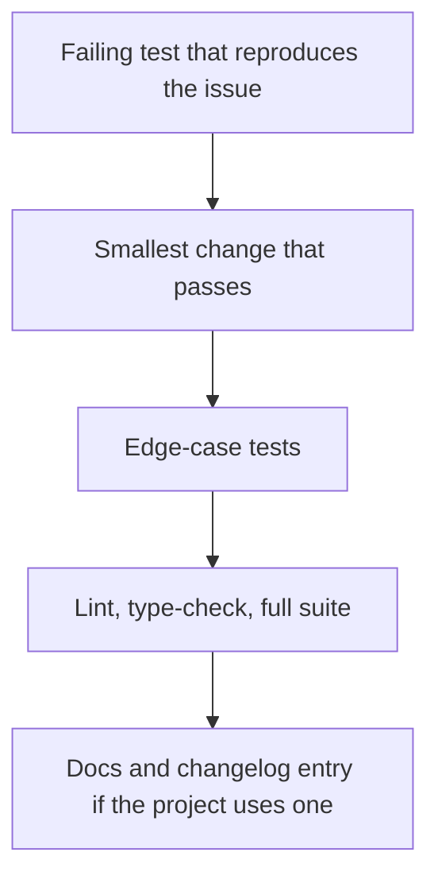
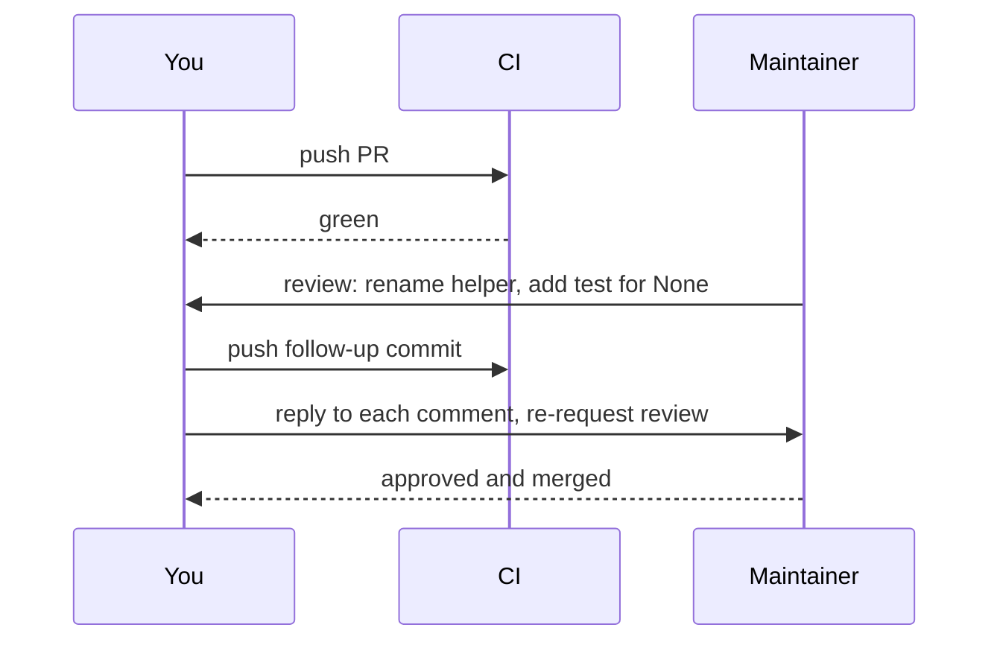

In session 2.4.4 you landed a first small pull request: a documentation fix or a tiny bug fix. This
final capstone raises the bar to a **meaningful** contribution: a real bug fix, a feature or a
performance improvement in a project you actually depend on, taken from first comment to merge.
It is the most public proof of seniority you can have: maintainers you have never met reviewed your
code and accepted it.

Analogy: your first PR was helping a neighbour carry a box. This one is joining a community garden:
you learn who tends which bed, agree on what to plant, do the work to their standards, and keep
showing up until the plant takes root.



## Choose a project and issue

The [Open Source Guides](https://opensource.guide/) on how to contribute recommend starting with
projects you already use. That advice matters even more for a meaningful contribution: you already
understand the user's perspective, you can reproduce problems in your own work, and you care about
the result.

### Pick the project

Candidates from this roadmap: FastAPI, Pydantic, SQLAlchemy, Alembic, pytest, Hypothesis, pandas,
scikit-learn, LlamaIndex, Ragas, the MCP SDKs, Gradio, shadcn/ui, or a smaller library from your
`pyproject.toml` or `package.json`. Smaller, active projects often respond faster than giant ones.

Check the project's health before investing weeks:

| Signal | Where to look | Good sign |
| --- | --- | --- |
| Activity | Commits and releases | Merges in the last month |
| Responsiveness | Recent PRs and issues | Maintainers reply within days or weeks |
| Welcome | `CONTRIBUTING.md`, labels | Clear setup steps, labels like `help wanted` |
| Conduct | `CODE_OF_CONDUCT.md`, tone of discussions | Respectful, constructive reviews |
| Licence and CLA | `LICENSE`, PR checks | You can and are willing to sign any required CLA |

### Pick the issue

"Meaningful" means it changes behaviour that users notice, with tests, not a typo. Good kinds:

- A **bug you hit yourself**, with a minimal reproduction.
- A `help wanted` issue the maintainers have already agreed should be done.
- A **performance** problem you can measure before and after.
- A **missing feature** that is small, well-scoped and wanted by others (look for upvotes and
  comments).

> [!TIP]
> Sort issues by "recently updated" and read the discussion fully. An issue with a maintainer
> comment like "a PR for this would be welcome" is worth ten untouched ones.

> [!WARNING]
> Avoid issues someone else is actively working on, large refactors, and anything labelled as
> needing design decisions you cannot influence. A first meaningful PR should be mergeable in a few
> review rounds, not a month-long debate.

## Discuss, implement and test

### Discuss first

Before writing much code, comment on the issue: what you found, the approach you propose, and a
question if anything is unclear. This avoids the most painful outcome, a finished PR the
maintainers would never accept.

> [!EXAMPLE]
> "I can reproduce this on v2.7.1 with the snippet below. The cause seems to be that `parse_date`
> ignores the timezone when the input has a `Z` suffix (line 142 of `dates.py`). I'd like to fix it
> by delegating to `datetime.fromisoformat` on Python 3.11+, with a test for `Z`, `+00:00` and
> naive inputs. Does that approach work for you? Happy to open a PR."

### Set up and understand

Follow `CONTRIBUTING.md` exactly: fork, clone, create the dev environment, and run the full test
suite **before** changing anything, so you know which failures were already there. Then read the
code around your change:

- Find the entry point with search (`git grep`, your editor's "go to definition").
- Read the tests for that module; they show the intended behaviour.
- Use `git log -p` and `git blame` on the lines you will change to learn why they look the way
  they do.

### Implement like a maintainer



- **Write the failing test first.** It proves the bug and protects the fix.
- **Match the project's style**, even where you would choose differently. Consistency beats
  preference in someone else's codebase.
- **Keep the diff focused.** No drive-by reformatting or unrelated refactors; offer those as
  separate PRs.
- **Update docs** and the changelog if the project keeps one.
- **Run everything the CI runs** locally, including linters and type checks.

> [!NOTE]
> If you use AI coding tools (session 2.4.3), check the project's policy first: some projects ask
> contributors to disclose AI assistance, and some do not accept it. Either way, you must understand
> and be able to defend every line you submit.

## Respond to review and get it merged

### Open a PR reviewers enjoy

Use the project's PR template if there is one. Otherwise:

```md
Fixes #1234

**Problem**: `parse_date("2025-01-01T10:00Z")` returns a naive datetime, losing the UTC offset.

**Change**: delegate ISO parsing to `datetime.fromisoformat` (Python 3.11+ handles `Z`); keep the
old path for 3.10.

**Tests**: added cases for `Z`, `+00:00`, `-05:30` and naive input. Full suite passes locally.

**Notes**: no public API change. Happy to add a changelog entry if you prefer it in this PR.
```

Keep it small enough to review in one sitting, make sure CI is green, and mark it as a draft if you
want early feedback before it is finished.

### Handle review like a professional

Review is a conversation with someone who knows the codebase better than you do (session 2.4.1).

- **Thank, then address every comment.** Either change the code or explain your reasoning
  politely, and ask when you don't understand.
- **Push follow-up commits** rather than force-pushing during review, unless the project asks you
  to squash or rebase. It lets reviewers see what changed.
- **Resolve conversations** only when the project's convention allows it; some reviewers prefer to
  resolve their own threads.
- **Be patient.** Maintainers are often volunteers. A polite nudge after a week or two is fine;
  daily pings are not.



> [!WARNING]
> Don't take change requests personally, and don't argue to win. If a maintainer prefers a different
> approach after discussion, it is their project; adapt or offer to close the PR gracefully.

> [!TIP]
> If the PR stalls with no response for weeks, ask once whether it is still wanted. If not, you still
> have a public, well-reasoned PR and discussion, which is valuable in a portfolio. Then pick another
> issue, ideally in the same project, where you now know the code.

### After the merge

Check the next release notes for your change, update your CV and portfolio with a link to the PR,
and consider the next step: answer issues in that area, review other contributors' PRs, or take a
larger issue. Repeated contributions to one project are worth more than single ones scattered
across many.

### Project plan: land a meaningful contribution

Allow three to six weeks, mostly waiting for review. Work on something else in parallel.

#### Step 1: Shortlist

List three projects you use, check their health with the table above, and pick one. Read its
`CONTRIBUTING.md` and code of conduct.

#### Step 2: Choose and claim

Find an issue (or open one for a bug you hit, with a minimal reproduction). Comment with your
analysis and proposed approach, and wait for a maintainer response before investing heavily.

#### Step 3: Implement

Set up the dev environment, run the full suite, write a failing test, implement the fix, add edge
cases and docs, and run all CI checks locally.

#### Step 4: PR and review

Open the PR with the template above. Respond to every review comment within a couple of days. Keep a
short log of what you learned from each review round.

#### Step 5: Reflect

Write a short post: the project, the issue, what you learned about the codebase, the review
feedback, and how long it took. Link the merged PR.

> [!EXAMPLE]
> Definition of done: a merged PR to a project you use, with a test and (where relevant) docs; a
> public discussion showing you agreed the approach with maintainers; and a write-up linked from your
> portfolio.
