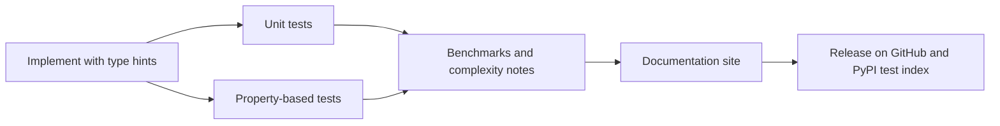
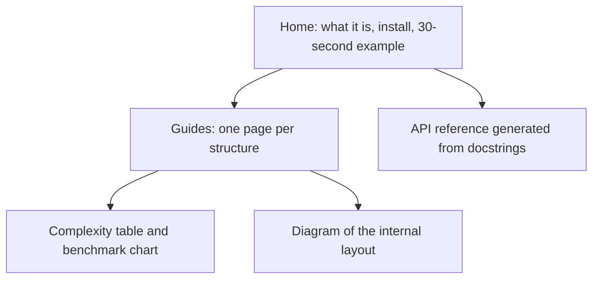

In Track 1 you implemented data structures and algorithms one exercise at a time. This capstone
turns those exercises into a small, published library: typed, tested from two angles, benchmarked
and documented. The goal is not to compete with Python's built-ins (you won't, and that's fine). The
goal is to show a reviewer that you can build a reusable component with the discipline of a real
open-source package.

Think of it as a carpenter's portfolio of joints. Nobody needs another dovetail, but a set of clean,
labelled, stress-tested joints shows exactly what the carpenter can do.



## Implement core structures with type hints

Pick a scope you can finish. A good set covers the main families from Track 1:

| Family | Suggested items | Track 1 session |
| --- | --- | --- |
| Linear | Dynamic array, singly linked list, stack, queue (ring buffer) | 1.3.1, 1.3.2 |
| Hashing | Hash map with open addressing or chaining | 1.3.3 |
| Trees | Binary search tree, then an AVL or red-black tree | 1.3.4 |
| Heaps | Binary min-heap with `push`, `pop`, `heapify` | 1.3.5 |
| Graphs | Adjacency list, BFS, DFS, Dijkstra, topological sort | 1.3.6, 1.4.4, 1.4.5 |
| Algorithms | Binary search, merge sort, quicksort | 1.4.1, 1.4.2 |

[Open Data Structures](https://opendatastructures.org/) is an excellent companion here: it presents
each structure with its interface, implementation and analysis, which is exactly the shape your
library should take.

### Design the interface first

Write the public methods and their docstrings before the internals. Use **generics** so the
structures work for any element type, and **protocols** to state what the elements must support.

```python
from __future__ import annotations
from typing import Generic, Iterator, Protocol, TypeVar

class SupportsLessThan(Protocol):
    def __lt__(self, other: object, /) -> bool: ...

T = TypeVar("T", bound=SupportsLessThan)

class MinHeap(Generic[T]):
    """Binary min-heap stored in a list. push/pop are O(log n), peek is O(1)."""

    def __init__(self, items: list[T] | None = None) -> None:
        self._data: list[T] = list(items or [])
        for i in reversed(range(len(self._data) // 2)):
            self._sift_down(i)

    def __len__(self) -> int:
        return len(self._data)

    def push(self, item: T) -> None:
        self._data.append(item)
        self._sift_up(len(self._data) - 1)

    def pop(self) -> T:
        if not self._data:
            raise IndexError("pop from empty heap")
        top, last = self._data[0], self._data.pop()
        if self._data:
            self._data[0] = last
            self._sift_down(0)
        return top
    # _sift_up and _sift_down omitted
```

> [!TIP]
> Follow Python's conventions so your structures feel native: `__len__`, `__iter__`,
> `__contains__`, and raising `IndexError`/`KeyError` like built-ins do. Users should be able to
> guess the API without reading the docs.

> [!NOTE]
> Run a type checker (`mypy --strict` or `pyright`) in CI. Type hints that are never checked drift
> out of date and become lies.

## Property-based and unit tests

You need two kinds of tests, and they catch different bugs.

**Unit tests** check specific examples you chose: an empty heap raises on `pop`, a BST with three
keys returns them in order. They document the expected behaviour and are easy to read. The
[pytest docs](https://docs.pytest.org/en/stable/) cover everything you need: plain `assert`,
`pytest.raises`, fixtures and `@pytest.mark.parametrize` to run one test over many inputs.

```python
import pytest
from dsa.heap import MinHeap

def test_pop_empty_raises():
    with pytest.raises(IndexError):
        MinHeap[int]().pop()

@pytest.mark.parametrize("items", [[3, 1, 2], [1], [5, 5, 5], [9, -1, 0, 4]])
def test_pops_in_sorted_order(items):
    h = MinHeap(items)
    assert [h.pop() for _ in range(len(items))] == sorted(items)
```

**Property-based tests** flip the approach. Instead of picking inputs, you state a **property**
that must hold for _every_ input, and a library (in Python, Hypothesis) generates hundreds of random
inputs, including nasty edge cases like empty lists, duplicates and huge numbers. When it finds a
failure, it **shrinks** the input to the smallest example that still fails.

Analogy: unit tests are a teacher's handpicked exam questions; property-based tests are a
mischievous student trying every trick to break your rule.

```python
from hypothesis import given, strategies as st
from dsa.heap import MinHeap
from dsa.sorting import merge_sort

@given(st.lists(st.integers()))
def test_heap_sort_matches_sorted(xs):
    h = MinHeap(xs)
    assert [h.pop() for _ in range(len(xs))] == sorted(xs)

@given(st.lists(st.integers()))
def test_merge_sort_is_permutation_and_ordered(xs):
    out = merge_sort(xs)
    assert sorted(out) == sorted(xs)
    assert all(a <= b for a, b in zip(out, out[1:]))
```

Good properties for data structures:

- **Model equivalence**: your hash map behaves like a `dict` after the same sequence of operations.
- **Invariants**: after every insert, the BST in-order traversal is sorted; the AVL tree's balance
  factors are all in -1..1.
- **Round trips**: `pop` everything you `push`ed and you get the same multiset back.

> [!EXAMPLE]
> Hypothesis can even generate whole operation sequences with `RuleBasedStateMachine`: it randomly
> calls `put`, `get` and `delete` on your hash map and on a real `dict`, and fails as soon as they
> disagree. This is how many real libraries catch resize bugs.

> [!WARNING]
> A property that just re-implements the code ("the output equals my algorithm's output") proves
> nothing. Compare against a trusted oracle (`sorted`, `dict`, `heapq`) or check an invariant.

## Benchmarks and complexity notes

Big-O tells you how cost grows; benchmarks tell you what it costs on a real machine. Your docs
should have both.

For each structure, write a short **complexity table** with the reasoning in one line:

| Operation | MinHeap | Why |
| --- | --- | --- |
| `push` | O(log n) | Sifts up at most the height of the tree |
| `pop` | O(log n) | Sifts down at most the height of the tree |
| `peek` | O(1) | Minimum is at index 0 |
| build from list | O(n) | Bottom-up heapify; most nodes are near the leaves |

Then **measure**. Use `timeit` for quick checks or the `pytest-benchmark` plugin to keep benchmarks
next to tests. Measure at several sizes (10³, 10⁴, 10⁵, 10⁶) and plot time against n: a straight
line on a log-log plot with slope about 1 means linear, slope about 2 means quadratic.

```python
import random, timeit
from dsa.sorting import merge_sort

for n in [1_000, 10_000, 100_000]:
    xs = [random.random() for _ in range(n)]
    t = min(timeit.repeat(lambda: merge_sort(xs), number=1, repeat=5))
    print(f"n={n:>7}  merge_sort={t*1000:.1f} ms  sorted={min(timeit.repeat(lambda: sorted(xs), number=1, repeat=5))*1000:.1f} ms")
```

> [!NOTE]
> Your pure-Python merge sort will be much slower than `sorted`, which is written in C and uses
> Timsort. Say so in the docs and explain why. Honest comparisons are more impressive than hiding
> the numbers.

> [!TIP]
> Benchmark with `min` over several repeats, not the average: the minimum is the run least
> disturbed by other processes on your machine.

## Documentation site

A library without docs is a library nobody uses. Aim for a small static site with three kinds of
pages:



A common, low-effort stack is **MkDocs** with the Material theme plus **mkdocstrings**, which
renders your docstrings and type hints into an API reference. Publish it with GitHub Pages from a
GitHub Actions workflow on every push to `main`. Sphinx is the long-standing alternative, and you
will meet it in many established projects.

Each structure's guide page should explain: what problem it solves, a picture of how it is stored
(Mermaid works well), the complexity table, a benchmark chart, and when you would use the standard
library instead (`heapq`, `collections.deque`, `dict`, `bisect`).

### Project plan: publish a tested DSA library

Allow two to three weeks. The deliverable is a public repository with a docs site.

#### Step 1: Scaffold

Create `dsa/` with a `src/` layout, a `pyproject.toml`, and dev dependencies `pytest`,
`hypothesis`, `mypy` and `ruff`. Add a GitHub Actions workflow running `ruff check`,
`mypy --strict src` and `pytest` on Python 3.12 and 3.13.

#### Step 2: Implement five structures

Port your Track 1 code into the library, one module per structure. Add type hints and docstrings
stating complexity. Keep the public API in `dsa/__init__.py`.

#### Step 3: Test from both angles

For each structure: at least three unit tests (including the empty case and an error case) and one
property-based test against a standard-library oracle. Aim for high branch coverage with
`pytest --cov`, but treat the number as a hint, not a goal.

#### Step 4: Benchmark

Write `benchmarks/run.py` that times each core operation at four sizes and saves a chart. Compare
against the standard-library equivalent and write two sentences interpreting each chart.

#### Step 5: Docs and release

Set up MkDocs, write a guide page per structure, generate the API reference, and deploy to GitHub
Pages. Tag `v0.1.0`, write release notes, and (optionally) publish to TestPyPI to practise the
packaging flow.

> [!EXAMPLE]
> Definition of done: CI is green on two Python versions, `mypy --strict` passes, every structure
> has a property-based test, the docs site is live and linked from the README, and the README shows
> one benchmark chart with an honest explanation.
