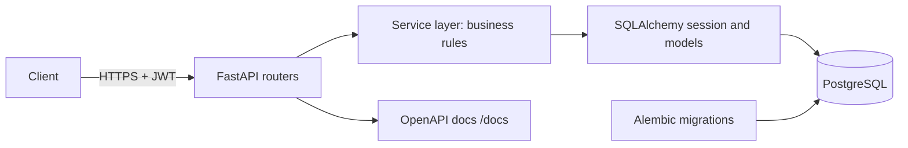
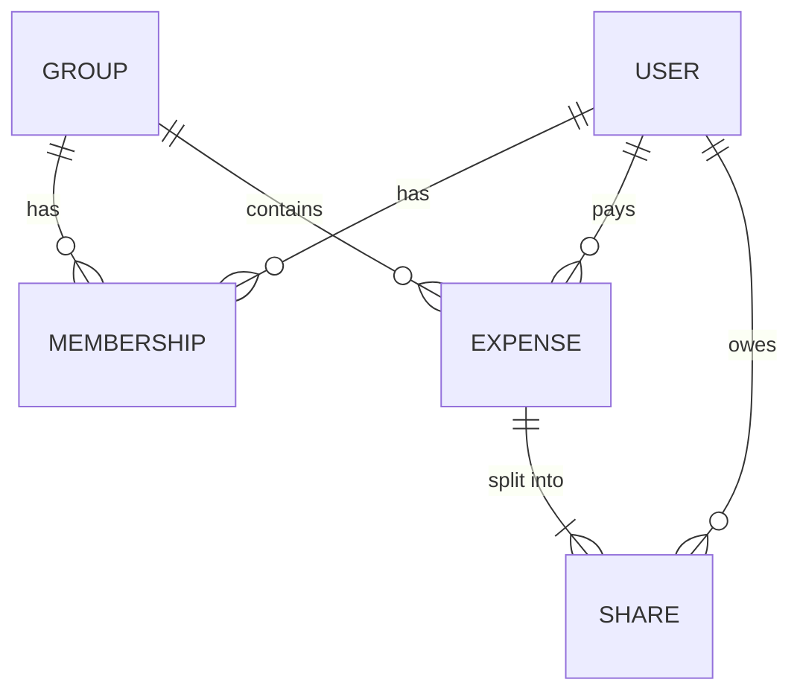
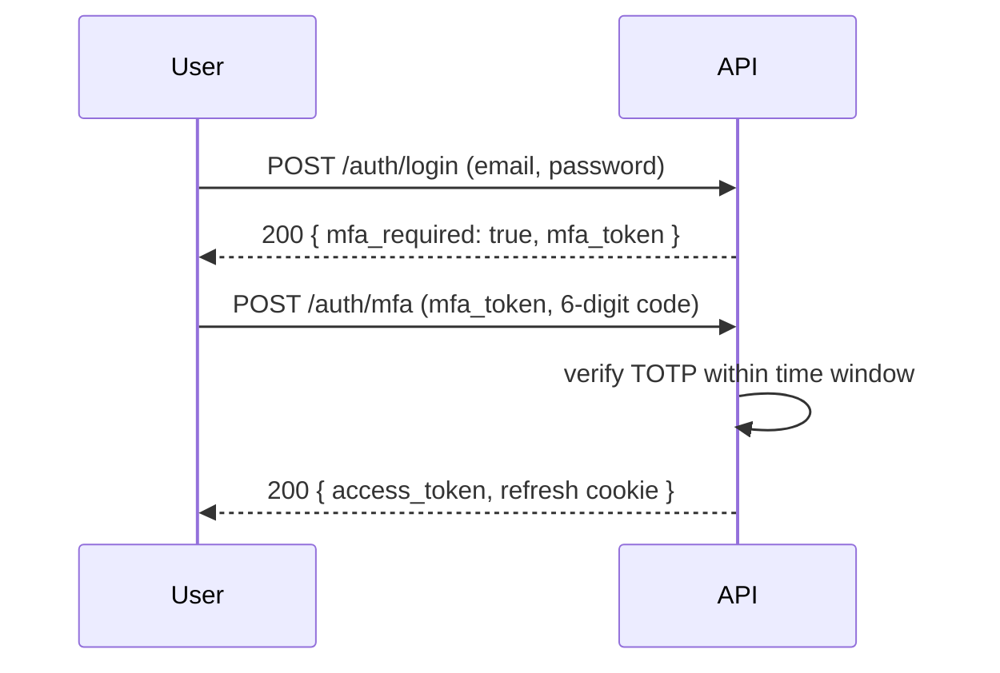

This capstone is the backbone of your backend portfolio: a FastAPI service backed by PostgreSQL,
with a real data model, migrations, secure login with two-factor authentication, tests and generated
API docs. The next two capstones (11.1.4 and 11.1.5) deploy, observe and harden **this same
service**, so choose a domain you will enjoy living with for a few weeks.

Analogy: you are building a restaurant kitchen. The domain model is the menu, the API is the
waiter's order pad, the database is the pantry, auth is the staff entrance, and tests are the health
inspection you run yourself before opening.



## Domain model and API design

Pick a domain small enough to finish but rich enough to have relationships and rules. Good options:

- **Habit tracker**: users, habits, check-ins, streaks.
- **Book club**: users, clubs, memberships, books, reviews.
- **Expense splitter**: users, groups, expenses, shares, settlements.

Start on paper, not in code. List the **entities**, their **relationships**, and the **rules** that
must always hold (the invariants). This is the domain-driven design habit from session 2.5.2.



> [!EXAMPLE]
> Invariants for an expense splitter: the shares of an expense sum to its amount; only group
> members can add expenses to the group; amounts are stored as integer cents, never floats.

Then design the API as **resources**, following session 3.2.1:

| Method | Path | Purpose | Success |
| --- | --- | --- | --- |
| `POST` | `/groups` | Create a group | 201 + `Location` |
| `GET` | `/groups/{id}` | Read a group | 200 |
| `POST` | `/groups/{id}/expenses` | Add an expense | 201 |
| `GET` | `/groups/{id}/expenses?cursor=…&limit=20` | List expenses, paginated | 200 |
| `GET` | `/groups/{id}/balances` | Who owes whom | 200 |
| `DELETE` | `/expenses/{id}` | Delete an expense | 204 |

Define request and response bodies as separate Pydantic models (`ExpenseCreate`, `ExpenseOut`), so
you never leak internal fields such as password hashes. Use one consistent error format, such as
RFC 9457 problem details, and return 404 rather than 403 when a user asks for something they cannot
see, to avoid revealing that it exists.

> [!TIP]
> Write the OpenAPI shape first: routers with Pydantic models and `...` bodies. Open `/docs` and
> click through the API before writing any persistence. Changing a design at this stage costs
> minutes; changing it after migrations costs hours.

## Persistence with SQLAlchemy and Alembic

Use the [SQLAlchemy 2.0](https://docs.sqlalchemy.org/en/20/) typed declarative style, where
`Mapped[...]` annotations give your editor and type checker the column types:

```python
from datetime import datetime
from sqlalchemy import ForeignKey, func
from sqlalchemy.orm import DeclarativeBase, Mapped, mapped_column, relationship

class Base(DeclarativeBase):
    pass

class Expense(Base):
    __tablename__ = "expenses"
    id: Mapped[int] = mapped_column(primary_key=True)
    group_id: Mapped[int] = mapped_column(ForeignKey("groups.id", ondelete="CASCADE"), index=True)
    payer_id: Mapped[int] = mapped_column(ForeignKey("users.id"))
    amount_cents: Mapped[int]
    description: Mapped[str]
    created_at: Mapped[datetime] = mapped_column(server_default=func.now())
    shares: Mapped[list["Share"]] = relationship(back_populates="expense", cascade="all, delete-orphan")
```

Provide the session to routes through a FastAPI **dependency**, so each request gets its own
session and tests can swap it:

```python
def get_db() -> Iterator[Session]:
    with SessionLocal() as session:
        yield session

@router.post("/groups/{group_id}/expenses", status_code=201)
def add_expense(group_id: int, body: ExpenseCreate,
                db: Session = Depends(get_db), user: User = Depends(current_user)) -> ExpenseOut:
    return services.add_expense(db, user, group_id, body)
```

Keep business rules in a **service layer** (plain functions that take a session), not in the
routers. Routers translate HTTP; services enforce invariants inside a transaction.

**Alembic** owns the schema. Never call `Base.metadata.create_all()` in production: generate a
migration with `alembic revision --autogenerate -m "add expenses"`, **read it**, then apply it with
`alembic upgrade head`. Database constraints back up your Python checks: `NOT NULL`, foreign keys,
`UNIQUE (group_id, user_id)` on memberships, and `CHECK (amount_cents > 0)`.

> [!WARNING]
> Autogenerate is a draft, not a truth. It misses some changes (such as renames, which it sees as a
> drop plus an add, losing data) and server-side defaults. Review every generated file before
> committing it.

> [!NOTE]
> Watch for the N+1 query problem when listing expenses with their shares. Use
> `selectinload(Expense.shares)` and check the SQL log (`echo=True`) during development.

## Authentication with 2FA

Implement the flow from sessions 6.3.1 and 6.3.2, using vetted libraries rather than your own
crypto:

1. **Register**: hash passwords with Argon2id (for example via `argon2-cffi` or `pwdlib`). Never
   store or log the plain password.
2. **Login, step 1**: verify the password. If the user has 2FA enabled, do **not** issue a full
   token yet; return a short-lived "2FA pending" token.
3. **Login, step 2**: verify a TOTP code (the 6-digit code from an authenticator app, via a library
   such as `pyotp`) and only then issue the access token.
4. **Enrolment**: generate a TOTP secret, show it as a QR code, require one valid code to confirm,
   and issue single-use recovery codes (store them hashed).



Use short-lived access tokens (for example 15 minutes, a JWT signed with a secret from the
environment) plus a refresh token in an `HttpOnly`, `Secure`, `SameSite` cookie that you can revoke
in the database. Protect routes with a `current_user` dependency, then check **authorisation**
(is this user a member of this group?) in the service layer on every request.

> [!WARNING]
> Rate-limit login and 2FA endpoints. A 6-digit code has only a million possibilities; without a
> limit and lockout, it can be brute-forced.

## Test suite and OpenAPI docs

Test at three levels (session 2.2.4):

- **Unit**: service functions such as "balances sum to zero", using a database session.
- **API**: FastAPI's `TestClient` (or `httpx.AsyncClient`) calling endpoints with real JSON.
- **Migrations**: a test that runs `alembic upgrade head` on an empty database, so a broken
  migration fails CI, not production.

Run tests against **real PostgreSQL** (a Docker container or Testcontainers), not SQLite: types,
constraints and locking differ. Wrap each test in a transaction that is rolled back, so tests stay
fast and independent.

```python
def test_non_member_cannot_add_expense(client, make_user, make_group):
    owner, stranger = make_user(), make_user()
    group = make_group(owner=owner)
    r = client.post(f"/groups/{group.id}/expenses",
                    json={"amount_cents": 1200, "description": "Pizza"},
                    headers=auth(stranger))
    assert r.status_code == 404
```

The [FastAPI docs](https://fastapi.tiangolo.com/) show how the framework builds an OpenAPI schema
from your type hints and serves Swagger UI at `/docs` and ReDoc at `/redoc`. Make it good: add
`summary` and `description` to routes, `examples` to Pydantic fields, `responses={404: ...}` for
documented errors, and tags to group routers. Commit an exported `openapi.json` and add a CI check
that fails if it changes unexpectedly; that turns accidental breaking changes into visible diffs.

> [!TIP]
> Write at least one test per authorisation rule. Access control bugs are the most common serious
> API vulnerability, and they are invisible in happy-path tests.

### Project plan: build and test the API

Allow two to four weeks. The deliverable is a repository that 11.1.4 will deploy.

#### Step 1: Design (1–2 evenings)

Write `docs/design.md` with the entity diagram, invariants and endpoint table. Scaffold routers with
Pydantic models only and review `/docs`.

#### Step 2: Database (3–4 evenings)

Add `docker-compose.yml` with PostgreSQL, SQLAlchemy models, `get_db`, and Alembic. Create the first
migration, apply it, and implement services for the main flows.

#### Step 3: Auth (3–4 evenings)

Implement register, login, TOTP enrolment, the two-step login, refresh and logout. Add rate limiting
on auth routes. Test the full flow, including a wrong code and a replayed recovery code.

#### Step 4: Tests and docs (2–3 evenings)

Reach a suite with unit, API and migration tests running against PostgreSQL in GitHub Actions.
Polish OpenAPI metadata and commit `openapi.json`.

#### Step 5: README

Explain the domain, show the diagram, give a one-command start (`docker compose up`), list the
endpoints with links to `/docs`, and describe the security choices in a short section.

> [!EXAMPLE]
> Definition of done: `docker compose up` starts the API and database; a user can register, enable
> 2FA and log in with it; non-members get 404 on other groups; CI runs ruff, migrations and pytest
> against PostgreSQL; `/docs` documents every endpoint with examples.
