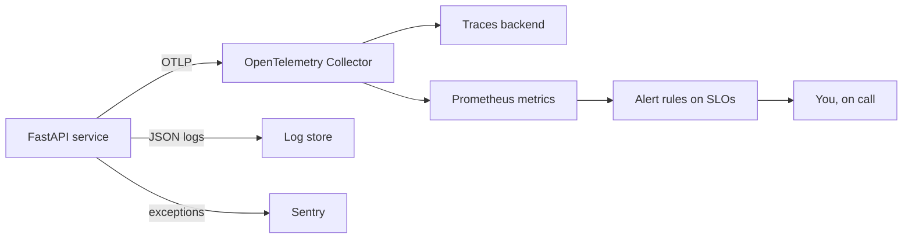
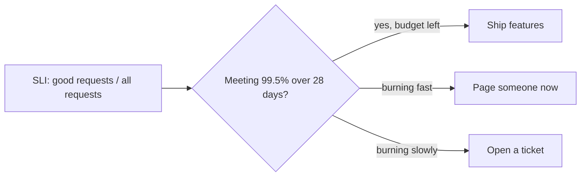
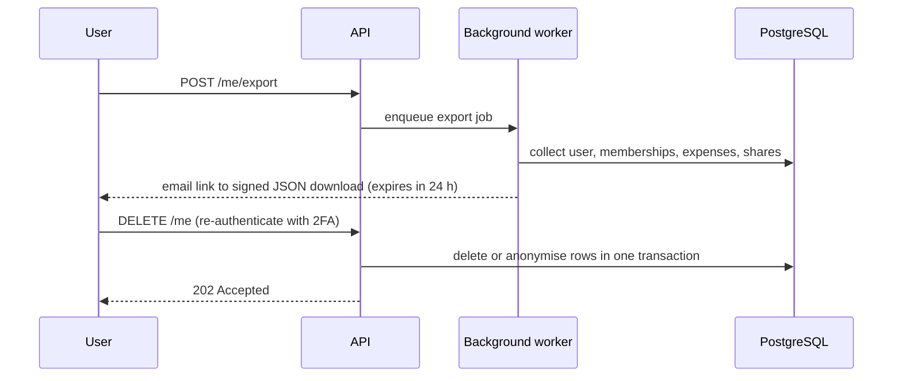

Your API is deployed. Now two questions decide whether it is production-grade: **when something
goes wrong, will you know, and will you know why?** And **have you closed the obvious doors an
attacker would try?** This capstone adds observability (Track 5, module 5.6) and security and
privacy hardening (Track 6) to the service you built in 11.1.3 and deployed in 11.1.4.

Analogy: a car leaving the factory gets a dashboard (speed, fuel, warning lights), a black-box
recorder, and a safety inspection. Observability is the dashboard and the recorder; hardening is the
inspection; GDPR features are the owner's right to see and wipe the car's data.



## Logs, metrics, traces and Sentry

The three classic **signals** answer different questions:

| Signal | Question it answers | Example |
| --- | --- | --- |
| **Logs** | What exactly happened in this event? | `{"event": "expense_created", "group_id": 7, "request_id": "ab12"}` |
| **Metrics** | How is the system behaving overall? | `http_requests_total{route="/groups/{id}", status="500"}` |
| **Traces** | Where did the time go in this one request? | Request 340 ms: 12 ms auth, 310 ms SQL query |

[OpenTelemetry](https://opentelemetry.io/docs/) is the vendor-neutral standard for producing all
three: one set of APIs and SDKs, one wire protocol (OTLP), and a Collector that forwards data to
whichever backend you choose. That means you can switch from a local Jaeger or Grafana stack to a
hosted vendor without touching application code.

### Traces

Start with **automatic instrumentation**: the OpenTelemetry instrumentation packages for FastAPI,
SQLAlchemy and HTTP clients create spans for every request, query and outbound call. Then add
manual spans around important business steps:

```python
from opentelemetry import trace

tracer = trace.get_tracer(__name__)

def settle_group(db, group_id: int):
    with tracer.start_as_current_span("settle_group") as span:
        span.set_attribute("group.id", group_id)
        balances = compute_balances(db, group_id)
        span.set_attribute("balances.count", len(balances))
        return balances
```

### Logs

Emit **structured JSON logs** (session 5.6.1) with a request ID and the trace ID in every line, so
you can jump from a log line to its trace. Log events, not prose, and never log secrets, tokens,
passwords or full request bodies.

### Metrics

Track the **RED** metrics for every route: **R**ate (requests per second), **E**rrors (failed
requests), **D**uration (latency histogram). Expose them for Prometheus or send them through the
Collector, and build one Grafana dashboard with these three panels per endpoint group.

### Sentry

Sentry (session 5.6.4) groups exceptions, shows the stack trace with local variables, the release
that introduced them and how many users are affected. Initialise it with the release set to your
commit SHA from 11.1.4, so every error points to the exact code version.

> [!WARNING]
> Sentry and traces can capture request data. Configure scrubbing (`send_default_pii=False`,
> before-send hooks) so emails, tokens and authorization headers never leave your system. This is a
> GDPR concern as well as a security one.

> [!TIP]
> Before building dashboards, break something on purpose (a route that sleeps 2 seconds, one that
> raises) and check you can find it in each signal within two minutes. If you can't, your
> instrumentation is not done.

## SLOs and alerts

Dashboards are for when you are already looking. **Alerts** are for when you are not. But alerting
on every spike burns people out. **Service level objectives** (SLOs) give alerts a principled basis.

- **SLI** (indicator): a measured ratio, such as "fraction of requests that succeed in under
  300 ms".
- **SLO** (objective): a target for that SLI over a window, such as "99.5% over 28 days".
- **Error budget**: what the SLO allows to fail. At 99.5%, 0.5% of requests can be slow or fail.



Alert on **burn rate**: how fast you are spending the budget. A burn rate of 1 uses exactly the
whole budget over the window; a burn rate of 14 would exhaust a 28-day budget in about two days.
A common pattern from the SRE literature is a fast alert (high burn rate over a short window) that
pages, plus a slow alert (lower burn rate over hours) that opens a ticket.

> [!EXAMPLE]
> Your API's SLOs:
> 1. **Availability**: 99.5% of requests to `/groups/*` return a non-5xx status, over 28 days.
> 2. **Latency**: 95% of `GET` requests complete in under 300 ms, over 28 days.
>
> Each has a fast-burn page and a slow-burn ticket, and each alert links to a short runbook:
> what to check first, how to roll back.

> [!NOTE]
> Every alert must be **actionable**. If the person who receives it cannot do anything, it should
> be a dashboard panel, not an alert.

## OWASP review and fixes

Now play attacker against your own API. The [OWASP Top 10](https://top10.owasp.org/) is the
checklist; for APIs, the OWASP API Security Top 10 (session 6.2.4) is even closer to your risks.
Walk through each category and write down evidence, not opinions.

| OWASP Top 10:2025 | What to check in your API | Typical fix |
| --- | --- | --- |
| A01 Broken Access Control | Can user A read or delete user B's group by changing the ID? Does any endpoint fetch a user-supplied URL (SSRF)? | Ownership check in every service function, tests per rule, host allow-list |
| A02 Security Misconfiguration | Debug mode, verbose errors, open CORS, missing security headers | Production settings, strict CORS, security headers |
| A03 Software Supply Chain Failures | Outdated packages, base image CVEs, unpinned actions | `pip-audit`, Trivy in CI (11.1.4), Dependabot, pinned versions |
| A04 Cryptographic Failures | Password hashing, TLS everywhere, secrets in env not code | Argon2id, HTTPS-only Ingress, secret manager |
| A05 Injection | Any raw SQL or string-built queries? | SQLAlchemy parameters only |
| A06 Insecure Design | Unlimited 2FA attempts, no pagination limits | Rate limits, max `limit` |
| A07 Authentication Failures | Token lifetime, logout revocation, credential stuffing | Short access tokens, revocable refresh tokens, lockout |
| A08 Software or Data Integrity Failures | Can unsigned or unverified data change state (webhooks, cached objects)? | Verify signatures, validate on the server |
| A09 Security Logging and Alerting Failures | Are failed logins and permission denials logged and alerted? | Security events in logs, an alert on spikes |
| A10 Mishandling of Exceptional Conditions | Does an exception ever fail open or leak a stack trace? | Fail closed, generic error responses, tests for error paths |

Run automated tools to supplement, not replace, the manual review: a DAST scanner such as OWASP ZAP
against a staging deployment, `bandit` for Python, and your image scan.

> [!WARNING]
> Only scan systems you own. Pointing a scanner at someone else's service, even "just to test",
> can be illegal.

Record each finding as an issue with severity, fix it with a test that would have caught it, and
keep the review as `docs/security-review.md`.

## GDPR data export and deletion

If real people in the EU use your API, the GDPR (session 6.5.1) gives them rights you must
implement in code. Two are concrete engineering features:

- **Right of access and data portability**: a user can download their personal data in a
  structured, commonly used, machine-readable format.
- **Right to erasure**: a user can ask you to delete their personal data, subject to legal
  exceptions (for example, invoices you must keep for tax law).



Design decisions you must make and document:

1. **Inventory**: list every table and column holding personal data, plus logs, backups, Sentry and
   third-party processors.
2. **Delete or anonymise**: in a shared expense group, deleting a user's expenses would break other
   members' balances. A common choice is to replace the user with an anonymous "Deleted user"
   record, keeping amounts but removing identity.
3. **Re-authentication**: require password plus 2FA before export or deletion, so a stolen session
   cannot exfiltrate or wipe an account.
4. **Backups and logs**: you rarely rewrite backups; instead, document retention periods so deleted
   data ages out, and keep personal data out of logs in the first place.

> [!TIP]
> Write a test that creates a user with data in every table, calls the deletion flow, and then
> asserts that no row still contains their email or name. It is the only reliable way to keep
> erasure correct as the schema grows.

### Project plan: instrument and harden the API

Allow two to three weeks. Work on the repository from 11.1.3 and 11.1.4.

#### Step 1: Instrument

Add OpenTelemetry auto-instrumentation and a Collector (in Compose and in the Helm chart). Add JSON
logging with trace IDs, RED metrics and Sentry with release tagging and PII scrubbing. Run a local
Grafana stack and build one dashboard.

#### Step 2: Define SLOs

Write two SLOs in `docs/slo.md`. Create fast and slow burn-rate alerts in Prometheus or Grafana, each
with a runbook link. Trigger one deliberately with a load test (k6) against a slow endpoint.

#### Step 3: OWASP review

Fill the table above for your API with evidence. Fix every high-severity finding with a regression
test. Add `pip-audit` and `bandit` to CI.

#### Step 4: GDPR features

Write the personal-data inventory, implement `POST /me/export` and `DELETE /me` with
re-authentication, and add the erasure test.

#### Step 5: Write it up

Add an "Operations and security" section to the README: architecture of the telemetry pipeline, the
SLOs, a screenshot of the dashboard, a summary of the security review and the data-rights flows.

> [!EXAMPLE]
> Definition of done: you can follow a single slow request from a dashboard spike to its trace and
> its log lines; an SLO alert fires in a load test; every OWASP finding has an issue and a test;
> export returns all of a user's data and deletion leaves no trace of their identity.
