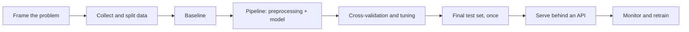
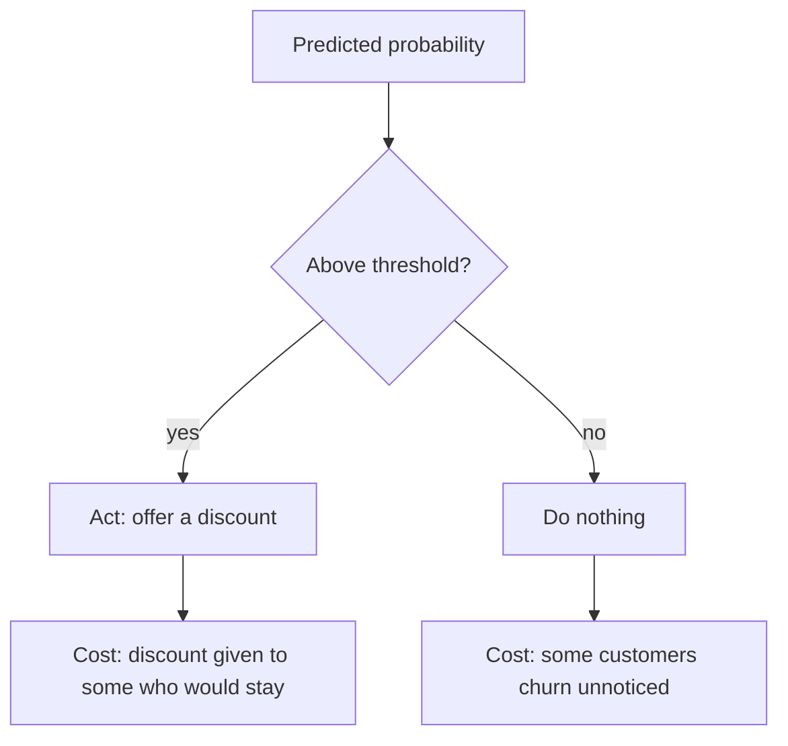

This capstone takes a machine learning model from a question to a running service: frame the
problem, build a leak-free pipeline, evaluate it honestly against a baseline, and serve it behind an
API. It draws on Track 8 (module 8.2) and on the API skills from 11.1.3. Most real-world ML work
looks like this project, not like training giant neural networks.

Analogy: you are hiring a junior analyst to make one specific prediction. First you write the job
description (framing), then you train them on past cases without letting them peek at the answers
(pipeline and validation), test them on cases they have never seen (evaluation), and finally give
them a desk where colleagues can send questions (serving).



## Problem framing and data

The [Google ML Crash Course](https://developers.google.com/machine-learning/crash-course) stresses
that framing comes first: what exactly are you predicting, for whom, and what decision will change
because of the prediction? If no decision changes, the model is a toy.

Answer these in a short `docs/framing.md`:

1. **Target**: what you predict. A number (regression: price, duration) or a category
   (classification: churn yes/no, spam/not spam).
2. **Unit of prediction**: one row is one what? A house, a customer-month, a transaction.
3. **Prediction time**: when is the prediction made, and what data exists at that moment? This is
   the key defence against **data leakage**.
4. **Success metric**: tied to the decision. For fraud, missing a fraud costs more than a false
   alarm, so recall matters more than accuracy.
5. **Baseline**: the simplest thing that could work, such as "always predict the median" or "the
   majority class". Your model must beat it clearly.

> [!WARNING]
> **Leakage** is a feature that would not be available at prediction time, or that encodes the
> answer. Predicting whether a loan defaults using a "collections_calls" column is cheating: those
> calls happen _after_ the default. Leaky models look brilliant in evaluation and fail in
> production.

Good datasets for this project: the California housing data built into scikit-learn (regression),
a public customer churn dataset or the UCI Adult income dataset (classification), or open data from
your 11.1.1 analysis.

### Splitting

Split **before** you explore deeply. Keep a **test set** (for example 20%) locked away until the
very end. Use cross-validation on the remaining data for model selection. For time-dependent data
(sales, sensor readings), split by time: train on the past, test on the future.

> [!NOTE]
> For classification with imbalanced classes, use a **stratified** split so each set keeps the same
> class proportions.

## Pipeline and evaluation

In scikit-learn, a **Pipeline** chains preprocessing and the model into one object. That matters
because preprocessing (scaling, imputing, encoding) must be **fitted only on training data**. Inside
cross-validation, a pipeline refits the preprocessing on each training fold automatically, so no
information from the validation fold leaks in. The
[scikit-learn User Guide](https://scikit-learn.org/stable/user_guide.html) covers pipelines,
`ColumnTransformer` and model selection in depth.

```python
from sklearn.compose import ColumnTransformer
from sklearn.ensemble import HistGradientBoostingClassifier
from sklearn.impute import SimpleImputer
from sklearn.model_selection import train_test_split, cross_validate
from sklearn.pipeline import Pipeline
from sklearn.preprocessing import OneHotEncoder, StandardScaler

numeric = ["age", "tenure_months", "monthly_charges"]
categorical = ["contract", "payment_method"]

pre = ColumnTransformer([
    ("num", Pipeline([("impute", SimpleImputer(strategy="median")),
                      ("scale", StandardScaler())]), numeric),
    ("cat", OneHotEncoder(handle_unknown="ignore"), categorical),
])
model = Pipeline([("pre", pre), ("clf", HistGradientBoostingClassifier(random_state=0))])

X_train, X_test, y_train, y_test = train_test_split(
    X, y, test_size=0.2, stratify=y, random_state=0)
scores = cross_validate(model, X_train, y_train, cv=5,
                        scoring=["roc_auc", "average_precision", "f1"])
```

### Compare models fairly

Try a small ladder of models with the same pipeline and cross-validation:

| Step | Model | Why |
| --- | --- | --- |
| 0 | `DummyClassifier` / `DummyRegressor` | The baseline every model must beat |
| 1 | Logistic or linear regression | Simple, fast, interpretable |
| 2 | Random forest | Non-linear, few hyperparameters |
| 3 | Gradient boosting (`HistGradientBoosting…`) | Often strongest on tabular data |

Tune hyperparameters with `GridSearchCV` or `RandomizedSearchCV` over the whole pipeline, then
evaluate the chosen model **once** on the test set.

### Choose metrics that match the decision

- **Regression**: MAE (average error in the target's units, easy to explain), RMSE (punishes big
  errors more), R².
- **Classification**: precision, recall, F1, ROC AUC, and precision-recall AUC for imbalanced data.
  Look at the **confusion matrix** and pick a decision **threshold** based on the cost of each
  error, not the default 0.5.



> [!TIP]
> Do an **error analysis**: look at the 20 worst predictions by hand. You will often find a data
> bug, a missing feature or a segment where the model fails. This is more valuable than another
> round of tuning.

> [!WARNING]
> If you check the test set, change something, and check again, it is no longer a test set: you
> have tuned on it. Make every decision with cross-validation and touch the test set once.

## Serve the model behind an API

A model in a notebook helps nobody. Save the **whole fitted pipeline** (preprocessing included),
version it, and load it once at API startup.

```python
import joblib
joblib.dump(best_model, "models/churn-v1.joblib")
```

```python
from contextlib import asynccontextmanager
import joblib, pandas as pd
from fastapi import FastAPI
from pydantic import BaseModel, Field

class Customer(BaseModel):
    age: int = Field(ge=18, le=120)
    tenure_months: int = Field(ge=0)
    monthly_charges: float = Field(ge=0)
    contract: str
    payment_method: str

class Prediction(BaseModel):
    churn_probability: float
    will_churn: bool
    model_version: str

MODEL_VERSION = "churn-v1"
THRESHOLD = 0.35  # chosen from the precision-recall trade-off, see docs/evaluation.md
state = {}

@asynccontextmanager
async def lifespan(app: FastAPI):
    state["model"] = joblib.load(f"models/{MODEL_VERSION}.joblib")
    yield

app = FastAPI(lifespan=lifespan)

@app.post("/predict")
def predict(c: Customer) -> Prediction:
    p = float(state["model"].predict_proba(pd.DataFrame([c.model_dump()]))[0, 1])
    return Prediction(churn_probability=p, will_churn=p >= THRESHOLD, model_version=MODEL_VERSION)
```

Points that separate a serious service from a demo:

- **Validate inputs** with Pydantic: ranges, allowed categories. Garbage in means confident garbage
  out.
- **Return the model version** with every prediction, so you can trace a bad prediction to a model.
- **Pin library versions**: a joblib file saved with one scikit-learn version may not load in
  another. Record versions in `pyproject.toml` and in a model card.
- **Log inputs and outputs** (without personal data) so you can detect **drift** later: when live
  inputs stop looking like the training data, performance silently drops.
- **Test the API**: a smoke test that loads the real model and checks one known prediction.

> [!NOTE]
> joblib and pickle files can execute code when loaded. Only load model files you produced
> yourself or from a trusted, verified source.

> [!EXAMPLE]
> A minimal **model card** (`docs/model-card.md`): intended use, training data and date, features,
> metrics on the test set versus the baseline, chosen threshold and why, known limitations and
> segments where it underperforms, and library versions.

### Project plan: train, evaluate and serve a model

Allow about two weeks. The deliverable is a repository with a training script, an evaluation
report and a containerised prediction API.

#### Step 1: Frame

Pick a dataset and write `docs/framing.md` with target, unit, prediction time, metric and baseline.
List features you will exclude because of leakage.

#### Step 2: Split and baseline

Create the train/test split with a fixed seed, save the indices, and score a dummy model with
cross-validation.

#### Step 3: Pipeline and model ladder

Build the `ColumnTransformer` pipeline and compare at least three models with the same
cross-validation. Tune the best one. Record results in a table.

#### Step 4: Evaluate once

Evaluate the final pipeline on the test set. Plot the confusion matrix or residuals, choose a
threshold, and do the 20-worst error analysis. Write `docs/evaluation.md` and the model card.

#### Step 5: Serve

Write `train.py` that produces the joblib file reproducibly, and the FastAPI service above with input
validation, a `/health` endpoint and tests. Reuse your Dockerfile pattern from 11.1.4.

> [!EXAMPLE]
> Definition of done: `python train.py` recreates the model from raw data; the model beats the
> baseline by a margin you can explain; `docker run` serves `/predict` with validated input and a
> model version; the README links the framing, evaluation and model card.
