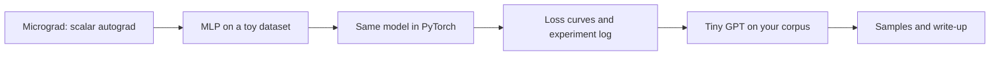
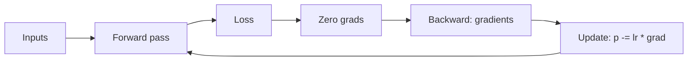
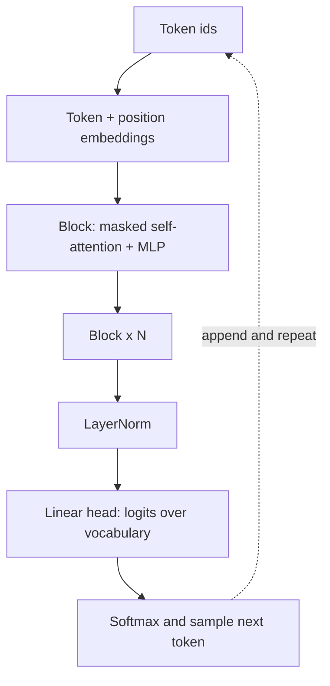

This capstone proves to yourself, and to anyone reading your portfolio, that neural networks and
language models are not magic. You build a tiny autograd engine and train a network with it, then
train the same kind of network in PyTorch with proper loss tracking, and finally train a small GPT
on a text corpus you choose. It is the hands-on follow-up to sessions 8.3.2, 8.4.2 and 8.5.2, and it
follows the path of Andrej Karpathy's [Zero to Hero](https://karpathy.ai/zero-to-hero.html) series.

Analogy: first you build a bicycle from parts to understand every gear (micrograd), then you ride a
modern bike with a speedometer (PyTorch with loss tracking), then you enter a small race on a
route you picked yourself (a tiny GPT on your corpus).



## Micrograd network

**Micrograd** is a minimal automatic differentiation engine: a `Value` class that wraps a number,
remembers which operation produced it, and can compute gradients by walking backwards through that
graph. Karpathy builds it in the first lecture of Zero to Hero, in about a hundred lines.

The core idea is the **chain rule** (session 7.2.2). Each operation knows its local derivative;
`backward()` visits nodes in reverse topological order and multiplies local derivatives along the
way.

```python
import math

class Value:
    def __init__(self, data, children=(), op=""):
        self.data, self.grad = data, 0.0
        self._prev, self._op = set(children), op
        self._backward = lambda: None

    def __add__(self, other):
        other = other if isinstance(other, Value) else Value(other)
        out = Value(self.data + other.data, (self, other), "+")
        def _backward():
            self.grad += out.grad
            other.grad += out.grad
        out._backward = _backward
        return out

    def __mul__(self, other):
        other = other if isinstance(other, Value) else Value(other)
        out = Value(self.data * other.data, (self, other), "*")
        def _backward():
            self.grad += other.data * out.grad
            other.grad += self.data * out.grad
        out._backward = _backward
        return out

    def tanh(self):
        t = math.tanh(self.data)
        out = Value(t, (self,), "tanh")
        def _backward():
            self.grad += (1 - t * t) * out.grad
        out._backward = _backward
        return out

    def backward(self):
        order, seen = [], set()
        def build(v):
            if v not in seen:
                seen.add(v)
                for c in v._prev:
                    build(c)
                order.append(v)
        build(self)
        self.grad = 1.0
        for v in reversed(order):
            v._backward()
```

On top of `Value` you build `Neuron`, `Layer` and `MLP` classes and a training loop: forward pass,
compute a loss, **zero the gradients**, `loss.backward()`, then nudge every parameter by
`-learning_rate * grad`.



> [!WARNING]
> Gradients **accumulate** (`+=`). Forgetting to reset them to zero before each backward pass is the
> classic micrograd bug, and the same bug exists in PyTorch if you skip `optimizer.zero_grad()`.

> [!TIP]
> Verify your gradients numerically: nudge a parameter by a tiny `h`, recompute the loss, and check
> that `(loss(p + h) - loss(p - h)) / (2h)` matches the gradient your engine computed. This
> **gradient check** catches almost every bug in a hand-written backward function.

Train a small MLP (for example 2 → 16 → 16 → 1) on a toy dataset like scikit-learn's `make_moons`
and plot the decision boundary. Seeing a curved boundary appear from your own hundred lines of
code is the point of the exercise.

## PyTorch training with loss tracking

Now rebuild the same model in PyTorch (see the [PyTorch tutorials](https://docs.pytorch.org/tutorials/)).
PyTorch's `autograd` does exactly what your `Value` class did, but on tensors and on a GPU if you
have one. Then scale up to a real dataset such as MNIST or Fashion-MNIST.

```python
import torch, torch.nn as nn
from torch.utils.data import DataLoader

model = nn.Sequential(nn.Flatten(), nn.Linear(28 * 28, 128), nn.ReLU(), nn.Linear(128, 10))
opt = torch.optim.AdamW(model.parameters(), lr=1e-3)
loss_fn = nn.CrossEntropyLoss()

for epoch in range(10):
    model.train()
    for xb, yb in train_loader:
        loss = loss_fn(model(xb), yb)
        opt.zero_grad()
        loss.backward()
        opt.step()
        history["train_loss"].append(loss.item())
    model.eval()
    with torch.no_grad():
        val_loss = sum(loss_fn(model(xb), yb).item() for xb, yb in val_loader) / len(val_loader)
    history["val_loss"].append(val_loss)
```

**Loss tracking** is how you know what training is doing. Log training loss every step and
validation loss every epoch, then plot both. You can use a CSV and Matplotlib, TensorBoard, or an
experiment tracker such as MLflow or Weights and Biases.

Reading loss curves (session 8.4.2):

| What you see | Likely meaning | What to try |
| --- | --- | --- |
| Training loss does not decrease | Learning rate too high or too low, bug in data or labels | Overfit one small batch first; check labels |
| Both losses fall, then flatten | Model is learning, capacity reached | Bigger model, more epochs, better features |
| Training falls, validation rises | Overfitting | More data, dropout, weight decay, early stopping |
| Loss becomes `nan` | Exploding values | Lower learning rate, gradient clipping, check inputs |

> [!TIP]
> Before a long run, **overfit a single batch**: train on 32 examples until the loss is near zero.
> If the model cannot even memorise 32 examples, there is a bug, and you found it in a minute
> instead of an hour.

> [!NOTE]
> Fix random seeds (`torch.manual_seed`) and record hyperparameters with each run. Without that, you
> cannot tell whether a change helped or was just luck.

## Tiny GPT trained on your corpus

The final stage follows the Zero to Hero lecture "Let's build GPT" and session 8.5.2: a
**decoder-only transformer** trained to predict the next character (or token) of a text.

Choose a corpus that is yours and fun: your favourite author's public-domain books, song lyrics you
own, your city's open-data descriptions, or your own notes. One to a few megabytes of plain text is
plenty for a laptop or a free GPU notebook.

The pieces, in order:

1. **Tokeniser**: start with characters (the vocabulary is every distinct character). Optionally
   move to byte-pair encoding later (session 8.5.3).
2. **Data**: encode the text as integers, split 90/10 into train and validation, and sample random
   chunks of `block_size` tokens; the target is the same chunk shifted by one.
3. **Model**: token embeddings + position embeddings, then N blocks of (masked multi-head
   self-attention + feed-forward), each with residual connections and layer norm, then a linear
   head over the vocabulary.
4. **Training**: cross-entropy loss on next-token prediction, AdamW, and validation loss estimated
   every few hundred steps.
5. **Sampling**: start from a prompt, repeatedly predict a distribution, sample a token, append it.



A good starting configuration on modest hardware: `block_size=128`, `n_embd=192`, `n_head=6`,
`n_layer=6`, dropout 0.1, learning rate 3e-4, a few thousand steps.

> [!EXAMPLE]
> Track what changes when you vary one thing at a time:
>
> | Run | Change | Final val loss | Sample quality |
> | --- | --- | --- | --- |
> | 1 | Bigram baseline | high | random-looking characters |
> | 2 | 4 layers, 128 dims | lower | real words, broken grammar |
> | 3 | 6 layers, 192 dims | lower still | phrases in the corpus style |
> | 4 | Run 3 + dropout 0.2 | similar, less overfit | similar |

> [!WARNING]
> A small corpus is easy to memorise. If validation loss rises while training loss falls, your
> model is starting to copy the training text verbatim. Stop at the best validation loss
> (checkpoint it), add dropout, or reduce model size.

Remember what this model is: a next-token predictor with no instruction tuning or alignment
(session 8.5.4). It will produce text in the _style_ of your corpus, not answers to questions.

### Project plan: train a network and a tiny GPT

Allow two to three weeks. The deliverable is one repository with three folders and a write-up.

#### Step 1: micrograd

Implement `Value`, the MLP and the training loop from scratch (do not copy-paste; re-derive each
backward function). Add a gradient-check test with pytest. Train on `make_moons` and save the
decision-boundary plot.

#### Step 2: PyTorch

Reimplement the moons model in PyTorch and confirm similar results. Then train an MLP on
Fashion-MNIST with training and validation loss logged per epoch. Run three experiments (learning
rate, width, weight decay) and plot the curves together.

#### Step 3: Tiny GPT

Prepare your corpus, implement the character-level GPT, and train it with validation loss tracking
and checkpointing at the best validation loss. Save samples at several checkpoints to show how the
text improves.

#### Step 4: Write it up

In the README: what each stage taught you, the loss plots, an experiment table, sample outputs from
early, middle and final checkpoints, and what you would try with more compute.

> [!EXAMPLE]
> Definition of done: the micrograd gradient check passes in CI; the PyTorch notebook shows labelled
> training and validation curves; the GPT script trains from a single command with a config file
> and produces samples in the style of your corpus; the README tells the story with plots.
