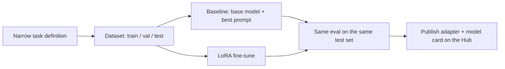
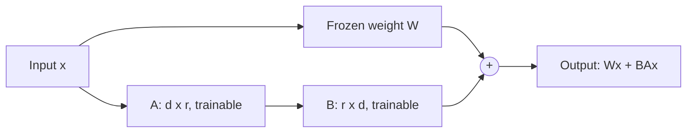

Fine-tuning is how you take a general model and make it reliably good at **one narrow job**:
classify support tickets into your categories, turn messy notes into a fixed JSON format, answer in
your company's tone. This capstone puts session 8.6.3 into practice end to end: build a dataset,
fine-tune a small open model with LoRA, prove with numbers that it got better, and publish it on the
Hugging Face Hub with an honest model card.

Analogy: a general model is a talented graduate who knows a bit of everything. Fine-tuning is a
short, focused apprenticeship on your exact task. LoRA is doing that apprenticeship with a notebook
of corrections clipped to the textbook, instead of rewriting the textbook itself.



## Dataset preparation

Fine-tuning is mostly a data project. The model can only learn what your examples show, including
their mistakes.

### Pick a task where fine-tuning makes sense

Fine-tuning is worth it when the task is **narrow and repetitive**, the output format is **strict**,
you have (or can create) **hundreds to a few thousand good examples**, and prompting a small model
is not reliable enough. If a good prompt on an API model already solves it, or the task needs fresh
facts, prefer prompting or RAG (session 9.3.3).

Good capstone tasks:

- Extract `{"date", "amount", "merchant", "category"}` from receipt text.
- Classify GitHub issues into `bug`, `feature`, `question`, `docs`.
- Rewrite technical sentences in plain English at a fixed reading level.

### Build the examples

Use the **chat format** the model was trained with: a list of messages with `role` and `content`.
Libraries apply the model's **chat template** to turn them into the exact token sequence the model
expects. The [smol-course](https://github.com/huggingface/smol-course) unit on instruction tuning
covers chat templates and supervised fine-tuning with small models.

```json
{"messages": [
  {"role": "system", "content": "Extract receipt fields as JSON."},
  {"role": "user", "content": "COOP Milano 12/03/2025 TOTALE EUR 23,40"},
  {"role": "assistant", "content": "{\"date\": \"2025-03-12\", \"amount\": 23.40, \"merchant\": \"COOP\", \"category\": \"groceries\"}"}
]}
```

Sources of examples: real data you are allowed to use, examples you write by hand, and **synthetic
data** generated by a larger model and then **checked by you**.

> [!WARNING]
> Split into train, validation and test **before** any training, and make sure near-duplicates do
> not appear in both train and test. Otherwise your "improvement" is memorisation. Keep at least 100
> test examples you never look at during development.

> [!TIP]
> Quality beats quantity. Five hundred consistent, correct examples usually beat five thousand noisy
> ones. Read a random sample of 50 before every training run.

## LoRA fine-tuning

Full fine-tuning updates every weight, which needs a lot of GPU memory. **LoRA** (Low-Rank
Adaptation) freezes the original weights and learns small low-rank matrices added to chosen layers.
Only those adapters train, often well under 1% of the parameters, so a small model can be tuned on a
single consumer GPU or a free notebook GPU. The
[Hugging Face PEFT docs](https://huggingface.co/docs/peft/index) describe LoRA and the other
parameter-efficient methods, and how adapters can be saved, loaded and merged.



A typical setup with PEFT and TRL's `SFTTrainer`:

```python
from datasets import load_dataset
from peft import LoraConfig
from trl import SFTConfig, SFTTrainer

base = "HuggingFaceTB/SmolLM2-360M-Instruct"   # any small instruct model works
data = load_dataset("json", data_files={"train": "train.jsonl", "validation": "val.jsonl"})

peft_config = LoraConfig(
    r=16, lora_alpha=32, lora_dropout=0.05,
    target_modules="all-linear", task_type="CAUSAL_LM",
)
args = SFTConfig(
    output_dir="out/receipts-lora",
    num_train_epochs=3, learning_rate=2e-4,
    per_device_train_batch_size=8, gradient_accumulation_steps=2,
    eval_strategy="steps", eval_steps=50, logging_steps=10,
    save_strategy="steps", save_steps=50, load_best_model_at_end=True,
)
trainer = SFTTrainer(model=base, args=args, train_dataset=data["train"],
                     eval_dataset=data["validation"], peft_config=peft_config)
trainer.train()
trainer.save_model("out/receipts-lora/best")
```

The settings that matter most:

| Setting | What it does | Starting point |
| --- | --- | --- |
| `r` (rank) | Size of the adapter matrices; more capacity, more memory | 8–32 |
| `lora_alpha` | Scales the adapter's contribution | Often 2 × `r` |
| `target_modules` | Which layers get adapters | Attention projections or all linear layers |
| Learning rate | Higher than full fine-tuning, because few weights train | 1e-4 to 3e-4 |
| Epochs | Passes over the data | 1–3; watch validation loss |

> [!NOTE]
> **QLoRA** loads the frozen base model in 4-bit precision and trains LoRA adapters on top, cutting
> memory further. Use it when the model does not fit otherwise; for a model of a few hundred million
> parameters, plain LoRA is simpler.

> [!WARNING]
> Watch validation loss. If it starts rising while training loss falls, you are overfitting; stop
> at the best checkpoint. Also check that the model still behaves sensibly on inputs outside your
> task: aggressive fine-tuning can damage general abilities.

## Before/after evaluation

"It seems better" is not a result. You need the **same test set**, the **same metric** and the
**same generation settings** for the base model and the fine-tuned one.

Choose metrics that match the task:

- **Classification**: accuracy and macro F1, plus a confusion matrix.
- **Structured extraction**: percentage of outputs that are valid JSON, and per-field exact match.
- **Free text**: a rubric scored by a stronger LLM as a judge, checked against your own scores on
  a sample (session 9.6.1).

```python
import json

def score(outputs: list[str], gold: list[dict]) -> dict:
    valid = fields = correct = 0
    for out, g in zip(outputs, gold):
        try:
            pred = json.loads(out)
            valid += 1
        except json.JSONDecodeError:
            pred = {}
        for k, v in g.items():
            fields += 1
            correct += pred.get(k) == v
    return {"valid_json": valid / len(gold), "field_accuracy": correct / fields}
```

Run three systems and put them in one table:

| System | Valid JSON | Field accuracy | Latency per item |
| --- | --- | --- | --- |
| Base model, zero-shot prompt | | | |
| Base model, few-shot prompt | | | |
| Fine-tuned with LoRA | | | |

> [!TIP]
> Always include a strong **prompt-only baseline**. If few-shot prompting gets 90% of the way, the
> fine-tune must justify its extra complexity. That comparison is exactly what a senior reviewer
> will ask about.

> [!EXAMPLE]
> Error analysis after the run: list the 20 test items the fine-tuned model got wrong. Group them
> ("dates in US format", "multiple totals on one receipt"). Each group is either a data fix (add
> examples) or a documented limitation in the model card.

## Publish on the Hugging Face Hub

Publishing makes your work reusable and visible. You can push only the **adapter** (a few
megabytes, loaded on top of the base model) or a **merged** model (adapter folded into the base
weights with `merge_and_unload()`, simpler to use but much larger).

```python
from huggingface_hub import login
login()  # token with write access, from your Hub settings

trainer.model.push_to_hub("your-username/smollm2-360m-receipts-lora")
trainer.processing_class.push_to_hub("your-username/smollm2-360m-receipts-lora")
```

Then write the **model card** (`README.md` in the repo). It should cover: base model and licence,
the task, dataset description (and a link if you publish the dataset), training settings, the
before/after table, intended use, out-of-scope uses, known limitations and failure modes, and a
short usage snippet.

> [!WARNING]
> Check licences on both sides: the base model's licence decides what you may do with derivatives,
> and your dataset must not contain personal data or text you have no right to redistribute.

### Project plan: fine-tune and publish a small model

Allow about two weeks. You need a GPU: a free notebook GPU is enough for a model of a few hundred
million parameters.

#### Step 1: Define the task and metric

Write one paragraph describing the task, the output format and the metric, plus 10 hand-written
examples that show edge cases.

#### Step 2: Build the dataset

Create 500–2,000 examples in chat format, split 80/10/10, deduplicate across splits, and read 50
random examples to check quality. Save as JSONL.

#### Step 3: Baselines

Evaluate the base model zero-shot and few-shot on the test set with fixed generation settings
(greedy decoding, fixed max tokens). Record the table.

#### Step 4: Fine-tune

Train with LoRA, tracking training and validation loss. Keep the best checkpoint. Try one variation
(rank or epochs) and compare on the validation set only.

#### Step 5: Evaluate and publish

Evaluate the chosen checkpoint once on the test set, do the error analysis, push the adapter to the
Hub, and write the model card. Link the Hub page and the training repository from your portfolio.

> [!EXAMPLE]
> Definition of done: a reproducible training script and config, a before/after table with three
> systems on the same test set, a published adapter on the Hub, and a model card that states where
> the model fails.
