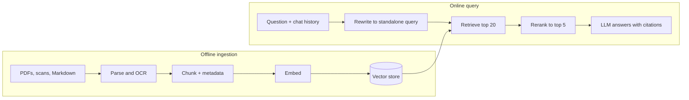
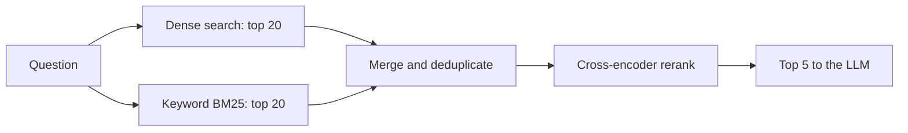
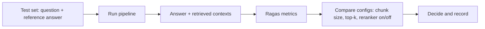

This capstone builds the AI project most companies ask about first: a chatbot that answers
questions about **your own documents**, cites where each answer came from, remembers the
conversation, and comes with numbers that show how good it is. It combines Track 9 modules 9.3 (RAG)
and 9.4 (OCR and memory).

Analogy: an open-book exam. A good student does not answer from memory alone. They find the right
pages (retrieval), pick the most relevant paragraphs (reranking), write an answer with page
references (citations), and remember what the examiner asked a minute ago (memory). The examiner then
grades both the answer and the pages chosen (evaluation).



## Ingestion with OCR

Choose a document collection you know well, so you can judge answers: your course notes, a
product's manuals, your city's public regulations, or a set of papers. Include at least some
**scanned PDFs or images**, because real collections always contain them.

### Parse, and OCR only when needed

A digital PDF already contains text; extracting it is fast and accurate. A scanned PDF is just
pictures of pages, so you need **OCR** (optical character recognition, session 9.4.1). A practical
rule: try text extraction first, and if a page yields almost no text, render it to an image and OCR
it with a tool such as Tesseract, or use a multimodal model for complex layouts like tables.

```python
def page_text(page) -> str:
    text = page.extract_text() or ""
    if len(text.strip()) < 50:          # probably a scanned page
        image = render_page_to_image(page, dpi=300)
        text = ocr(image)               # e.g. Tesseract via pytesseract
    return text
```

> [!TIP]
> OCR quality depends heavily on the image. Render at around 300 DPI, convert to grayscale, and
> deskew if pages are tilted. Spot-check ten OCR'd pages by eye before indexing thousands.

### Chunk with metadata

Split text into chunks of a few hundred tokens with some overlap, preferably along natural
boundaries (headings, paragraphs). Every chunk keeps **metadata**: source file, page number,
section heading, and whether it came from OCR. That metadata is what makes citations possible later.

The [LlamaIndex docs](https://developers.llamaindex.ai/python/framework/) describe this pipeline with
readers that load files into documents, node parsers that split them into chunks (called nodes) with
metadata, and indexes that embed and store them.

```python
from llama_index.core import SimpleDirectoryReader, VectorStoreIndex
from llama_index.core.node_parser import SentenceSplitter

docs = SimpleDirectoryReader("data/", recursive=True).load_data()
index = VectorStoreIndex.from_documents(
    docs, transformations=[SentenceSplitter(chunk_size=512, chunk_overlap=64)]
)
index.storage_context.persist("storage/")
```

> [!WARNING]
> Make ingestion **idempotent**: store a content hash per file and skip unchanged files, and delete
> a file's old chunks before re-adding it. Otherwise re-running ingestion duplicates chunks and
> retrieval fills up with copies. This platform's own `rag.py` skips pages whose content hash has not
> changed for exactly this reason.

## Retrieval with reranking

First-stage retrieval with embeddings is fast but approximate: it finds chunks that are _about the
same topic_, not necessarily the ones that _answer the question_. A **reranker** fixes that. It is a
cross-encoder model that reads the question and each candidate chunk together and scores how well
the chunk answers it. It is too slow to run over the whole collection, but perfect for reordering
the top 20 or 50 candidates.



Two improvements from session 9.3.4 usually pay off:

- **Hybrid search**: combine dense embeddings with keyword search (BM25). Keywords catch exact
  terms like product codes, names and error messages that embeddings blur.
- **Query rewriting**: in a conversation, "and what about the second one?" is useless as a search
  query. Ask the LLM to rewrite it into a standalone question using the chat history before
  retrieving.

```python
from llama_index.core.postprocessor import SentenceTransformerRerank

reranker = SentenceTransformerRerank(model="cross-encoder/ms-marco-MiniLM-L-6-v2", top_n=5)
query_engine = index.as_query_engine(similarity_top_k=20, node_postprocessors=[reranker])
```

> [!NOTE]
> Measure retrieval separately from generation. If the right chunk is not in the top 5, no prompt
> can save the answer. A small labelled set of question-to-correct-chunk pairs lets you compute
> hit rate and MRR (mean reciprocal rank) for each retrieval setting.

## Cited answers and memory

### Citations

Users trust an answer they can check. Number the retrieved chunks in the prompt, instruct the model
to cite them, and render citations as links to the source and page:

```text
Answer the question using only the numbered sources below.
After each claim, cite its source like [2]. If the sources do not contain the answer,
say "I could not find this in your documents."

[1] (handbook.pdf, p. 4) Employees accrue 2.08 days of leave per month...
[2] (policy-2024.pdf, p. 12) Unused leave expires on 30 June of the following year...

Question: When does my unused leave expire?
```

Then **validate** the output: every cited number must exist, and you can flag answers with no
citations. LlamaIndex also offers a citation query engine that splits sources into numbered chunks
for you.

> [!WARNING]
> Retrieved documents are **untrusted input**. A document can contain text like "ignore previous
> instructions". Keep instructions in the system prompt, delimit sources clearly, and never let the
> model trigger actions based on document content alone (session 9.6.5).

### Memory

Conversation memory (session 9.4.3) comes in layers:

| Layer | What it holds | How |
| --- | --- | --- |
| Short-term | The last few turns | Keep recent messages up to a token budget |
| Summary | Older parts of the conversation | Periodically summarise and replace old turns |
| Long-term | Stable user facts and preferences | Store explicitly, with the user able to see and delete them |

In LlamaIndex, a chat engine in "condense plus context" mode does the query rewriting and
short-term memory for you:

```python
from llama_index.core.memory import ChatMemoryBuffer

chat = index.as_chat_engine(
    chat_mode="condense_plus_context",
    memory=ChatMemoryBuffer.from_defaults(token_limit=3000),
    node_postprocessors=[reranker],
)
print(chat.chat("When does unused leave expire?"))
print(chat.chat("And can I carry it over?"))   # rewritten using the history
```

> [!TIP]
> Show the retrieved sources in the UI next to each answer, even uncited ones. When an answer is
> wrong, the first debugging question is always "what did it retrieve?".

## Evaluation with Ragas

[Ragas](https://docs.ragas.io/) is a library for evaluating RAG pipelines. Its RAG metrics separate
the two halves of the system, so you know which half to fix:

| Metric | Question it answers | Half |
| --- | --- | --- |
| Context precision | Are the retrieved chunks relevant, and ranked high? | Retrieval |
| Context recall | Did retrieval find everything the reference answer needs? | Retrieval |
| Faithfulness | Is every claim in the answer supported by the retrieved context? | Generation |
| Response relevancy | Does the answer actually address the question? | Generation |

Most of these use an LLM as a judge, so treat scores as estimates: check a sample by hand, and
compare configurations on the **same** dataset rather than reading absolute numbers.



Build a test set of 30–100 questions: write some by hand from real needs, generate others from your
documents with an LLM (Ragas includes test-set generation), and review all of them. Include
questions that **cannot** be answered from the documents, to test that the bot says so.

> [!NOTE]
> The Ragas API has changed between versions (sample and dataset classes, metric class names). Use
> the quickstart for the version you install rather than copying old blog code.

> [!EXAMPLE]
> An experiment table you can put in your README:
>
> | Config | Context precision | Context recall | Faithfulness | Latency p50 |
> | --- | --- | --- | --- | --- |
> | Dense top 5 | 0.61 | 0.70 | 0.84 | 1.9 s |
> | Dense top 20 + rerank top 5 | 0.78 | 0.81 | 0.90 | 2.4 s |
> | Hybrid + rerank | 0.82 | 0.86 | 0.91 | 2.6 s |
>
> (Illustrative numbers: yours will differ.)

### Project plan: build and evaluate your document chatbot

Allow two to three weeks.

#### Step 1: Collect and ingest

Gather 50–500 documents including some scans. Write an ingestion script with text extraction, OCR
fallback, chunking with metadata and content-hash skipping. Spot-check OCR output.

#### Step 2: Retrieval

Start with dense retrieval, then add hybrid search and a reranker. Build 20 question-to-chunk pairs
and measure hit rate at 5 for each setup.

#### Step 3: Answers, citations and memory

Write the prompt with numbered sources, validate citations, add a condense-plus-context chat
engine, and expose it through a FastAPI endpoint or a simple Gradio chat UI.

#### Step 4: Evaluate

Create a test set of at least 30 questions including unanswerable ones. Run Ragas on three
configurations and record the table. Read the five lowest-faithfulness answers and note why they
failed.

#### Step 5: Write up

README with the architecture diagram, how to ingest your own files, the experiment table, a GIF of a
cited conversation, and known limitations.

> [!EXAMPLE]
> Definition of done: one command ingests a folder idempotently; every answer shows clickable
> sources with page numbers; follow-up questions work; unanswerable questions get a polite refusal;
> the README shows Ragas results for at least three configurations.
