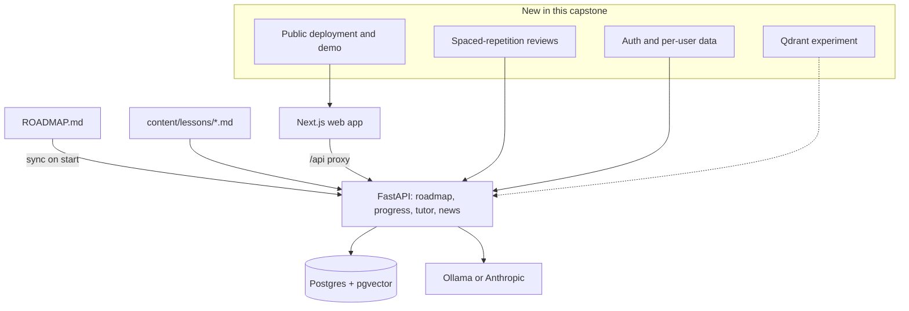
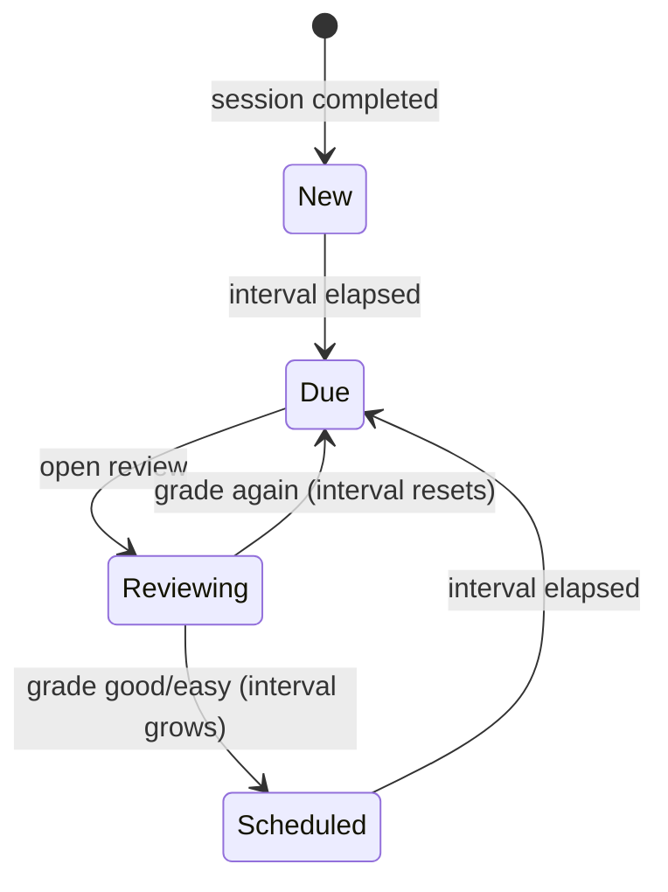
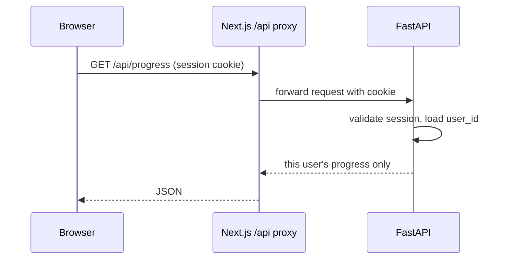

Every other capstone is a fresh repository. This one is the platform you are using right now.
YouCanDoIt already has a curriculum parser, gamified progress, a RAG tutor and lessons. Growing it
into a multi-user, publicly deployed product with real learning science behind it is the single best
portfolio piece you can show, because it is large, it is yours, and it is **used daily by at least
one real user**: you.

Analogy: the other capstones are model ships built to show a technique. This one is the boat you
sail every day. Improving it means working the way senior engineers do: with existing code,
existing data, existing users, and the constraint of not breaking any of them.



Before you start, re-read `CLAUDE.md` and `README.md`. The architecture notes there describe the
rules this codebase lives by: `ROADMAP.md` is the single source of truth for curriculum data,
gamification is derived from the completions table rather than stored, and lessons are validated
against the roadmap by `tests/test_lessons.py`.

## Full lessons with diagrams and quizzes

Lessons live in `content/lessons/<session id>.md`. The API returns them with the session, the web
app renders them (callouts and Mermaid diagrams via `components/lesson.tsx`), and `index-sources`
indexes them into RAG so the tutor can cite them. The format contract is
`content/lessons/README.md`, and the test enforces it: one `##` heading per subchapter bullet, in
order, no H1, no empty Mermaid blocks.

Your job here is to finish and raise the quality of the content:

- **Coverage**: every session has a lesson, and the test passes for all of them.
- **Accuracy**: claims link to the session's sources; nothing is invented.
- **Consistency**: same tone and depth as the pilot lesson `0.1.1.md`.

### Quizzes: design before you build

The platform once had a quiz feature that was removed. That is useful history: before rebuilding
it, write down why. A senior approach is a short design doc (session 2.4.2) answering:

1. **Where do questions live?** Options: a separate file per session (`content/quizzes/<id>.yaml`)
   validated by its own test, or generated on demand by the LLM from the lesson text.
2. **What is checked?** Multiple choice can be graded exactly; open answers need an LLM judge,
   which needs evals (11.1.11).
3. **How does it feed the rest?** A quiz result is exactly the signal spaced repetition needs (next
   section), so design both together.

> [!TIP]
> Prefer **retrieval-style questions** ("explain in two sentences why...") over recognition-style
> multiple choice. Session 0.1.1 explains why: producing an answer strengthens memory far more than
> recognising one.

> [!WARNING]
> Remember the coupling: changing a subchapter bullet in `ROADMAP.md` changes the expected lesson
> headings, and inserting or reordering bullets shifts subchapter ids, which changes which items
> count as done. Append new bullets; do not reorder.

## Spaced-repetition reviews

Session 0.1.1 introduced spaced repetition: review just as you are about to forget, at growing
intervals. Building it into the platform turns "I completed this session" into "I still remember
this session".

### Model

Keep the platform's principle: **store events, derive state**. Add an append-only `reviews` table
(subchapter or session id, timestamp, grade such as again/hard/good/easy) and compute each item's
next due date as a pure function of its review history, just as `app/gamification.py` derives XP and
streaks from completions.

```python
from datetime import datetime, timedelta

def next_due(reviews: list[tuple[datetime, str]]) -> datetime:
    """Simplified SM-2 style scheduler. reviews are (when, grade) in time order."""
    interval, ease = 1.0, 2.5
    for _, grade in reviews:
        if grade == "again":
            interval, ease = 1.0, max(1.3, ease - 0.2)
        else:
            ease += {"hard": -0.15, "good": 0.0, "easy": 0.15}[grade]
            interval = interval * ease if interval > 1 else 3.0
    last = reviews[-1][0]
    return last + timedelta(days=round(interval))
```

The first review is created when a session is completed, so the schedule starts automatically.
Well-known algorithms to research and compare are SM-2 (the classic behind early Anki) and FSRS
(a more recent, data-driven scheduler).



### Features

- A **Today** view: items due, with a review prompt per item (the tutor can ask one question from
  the lesson, then you grade yourself).
- Review activity counts toward streaks and XP, derived in `gamification.py`.
- Pure-function tests for the scheduler with fixed dates, plus an API test and a Playwright e2e test
  for the review flow.

> [!NOTE]
> Because the scheduler is a pure function of events, you can change the algorithm later and every
> user's schedule is recomputed consistently. Storing "next due date" directly would freeze old
> decisions into the data.

## Optional: port RAG from pgvector to Qdrant and compare speed, filtering and setup

Today `app/rag.py` stores chunks with 768-dimension embeddings in PostgreSQL via pgvector with an
HNSW index, and `retrieve()` filters by document kind or session id in SQL. Qdrant is a dedicated
vector database with its own server, collections and **payload** filtering (see the
[Qdrant docs](https://qdrant.tech/documentation/)). This optional task is a small, honest
engineering comparison, the kind of decision record (ADR) seniors write.

Keep the experiment clean:

1. **Same interface**: put retrieval behind a small protocol (`index_chunks`, `search(query, k,
   filters)`), with a pgvector and a Qdrant implementation, chosen by config.
2. **Same data and queries**: index the same chunks, run the same 50+ queries with the same filters.
3. **Same quality metric**: check the top-k overlap between the two, and hit rate on a few
   labelled queries, so you compare speed at equal quality.

```python
from qdrant_client import QdrantClient, models

client = QdrantClient(url="http://qdrant:6333")
client.create_collection("chunks", vectors_config=models.VectorParams(size=768, distance=models.Distance.COSINE))
client.create_payload_index("chunks", field_name="session_id", field_schema="keyword")

hits = client.query_points(
    "chunks", query=query_vector, limit=6,
    query_filter=models.Filter(must=[models.FieldCondition(key="session_id", match=models.MatchValue(value="9.3.3"))]),
).points
```

| Dimension | What to measure |
| --- | --- |
| Speed | p50 and p95 search latency, with and without filters; indexing time |
| Filtering | Does a selective filter still return k results? (With approximate indexes, filtering after the index scan can return fewer; pgvector 0.8 added iterative index scans to address this, and Qdrant builds filtering into the search.) |
| Setup and operations | Extra container, backups, migrations, transactions with relational data, memory use |

> [!EXAMPLE]
> A likely conclusion for a single-user platform with a few thousand chunks: both are fast enough,
> and keeping vectors in Postgres wins on simplicity (one database, one backup, joins with
> documents). Qdrant becomes attractive with many millions of vectors or heavy filtered search. Your
> numbers decide; write them in an ADR either way.

## Auth, multi-user and public deployment

The current app is single-user: the `completions` table's primary key is just the subchapter id,
and favourites are a column on `articles`. Multi-user means every piece of personal state gets an
owner.

### Data changes (with Alembic)

- `users` table; `completions` keyed by `(user_id, subchapter_id)`; a `favorites` join table
  instead of `articles.favorite_at`; `reviews` with `user_id`.
- A migration that assigns existing rows to your account, so your progress survives.
- Gamification functions take a user's completions, so they stay pure.

### Authentication

Use an established approach rather than rolling your own (Track 6): email and password with Argon2
plus TOTP 2FA or passkeys, or OAuth/OIDC sign-in with a provider. Because the browser only talks to
Next.js and the `/api/*` proxy forwards requests, a session cookie set on the web domain can be
forwarded to FastAPI, which validates it on every request. Add authorisation tests: user A must never
see user B's progress, reviews or favourites.



### Public deployment

The backlog suggests a free stack: Vercel for the web app, Render for the API, Neon for Postgres.
Points to decide and document:

- **LLM**: a hosted Ollama is expensive; use the Anthropic provider with a spending cap and per-user
  rate limits, or keep the tutor off in the public demo.
- **Embeddings** are always Ollama in this codebase today, so a public deployment needs either an
  Ollama host or a new hosted `Embedder` implementation behind the existing protocol.
- **Scheduler**: APScheduler jobs run inside the API process; on platforms that sleep idle services,
  move them to a cron trigger.
- **Security**: run the threat model from session 6.1.1 again now that the app is public.

> [!WARNING]
> Never publish with the default `ycdi` database password or with the database port exposed. Both
> are fine for a laptop and unacceptable on the internet.

## Architecture write-up and demo video

The last step turns the work into something a hiring manager can absorb in ten minutes.

**Write-up** (README section or blog post):

1. What it is and who it is for, with a screenshot.
2. Architecture diagram (C4 container level): web, API, database, LLM providers, scheduler.
3. Key decisions as short ADRs: roadmap file as source of truth, derived gamification, pgvector
   versus Qdrant, the auth approach, the spaced-repetition algorithm.
4. Quality: test pyramid (pytest, lesson contract test, Playwright e2e), CI pipeline.
5. Operations: deployment, cost per month, what you monitor.
6. What you would do next.

**Demo video** (3–5 minutes): show a real learning flow, not a feature list. Sign in, open a
session, read a lesson with a diagram, ask the tutor a question and show the citations, complete
the session, do a due review, show the streak. End with thirty seconds on the architecture diagram.

> [!TIP]
> Script the video, seed a demo account with realistic progress, record in short takes, and add
> captions. A tight three-minute video beats a rambling fifteen-minute one.

### Project plan: grow YouCanDoIt

This is a long project; work in small, shippable pull requests and keep `main` green.

#### Step 1: Lessons

Fill missing lessons, run `pytest tests/test_lessons.py`, and write the quiz design doc.

#### Step 2: Spaced repetition

Add the `reviews` table via Alembic, the pure scheduler with tests, the API, the Today view and an
e2e test.

#### Step 3: Optional Qdrant comparison

Add the retrieval protocol, a Qdrant implementation and service, run the benchmark, write the ADR.

#### Step 4: Multi-user and deployment

Add users and ownership with a data-preserving migration, authentication, authorisation tests, then
deploy publicly with spending caps and a refreshed threat model.

#### Step 5: Tell the story

Write the architecture write-up, record the demo video, and pin the repository on your profile.

> [!EXAMPLE]
> Definition of done: every session has a valid lesson; reviews are scheduled and counted in your
> streak; two users cannot see each other's data; the app is reachable at a public URL with a demo
> account; the README has the diagram, ADRs and a link to the video.
