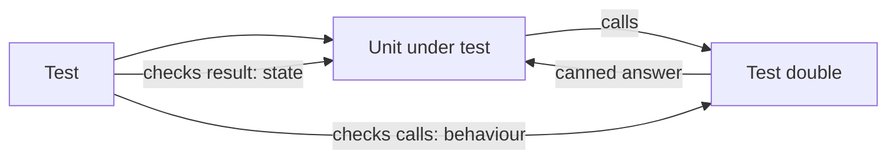
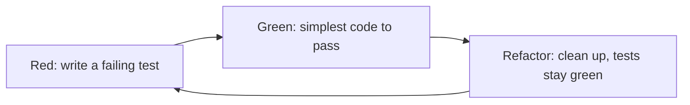

Real code doesn't live alone. It sends emails, calls payment providers, reads the clock and talks
to databases. If every unit test had to send a real email, your suite would be slow, flaky and
would spam people. This session shows you how to replace those collaborators with stand-ins
(test doubles), and how writing the test *first* (test-driven development) can shape better
designs.

## Stubs, mocks, fakes and spies

In films, a stunt double replaces the actor for the dangerous scenes. A **test double** replaces a
real dependency for the duration of a test. The term comes from Gerard Meszaros, and Martin Fowler's
article [Mocks Aren't Stubs](https://martinfowler.com/articles/mocksArentStubs.html) explains the
different kinds clearly. They are often all loosely called "mocks", but the distinctions help you
choose the right one.

| Double | What it does | Example |
|---|---|---|
| **Dummy** | Passed around but never used; fills a parameter | `None` or an empty object for an unused logger |
| **Stub** | Returns canned answers to calls | An exchange-rate service that always returns 1.1 |
| **Fake** | A working, simplified implementation | An in-memory repository backed by a dict |
| **Spy** | A stub that also records how it was called | An email sender that stores sent messages in a list |
| **Mock** | Pre-programmed with *expectations*, and fails if they aren't met | "`charge` must be called once with 20 EUR" |

The deepest difference is *what the test checks*:

- **State verification:** you run the code, then check the resulting state ("the order's status is
  `PAID`", "the fake repository now contains one user"). Stubs and fakes support this style.
- **Behaviour verification:** you check that the code *talked to* its collaborators in the right way
  ("the payment gateway was called with these arguments"). Mocks and spies support this style.



> [!NOTE]
> Fowler describes two schools. **Classicists** use real objects where possible and doubles only
> for awkward collaborators (network, clock, email), preferring state verification. **Mockists**
> mock every collaborator and verify interactions. Most teams sit somewhere in between; the
> article is worth reading to understand the trade-off.

> [!WARNING]
> Over-mocking ties tests to *how* code works instead of *what* it does. If every refactoring
> breaks twenty tests because they assert exact internal calls, the tests are slowing you down
> instead of protecting you. Mock at the boundaries of your system (external services, time,
> randomness), not between every pair of your own classes.

## unittest.mock and monkeypatch

Python gives you two everyday tools for doubles.

### unittest.mock

`unittest.mock` is in the standard library. A `Mock` (or `MagicMock`) object accepts any call,
returns configurable values, and records everything that happened to it, so it can act as a stub,
spy or mock.

```python
from unittest.mock import Mock

def test_checkout_charges_the_total():
    gateway = Mock()
    gateway.charge.return_value = {"status": "ok"}      # stub behaviour

    checkout(cart_total=20, gateway=gateway)

    gateway.charge.assert_called_once_with(amount=20, currency="EUR")  # mock-style check
```

Notice that `checkout` receives the gateway as a parameter. This is **dependency injection**:
passing collaborators in instead of creating them inside. It is the single biggest thing you can
do to make code testable, because swapping in a double becomes trivial.

When you can't inject (the code imports something directly), `unittest.mock.patch` temporarily
replaces a name where it is *looked up*:

```python
from unittest.mock import patch

@patch("shop.checkout.send_email")
def test_checkout_sends_receipt(send_email):
    checkout(cart_total=20, gateway=Mock())
    send_email.assert_called_once()
```

> [!TIP]
> Use `Mock(spec=RealClass)` or `create_autospec`. Without a spec, a typo like
> `gateway.chrage(...)` silently succeeds on a plain `Mock`. With a spec, calling a method the real
> class doesn't have raises an error.

### monkeypatch

pytest's built-in `monkeypatch` fixture changes attributes, environment variables or dictionary
entries for one test and restores them automatically afterwards. It is the tidy way to fake
configuration or swap a function. The [pytest docs](https://docs.pytest.org/en/stable/) cover it
under "How to monkeypatch/mock modules and environments".

```python
def test_uses_api_key_from_env(monkeypatch):
    monkeypatch.setenv("PAYMENT_API_KEY", "test-key")
    assert load_config().api_key == "test-key"

def test_greeting_in_the_morning(monkeypatch):
    monkeypatch.setattr("app.greetings.current_hour", lambda: 9)
    assert greeting() == "Good morning"
```

A hand-written **fake** is often clearer than either:

```python
class FakeEmailSender:
    def __init__(self):
        self.sent = []

    def send(self, to, subject, body):
        self.sent.append((to, subject))
```

It reads like real code, needs no mocking library, and tests can assert on `sender.sent`.

## The red–green–refactor cycle

**Test-driven development (TDD)** flips the usual order: you write a failing test *before* the
code that makes it pass. It is like writing the exam question before studying: it forces you to be
precise about what "done" means.

The cycle has three short steps, repeated every few minutes:

1. **Red:** write a small test for the next bit of behaviour. Run it and watch it fail (this
   proves the test can fail and that the behaviour is really missing).
2. **Green:** write the *simplest* code that makes it pass, even if it's naive.
3. **Refactor:** clean up names, remove duplication, improve structure, with the tests keeping
   you safe (Session 2.1.2).



> [!EXAMPLE]
> Building a `slugify` function test-first:
>
> 1. Red: `assert slugify("Hello") == "hello"` fails (function doesn't exist).
> 2. Green: `return text.lower()`.
> 3. Red: `assert slugify("Hello World") == "hello-world"` fails.
> 4. Green: `return text.lower().replace(" ", "-")`.
> 5. Red: `assert slugify("  Hi!  ") == "hi"` fails.
> 6. Green: strip whitespace and remove punctuation.
> 7. Refactor: extract the punctuation rule into a named regex constant.
>
> Each step is tiny, and at every point you have working, tested code.

The discipline of "simplest code to pass" feels silly at first (why return a hard-coded value?),
but it keeps you from writing code no test demands, and the next test forces the real
generalisation.

## When TDD helps and when it doesn't

TDD is a tool, not a religion. It shines in some situations and gets in the way in others.

**TDD helps most when:**

- The behaviour is **clear but the implementation isn't**: parsers, calculations, validation rules,
  state machines, data-structure operations.
- You're **fixing a bug**: first write a test that reproduces it (red), then fix it (green). The
  bug can never silently return.
- You want **design pressure**: writing the call before the implementation pushes you towards
  small functions with simple inputs and injected dependencies.

**TDD helps less when:**

- You're **exploring**: spiking a new library, prototyping UI, or figuring out whether an idea
  works at all. Write throwaway code, learn, then rebuild it test-first if it stays.
- The thing is **mostly glue or visuals**: layout and styling are better checked by eye and by
  end-to-end or visual tests.
- The requirements are **unknown**: you can't write a precise test for a behaviour nobody has
  decided yet.

> [!WARNING]
> "I'll add tests later" usually means never. Even when you don't use strict TDD, write the tests
> in the same pull request as the code. Reviewers should treat missing tests as a reason to ask
> for changes.

## Practice: build a small feature test-first

Build a **shopping-cart discount** feature using strict red–green–refactor. Rules:

- A cart holds items with a price and a quantity.
- Total is the sum of price × quantity.
- A discount code `WELCOME10` takes 10% off orders of 50 EUR or more.
- Unknown codes raise `InvalidCode`.
- An order confirmation is sent through an injected `notifier` with the final total.

### Step 1: Start from an empty file

Create `cart.py` (empty) and `test_cart.py`. Write the first test: an empty cart totals 0. Run it,
see red, make it green.

### Step 2: One rule at a time

Add one test per rule, in the order above. Keep each green step minimal. After each green, look
for something to refactor (names, duplicated arithmetic) before writing the next test.

### Step 3: Test the edges

Add tests for an order of exactly 50 EUR (boundary), 49.99 EUR (just below), and an unknown code
raising `InvalidCode` via `pytest.raises`.

### Step 4: Introduce a double

For the confirmation, write a `FakeNotifier` that records messages. Inject it into `checkout()`
and assert on the recorded total (state verification). Then rewrite the same test with a `Mock`
and `assert_called_once_with` (behaviour verification) and compare which one reads better.

### Step 5: Reflect

Look at your git log: you should have a commit per green-and-refactored step. Note one place where
writing the test first changed the design you would otherwise have chosen.
