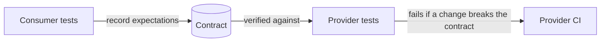

Unit tests check that each brick is solid. But a wall can still fall down if the bricks don't fit
together: your SQL might be valid in your head but not in PostgreSQL, the API might return
`userId` while the front end reads `user_id`, and the "Save" button might be hidden behind a
dialog. This session covers the tests that check pieces *together*: integration tests against
real infrastructure, contract tests between services, and end-to-end tests that drive a real
browser with Playwright.

## Integration tests with real databases (containers)

An **integration test** checks that your code works with something outside it that you don't
control in the same way: a database, a message queue, the file system, another module. Martin
Fowler's [Practical Test Pyramid](https://martinfowler.com/articles/practical-test-pyramid.html)
recommends testing each such integration point separately, with the real thing where possible.

Why not just fake the database, as in Session 2.2.2? Because the bugs you are hunting live in the
*interaction*: a migration that forgot a column, a query that behaves differently in PostgreSQL
than in SQLite, a unique constraint your code doesn't handle, a JSON column that returns strings
instead of dicts. A fake can't reproduce those, by definition.

The analogy: you can test a car's engine on a bench (unit test), but you also need to check it
actually bolts into *this* chassis and turns *these* wheels.

**Containers** make real databases practical for tests. Docker can start a throwaway PostgreSQL
in seconds, identical to the one in production, and libraries such as Testcontainers (available
for Python, Java, Go, Node and more) start and stop those containers from inside the test run.
This project uses a simpler approach: Docker Compose runs a `db` container, and the API tests
point at a dedicated `ycdi_test` database.

```python
@pytest.fixture
def db_session(engine):
    connection = engine.connect()
    transaction = connection.begin()
    session = Session(bind=connection)
    yield session
    session.close()
    transaction.rollback()   # every test leaves the database exactly as it found it
    connection.close()

def test_saving_duplicate_email_is_rejected(db_session):
    repo = UserRepository(db_session)
    repo.add(User(email="a@example.com"))
    with pytest.raises(DuplicateEmail):
        repo.add(User(email="a@example.com"))
```

> [!TIP]
> Wrapping each test in a transaction that is rolled back at the end keeps tests isolated and
> fast: no need to drop and recreate tables between tests. Run migrations once per test session,
> not once per test.

> [!WARNING]
> Integration tests that share data are a classic source of "passes alone, fails in the suite".
> Each test should create the data it needs and must not rely on rows created by another test or
> on the order tests run in.

## Contract tests for APIs

Imagine a front-end team and a back-end team, or two microservices. Each has thorough tests, both
suites are green, and production still breaks, because the provider renamed a field the consumer
relied on. Each side tested *its own assumptions* about the other.

A **contract test** makes those assumptions explicit and checks them on both sides. The contract
is the agreed shape of requests and responses ("`GET /users/42` returns `{id, email, name}`").



There are two common styles:

- **Consumer-driven contracts:** the consumer writes down what it actually uses; the provider's
  CI replays those expectations and fails if a change would break any consumer. Tools such as
  Pact implement this. The Test Pyramid article describes this approach in detail.
- **Schema-based contracts:** the provider publishes a schema (OpenAPI, JSON Schema, protobuf)
  and both sides generate or validate code against it.

This repository uses the schema approach: FastAPI's Pydantic models produce an OpenAPI schema,
`npm run gen:api` turns it into TypeScript types, and `npm run typecheck` fails if the web app
uses a field the API no longer returns. That is a lightweight contract test running on every CI
build.

> [!NOTE]
> Contract tests check *shape and meaning of the interface*, not business logic. "The response has
> an integer `xp` field" is a contract; "XP is computed correctly" is a unit test on the provider.

## End-to-end testing with Playwright

An **end-to-end (E2E) test** drives the whole system the way a user would: a real browser clicks
real buttons in the real front end, which calls the real API, which writes to a real database. It
is the most realistic test you can write, and also the slowest and most fragile, so you write
*few* of them, for the journeys that matter most (sign up, check out, complete a session).

[Playwright](https://playwright.dev/docs/intro) is a modern E2E framework from Microsoft. It drives
Chromium, Firefox and WebKit, and has three features that make tests more reliable than older
tools:

- **Auto-waiting.** Before clicking, Playwright waits until the element is attached, visible,
  stable and enabled. No more `sleep(2)`.
- **User-facing locators.** You find elements the way a user does: by role, label or text, e.g.
  `getByRole('button', { name: 'Save' })`. This also nudges you towards accessible markup.
- **Web-first assertions.** `await expect(locator).toBeVisible()` retries until the condition is
  true or a timeout expires, instead of checking once.

```ts
import { test, expect } from '@playwright/test';

test('ticking a subchapter awards XP', async ({ page }) => {
  await page.goto('/session/0.1.1');
  const xp = page.getByTestId('xp-total');
  const before = parseInt((await xp.textContent()) ?? '0');

  const box = page.getByTestId('sub-0.1.1.1');
  await box.click();
  await expect(box).toBeChecked();
  await expect(xp).toContainText(`${before + 10} XP`);
});
```

This is a trimmed version of `apps/web/e2e/progress.spec.ts` in this repository. It uses test ids
for elements that have no stable accessible name, which is a reasonable fallback.

Run it with `npx playwright test`. When something fails, the **trace viewer** lets you step
through every action with screenshots, DOM snapshots and network calls, and `npx playwright
codegen` records your clicks into a starting script.

> [!EXAMPLE]
> This project's `scripts/e2e.sh` shows a complete E2E setup: it creates an isolated `ycdi_e2e`
> database, switches the LLM to a deterministic fake, seeds known data, then runs the Playwright
> specs in `apps/web/e2e/`. Every part of the system is real except the one thing that is
> non-deterministic by nature.

## Flaky tests: causes and cures

A **flaky test** passes sometimes and fails sometimes with no code change. Flaky tests are worse
than no tests: people learn to hit "re-run" and ignore red builds, and then a real failure slips
through. Treat a flaky test like a smoke alarm that goes off randomly: fix it or remove it, never
just get used to it.

| Cause | Symptom | Cure |
|---|---|---|
| **Timing / races** | Fails on slow CI machines | Wait for a condition (web-first assertions), never fixed sleeps |
| **Shared state** | Fails only when run with other tests | Each test creates its own data; roll back or reset between tests |
| **Order dependence** | Fails when tests run in parallel or shuffled | Remove hidden dependencies; run tests in random order to expose them |
| **Real time and dates** | Fails at midnight or month-end | Inject or freeze the clock |
| **Randomness** | Fails one run in fifty | Seed random generators, or use deterministic fakes |
| **External services** | Fails when a third-party API is down | Stub the network at the boundary; keep live checks out of the main suite |
| **Brittle selectors** | Fails after a harmless CSS change | Use role/label/text locators or dedicated test ids |

> [!TIP]
> When you find a flaky test, first make it fail *reliably*: run it in a loop
> (`npx playwright test --repeat-each=20`, or a pytest plugin that repeats tests), run it in
> parallel, slow the machine down. A bug you can reproduce is half fixed.

> [!WARNING]
> Automatic retries hide flakiness instead of curing it. They are acceptable as a short-term
> safety net in CI, but every retried test should be tracked and fixed.

## Practice: one integration and one Playwright test for a web app

Use this project, or any small web app with a database and a UI.

### Step 1: Pick one integration point

Choose a repository or query function that talks to the database, for example "completing a
subchapter twice doesn't create two rows". Write a pytest integration test against a real
PostgreSQL (the Compose `db` service, or a Testcontainers container). Use a transaction-rollback
fixture so the test leaves no data behind.

### Step 2: Make it fail for the right reason

Temporarily remove the uniqueness check or constraint and confirm the test turns red. Restore it.

### Step 3: Pick one critical user journey

List the three journeys a user would be most upset to see broken. Pick one and write it as plain
steps: "open session page, tick a subchapter, see XP increase".

### Step 4: Write the Playwright test

```sh
npm init playwright@latest   # skip if the project already has Playwright
npx playwright codegen http://localhost:3000
```

Use codegen to get started, then clean up: replace CSS selectors with `getByRole`/`getByLabel`,
add a web-first assertion for the outcome, and give the test a behaviour-based name.

### Step 5: Hunt flakiness

Run the new test with `--repeat-each=20`. If it ever fails, open the trace
(`npx playwright show-trace`), find the cause in the table above, and fix it before committing.
