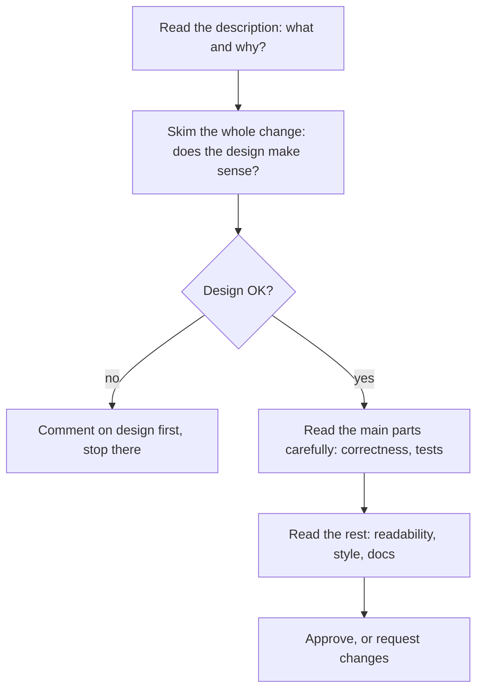
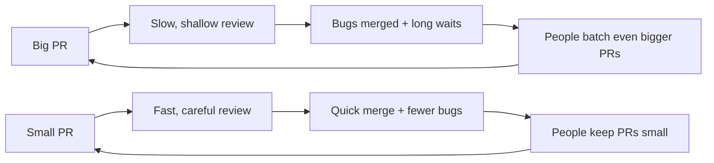

In most professional teams, no code reaches the main branch until another engineer has read it.
Code review catches bugs, but that's only part of its value: it spreads knowledge across the team,
keeps the codebase consistent, and is one of the fastest ways to learn from more experienced
people. It's also where you'll be judged, informally, as a colleague. This session covers what to
look for, how to write comments people are glad to receive, why small pull requests matter, and how
to take feedback well.

## What reviewers look for: design, correctness, tests, readability

Think of code review like an editor reading an article before publication. A good editor doesn't
just fix commas; they ask whether the argument holds, whether a paragraph belongs, and whether
readers will follow it. Commas come last.

Google publishes its internal guidance as
[Google Engineering Practices — Code Review](https://google.github.io/eng-practices/review/). Its
central rule is worth memorising: reviewers should approve a change once it **definitely improves
the overall health of the codebase**, even if it isn't perfect. There's no such thing as perfect
code, only better code. Blocking a good change over taste slows everyone down; letting a change
through that makes the codebase worse costs everyone later.

Review in roughly this order, from most to least important:

| Area | Questions to ask |
|---|---|
| **Design** | Does this change belong here? Does it fit the architecture? Is it the right time to add it? |
| **Functionality / correctness** | Does it do what the author intended, and is that good for users? Edge cases, error handling, concurrency, security? |
| **Complexity** | Could it be simpler? Is anything built "for later" that isn't needed now? |
| **Tests** | Are there tests, at the right level? Would they fail if the code broke? |
| **Readability** | Names, function size, comments that explain *why* (Session 2.1.1) |
| **Consistency and style** | Does it follow the codebase's patterns and style guide? |
| **Documentation** | Do READMEs, API docs or changelogs need updating? |

> [!TIP]
> If the design is wrong, say so *first* and stop. Twenty comments on variable names in code that
> will be rewritten waste both your time and the author's.

> [!NOTE]
> Linters and formatters should handle style automatically (Session 2.1.1). If you're leaving many
> comments about spacing or import order, the fix is a tool in CI, not more review comments.

Google's guide also asks reviewers to look at **every line** they've been asked to review, to read
changes in the **context** of the whole file, and to point out **good things** too. Telling
someone "nice, this test makes the edge case really clear" reinforces good habits and makes the
critical comments easier to hear.

## Writing helpful comments

A review comment has two audiences: the author, today, and anyone reading the history later. Good
comments are like good directions to a tourist: clear, specific, friendly, and they explain *why*
the route matters.

**Comment on the code, not the person.** "This function is hard to follow" rather than "You wrote
this confusingly". "We" and "this code" work better than "you".

**Explain why.** "Use a set here" teaches nothing. "Use a set here: we check membership in a loop,
so a list makes this O(n²) for large inputs" teaches the principle.

**Separate must-fix from optional.** Label the severity so the author knows what blocks approval.
Google's guide recommends prefixing minor points with **Nit:** ("nitpick": a small polish point
the author may ignore). Many teams also use labels such as *Optional:* or *FYI:*.

**Ask questions when you're unsure.** "What happens if `items` is empty here?" is better than
"This crashes on empty input" when you're not certain. It invites explanation instead of defence.

**Offer a direction, not a full rewrite.** Point at the problem and suggest an approach; leave the
author room to solve it. When a concrete snippet is the clearest explanation, GitHub's "suggested
changes" feature lets the author apply it with one click.

> [!EXAMPLE]
> | Unhelpful | Helpful |
> |---|---|
> | "Wrong." | "This returns `None` when the user has no completions, but the caller does `len(...)` on it. Return an empty list instead?" |
> | "Why did you do it like this??" | "I'm not sure why the retry is needed here. Is the provider flaky? A short comment would help future readers." |
> | "Rename this." | "Nit: `data` → `completions` would make the loop below easier to read." |
> | (nothing positive) | "Really nice test names, they read like a spec." |

> [!WARNING]
> Tone is easy to misread in text. A comment that feels neutral to you can feel harsh to someone
> new, nervous or working in a second language. If a thread goes back and forth more than twice,
> move to a call or a chat, then write the conclusion in the review for the record.

## Small PRs and review speed

### Small pull requests

Reviewing a 2,000-line pull request is like proofreading a novel in one sitting: attention fades,
and reviewers end up skimming and approving. Small changes get *better* reviews. Google's guide on
small changes gives the reasons: they are reviewed faster and more thoroughly, are less likely to
introduce bugs, waste less work if rejected, are easier to merge and to roll back.

What "small" means: **one self-contained change**. It does one thing, includes its tests, and
leaves the system working. As a rough feel, around a hundred lines is usually comfortable and a
thousand is usually too large, but a mechanical rename across many files can be fine while a
dense 200-line algorithm might be too much.

How to keep PRs small:

- **Separate refactoring from behaviour changes** (Session 2.1.2): one PR moves code, the next
  changes it.
- **Slice vertically** (Session 2.3.2): ship one narrow end-to-end case at a time.
- **Stack changes:** PR 2 builds on PR 1, each reviewed separately.
- **Hide unfinished work behind a feature flag** so partial features can merge safely.

### Review speed

A pull request waiting two days for review blocks its author, who starts something else, and then
has to context-switch back. Slow reviews also push people towards giant PRs ("if each review takes
days, I'll bundle everything"). Google's guidance is that one business day is the *maximum* time to
respond to a review request, and that responding quickly matters more than finishing the whole
review instantly. If you're deep in focused work, finish your current task first; then review
before starting the next thing.

## Receiving feedback without ego

The hardest part of code review for most people isn't writing comments; it's reading them about
your own work. Remember: **you are not your code**. A comment that says the code has a bug is
information about a file, not a verdict on you.

Habits that help:

- **Assume good intent.** The reviewer spent their time to make your change better. Read ambiguous
  comments in the kindest plausible way.
- **Write a clear description first.** Explain what, why, and how you tested it. Most frustrating
  review threads are really missing context.
- **Reply to every comment.** "Done", "Good catch, fixed in abc123", or a reasoned disagreement.
  Silence leaves reviewers guessing.
- **Disagree with reasons, not feelings.** "I kept the list because order matters for the UI and
  inputs are capped at 20 items" is a good reply. If you still disagree after a round, escalate to
  a short conversation, not a longer thread.
- **Turn repeated comments into learning.** If three reviewers point out missing edge-case tests,
  that's your next deliberate-practice target (Session 0.1.1).
- **Say thank you.** Especially for the comments that stung a bit and were right.

> [!TIP]
> Before requesting review, review your own diff as if someone else wrote it. You'll catch the
> leftover `print`, the commented-out code and the missing test yourself, and the reviewer can
> focus on what matters.

> [!NOTE]
> Senior engineers ask for review on their own code and receive plenty of comments. Being reviewed
> isn't a sign of being junior; resisting review is.

## Practice: review an open-source PR and write your comments

Reading real reviews is one of the best ways to learn. In this exercise you'll practise *writing*
them, without posting anything.

### Step 1: Pick a PR

Choose a project you use (a Python library, a tool, a framework) and find a recently opened, small
pull request: under about 300 changed lines, ideally with tests. Avoid trivial typo fixes.

### Step 2: Read the context

Read the linked issue and PR description. Write one sentence: what is this change for?

### Step 3: Review in order

Go through the table from the first section: design, correctness, complexity, tests, readability,
style, docs. Write your comments in a local document, each with a severity label (*must fix*,
*Nit:*, *question*, *praise*) and a *why*. Aim for 5–10 comments, including at least one positive.

### Step 4: Compare with the real review

Read the maintainers' comments on the PR (or wait until they appear). What did they catch that you
missed? What did you notice that they didn't mention? How did their tone compare with yours?

### Step 5: Reflect

Write down one thing you'll look for in every future review, and one phrasing you'll steal from the
maintainers. Only post a comment on the real PR if you find something genuinely useful and the
project welcomes outside reviews.
