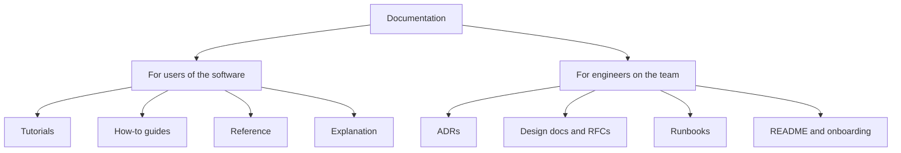
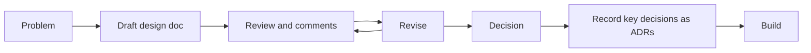

Code tells you *how* a system works. It rarely tells you *why* it works that way, how to get
started with it, or which alternatives were rejected and for what reason. That knowledge lives in
people's heads until they change team or forget, and then it's gone. Writing it down well is one of
the clearest marks of a senior engineer, because it multiplies the effectiveness of everyone around
you. This session covers the main kinds of technical documentation and how to write ones people
actually read.

## Types of documentation and their audience

Documentation is like signage in a building. Visitors need a map at the entrance, staff need the
fire-exit plan, and the maintenance crew needs the wiring diagrams. Putting the wiring diagram at
the entrance helps nobody. The first question for any document is: **who is reading it, and what
are they trying to do?**

A popular way to organise docs, used by many open-source projects and discussed widely in the
[Write the Docs](https://www.writethedocs.org/guide/) community, is the **Diátaxis** framework. It
splits user-facing documentation into four kinds, each serving a different need:

| Kind | Reader's need | Example |
|---|---|---|
| **Tutorial** | "Teach me, I'm new" | "Build your first FastAPI endpoint in 15 minutes" |
| **How-to guide** | "Help me do this specific task" | "How to add a new database migration" |
| **Reference** | "Give me the facts" | API reference, configuration options, CLI flags |
| **Explanation** | "Help me understand why" | "Why gamification is derived, not stored" |

Mixing them is the classic mistake: a tutorial that stops every paragraph to explain theory, or a
reference page written as a story. Keep each document focused on one need.

Inside engineering teams there are also **decision documents**, written for colleagues rather
than users:

- **Architecture Decision Records (ADRs):** short records of one decision and its reasons.
- **Design docs / RFCs:** longer proposals written *before* building something significant, to
  gather feedback.
- **Runbooks:** step-by-step instructions for operating the system, especially during incidents.



> [!TIP]
> Google's free [Tech Writing](https://developers.google.com/tech-writing) courses teach the
> sentence-level craft: define your audience, use short sentences, prefer active voice, put the
> key point first, and use lists and tables for anything list-like or comparable. A couple of
> hours there pays off in every PR description you write.

> [!WARNING]
> Documentation rots when it lives far from the code. Keep docs in the repository, review them in
> the same pull request as the code they describe, and delete pages that are no longer true. A
> wrong document is worse than a missing one.

## READMEs and onboarding docs

The **README** is the front door of a repository. Someone landing on it, perhaps a new teammate,
a recruiter, or you in a year, should be able to answer three questions within a minute: *What is
this? Should I care? How do I run it?*

A solid README usually contains:

1. **Name and one-line description.** What it does and for whom.
2. **Why it exists / features.** A short list, maybe a screenshot.
3. **Quick start.** The fewest commands to get it running, copy-pasteable and tested.
4. **Usage.** The most common tasks, with examples.
5. **Development.** How to run tests, lint, and where to look in the code.
6. **Links.** Deeper docs, contribution guide, licence.

```md
# YouCanDoIt

A personal, gamified learning platform: a Markdown roadmap, a FastAPI API and a Next.js app.

## Quick start
    docker compose up -d --build
    open http://localhost:3000

## Running the tests
    docker compose run --rm -v "$PWD/apps/api:/app" api pytest -q
```

**Onboarding docs** go further: everything a new teammate needs in their first week. Architecture
overview, how to get access to systems, how to deploy, who owns what, team conventions. A great
test: ask the next new joiner to follow it and fix every place they got stuck. They are the only
reader who sees it with fresh eyes.

> [!EXAMPLE]
> This repository's `CLAUDE.md` is a kind of onboarding doc for AI assistants: the commands to run,
> the architecture in a few paragraphs, and the non-obvious rules ("`ROADMAP.md` is the single
> source of truth", "gamification is derived, never stored"). The same content would help a human
> joining the project.

## Architecture Decision Records

Six months after a decision, someone asks "why on earth do we use PostgreSQL for vector search
instead of a dedicated vector database?" Nobody remembers. The original reasons may still be valid,
or the context may have changed, but without a record you can't tell. Teams then either blindly
keep the decision or blindly reverse it.

An **Architecture Decision Record (ADR)** is a short document capturing *one* architecturally
significant decision: its context, the choice made, and its consequences. Think of it as a ship's
log: brief entries, written at the time, never rewritten later. The
[ADR community site](https://adr.github.io/) collects templates and tooling; the most widely used
template comes from Michael Nygard and has just a few sections. Here is an illustrative example:

```md
# ADR 7: Derive gamification from completions instead of storing it

## Status
Accepted

## Context
XP, levels, streaks and badges must stay correct when ROADMAP.md changes or a completion is
undone. Storing totals means keeping two sources of truth in sync.

## Decision
Compute all gamification values as pure functions of the completions table on each request.

## Consequences
+ No sync bugs; rules can change and history is recomputed automatically.
+ Easy to unit-test (pure functions).
- Every request recomputes; fine for one learner, may need caching at larger scale.
```

Key practices:

- **One decision per ADR**, numbered, stored in the repo (often `docs/adr/`).
- **Immutable once accepted.** If you change your mind, write a new ADR that *supersedes* the old
  one and update the old one's status. The history of reasoning is the point.
- **Record the alternatives** you rejected and why, and the negative consequences too. An ADR with
  only upsides isn't honest, and future readers need the trade-offs.
- **Keep it short.** One or two pages at most. If it needs ten, it's a design doc.

> [!NOTE]
> "Architecturally significant" means hard or costly to change later: a database, a framework, an
> API style, a data model, a deployment platform. You don't need an ADR for a variable name.

## Design docs and RFCs

Before building something big, many teams write a **design doc** (also called a technical spec)
or an **RFC** ("request for comments"). The goal is to find problems *on paper*, where changing
your mind costs an afternoon, instead of in code, where it costs weeks. It's like an architect's
plan reviewed before the foundations are poured.

A typical design doc covers:

| Section | Purpose |
|---|---|
| **Context and goals** | The problem, who has it, what success looks like |
| **Non-goals** | What this explicitly won't do (prevents scope creep) |
| **Proposed design** | How it works: components, data model, APIs, diagrams |
| **Alternatives considered** | Other options and why they lost |
| **Risks and open questions** | What could go wrong, what's still undecided |
| **Rollout and testing** | How it will be shipped, migrated and verified |

The **RFC** process adds a formal comment period: the doc is shared widely, people comment, the
author revises, and a decision is recorded. Many open-source projects (programming languages,
frameworks) use public RFCs for significant changes.



> [!TIP]
> Write the **non-goals** and **alternatives** sections carefully. Reviewers trust a design much
> more when they can see that you considered the obvious alternatives and deliberately ruled
> things out.

> [!WARNING]
> Design docs are not for every change. A two-day feature doesn't need one; a new service, a data
> migration or a change many teams depend on does. When in doubt, write a one-page version.

## Practice: write an ADR for a YouCanDoIt decision

Pick a real, already-made decision in this repository and write the ADR its authors could have
written. Good candidates:

- `ROADMAP.md` as the single source of truth for curriculum data, synced into the database on every
  start.
- Storing embeddings in PostgreSQL with pgvector instead of a separate vector database.
- Supporting both Ollama and Anthropic behind one `LLMProvider` protocol.
- Subchapter ids based on position rather than stable slugs.

### Step 1: Gather the context

Read `CLAUDE.md`, `README.md` and the relevant code. Write down the forces at play: what problem
was being solved, what constraints existed (a single developer, local-first, cost, simplicity).

### Step 2: List the alternatives

Name at least two realistic alternatives (for pgvector: a hosted vector database, a local vector
library with files on disk). For each, one line on why it might have lost.

### Step 3: Write the ADR

Use the Nygard template: Title, Status, Context, Decision, Consequences. Include at least one
honest negative consequence. Keep it under one page.

### Step 4: Review it like code

Read it aloud. Is every sentence needed? Could someone who has never seen the project understand
the context? Apply one Tech Writing tip: shorten every sentence over about 25 words.

### Step 5: Store it properly

Save it as `docs/adr/0001-<short-title>.md` in your practice fork or notes repository. If the
decision ever changes, you'll write ADR 0002 to supersede it, not edit this one.
