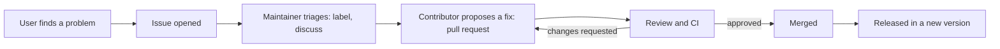

Almost every application you'll ever work on stands on open-source software: Python, PostgreSQL,
FastAPI, React, pytest. Contributing back is one of the best things you can do for your career
without a CS degree: your work is public, reviewed by experienced maintainers, and linked to your
name. It also teaches you to read unfamiliar codebases and collaborate with strangers, two skills
every senior engineer needs. This session explains how projects are organised, how to find a good
first contribution, and the etiquette that gets your pull request merged.

## How open-source projects are organised

An open-source project is like a community garden. Anyone can visit, many people help a little,
and a small group of regulars decides what gets planted where and keeps the place running. The
[Open Source Guides](https://opensource.guide/) describe the typical roles:

| Role | What they do |
|---|---|
| **Author / owner** | Created the project or owns the repository and its direction |
| **Maintainers** | Review and merge contributions, triage issues, cut releases, set direction |
| **Contributors** | Anyone who has had a contribution accepted: code, docs, bug reports, design |
| **Community members / users** | Use the project, ask and answer questions, report problems |

Maintainers are often volunteers with limited time, or a few paid people supporting thousands of
users. Keep that in mind: your contribution competes for scarce attention, so making it easy to
review is the biggest favour you can do.

### Files that tell you how the project works

Before contributing, read these files at the root of the repository (or in a `.github/` or `docs/`
folder):

- **README:** what the project does and how to install it.
- **LICENSE:** the legal terms under which you may use, change and share the code. Your
  contribution will be released under it.
- **CONTRIBUTING:** how to set up a development environment, run tests, the style rules, the
  branch and commit conventions, and how to propose changes. *Read this first, every time.*
- **CODE_OF_CONDUCT:** the expected behaviour in issues, PRs and chat, and how to report problems.
- **Issue and PR templates:** what information maintainers want when you open something.

### How decisions are made (governance)

Small projects are often run by one maintainer who decides everything. Larger ones have a core
team, a steering committee, or a foundation, with written processes such as RFCs (Session 2.4.2)
for significant changes. The Open Source Guides' section on leadership and governance explains the
common models. Knowing who decides tells you who to convince, and whether a big change needs a
discussion before any code.



## Finding good first issues

The hardest part of a first contribution is choosing what to work on. Aim for something small,
clearly defined and welcomed by the maintainers.

**Where to look:**

- **Projects you already use.** You understand the problem domain, you can reproduce issues, and
  you care about the result. A library from this course (pytest, FastAPI, Playwright, a
  documentation site) is a great start.
- **Labels.** Many projects tag beginner-friendly issues with labels such as `good first issue`,
  `help wanted` or `documentation`. GitHub lets you search issues by label across all
  repositories.
- **Your own friction.** A confusing error message, a broken link in the docs, an example that
  doesn't run with the current version: if it tripped you up, it trips others up too.

**Signs an issue is a good choice:**

| Good sign | Warning sign |
|---|---|
| Clear description and steps to reproduce | Vague "it would be nice if..." |
| A maintainer has confirmed it, or labelled it | No maintainer response in a long time |
| Nobody is assigned, or the assignee hasn't been active for weeks | Someone said "I'm on it" yesterday |
| Small scope: one function, one page | Touches architecture or many modules |
| Recent activity in the repo | Last commit years ago (the project may be abandoned) |

> [!TIP]
> Documentation contributions are real contributions, and often the easiest to get merged: fixing
> an outdated example, clarifying an installation step, adding a missing parameter to a reference
> page. They also force you to understand the code well enough to explain it.

> [!WARNING]
> Don't start with a large feature nobody asked for. Even excellent code may be rejected because it
> doesn't fit the project's direction, or because maintainers would have to support it forever.
> For anything beyond a small fix, open an issue (or comment on an existing one) and agree on the
> approach first.

## Contribution etiquette: issues, PRs, CLA, code of conduct

### Issues

A good bug report saves maintainers hours. Include: what you did (minimal steps or code to
reproduce), what you expected, what happened instead (full error message), and your versions
(library, language, OS). Search existing issues first to avoid duplicates; if one exists, add new
information there rather than "+1".

Before working on an issue, **comment to say you'd like to take it**, and wait for a reply if the
project asks for that. It avoids two people doing the same work.

### Pull requests

The mechanics on GitHub, explained in the [GitHub Docs](https://docs.github.com/en/get-started):
**fork** the repository to your account, **clone** your fork, create a **branch**, make your
change, **push** to your fork, and open a **pull request** against the original repository.

```sh
git clone https://github.com/<you>/<project>.git
cd <project>
git switch -c fix-broken-install-link
# make the change, run the project's tests and linters
git commit -m "Fix broken link in installation docs"
git push -u origin fix-broken-install-link
# then open a pull request from your fork on GitHub
```

Etiquette that gets PRs merged:

- **Follow CONTRIBUTING exactly:** test commands, formatting, commit message style, changelog
  entries.
- **Keep it small and focused** (Session 2.4.1). One fix per PR. No unrelated reformatting.
- **Write a clear description:** link the issue ("Fixes #123"), explain what and why, and how you
  tested it.
- **Make CI green** before asking for review. If a check fails for reasons you don't understand,
  say so and ask.
- **Be patient.** Maintainers may take days or weeks. A polite ping after a week or two is fine;
  repeated pings are not.
- **Respond to review gracefully** (receiving feedback without ego, Session 2.4.1) and push
  follow-up commits rather than opening new PRs.

### CLA and DCO

Some projects, often those backed by companies or foundations, require a **Contributor License
Agreement (CLA)**: a document you sign (usually by clicking through a bot's link on your PR)
granting the project the rights it needs to distribute your contribution. Others use the
**Developer Certificate of Origin (DCO)**, a lighter statement that you have the right to submit
the code, which you agree to by adding a `Signed-off-by:` line to each commit (`git commit -s`).
If a bot comments on your PR about either, follow its instructions: the PR usually can't be merged
until you do.

> [!NOTE]
> If you contribute as part of your job, check your employment contract and company policy: your
> employer may own code you write, even in your spare time, and may need to approve contributions.

### Code of conduct

The code of conduct applies to every interaction in the project. In practice: be respectful and
patient, assume good intent, keep discussions technical, and never demand free work from
maintainers. Most codes of conduct also explain how to report harassment privately.

> [!EXAMPLE]
> **Poor comment:** "This bug has been open for months, why hasn't anyone fixed it??"
>
> **Good comment:** "I can reproduce this on version 2.3 with Python 3.12 (minimal example below).
> I'd be happy to work on a fix if a maintainer can confirm the expected behaviour."

## Practice: land one documentation or bug-fix PR

The goal is one merged pull request in a real project. Allow a few weeks, because review takes
time.

### Step 1: Choose a project and read its rules

Pick a project you use. Read its README, CONTRIBUTING and CODE_OF_CONDUCT. Set up the development
environment and run the test suite locally before changing anything.

### Step 2: Find and claim an issue

Look for a `good first issue` or `documentation` label, or a problem you hit yourself. Check it's
still open and unassigned. Comment that you'd like to work on it and outline your approach in two
or three sentences.

### Step 3: Make a small, clean change

Branch, change, test, lint. Read your own diff as a reviewer would. Write a commit message in the
project's style.

### Step 4: Open the PR

Use the PR template. Link the issue, explain what and why, describe how you tested it. Sign the
CLA or add DCO sign-offs if asked. Make sure CI passes.

### Step 5: Iterate and record

Respond to review, push fixes, thank the reviewers. Once merged, add the link to your CV or
portfolio, and write a short note: what surprised you about the codebase, what the reviewers
taught you, and which issue you might pick next.

> [!TIP]
> If the first PR stalls for weeks with no response, that's normal and not about you. Leave one
> polite ping, then start a second contribution in a more active project in parallel.
