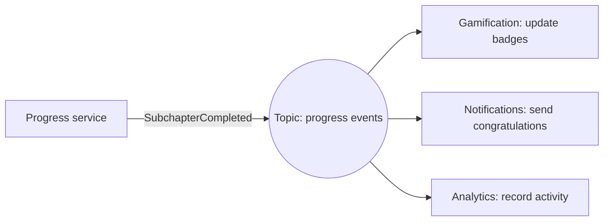
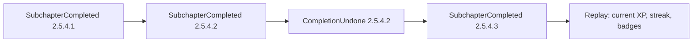

In the previous session you saw that services can talk synchronously (call and wait) or
asynchronously (send and move on). **Event-driven architecture** takes the asynchronous route
seriously: parts of the system announce what has happened, and other parts react, without the
announcer knowing who's listening. It's how many large systems stay loosely coupled and resilient,
and it brings its own vocabulary and pitfalls. This session gives you both.

## Events, commands and messages

A **message** is any piece of data sent from one component to another through some channel. Two
kinds of message carry very different intentions, and confusing them leads to tangled designs.

- A **command** asks for something to happen: `SendWelcomeEmail`, `ChargeCard`,
  `GenerateCertificate`. It is addressed to *one* receiver that is expected to handle it, and it
  can be refused or fail. Named in the imperative.
- An **event** announces something that **already happened**: `LearnerRegistered`,
  `SubchapterCompleted`, `PaymentReceived`. It's a fact about the past, so it can't be refused.
  The sender doesn't know or care how many receivers there are, possibly none. Named in the past
  tense.

The analogy: a command is a waiter taking your order to the kitchen ("make one pizza"). An event
is the kitchen bell ringing ("order 42 is ready"): whoever cares (the waiter, the cashier, the
customer) reacts in their own way.

```python
# Command: I want this done, by you
ChargeCard(order_id="o-17", amount_cents=2000)

# Event: this happened, anyone may react
SubchapterCompleted(learner_id="u-1", subchapter_id="2.5.4.1", at="2026-04-01T09:12:00Z")
```

Martin Fowler's article
[What do you mean by "Event-Driven"?](https://martinfowler.com/articles/201701-event-driven.html)
points out that "event-driven" is used for several quite different patterns. Two of them concern
what an event *contains*:

| Pattern | Event contains | Trade-off |
|---|---|---|
| **Event notification** | Just enough to say what happened, maybe an id | Very decoupled; receivers may need to call back for details |
| **Event-carried state transfer** | The data receivers need (e.g. the new address) | Receivers keep a local copy and don't call back; more data duplicated |

The other two patterns he describes, event sourcing and CQRS, are covered below.

> [!WARNING]
> A frequent mistake is publishing commands disguised as events: `SendEmailEvent` aimed at exactly
> one service that must act on it. If the sender depends on a specific reaction, it's a command;
> treat it as one, with a clear owner and error handling.

> [!NOTE]
> Event notification makes the flow of the system harder to see. Fowler highlights this: with
> events, there's no single place in the code that says "when X happens, do A, B and C". You need
> good monitoring and documentation of who listens to what.

## Publish/subscribe and event buses

How does an event reach everyone interested without the publisher knowing them? Through
**publish/subscribe** (pub/sub). Publishers send events to a **topic** (or channel) on a message
**broker**; subscribers register interest in topics; the broker delivers a copy to each
subscriber. It's like a newspaper: the publisher prints once, and every subscriber gets a copy.



Compare with a **point-to-point** queue, where each message is consumed by exactly *one* of
possibly several workers. That's the right tool for distributing commands or jobs (e.g. "index
this source page") across workers.

An **event bus** is the infrastructure that carries events. It ranges from an in-process
dispatcher inside one app, to brokers such as RabbitMQ, to distributed logs such as Apache Kafka
that keep events for days or indefinitely so new consumers can replay history.

Practical issues every event-driven system must handle:

- **At-least-once delivery.** Most brokers can deliver the same message twice (after a timeout or
  crash). Consumers must be **idempotent**: processing the same event twice has the same effect
  as once. Store processed event ids, or make the operation naturally idempotent ("set badge
  awarded = true" rather than "add 1 badge").
- **Ordering.** Events may arrive out of order across partitions or consumers. Include timestamps
  or version numbers, and design receivers to cope.
- **Failures.** A message that keeps failing is moved to a **dead letter queue** for inspection
  instead of blocking everything behind it.
- **Publishing reliably.** Saving to your database and publishing an event are two separate
  operations; if one succeeds and the other fails, they disagree. The **transactional outbox**
  pattern writes the event to an "outbox" table in the same transaction as the data, and a
  separate process publishes it.

> [!TIP]
> Make every event carry an id, a type, a timestamp, a version of its schema, and a correlation
> id that ties together everything caused by one user action. Debugging is much easier when you
> can follow one correlation id through every service's logs.

## Event sourcing and CQRS (overview)

### Event sourcing

In a normal application, the database stores the **current state**: the learner has 340 XP. The
history of how they got there is lost, or kept in a separate log. **Event sourcing** flips this:
the **sequence of events is the source of truth**, and current state is derived by replaying them.

A bank account is the classic analogy. The bank doesn't just store "balance: €1,240"; it stores
every deposit and withdrawal, and the balance is the sum. You can always explain the balance, and
you can compute what it was on any past date.



> [!EXAMPLE]
> YouCanDoIt is close to this idea already. Gamification is "derived, never stored": XP, levels,
> streaks and badges are computed from the completions table. The completions are the facts;
> everything else is a projection. Full event sourcing would go further, storing undo actions as
> events too rather than deleting rows.

Benefits: a complete audit trail, the ability to rebuild state or build new views from history, and
easier debugging of "how did we get here?". Costs: more complex queries for current state (you
need snapshots or projections), schema evolution of old events, and a steeper learning curve. Use it
where history is itself valuable: finance, auditing, collaborative editing.

### CQRS

**Command Query Responsibility Segregation (CQRS)** separates the model for **writing** (commands
that change state, enforcing business rules) from the model for **reading** (queries, shaped for
the screens that display data). The read side is often a set of denormalised views, updated from
events.

Think of a restaurant: the kitchen (write side) is organised for cooking correctly; the menu (read
side) is organised for customers to choose quickly. Same food, two very different structures.

CQRS pairs naturally with event sourcing, but each can be used without the other. Fowler warns
that CQRS adds significant complexity and suits only some parts of some systems; for most CRUD
screens, one model is fine.

## Enterprise integration patterns

When systems talk through messages, the same problems recur: routing, transforming, splitting,
recovering from failure. Gregor Hohpe and Bobby Woolf catalogued the solutions in the book
*Enterprise Integration Patterns* (2003); the patterns and their icon language are summarised on
[enterpriseintegrationpatterns.com](https://www.enterpriseintegrationpatterns.com/). They predate
today's brokers but map directly onto them, and the names are widely used in architecture
discussions.

| Pattern | Problem it solves |
|---|---|
| **Message channel** (point-to-point, publish-subscribe) | How messages travel from sender to receivers |
| **Content-based router** | Send each message to a different destination based on its content |
| **Message translator** | Convert a message from one format or model to another (an anticorruption layer for messages) |
| **Splitter / aggregator** | Break one message into many, or combine many related messages into one |
| **Competing consumers** | Several workers share the load from one queue |
| **Idempotent receiver** | Safely handle duplicate messages |
| **Dead letter channel** | Where messages go when they can't be delivered or processed |
| **Correlation identifier** | Match replies or related messages to the request that caused them |

> [!TIP]
> When you read about a cloud messaging product, try mapping its features onto these patterns
> ("topic subscriptions with filters" is a content-based router plus publish-subscribe). It's a
> fast way to understand any new messaging tool.

## Practice: redesign a synchronous workflow as events

Today, imagine that when a learner completes a subchapter, one API request does everything in
sequence: save the completion, recompute XP and badges, send a congratulations email if a badge is
earned, update analytics, and re-index the learner's notes for the tutor. If the email provider is
slow, the checkbox spins; if it's down, the request fails.

### Step 1: Draw the current flow

Draw it as a sequence diagram. Mark which steps the learner actually needs to wait for (saving the
completion, probably seeing the new XP) and which they don't.

### Step 2: Identify events and commands

Name the event at the heart of the flow (`SubchapterCompleted`) and its fields. List any commands
(`SendEmail`) and which component owns each. Decide between event notification and event-carried
state transfer for each consumer.

### Step 3: Redesign

Keep the essential step synchronous (save the completion, return). Publish `SubchapterCompleted`
via a transactional outbox. Draw subscribers for badges, email, analytics and indexing. Mark where
you'd use pub/sub and where a point-to-point work queue.

### Step 4: Handle the hard parts

For each consumer, write: how it stays idempotent, what happens on failure (retries, dead letter
queue), and what the learner sees while work is still in flight (eventual consistency: "badge may
take a few seconds to appear").

### Step 5: Weigh it

Write a short trade-off note: what got better (latency, resilience, independent changes) and what
got worse (debuggability, more infrastructure, eventual consistency). Would you actually make this
change for YouCanDoIt at its current size? Record your answer as an ADR.
