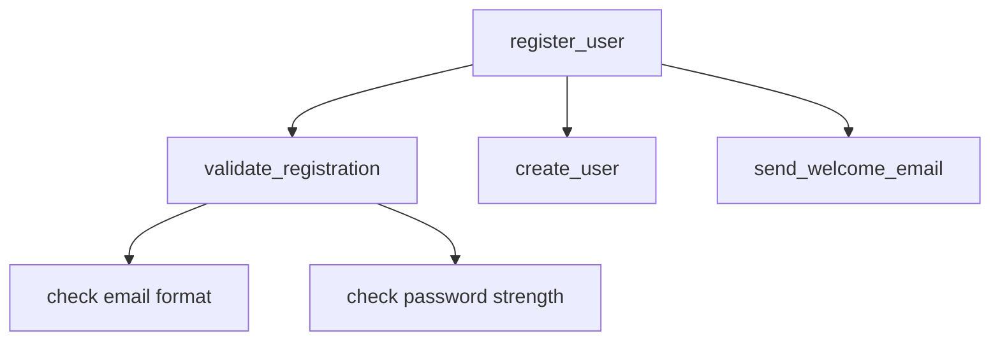

Code is read far more often than it is written. You write a function once, but you, your
teammates, reviewers and your future self will read it dozens of times while fixing bugs, adding
features or just trying to understand what the system does. Readable code is not a matter of
taste or politeness: it is what makes a codebase cheap to change. This session gives you the habits
that make code easy to read, and a practice exercise to apply them to a real mess.

## Meaningful names

A name is a tiny piece of documentation that travels everywhere the variable goes. Think of
labels on boxes when you move house: "kitchen — fragile glasses" saves you from opening every box;
"stuff 3" does not.

A good name answers three questions: **what is it, why does it exist, and how is it used?** If you
need a comment to explain a variable, the name is probably not doing its job.

```python
# Hard to read
d = 86400
def calc(l):
    t = 0
    for x in l:
        if x[2]:
            t += x[1]
    return t

# Easy to read
SECONDS_PER_DAY = 86_400
def total_paid_amount(invoices):
    total = 0
    for invoice in invoices:
        if invoice.is_paid:
            total += invoice.amount
    return total
```

Nothing about the logic changed, yet the second version can be understood in a single pass.
Some rules of thumb:

- **Use the vocabulary of the problem.** If the business says "invoice", don't call it `doc` or
  `record`. Matching the domain language makes conversations with non-developers easier.
- **Name length should match scope.** A loop index `i` living for two lines is fine. A module-level
  constant used across the codebase deserves a full, descriptive name.
- **Functions are verbs, data is nouns.** `send_reminder()`, `parse_date()`, `user`, `orders`.
  Booleans read as questions: `is_paid`, `has_access`, `should_retry`.
- **Avoid noise words and encodings.** `user_data`, `user_info` and `the_user` all mean "user".
  Type prefixes like `str_name` repeat what the type hints already say.
- **Be consistent.** If you use `fetch_` for network calls in one module, don't use `get_`,
  `load_` and `retrieve_` for the same idea elsewhere.

> [!TIP]
> Renaming is the cheapest refactoring there is. Modern editors rename a symbol everywhere it is
> used in one keystroke. When you finally understand what a variable really is, rename it
> immediately so the next reader gets that understanding for free.

> [!WARNING]
> A misleading name is worse than a vague one. A function called `get_user()` that also *creates*
> the user when missing will surprise everyone. If a function does more than its name says, either
> rename it (`get_or_create_user`) or split it.

## Small functions that do one thing

Imagine a recipe written as a single paragraph with no steps. You could follow it, but you would
keep losing your place. Small functions are the numbered steps of your code.

A function "does one thing" when all its statements sit at the **same level of abstraction**, and
you could describe it in one sentence without using "and". A useful test from the refactoring
literature: if you feel the urge to write a comment above a block inside a function, that block
probably wants to be its own function, with the comment as its name. The
[Refactoring.Guru catalogue](https://refactoring.guru/refactoring) calls this move *Extract Method*.

```python
def register_user(form):
    data = validate_registration(form)
    user = create_user(data)
    send_welcome_email(user)
    return user
```

You can read `register_user` like a table of contents. If you care about how validation works, you
open `validate_registration`; if you don't, you skip it. That is the real benefit: small functions
let readers choose how deep to go.



Other signals that a function is doing too much:

- **Many parameters.** Four or more is a smell. Often several of them travel together and want to
  be one object (`date_from`, `date_to` → `date_range`).
- **Flag arguments.** `render(page, True)` hides two functions behind a boolean. Prefer
  `render_preview(page)` and `render_final(page)`.
- **Deep nesting.** Three levels of `if` inside a `for` is hard to follow. Guard clauses (return
  early on the unusual case) flatten the code.

```python
# Nested
def discount(user):
    if user is not None:
        if user.is_member:
            return 0.1
    return 0

# Guard clauses
def discount(user):
    if user is None or not user.is_member:
        return 0
    return 0.1
```

> [!NOTE]
> "Small" has no magic number. A ten-line function that mixes SQL, business rules and formatting
> is too big; a twenty-line function that builds one well-structured dictionary can be fine. Judge
> by the number of *ideas*, not lines.

## Comments: when they help and when they hurt

Comments are like sticky notes on a machine. A note saying "do not open while running — capacitor
holds charge" is gold. A note saying "this is a button" on a button is noise, and a note that
still says "red wire = power" after someone rewired it is dangerous.

**Comments that hurt:**

- **Restating the code.** `i += 1  # increment i` adds reading time and nothing else.
- **Explaining bad names.** `d = 7  # days until expiry` should just be `days_until_expiry = 7`.
- **Commented-out code.** Version control remembers deleted code; dead code in the file only
  confuses readers ("is this needed? why was it disabled?").
- **Stale comments.** Code gets updated, comments often don't. A comment that contradicts the code
  sends the reader down the wrong path.

**Comments that help** explain what the code *cannot* say:

- **Why**, not what: `# Retry 3 times: the payment provider returns 502 during deploys.`
- **Warnings and consequences:** `# Order matters: migrations run alphabetically.`
- **Links to context:** a ticket, an RFC, a bug report in a library you work around.
- **Public API documentation:** docstrings describing what a function promises, its parameters
  and the errors it raises. Python's conventions for these live in
  [PEP 257](https://peps.python.org/pep-0257/), referenced from
  [PEP 8](https://peps.python.org/pep-0008/).

> [!EXAMPLE]
> ```python
> # Bad: says what
> # Loop over the users and check if they are active
> active = [u for u in users if u.last_login > cutoff]
>
> # Good: says why
> # "Active" means logged in within 90 days, per the billing team's definition.
> active = [u for u in users if u.last_login > cutoff]
> ```

The first instinct when code is confusing should be to *improve the code* (better names, extracted
functions). Write a comment when the code is already as clear as it can be and there is still
something the reader needs to know.

## Formatting and consistency

Formatting is the typography of code. A book with random fonts and margins is tiring to read even
if every sentence is good. Consistent formatting lets your eyes jump straight to the parts that
matter.

[PEP 8](https://peps.python.org/pep-0008/) is Python's style guide. It covers indentation (four
spaces), naming conventions (`snake_case` for functions and variables, `PascalCase` for classes,
`UPPER_CASE` for constants), import ordering, whitespace and line length. Its most important line
is near the top: *a foolish consistency is the hobgoblin of little minds*, and consistency within
a project matters more than consistency with the guide itself.

In practice, **don't format by hand**. Use tools so that nobody ever argues about spaces in a
code review again:

| Tool | Job |
|---|---|
| A formatter (e.g. `ruff format`, Black, Prettier) | Rewrites layout automatically |
| A linter (e.g. `ruff check`, ESLint) | Flags likely bugs and style violations |
| Editor config / pre-commit hooks | Runs both before code reaches the repo |
| CI check | Fails the build if formatting drifted |

This repository does exactly that: CI runs `ruff check` and `ruff format --check` on the API and
`eslint` on the web app.

Beyond whitespace, consistency means **following the patterns already in the codebase**. If every
route handler in a project validates input with Pydantic models, a new handler that parses a raw
dict stands out and slows everyone down. Google's
[engineering practices](https://google.github.io/eng-practices/) put it simply: new code should be
consistent with the surrounding code unless that code is clearly wrong.

> [!TIP]
> Organise a file top-down, like a newspaper: the high-level public function first, the helpers it
> calls below it. Readers get the headline before the details.

## Practice: rewrite a messy function and get feedback

Here is a function with most of the problems from this lesson. Copy it into a file, then improve
it step by step. Keep the behaviour identical.

```python
def proc(d, f=False):
    # process
    r = []
    for i in range(len(d)):
        if d[i]["s"] == "A":
            if d[i]["amt"] > 0:
                x = d[i]["amt"] * 1.22  # vat
                if f:
                    x = round(x, 2)
                r.append({"n": d[i]["n"], "t": x})
    # r.sort(key=lambda z: z["t"])
    return r
```

### Step 1: Pin the behaviour with a quick test

Before changing anything, write two or three asserts with sample input and the current output.
This is your safety net. (You will learn proper testing in Session 2.2.1; a few asserts are enough
for now.)

### Step 2: Rename

Work out what each name means and rename: `d` → `orders`, `"s" == "A"` → an `ACTIVE` status
constant, `1.22` → `VAT_RATE = 0.22`, `r` → `totals`. Run your asserts after each rename.

### Step 3: Flatten and extract

Replace `range(len(...))` with direct iteration, use guard clauses or a single combined condition,
and extract the VAT calculation into `gross_amount(net)`.

### Step 4: Remove the flag and the dead code

The `f` flag changes the output format. Decide whether callers really need unrounded values; if
not, always round. Delete the commented-out sort, and delete `# process` (it says nothing).

### Step 5: Get feedback

A possible result:

```python
VAT_RATE = 0.22
ACTIVE = "A"

def gross_amount(net: float) -> float:
    return round(net * (1 + VAT_RATE), 2)

def active_order_totals(orders: list[dict]) -> list[dict]:
    return [
        {"name": order["n"], "total": gross_amount(order["amt"])}
        for order in orders
        if order["s"] == ACTIVE and order["amt"] > 0
    ]
```

Notice the output keys changed (`"n"` → `"name"`): that is a behaviour change for callers, so in a
real codebase it needs a separate, deliberate step. Then ask for feedback: open a pull request in
your practice repo, ask a peer, or ask the platform's tutor to review it. Ask specific questions,
such as "is any name still unclear?" and "would you split anything further?"

> [!EXAMPLE]
> Keep a short "before/after" note for this exercise in your notes repo. Readability habits stick
> faster when you can see the contrast.

```quiz
{"questions": [
  {"question": "You find yourself writing a comment above a block of code inside a long function to explain what the block does. What is usually the better move?", "options": ["Make the comment longer and more detailed", "Extract the block into a function whose name says what the comment said", "Delete the comment and leave the block as is", "Move the comment to the top of the file"], "answer": 1, "explanation": "A comment describing *what* a block does is often a missing function name. Extract Method turns the comment into a name that cannot go stale silently."},
  {"question": "Which comment adds the most value?", "options": ["# loop over users", "# increment counter", "# Retry 3 times: the provider returns 502 during its deploys", "# this function returns a list"], "answer": 2, "explanation": "Good comments explain *why*: context the code cannot express. The others restate what the code already says."},
  {"question": "A function is called render(page, True). What is the main readability problem?", "options": ["The function name is too short", "A boolean flag argument hides two different behaviours behind an unlabelled value", "It should use keyword-only arguments for page", "It returns nothing"], "answer": 1, "explanation": "Flag arguments make call sites unreadable and signal that the function does two things. Split it into two well-named functions."},
  {"question": "Why should formatting be handled by tools like ruff format or Prettier rather than by hand?", "options": ["Tools produce faster code", "Hand formatting is forbidden by PEP 8", "Automated formatting is consistent and removes style debates from code review", "Tools also fix logic bugs"], "answer": 2, "explanation": "A formatter run in pre-commit or CI keeps the whole codebase uniform, so reviewers can focus on design and correctness."},
  {"question": "A function get_user() also creates the user if it doesn't exist. What is the issue?", "options": ["The name hides a side effect, so callers will be surprised", "Functions should never create data", "It should be a class instead", "There is no issue as long as it is documented in a comment"], "answer": 0, "explanation": "Names should tell the truth. Rename it (get_or_create_user) or split it so readers aren't misled."}
]}
```
