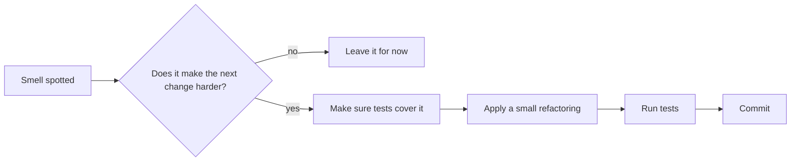
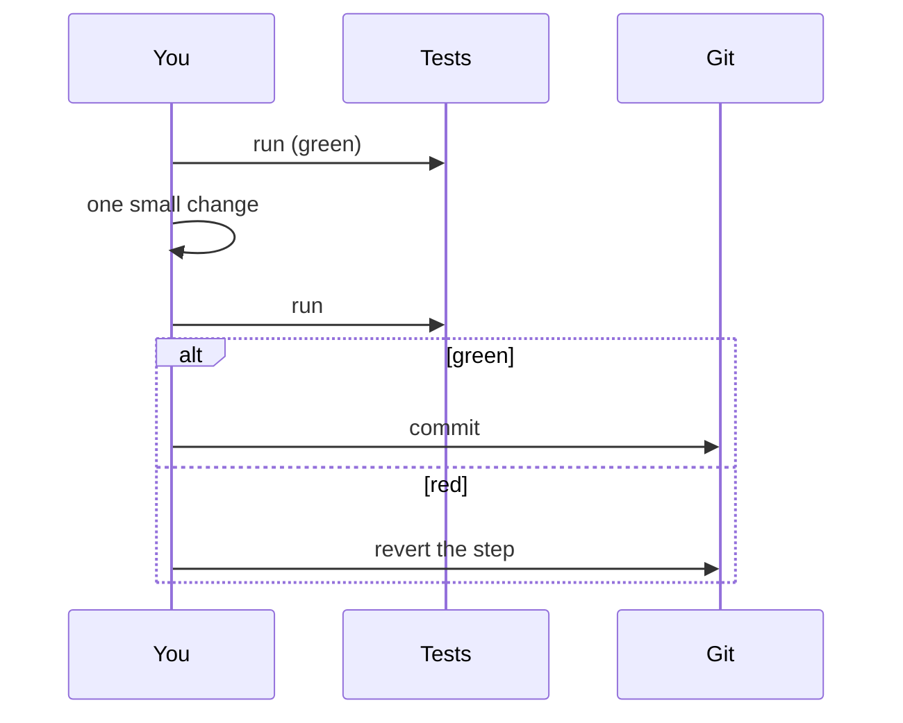

Every codebase that lives long enough gets messy. Deadlines push in quick fixes, requirements
change, and code written for one purpose gets stretched to serve three. Senior engineers are not the
ones who never write messy code; they are the ones who can *recognise* where the mess is and clean
it up in small, safe steps without breaking anything. This session teaches you the vocabulary for
spotting problems (code smells) and the moves for fixing them (refactorings).

## Common smells: long method, duplicated code, feature envy

A **code smell** is like a strange smell in a kitchen. It doesn't prove something is rotten, but it
tells you where to look. Smells are *hints*, not bugs: the code works, but it is harder to
understand or change than it should be. The term was popularised by Kent Beck and Martin Fowler in
the book *Refactoring*, and [Refactoring.Guru](https://refactoring.guru/refactoring) keeps a free,
illustrated catalogue of them.

Three smells cover a surprising share of real-world mess.

### Long method

A function that has grown until you can't see all of it at once. Long methods usually mix several
levels of abstraction: input parsing, business rules, database calls and output formatting all in
one place. They are hard to name, hard to test and hard to reuse.

**Typical cause:** it's always easier to add two lines to an existing function than to create a
new one, so functions grow a little with every change.

### Duplicated code

The same (or nearly the same) logic in two or more places. The danger is not the extra lines; it's
that when the rule changes, someone updates one copy and forgets the other. Now you have a bug that
only shows up on one code path.

```python
# Two copies of the same business rule
def invoice_total(items):
    return sum(i.price * i.qty for i in items) * 1.22

def cart_preview_total(items):
    return sum(i.price * i.qty for i in items) * 1.22
```

> [!WARNING]
> Not every similarity is duplication. Two pieces of code that *look* alike but change for
> different reasons (say, a tax rule and a shipping rule that happen to use the same number) should
> stay separate. Merging them couples things that will later need to diverge. A common guideline
> is the *rule of three*: tolerate the second copy, refactor at the third.

### Feature envy

A method that is more interested in another object's data than its own. It reaches into another
class, pulls out field after field, and computes something that clearly belongs over there.

```python
class Order:
    def shipping_label(self):
        # Feature envy: everything here is about the customer
        c = self.customer
        return f"{c.first_name} {c.last_name}\n{c.street}\n{c.zip} {c.city}"
```

The address-formatting logic belongs on `Customer` (or an `Address` object). If the address format
changes, you want to change one class, not hunt through every class that ever printed an address.



> [!NOTE]
> Other smells worth knowing by name: *large class*, *long parameter list*, *primitive obsession*
> (using strings and ints where a small type would be clearer), *shotgun surgery* (one change
> forces edits in many files) and *speculative generality* (abstractions built "for later" that
> nobody uses).

## Refactoring catalogue: extract, inline, move, rename

**Refactoring** is changing the internal structure of code without changing what it does from the
outside. Fowler's definition stresses both halves: easier to understand and cheaper to modify,
*and* no change in observable behaviour. If behaviour changes, it is not a refactoring, it's a
feature or a fix, and it belongs in a separate commit.

Think of rearranging furniture: the room's purpose is the same, but now you can walk through it.
The catalogue gives each standard move a name so teams can talk about them precisely ("I'll
extract that into a method and move it to `Customer`").

| Refactoring | What it does | Fixes |
|---|---|---|
| **Extract Method / Function** | Pulls a block into a new, named function | Long method, comments explaining blocks |
| **Inline Method / Variable** | Replaces a call with the body when the indirection adds nothing | Needless indirection |
| **Move Method / Field** | Moves behaviour to the class whose data it uses | Feature envy |
| **Rename** | Gives a variable, function or class a truthful name | Unclear or misleading names |

Extract and Inline are opposites, and that's the point: refactoring is not "always add more
functions". If a helper's name says no more than its one-line body (`def is_adult(age): return
age >= 18` might be worth keeping; `def get_x(p): return p.x` probably isn't), inlining it makes
the code shorter and clearer.

> [!EXAMPLE]
> Fixing the duplicated total and the feature envy from above:
>
> ```python
> VAT_RATE = 0.22
>
> def gross_total(items):          # Extract Function
>     net = sum(i.price * i.qty for i in items)
>     return net * (1 + VAT_RATE)
>
> class Customer:
>     def mailing_label(self):     # Move Method
>         return f"{self.first_name} {self.last_name}\n{self.street}\n{self.zip} {self.city}"
>
> class Order:
>     def shipping_label(self):
>         return self.customer.mailing_label()
> ```

Bigger refactorings, such as replacing a conditional with polymorphism or splitting a class, are
built out of sequences of these small moves. Learn the small ones until they are automatic, and
let your editor do them where it can: IDE "rename symbol" and "extract method" commands are safer
than editing by hand.

## Refactoring safely with tests

The whole promise of refactoring is "same behaviour, better structure". The only way to *know*
behaviour didn't change is to check it, and checking by hand after every small step is too slow.
That is why the first step of any refactoring is to make sure tests cover the code you are about to
touch. Tests are the safety harness on a climbing wall: they don't make you climb, but they make it
safe to try a bold move.

The working rhythm is a loop of tiny steps:

1. Run the tests: all green.
2. Make **one** small refactoring (rename, extract, move).
3. Run the tests again.
4. Green? Commit. Red? Undo the step (don't debug a refactoring; revert and take a smaller step).



What if the code has **no tests**? This is the normal situation with legacy code. You write
**characterisation tests** first: tests that record what the code *currently* does, right or
wrong. Call the function with representative inputs, capture the outputs, and assert those. You are
not judging correctness yet; you are freezing behaviour so you notice if you change it.

> [!WARNING]
> Never mix refactoring and behaviour changes in one step or one commit. If tests go red, you won't
> know which change caused it, and reviewers can't tell which lines are "just moving things" and
> which lines change what users see. Two hats: refactor, *then* change behaviour.

> [!TIP]
> Fowler's advice on *when* to refactor is practical: refactor the code you are about to change,
> to make that change easy, rather than scheduling big "cleanup sprints". "Make the change easy,
> then make the easy change." You can find more of his writing on
> [martinfowler.com](https://martinfowler.com/).

## Practice: refactor a legacy module kata

A **kata** is a small exercise you repeat to build a skill. Refactoring katas give you working but
ugly code and ask you to clean it up. A well-known one is the **Gilded Rose** kata (search for
"Gilded Rose refactoring kata"; Emily Bache maintains versions in many languages on GitHub). If you
prefer, use the messy function from Session 2.1.1 or an old project of yours.

### Step 1: Read without changing

Spend ten minutes reading the code and the requirements. List every smell you can name: long
method, duplication, deep nesting, magic numbers, unclear names. Don't fix anything yet.

### Step 2: Build a safety net

Write characterisation tests. For Gilded Rose, a good approach is to generate many items with
different names, qualities and sell-in days, run the original `update_quality` for several days,
and store the outputs. Assert the refactored code produces exactly the same output. Commit the
tests on their own.

### Step 3: Small steps, frequent commits

Work through your smell list. Rename first (cheapest, highest value). Then extract methods for each
item type's rule. Then replace the nested conditionals with guard clauses or a lookup. Run the
tests after every step and commit each green state with a descriptive message ("Extract
update_brie", "Rename i to item").

### Step 4: Add the new feature

Only now implement the kata's requested feature (in Gilded Rose, a new item type). Notice how much
easier it is in the clean structure: that ease is the payoff of refactoring.

### Step 5: Reflect

Look at your commit history. Write three lines in your notes: which smell was most costly, which
refactoring you used most, and one step where you went too big and had to revert.

> [!EXAMPLE]
> A healthy commit log for this kata might read: "Add characterisation tests", "Rename loop
> variable", "Extract is_legendary", "Extract update_brie", "Extract update_backstage_pass",
> "Replace nested ifs with dispatch dict", "Add Conjured items". Each one small, each one green.

```quiz
{"questions": [
  {"question": "What makes a code change a refactoring rather than a feature?", "options": ["It touches more than one file", "It changes the internal structure without changing observable behaviour", "It makes the code run faster", "It removes tests that are no longer needed"], "answer": 1, "explanation": "Refactoring improves structure while preserving behaviour. Changing behaviour is a separate kind of change and belongs in a separate step."},
  {"question": "Order.shipping_label() reads five fields from self.customer to format an address. Which smell and which fix fit best?", "options": ["Long parameter list; add parameters", "Duplicated code; copy it into Customer too", "Feature envy; move the formatting logic to Customer", "Speculative generality; inline Customer"], "answer": 2, "explanation": "The method is more interested in Customer's data than its own: feature envy. Move Method puts the behaviour next to the data it uses."},
  {"question": "You want to refactor a legacy function that has no tests. What should you do first?", "options": ["Refactor carefully and test manually at the end", "Rewrite it from scratch", "Write characterisation tests that capture its current behaviour", "Add comments explaining each line"], "answer": 2, "explanation": "Characterisation tests freeze current behaviour, so you can detect any accidental change while you restructure."},
  {"question": "Midway through a refactoring step, the tests go red and you're not sure why. What is the recommended move?", "options": ["Debug until you find the cause", "Revert the step and redo it in smaller pieces", "Update the tests to match the new output", "Commit anyway and fix it later"], "answer": 1, "explanation": "Refactoring steps should be small enough that reverting is cheap. Taking a smaller step is faster than debugging a tangled change."},
  {"question": "Two functions contain an identical calculation, but one implements a tax rule and the other a shipping rule that happens to use the same numbers. Should you merge them?", "options": ["Yes, all duplication must be removed", "No, they change for different reasons, so merging would couple unrelated rules", "Yes, but only if they are in the same file", "No, because duplication is never a real problem"], "answer": 1, "explanation": "Duplication is about knowledge, not text. Code that looks alike but represents different rules should be allowed to evolve separately."}
]}
```
