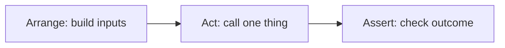

Up to now you have checked your code by running it and looking at the output. That works for a
script you write once, but not for a codebase that changes every day: nobody can re-check every
feature by hand after every commit. Automated tests do that checking for you, in seconds, every
time. This session covers why tests matter, how to structure a good one, and the pytest features
you will use daily.

## Why tests: confidence, design feedback, documentation

Imagine a trapeze artist. With a net below, they try new moves; without one, they repeat the same
safe routine forever. A good test suite is the net under your codebase. Tests give you three
things.

**1. Confidence to change code.** Without tests, every change is a gamble: you fix one bug and
quietly create another three screens away. With tests, you change code, run the suite, and know
within seconds whether you broke something you care about. That is what makes refactoring
(Session 2.1.2) possible at all.

**2. Design feedback.** Tests are the first *user* of your code. If a function is painful to
test (you need a database, a network connection and ten setup lines just to call it), that pain is
telling you the function does too much or depends on too many things. Code that is easy to test is
usually easier to read and reuse as well.

**3. Documentation that can't go stale.** A test named
`test_withdraw_more_than_balance_raises_error` tells a new teammate exactly how the code behaves,
and unlike a wiki page, it fails loudly the moment it stops being true.

A **unit test** checks one small piece of behaviour (a function, a class) in isolation, quickly.
"Quickly" matters: unit tests should run in milliseconds so you can run hundreds of them every few
minutes. Slower tests that involve databases or browsers come later in this module.
[The Practical Test Pyramid](https://martinfowler.com/articles/practical-test-pyramid.html)
explains why you want many fast unit tests and fewer slow, broad ones.

> [!NOTE]
> Tests don't prove your code is correct; they prove it behaves as expected *for the cases you
> wrote*. Their value comes from choosing cases well, which is what the rest of this session is
> about.

## Arrange–act–assert

Most good tests have the same three-part shape, like a scientific experiment: set up the
conditions, perform one action, check the result.

- **Arrange:** create the objects and inputs the test needs.
- **Act:** call the one thing you are testing.
- **Assert:** check the outcome.

```python
def test_push_then_pop_returns_last_item():
    # Arrange
    stack = Stack()
    stack.push(1)
    stack.push(2)

    # Act
    result = stack.pop()

    # Assert
    assert result == 2
    assert len(stack) == 1
```

The pattern keeps tests readable: anyone can find the setup, the behaviour under test, and the
expectation at a glance. (You'll also meet the same idea as *given–when–then* in
behaviour-driven development.)

Guidelines that follow from it:

- **One behaviour per test.** If a test checks pushing, popping *and* resizing, a failure tells
  you "something in the stack is broken", not *what*. Several asserts are fine as long as they
  describe one behaviour.
- **Name tests after behaviour.** `test_pop_on_empty_stack_raises` beats `test_pop_2`.
- **Keep logic out of tests.** No loops or `if` statements computing the expected value: if the
  test needs logic, it can have bugs too. Write the expected value literally.



> [!TIP]
> pytest uses plain `assert` statements. When one fails, pytest rewrites the assertion to show you
> both sides of the comparison, so you rarely need special assertion methods. See the
> [pytest docs](https://docs.pytest.org/en/stable/) for how assertion introspection works.

## pytest fixtures and parametrisation

Two pytest features remove most of the repetition from test suites.

### Fixtures

A **fixture** is reusable setup. Instead of building the same object at the top of ten tests, you
write a function decorated with `@pytest.fixture`, and any test that names it as a parameter
receives its return value. Think of it as a stagehand who sets up the props before each scene.

```python
import pytest

@pytest.fixture
def full_stack():
    stack = Stack()
    for n in [1, 2, 3]:
        stack.push(n)
    return stack

def test_pop_returns_last_pushed(full_stack):
    assert full_stack.pop() == 3

def test_len_counts_items(full_stack):
    assert len(full_stack) == 3
```

Each test gets a **fresh** fixture value by default, so tests can't leak state into each other.
Fixtures can depend on other fixtures, and they can clean up after themselves using `yield`:

```python
@pytest.fixture
def temp_db():
    db = connect(":memory:")
    yield db          # the test runs here
    db.close()        # teardown, runs even if the test fails
```

Fixtures shared by many test files go in a `conftest.py`, which pytest discovers automatically.
pytest also ships built-in fixtures such as `tmp_path` (a temporary directory) and `monkeypatch`
(covered in Session 2.2.2).

### Parametrisation

When the same behaviour should hold for many inputs, `@pytest.mark.parametrize` runs one test
function once per case, and reports each case separately.

```python
@pytest.mark.parametrize(
    ("text", "expected"),
    [
        ("()", True),
        ("(()[])", True),
        ("(]", False),
        ("((", False),
        ("", True),
    ],
)
def test_is_balanced(text, expected):
    assert is_balanced(text) is expected
```

Five test cases, one function, and if `"(]"` fails, the report names exactly that case.

> [!WARNING]
> Don't hide too much in fixtures. If a reader has to open three files to understand what a test
> sets up, the test stops being documentation. Keep the details that matter *for this test*
> visible inside it.

## Testing exceptions and edge cases

Happy paths are where bugs *don't* usually live. Bugs cluster at the edges: empty inputs, the
first and last elements, zero, negative numbers, very large values, duplicate keys, and invalid
input that should be rejected.

### Testing that code raises

Use `pytest.raises` as a context manager. The test passes only if the expected exception is raised
inside the block.

```python
def test_pop_on_empty_stack_raises():
    stack = Stack()
    with pytest.raises(IndexError, match="empty"):
        stack.pop()
```

The optional `match` argument checks the error message against a regular expression, so you know
it failed for the *right* reason.

### A checklist for edge cases

When you write tests for any function, walk through this list:

| Category | Examples |
|---|---|
| Empty / none | empty list, empty string, `None` |
| Boundaries | first and last index, capacity exactly reached, off-by-one |
| Size | one element, many elements, a resize being triggered |
| Invalid input | wrong type, negative size, missing key |
| Duplicates and order | the same key twice, unsorted input |

> [!EXAMPLE]
> For a dynamic array with initial capacity 4, a good boundary test appends exactly 4 items (no
> resize), then a 5th (resize happens), and checks that all 5 values are still there in order. The
> 4→5 boundary is where an off-by-one bug would hide.

## Practice: test the data structures you built in Track 1

Take the dynamic array, stack, queue and hash map you implemented in Module 1.3 (or write minimal
versions now) and give them a proper pytest suite.

### Step 1: Set up the project

```sh
pip install pytest
mkdir tests
touch tests/__init__.py tests/test_stack.py
pytest -q
```

pytest discovers files named `test_*.py` and functions named `test_*` automatically.

### Step 2: List behaviours before writing code

For each structure, write a bullet list of behaviours in plain English. For a stack: push adds to
the top; pop returns the most recent item; pop on empty raises; peek doesn't remove; length
reflects the number of items.

### Step 3: Write the tests with arrange–act–assert

Turn each bullet into one test, with a behaviour-based name. Use a fixture for a pre-filled
structure and `parametrize` for input tables.

### Step 4: Hunt the edges

Go through the edge-case table above for each structure. For the hash map, include two keys that
collide, overwriting an existing key, deleting a missing key, and a resize triggered by the load
factor.

### Step 5: Prove the tests can fail

Introduce a deliberate bug (return the *first* item from `pop`, skip copying one element during
resize) and check that at least one test turns red. A test that never fails protects nothing.
Revert the bug and commit.

> [!TIP]
> Run `pytest -x` to stop at the first failure and `pytest -k stack` to run only tests whose name
> matches "stack". Both speed up the write–run loop.

```quiz
{"questions": [
  {"question": "A function is very hard to test because it opens a database connection, calls an external API and formats HTML all in one place. What is this telling you?", "options": ["Unit tests are not suitable for real code", "The function probably has too many responsibilities and dependencies", "You should skip testing it", "You need a faster computer"], "answer": 1, "explanation": "Testing pain is design feedback. Splitting responsibilities usually makes code both easier to test and easier to understand."},
  {"question": "Why should a test usually check only one behaviour?", "options": ["pytest only allows one assert per test", "When it fails, you know exactly what broke", "It makes the test suite run faster", "Multiple behaviours cannot be tested in Python"], "answer": 1, "explanation": "A focused test gives a precise failure message. Several asserts are fine if they describe the same behaviour."},
  {"question": "Several tests need a stack already filled with three items. What's the idiomatic pytest solution?", "options": ["Copy the setup into each test", "A global variable shared by all tests", "A fixture that returns a fresh pre-filled stack to each test that requests it", "A parametrised test"], "answer": 2, "explanation": "Fixtures provide reusable, fresh setup per test, avoiding both duplication and shared mutable state."},
  {"question": "Which test best checks that pop() on an empty stack fails correctly?", "options": ["Call pop() in a try/except and pass if anything is raised", "with pytest.raises(IndexError, match=\"empty\"): stack.pop()", "assert stack.pop() is None", "Skip it, errors are not behaviour"], "answer": 1, "explanation": "pytest.raises checks both the exception type and, with match, the message, so the test fails if the code breaks for the wrong reason."},
  {"question": "You write a new test and it passes on the first run. What's a good way to confirm it actually protects you?", "options": ["Run it ten more times", "Introduce a deliberate bug and check the test fails", "Add more asserts that always pass", "Delete it, passing tests add no value"], "answer": 1, "explanation": "A test that can never fail is useless. Briefly breaking the code proves the test is checking what you think it checks."}
]}
```
