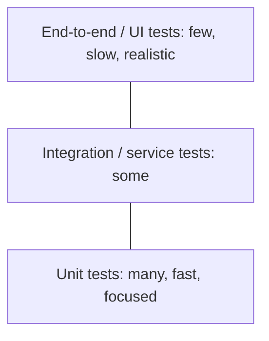
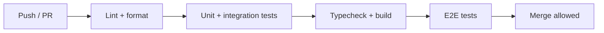

You now know how to write unit, integration, contract and end-to-end tests. The harder question is
*how many of each, and where*. Write too few tests and bugs reach users; write the wrong ones and
you get a slow, brittle suite that everyone hates. A testing strategy is the plan that answers
"what do we test, at which level, and how do we know it's working?" This session gives you the
models and tools to write one.

## The test pyramid and the testing trophy

### The test pyramid

The **test pyramid**, popularised by Mike Cohn and explained in depth in Ham Vocke's
[Practical Test Pyramid](https://martinfowler.com/articles/practical-test-pyramid.html), is a
picture of how to balance your suite:



The idea is economic. Tests lower in the pyramid are **cheap**: fast to run, easy to write, and
precise about what broke. Tests higher up are **expensive**: slower, more fragile, and a failure
tells you only that "something somewhere" is wrong. But they are also more **realistic**. So you
write lots of cheap tests and a thin layer of expensive ones covering the most important journeys.

Two lessons from the article are worth remembering even more than the shape:

- **Write tests with different granularity.** The exact layer names matter less than having both
  fine-grained and broad tests.
- **The higher you go, the fewer tests you should have.** If you find yourself writing many E2E
  tests, ask whether each could be pushed down a level.

The opposite shape, sometimes called the **ice-cream cone** (mostly manual and UI tests, almost no
unit tests), is the classic anti-pattern: slow feedback, flaky builds, and bugs found late.

### The testing trophy

Kent C. Dodds proposed the **testing trophy** for front-end applications. From bottom to top:
**static** checks (types, linters), a modest layer of **unit** tests, a *large* layer of
**integration** tests, and a small cap of **E2E** tests. The reasoning is that in UI code, most
bugs live in how components work together, and modern tools (like Testing Library) make
integration-style component tests nearly as fast as unit tests.

> [!NOTE]
> The pyramid and trophy disagree less than they seem. Both say: lots of fast feedback, few slow
> end-to-end tests, and pick the level that gives the most confidence per second of runtime. The
> trophy just counts static analysis as a layer and draws the "integration" line differently for
> UI code.

> [!TIP]
> A good rule for any single behaviour: test it at the **lowest level that can actually catch the
> bug**. A tax calculation goes in a unit test; "the checkout page shows the tax" needs, at most,
> one higher-level test.

## Coverage: useful signal, bad target

**Code coverage** measures which lines (or branches) of your code ran during the tests. Tools like
`coverage.py` (or the `pytest-cov` plugin) produce a percentage and a report highlighting unrun
lines.

Coverage is like a map of which rooms a security guard walked through. A room the guard never
entered is definitely unchecked: that's useful information. But walking through a room doesn't
mean the guard *looked* at anything.

```python
def test_discount_runs():
    apply_discount(order, "WELCOME10")   # 100% line coverage, zero assertions
```

That test executes every line of `apply_discount` and checks nothing. Coverage says 100%; the test
protects nothing.

**As a signal**, coverage is excellent: low coverage in a critical module tells you exactly where
to look, and the report shows untested branches (the `else` nobody thought about).

**As a target**, it backfires. This is Goodhart's law ("when a measure becomes a target, it ceases
to be a good measure"): mandate 90% and people write assertion-free tests for getters and
boilerplate to hit the number, while the hard, important edge cases stay untested.

> [!WARNING]
> Don't add tests just to raise a percentage. Ask instead "if this line were wrong, would any test
> fail?" **Mutation testing** tools automate that question: they introduce small bugs (flip `<` to
> `<=`, delete a line) and check whether your tests catch them. A surviving mutant is a real gap.

> [!TIP]
> A pragmatic policy many teams use: don't fix a global number, but don't let coverage *drop* on
> new code, and review the coverage report for critical modules during code review.

## Property-based testing (Hypothesis)

The tests you've written so far are **example-based**: you pick inputs and expected outputs. You
are limited by your imagination, and bugs hide precisely in the inputs you didn't imagine.

**Property-based testing** flips this. You describe a *property* that should hold for every valid
input, and a library generates hundreds of inputs trying to break it. In Python that library is
[Hypothesis](https://hypothesis.readthedocs.io/en/latest/).

```python
from hypothesis import given, strategies as st

@given(st.lists(st.integers()))
def test_sorting_is_idempotent_and_keeps_length(xs):
    once = sorted(xs)
    assert sorted(once) == once
    assert len(once) == len(xs)

@given(st.text())
def test_encode_decode_roundtrip(s):
    assert decode(encode(s)) == s
```

When Hypothesis finds a failing input, it **shrinks** it to the simplest example that still fails
(for instance, the empty string or `[0, -1]` instead of a 40-element list), which makes the bug much
easier to understand. It also remembers failing examples in a local database and replays them on the
next run.

Properties that work well in practice:

| Property | Example |
|---|---|
| **Round trip** | `decode(encode(x)) == x`, `parse(format(d)) == d` |
| **Invariant** | Sorting keeps the same elements and length |
| **Idempotence** | Normalising twice equals normalising once |
| **Oracle** | Your fast implementation matches a slow, obviously correct one |
| **Never crashes** | Any string input returns a result or a documented error |

> [!EXAMPLE]
> Testing the hash map from Track 1 with an oracle: generate a random list of `set`/`delete`
> operations, apply them to both your hash map and a Python `dict`, and assert both end up with
> the same contents. Hypothesis will find the collision-and-delete sequence your hand-written
> tests missed.

## Tests in CI and test data management

### Tests in CI

Tests only protect you if they run *every time*. **Continuous integration (CI)** runs the suite on
every push and pull request, and blocks merging when it fails. This repository's
`.github/workflows/ci.yml` is a good model: linting and format checks first (fastest feedback),
then API tests, then web lint, typecheck and build, then the Playwright end-to-end suite.



Good CI habits:

- **Fail fast:** run cheap checks first so a typo fails in seconds, not after a ten-minute E2E run.
- **Keep the main branch green.** A red main branch blocks everyone; fixing it is the top priority.
- **Make it reproducible:** CI should run the same commands developers run locally
  (here, via Docker Compose and `scripts/e2e.sh`).
- **Watch the clock.** If the suite gets slow, parallelise, split jobs, and push tests down the
  pyramid.

### Test data management

Tests need data, and data is where many test suites rot. Principles:

- **Each test owns its data.** Create what you need in the test or a fixture; never depend on rows
  from another test.
- **Use factories, not giant shared fixtures.** A helper like `make_user(email=...)` with sensible
  defaults lets each test override only what it cares about, keeping the important detail visible.
- **Isolate environments.** This project uses separate `ycdi_test` and `ycdi_e2e` databases, so
  tests never touch real data.
- **Seed deterministically.** E2E tests use a known seed script (`scripts/e2e-seed.sh`) and a fake
  LLM, so every run starts from the same state.
- **Never copy production data into tests** without anonymising it: it's a privacy and security
  risk.

## Practice: write a testing strategy for a project

Write a one-to-two-page testing strategy for this platform (or a project of your own). Use these
headings.

### Step 1: Risks

List the five things whose failure would hurt users most. For YouCanDoIt that might include: the
ROADMAP parser rejecting or misreading the curriculum, progress being lost, XP and streaks
miscalculated, the tutor failing when the LLM is unavailable.

### Step 2: Levels

For each risk, choose the lowest test level that catches it and say why. Example: "XP and streaks
are pure functions of completions: unit tests with parametrised cases plus a Hypothesis property
that XP never decreases when a completion is added."

### Step 3: Coverage and quality signals

Decide how you will judge test quality: coverage report reviewed on critical modules, a few
deliberate-bug checks, maybe mutation testing on the gamification module.

### Step 4: CI and data

Describe the CI order, the target total runtime, which databases tests use, and how E2E data is
seeded.

### Step 5: What you won't test

Be explicit about what's out of scope (e.g. visual styling details, third-party libraries'
internals) and why. A strategy that says no is a strategy; one that tests everything is a wish.

> [!TIP]
> Compare your plan with what the repository actually does in `apps/api/tests`, `apps/web/e2e` and
> `ci.yml`. Note one gap you'd close first.

```quiz
{"questions": [
  {"question": "Your team has 400 E2E tests and 30 unit tests, and the build takes 50 minutes and fails randomly. What does the test pyramid suggest?", "options": ["Add more E2E tests for coverage", "Push most behaviours down to fast unit and integration tests and keep only a few critical E2E journeys", "Remove all tests and test manually", "Run the E2E tests less often"], "answer": 1, "explanation": "This is the ice-cream-cone anti-pattern. Cheaper, lower-level tests give faster and more precise feedback; E2E tests should cover only key journeys."},
  {"question": "A module has 100% line coverage. What can you safely conclude?", "options": ["It has no bugs", "Every line ran during the tests, but not necessarily that anything was checked", "All edge cases are tested", "Its tests use mutation testing"], "answer": 1, "explanation": "Coverage shows execution, not verification. A test with no assertions can still produce full coverage."},
  {"question": "Which is a good property for a property-based test of a JSON serializer?", "options": ["serialize(x) returns a string longer than 10 characters", "deserialize(serialize(x)) == x for any valid x", "serialize always finishes in under 1 ms", "serialize(x) equals a hard-coded expected string"], "answer": 1, "explanation": "A round-trip property must hold for every valid input, which lets Hypothesis generate many cases and shrink failures."},
  {"question": "Why should CI run linting and formatting before the end-to-end suite?", "options": ["Linters need a running browser", "Cheap checks fail fast, so trivial mistakes are reported in seconds instead of after a long E2E run", "E2E tests depend on the formatter's output", "It is required by GitHub Actions"], "answer": 1, "explanation": "Ordering CI from cheapest to most expensive gives the fastest feedback for the most common mistakes."},
  {"question": "Many tests depend on one large shared fixture with dozens of pre-built users and orders. What's the main risk?", "options": ["Tests become too fast", "Tests become coupled to hidden data, so changing the fixture breaks unrelated tests and the important details are invisible", "pytest cannot load large fixtures", "It improves test isolation"], "answer": 1, "explanation": "Small factories with explicit overrides keep each test's relevant data visible and independent."}
]}
```
