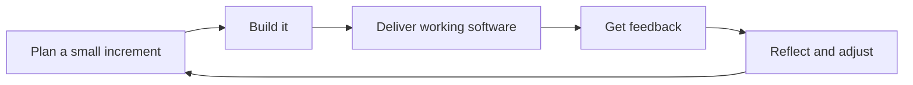
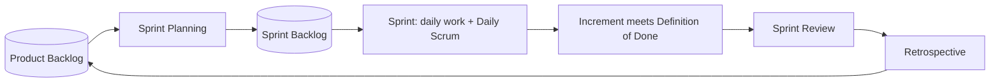

Almost every software team you join will say it is "Agile", and most will mention sprints,
stand-ups or a Kanban board on your first day. Knowing the vocabulary helps you fit in quickly;
knowing *why* the practices exist helps you tell a team that works well from one that just goes
through the motions. This session covers the Agile Manifesto, the Scrum framework, Kanban, and
how to borrow both for your own studies.

## The Agile Manifesto and its principles

In the 1990s, many software projects followed heavyweight, plan-everything-up-front processes.
Requirements were frozen for months, delivery came at the very end, and by then the world had
often moved on. In February 2001, seventeen practitioners met in Snowbird, Utah, and wrote the
[Manifesto for Agile Software Development](https://agilemanifesto.org/). It is short enough to
quote almost entirely. They came to value:

- **Individuals and interactions** over processes and tools
- **Working software** over comprehensive documentation
- **Customer collaboration** over contract negotiation
- **Responding to change** over following a plan

followed by the line most people forget: *"while there is value in the items on the right, we
value the items on the left more."* Agile is not "no documentation, no plan". It's a statement of
priorities when they conflict.

Think of the difference between planning a road trip by printing every turn in advance and driving
with a navigation app. Both have a destination. The app re-plans when there's a closed road,
because it checks reality continuously. Agile is the navigation-app mindset applied to software.

The manifesto comes with
[twelve principles](https://agilemanifesto.org/principles.html). A few carry most of the weight:

| Principle (paraphrased) | What it means day to day |
|---|---|
| Deliver working software frequently, preferring shorter timescales | Ship small increments; get feedback in weeks, not months |
| Welcome changing requirements, even late in development | Plans are hypotheses; learning is expected |
| Working software is the primary measure of progress | "90% done" doesn't count; running features do |
| Business people and developers work together daily | Developers talk to users and stakeholders directly |
| Simplicity, the art of maximising the work not done, is essential | Build the smallest thing that delivers value |
| At regular intervals, the team reflects and adjusts | Retrospectives are built into the process |



> [!WARNING]
> "We're Agile" is sometimes used to mean "no planning and changing priorities every day". That is
> chaos, not agility. Agile teams plan *constantly*, just in small, revisable chunks.

## Scrum: roles, sprints, ceremonies

**Scrum** is the most widely used framework for putting Agile values into practice. Its official
definition is [The Scrum Guide](https://scrumguides.org/scrum-guide.html), written by Ken Schwaber
and Jeff Sutherland; the current version dates from 2020 and is under twenty pages. Scrum is built
on **empiricism**: three pillars of *transparency* (everyone can see the real state of work),
*inspection* (look at it often) and *adaptation* (change course when something is off).

### Roles (the guide calls them accountabilities)

A **Scrum Team** is small (typically ten or fewer people) and has no sub-teams or hierarchy. It
contains:

- **Product Owner:** one person accountable for maximising the value of the product. Owns and
  orders the Product Backlog and decides what is worth building next.
- **Scrum Master:** accountable for the team's effectiveness. Coaches the team and organisation
  on Scrum, removes impediments, and makes sure events happen and are useful. A servant-leader,
  not a project manager.
- **Developers:** everyone who does the work of building the increment: programmers, testers,
  designers, whoever is needed. They own the Sprint Backlog and how the work gets done.

### Events

Everything happens inside a **Sprint**, a fixed time-box of one month or less (two weeks is
common). A new Sprint starts immediately after the previous one ends.

| Event | Purpose | Time-box (for a one-month Sprint) |
|---|---|---|
| **Sprint Planning** | Decide *why* this Sprint is valuable (Sprint Goal), *what* can be done, *how* | max 8 hours |
| **Daily Scrum** | Developers inspect progress towards the Sprint Goal and adapt the plan | 15 minutes |
| **Sprint Review** | Show the result to stakeholders, discuss what to do next | max 4 hours |
| **Sprint Retrospective** | Inspect how the team worked and pick improvements | max 3 hours |

Shorter Sprints usually get shorter events. People often call these events "ceremonies"; the guide
itself just says *events*.

### Artefacts

Each artefact comes with a **commitment** that gives it focus:

- **Product Backlog** → **Product Goal**: the ordered list of everything that might be built,
  pointing at a long-term objective.
- **Sprint Backlog** → **Sprint Goal**: the items chosen for this Sprint plus the plan to deliver
  them, serving a single objective.
- **Increment** → **Definition of Done**: a usable, verified piece of product. Work that doesn't
  meet the Definition of Done is not part of the Increment.



> [!NOTE]
> The Daily Scrum is not a status report to a manager. It's the Developers re-planning their next
> 24 hours together. "What I did yesterday / today / blockers" is a popular format, but the guide
> leaves the format to the team.

> [!WARNING]
> A common anti-pattern is "Scrum-but": sprints without a Sprint Goal, reviews without
> stakeholders, retrospectives that never change anything. The events are there to create
> feedback loops; if the loop is broken, the event is just a meeting.

## Kanban and flow

**Kanban** comes from Toyota's manufacturing system (the word means roughly "signboard" or "card"
in Japanese) and was adapted to knowledge work. Where Scrum is built around fixed time-boxes,
Kanban is built around **continuous flow**: work items move across a board as capacity frees up,
with no sprints required.

The core practices are simple:

1. **Visualise the work.** A board with columns for each stage, e.g. *To do → In progress →
   Review → Done*, and a card per item.
2. **Limit work in progress (WIP).** Each column has a maximum number of cards. If "Review" holds
   3 of 3, nobody starts new work: they help finish reviews instead.
3. **Manage flow.** Measure how long items take from start to finish (**cycle time**) and from
   request to delivery (**lead time**), and remove the bottlenecks.

Think of a motorway. Adding more cars beyond a certain point doesn't increase throughput; it
creates a traffic jam. WIP limits are the on-ramp traffic lights that keep traffic moving.

> [!EXAMPLE]
> A team has 12 items "in progress" across 4 people. Everything is 70% done and nothing ships.
> They introduce a WIP limit of 2 per person and a rule "stop starting, start finishing". Within
> a couple of weeks, fewer things are open at once but more things reach *Done*, and each item's
> cycle time drops because it no longer waits in queues.

There's a simple relationship behind this, known as **Little's Law**: on average, *lead time =
work in progress ÷ throughput*. If you keep finishing the same number of items per week but halve
the number in progress, each item takes half as long to get through.

| | Scrum | Kanban |
|---|---|---|
| Cadence | Fixed Sprints | Continuous flow |
| Roles | Product Owner, Scrum Master, Developers | None prescribed |
| Change during the cycle | Sprint Goal stays stable | New items enter any time, within WIP limits |
| Key metric | Sprint Goal met, increment delivered | Cycle time, throughput |

Many teams combine them: Scrum events with a WIP-limited board. Pick what serves the team.

## Practice: run a personal two-week sprint on your study plan

Apply Scrum and Kanban to your own learning for two weeks. You are Product Owner, Scrum Master and
Developer at once.

### Step 1: Build a Product Backlog

List the sessions, practice tasks and reviews you want to complete in the next month or two. Order
them by value: what unlocks the most for your goal (a job, a project)? Write a one-line **Product
Goal**, e.g. "Be able to build and test a small FastAPI service by the end of Track 3."

### Step 2: Sprint Planning

Pick a **Sprint Goal** for the next two weeks ("Finish Module 2.2 and write tests for my Track 1
data structures"). Move only the items that serve it into your Sprint Backlog, using the realistic
time budget from your study plan (Session 0.1.1). Write a **Definition of Done**, e.g. "subchapters
ticked, quiz passed the next day, practice task committed to git".

### Step 3: Set up a board with WIP limits

Use a simple board (paper, a GitHub Project, or a notes app) with *To do*, *Doing* (WIP limit 2),
*Review* (spaced-repetition reviews) and *Done*.

### Step 4: Daily Scrum, five minutes

Each study day, look at the board and answer: am I on track for the Sprint Goal? What's my next
step? What's blocking me?

### Step 5: Review and Retrospective

At the end of the two weeks, demo your increment to yourself (or a friend): run the tests, explain
a concept aloud. Then run a retrospective: what went well, what didn't, and **one** concrete change
for the next sprint. Write it down and carry it into the next Sprint Planning.

> [!TIP]
> Track how many items you planned versus finished. After two or three sprints you'll have real
> data about your pace, which is exactly what Session 2.3.3 on estimation builds on.

```quiz
{"questions": [
  {"question": "Which statement best reflects the Agile Manifesto's value 'working software over comprehensive documentation'?", "options": ["Documentation should never be written", "Both matter, but when they conflict, delivering working software takes priority", "Documentation is more important than code", "Only working software should be shown to customers"], "answer": 1, "explanation": "The manifesto explicitly says there is value in the items on the right; it states priorities, not prohibitions."},
  {"question": "Who is accountable for ordering the Product Backlog in Scrum?", "options": ["The Scrum Master", "The Developers", "The Product Owner", "The stakeholders by majority vote"], "answer": 2, "explanation": "The Product Owner is accountable for maximising product value, which includes ordering the Product Backlog."},
  {"question": "What is the main purpose of the Daily Scrum?", "options": ["Reporting status to a manager", "Developers inspecting progress towards the Sprint Goal and adapting their plan", "Demonstrating features to stakeholders", "Estimating the whole Product Backlog"], "answer": 1, "explanation": "The Daily Scrum is a short planning event for the Developers, not a status meeting."},
  {"question": "A team has many items 'in progress' and very few finished. Which Kanban practice addresses this most directly?", "options": ["Adding more columns to the board", "Limiting work in progress", "Starting more items in parallel", "Switching to one-month sprints"], "answer": 1, "explanation": "WIP limits force the team to finish before starting, which reduces queues and shortens cycle time (Little's Law)."},
  {"question": "Work that doesn't meet the Definition of Done at the end of a Sprint is:", "options": ["Released anyway to meet the deadline", "Not part of the Increment; it returns to the Product Backlog for consideration", "Automatically moved to the next Sprint's Sprint Goal", "Counted as 50% done in the Sprint Review"], "answer": 1, "explanation": "The Definition of Done is the commitment that makes the Increment trustworthy. Unfinished work is not presented as done."}
]}
```
