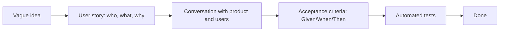
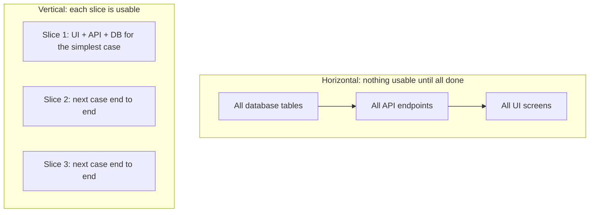

Most failed features don't fail because the code was bad. They fail because the team built the
wrong thing, or the right thing in a way nobody could use, or something nobody could tell was
finished. Turning "it would be nice if users could..." into work a developer can build and a tester
can check is a core senior skill. This session covers the kinds of requirements, how to write user
stories with acceptance criteria, and how to slice big ideas into small deliverables.

## Functional vs non-functional requirements

A **requirement** is something the system must do or be. Requirements come in two broad kinds,
and you need both.

**Functional requirements** describe *what* the system does: its behaviour. They usually read as
"the system shall..." or "the user can...":

- A learner can mark a subchapter as complete.
- The API returns the learner's current streak.
- An admin can trigger a news refresh.

**Non-functional requirements** (NFRs, sometimes called *quality attributes*) describe *how well*
the system does it: speed, reliability, security, usability and so on.

- The session page loads in under two seconds on a mid-range phone.
- Progress is never lost if the API restarts.
- Only the owner can see their completions.
- The UI meets WCAG accessibility guidelines.

The analogy: a functional requirement for a car is "it can carry five people"; non-functional ones
are "it does 0–100 km/h in under ten seconds", "it gets five safety stars", "it is quiet at
motorway speed". Two cars can satisfy the same functional list and feel completely different.

| Category | Example question |
|---|---|
| Performance | How fast must it respond, under what load? |
| Availability / reliability | How much downtime is acceptable? What happens on failure? |
| Security / privacy | Who can see or change what? What data must be protected? |
| Usability / accessibility | Can a keyboard or screen-reader user complete the task? |
| Maintainability | How easy is it to change, test, deploy? |
| Scalability | What happens with ten times the users or data? |

> [!WARNING]
> NFRs are the requirements most often forgotten, because nobody asks for them out loud until
> they're violated. "Of course it should be fast" and "obviously only I can see my data" are
> requirements too. Ask about them explicitly, and make them **measurable**: "fast" can't be
> tested; "p95 response time under 300 ms" can.

> [!NOTE]
> Many architecture decisions (Module 2.5) are driven by non-functional requirements, not
> functional ones. A to-do app for one user and a to-do app for ten million users have almost the
> same features and completely different architectures.

## User stories and acceptance criteria

A **user story** is a short description of a capability, told from the point of view of the person
who wants it. Martin Fowler's [User Story](https://martinfowler.com/bliki/UserStory.html) article
traces them to Extreme Programming, where they were deliberately kept small and informal: a
placeholder for a conversation, not a full specification.

The most common template is:

> *As a* **[type of user]**, *I want* **[some goal]**, *so that* **[some reason]**.

```text
As a learner returning after a break,
I want to see which sessions are due for review,
so that I can refresh what I'm about to forget before learning new material.
```

Each part does a job. **Who** reminds you there's a real person with a context. **What** is the
capability, phrased as a goal, not a UI design ("see which sessions are due", not "a red badge in
the sidebar"). **Why** is the most valuable part: it lets the team propose a better solution than
the one requested, and lets the Product Owner judge value.

A useful way to remember what a story is comes from Ron Jeffries' **three Cs**:

- **Card:** the short written story, small enough for an index card.
- **Conversation:** the discussion between developers, product and users that fills in the
  details. This is where the real requirements emerge.
- **Confirmation:** the acceptance criteria that tell everyone when the story is done.

### Acceptance criteria

**Acceptance criteria** are the testable conditions a story must meet. A popular format is
**Given–When–Then**, which maps neatly onto arrange–act–assert from Session 2.2.1:

```gherkin
Scenario: a session learned three days ago is due
  Given I completed session 2.2.1 three days ago
  And I have not reviewed it since
  When I open the dashboard
  Then I see session 2.2.1 in the "Due for review" list

Scenario: nothing is due
  Given I have no sessions due for review
  When I open the dashboard
  Then I see "You're all caught up"
```

Good acceptance criteria cover the happy path, the important edge cases (nothing due, many due)
and relevant NFRs ("the list loads with the rest of the dashboard, no extra spinner").

> [!TIP]
> A handy checklist for story quality is **INVEST**: Independent, Negotiable, Valuable, Estimable,
> Small, Testable. If a story fails "Testable", its acceptance criteria are missing or vague. If
> it fails "Small", see the next section.



> [!WARNING]
> "As a developer, I want to refactor the database layer" is not a user story: no user, no
> user-visible value. Technical work is real and necessary, but describe it honestly as a technical
> task and explain which user-facing outcome it enables.

## Slicing work into small deliverables

Big stories are risky. They take weeks, hide surprises until the end, and are hard to estimate.
Small stories deliver feedback early and keep work flowing (remember the Agile principle about
delivering frequently, from Session 2.3.1 and the
[Agile Manifesto](https://agilemanifesto.org/)).

The key idea is **vertical slicing**. Think of a layered cake: a slice cut from top to bottom
contains a bit of every layer, and you can eat it on its own. A horizontal slice (only the
sponge, only the cream) is useless alone.



A vertical slice goes through every layer (UI, API, database) for a *narrow* piece of behaviour,
so it can be demonstrated and shipped.

Ways to slice a big story:

| Technique | Example for "review reminders" |
|---|---|
| **Simplest case first** | Show due sessions with a fixed +3-day rule before supporting a full schedule |
| **By rule or variation** | First +1/+3/+7 days; later, custom intervals |
| **By data or user type** | Only completed sessions first; partial sessions later |
| **By interface** | Dashboard list first; email reminders later |
| **Defer non-essential qualities** | Plain list first; sorting, filtering and animations later |
| **Spike** | Time-boxed research when you don't know enough to slice yet |

> [!EXAMPLE]
> "Users can export their progress" might slice into: (1) download a CSV of completed subchapters;
> (2) include dates and XP; (3) JSON format too; (4) scheduled monthly export by email. Slice 1 is
> useful on its own, in days rather than weeks, and teaches you whether anyone uses exports before
> you build slice 4.

A good rule of thumb: a story should fit comfortably inside one sprint, ideally a few days of work.
If a story can't be demonstrated to a user on its own, it is probably a horizontal slice in
disguise.

## Practice: write stories for a YouCanDoIt feature

Pick a feature you'd genuinely like in this platform. Some ideas: review reminders based on spaced
repetition, notes per subchapter, a weekly progress email, or exporting your progress.

### Step 1: Write the raw idea and the "why"

One paragraph: what problem does it solve, for whom? If you can't say *why*, stop here and think.

### Step 2: List requirements of both kinds

Write three to five functional requirements and at least three non-functional ones (privacy,
performance, accessibility, behaviour when the LLM or database is down). Make each NFR measurable.

### Step 3: Write the epic story and slice it

Write one big "epic" story, then slice it vertically into four to six stories using the table above.
Order them so each one delivers value on its own and the riskiest assumption is tested early.

### Step 4: Add acceptance criteria

For the first two stories, write Given–When–Then scenarios: happy path, at least one edge case, and
one NFR check. Check each story against INVEST.

### Step 5: Get a second opinion

Show the stories to someone (a peer, or the platform's tutor) and ask: "Could you build and test
this without asking me anything?" Every question they ask is a gap in your acceptance criteria.
Update the stories and keep them in your notes repo: you'll estimate them in Session 2.3.3.

```quiz
{"questions": [
  {"question": "Which of these is a non-functional requirement?", "options": ["A learner can mark a subchapter as complete", "The dashboard shows the current streak", "The session page loads in under two seconds on a mid-range phone", "An admin can trigger a news refresh"], "answer": 2, "explanation": "It describes how well the system performs, not what it does. It's also measurable, which makes it testable."},
  {"question": "Why is the 'so that...' part of a user story valuable?", "options": ["It is required by Scrum", "It explains the purpose, letting the team propose better solutions and judge value", "It defines the database schema", "It replaces acceptance criteria"], "answer": 1, "explanation": "Knowing the goal behind the request lets developers and product owners find simpler or better ways to meet it."},
  {"question": "What do acceptance criteria provide that the story card alone does not?", "options": ["An estimate in hours", "Testable conditions that confirm when the story is done", "The name of the developer", "The UI colour scheme"], "answer": 1, "explanation": "Acceptance criteria are the 'confirmation' of the three Cs: concrete, checkable conditions, often written as Given/When/Then."},
  {"question": "A team splits a feature into 'build all tables', 'build all endpoints', 'build all screens'. What's the problem?", "options": ["Nothing, this is vertical slicing", "These are horizontal slices: nothing is usable or demonstrable until all three are done", "They should start with the screens", "Database work should never be a story"], "answer": 1, "explanation": "Vertical slices cut through every layer for a narrow behaviour, so each one can be demonstrated and gives early feedback."},
  {"question": "Which story best follows INVEST?", "options": ["As a developer, I want to rewrite the backend", "As a learner, I want the app to be better", "As a learner, I want to download my completed subchapters as CSV so that I can keep my own records", "As a user, I want every possible export format with scheduling and filters"], "answer": 2, "explanation": "It names a user and a purpose, is small, valuable on its own and testable. The others are technical tasks, vague, or too big."}
]}
```
