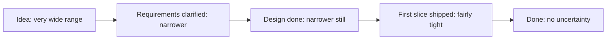
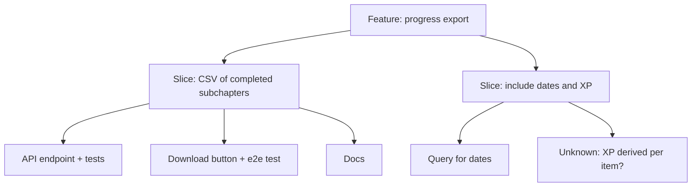

"How long will this take?" is the question developers dread most, and the one you'll hear in
almost every planning meeting. Junior developers tend to answer with a single optimistic number and
then work evenings to hit it. Senior developers answer differently: they ask what the estimate is
for, give a range, name the risks, and update the forecast as they learn. This session teaches that
second way.

## Why estimates are hard and what they are for

### Why they're hard

Estimating software is like estimating how long it will take to drive through a city you've never
visited, where some of the roads haven't been built yet. A few reasons it is genuinely difficult:

- **Novelty.** If you had built exactly this before, you'd reuse it. Most software work is at
  least partly new, and the new part is where surprises live.
- **Unknown unknowns.** You can list the risks you know about. The ones that hurt are the ones you
  don't: a library bug, an undocumented API limit, a requirement nobody mentioned.
- **The planning fallacy.** Psychologists Daniel Kahneman and Amos Tversky described how people
  systematically underestimate their own tasks, even when they know similar tasks ran late before.
  We imagine the smooth path and forget interruptions, reviews, bugs and meetings.
- **Uncertainty shrinks over time.** At the idea stage, an estimate can be off by a large factor.
  Once the design is done and the first slice is built, it's much tighter. This narrowing is often
  drawn as the **cone of uncertainty**.



### What they're for

Martin Fowler's [Purpose of Estimation](https://martinfowler.com/bliki/PurposeOfEstimation.html)
makes a simple but powerful point: an estimate is only worth producing if it helps someone make a
**significant decision**. Before estimating, ask: *what decision will this number inform?*

| Decision | What kind of estimate helps |
|---|---|
| Should we build this at all? Is it worth the cost? | Rough order of magnitude: days, weeks or months? |
| Which of these two features first? | Relative size: is A much bigger than B? |
| Can we promise this for the March conference? | A range with a confidence level |
| How much fits in this sprint? | Small items, sized by the team doing the work |

If no decision depends on it, the estimate is waste, and you can spend that time building instead.
Fowler also notes that a team delivering small items at a steady pace can often *forecast* from its
track record rather than estimating each item in detail.

> [!WARNING]
> An estimate is not a commitment, and a target is not an estimate. "We need it by Friday" is a
> target. "Based on what we know, it's likely 4–7 days" is an estimate. Conflating the two leads to
> estimates bent to match deadlines, which then help nobody decide anything.

## Relative estimation and ranges

### Relative estimation

People are bad at absolute estimates ("this will take 13 hours") but surprisingly good at
comparisons ("this is about twice as big as that"). Think of looking at two buildings: you can't
tell their exact height in metres, but you can easily say one is about twice as tall.

**Relative estimation** uses that strength. Teams pick a reference item and size everything else
against it:

- **Story points:** an abstract unit of size (effort, complexity and uncertainty together), often
  on a Fibonacci-like scale (1, 2, 3, 5, 8, 13...). The growing gaps reflect that bigger items are
  less certain: arguing whether something is 11 or 12 is pointless.
- **T-shirt sizes:** XS, S, M, L, XL. Great for early, rough sizing of a whole backlog.
- **Planning poker:** each team member picks a card privately, everyone reveals at once, and the
  highest and lowest explain their reasoning. The discussion is the point: it surfaces hidden
  complexity ("you forgot the migration") or hidden simplicity ("there's already a helper for
  that").

Over a few sprints, a team learns how many points it typically finishes (its **velocity**), which
turns relative sizes into a forecast. The [Scrum Guide](https://scrumguides.org/scrum-guide.html)
leaves the method open but is clear that the Developers who will do the work are responsible for
sizing it.

> [!NOTE]
> Story points only mean something *inside one team*. Comparing velocity between teams, or using it
> as a performance target, makes teams inflate their points and destroys the signal.

### Ranges

A single number hides the uncertainty that the decision-maker most needs to know about. Give a
**range** instead, ideally with a confidence: "3–6 days, I'm fairly confident it's under 6".

One structured method is the **three-point estimate**: an optimistic (O), most likely (M) and
pessimistic (P) value. A common way to combine them is the PERT weighting, (O + 4M + P) ÷ 6, but
even without the formula, *thinking* about the pessimistic case forces you to list what could go
wrong.

> [!EXAMPLE]
> "Add CSV export of progress": optimistic 1 day (one endpoint, one button), most likely 2 days
> (plus tests and date formatting), pessimistic 5 days (large accounts time out and we need
> streaming). PERT gives (1 + 8 + 5) ÷ 6 ≈ 2.3 days. What you tell the Product Owner: "About 2–3
> days; up to a week if large exports need streaming. I'll know which by tomorrow afternoon."

That last sentence matters: it tells people *when* the uncertainty will shrink.

## Breaking down work and identifying risks

The single most effective way to estimate better is to **make the pieces smaller**. Small tasks are
easier to understand, easier to compare, and errors on them partly cancel out. A two-month task
estimated as one block hides everything; twenty two-day tasks expose their unknowns.

Start from the vertical slices you learned to write in Session 2.3.2, then break each slice into
tasks:



As you break things down, **mark the unknowns**. Each unknown is a risk. For each one, decide:

| Response | Example |
|---|---|
| **Spike it** (time-boxed research) | "Spend 2 hours checking whether XP per item can be derived cheaply" |
| **Do it first** | Tackle the riskiest slice early, while there is time to change plan |
| **Buffer it** | Widen the range and say why |
| **Cut it** | Remove it from scope for now if it isn't essential |

> [!TIP]
> Don't forget the invisible work: code review, tests, migrations, documentation, deployment,
> waiting for feedback. A simple checklist of these, applied to every estimate, removes a whole
> class of underestimation.

> [!WARNING]
> Padding every estimate secretly ("I'll say 5 when I think 3") feels safe but damages trust and
> planning. Be open about uncertainty instead: give the range and name the risk.

Finally, **re-estimate as you learn**. An estimate is a forecast, like a weather forecast: it's
updated as new information arrives, and nobody calls the forecaster a liar for changing it. Tell
people early when the forecast changes, not on the due date.

## Practice: estimate and track a feature, then review accuracy

Use the stories you wrote in Session 2.3.2, or any small feature you plan to build in the next
week or two.

### Step 1: Break it down

Split the feature into tasks of at most one day each. Add the invisible work: tests, review,
docs, deployment.

### Step 2: Estimate with ranges

For each task write optimistic, most likely and pessimistic times. Mark every unknown and choose a
response (spike, do first, buffer, cut). Write down the decision your estimate informs ("Can I
finish this before starting Module 2.4?").

### Step 3: Track actuals

Keep a simple log as you work: task, estimate range, actual time, and a note when something
surprised you.

| Task | Estimate (O / M / P) | Actual | Surprise? |
|---|---|---|---|
| API endpoint + tests | 2h / 3h / 6h | 4h | Date timezone handling |
| Download button | 1h / 1h / 3h | 1h | — |

### Step 4: Review accuracy

When you finish, compare. How many actuals fell inside your range? Were you systematically
optimistic? Which *kind* of surprise came up most (unclear requirements, tooling, testing,
interruptions)?

### Step 5: Adjust your process

Write down one change for next time: a new item on your invisible-work checklist, a habit of
spiking unknown libraries first, or wider ranges for UI work. Over several features your estimates
will calibrate, and you'll have data to back them up in planning meetings.

```quiz
{"questions": [
  {"question": "According to Fowler's 'Purpose of Estimation', what should you ask before producing an estimate?", "options": ["How many hours exactly will it take?", "What significant decision will this estimate inform?", "Which developer is fastest?", "What is the team's velocity in other companies?"], "answer": 1, "explanation": "Estimates have value only when they help someone decide. If no decision depends on one, the effort is better spent building."},
  {"question": "Why do many teams use relative estimation such as story points?", "options": ["Because absolute hours are forbidden by Scrum", "Because people compare sizes far more reliably than they predict absolute durations", "Because points can be compared across companies", "Because it removes all uncertainty"], "answer": 1, "explanation": "Relative sizing exploits our skill at comparison; velocity then turns sizes into forecasts within a single team."},
  {"question": "Your manager asks for a deadline. Which answer is most useful?", "options": ["'Friday', with no further detail", "'3–6 days; the risk is the export timeout, I'll know more tomorrow afternoon'", "'Impossible to say'", "'Whenever it's done'"], "answer": 1, "explanation": "A range plus the main risk and when uncertainty will shrink gives the decision-maker real information."},
  {"question": "A two-month feature is estimated as a single block. What is the most effective way to improve the estimate?", "options": ["Multiply it by three", "Break it into small vertical slices and tasks, marking the unknowns", "Ask the most senior developer for a number", "Wait until it's finished"], "answer": 1, "explanation": "Smaller pieces expose hidden work and risks, are easier to compare, and their errors partly cancel out."},
  {"question": "Halfway through, you realise a task will take twice your estimate. What should you do?", "options": ["Say nothing and work overtime", "Tell stakeholders early with the updated forecast and the reason", "Wait until the due date to mention it", "Drop the tests to catch up"], "answer": 1, "explanation": "Estimates are forecasts to update as you learn. Early notice lets others adjust their plans."}
]}
```
