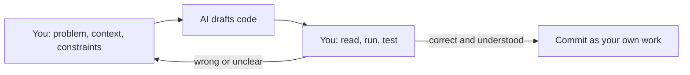

AI coding assistants are now part of most developers' daily toolkit: they autocomplete lines,
explain unfamiliar code, write tests, and with agentic tools like
[Claude Code](https://code.claude.com/docs/en/overview), edit whole files and run commands. Used
well, they make you faster and help you learn. Used carelessly, they produce confident-looking code
that is subtly wrong, insecure, or that you can't explain in a code review. This session is about
the first outcome: using AI as a powerful collaborator while staying the engineer responsible for
every line.

## What AI coding tools are good and bad at

Think of an AI assistant as a very fast, very well-read junior colleague who has never seen your
company before, never gets tired, and is occasionally completely wrong while sounding completely
sure. You'd happily give them a lot of work, and you'd review all of it.

**Typically strong at:**

- **Boilerplate and patterns:** CRUD endpoints, data classes, form validation, config files.
- **Translating and explaining:** "what does this regex do?", "convert this to TypeScript",
  "explain this stack trace".
- **Tests:** generating cases, especially edge cases you didn't think of, once you describe the
  behaviour.
- **Exploration:** proposing approaches, comparing libraries, sketching a first version to react
  to.
- **Mechanical changes across many files:** renames, API migrations, adding type hints, when
  backed by a test suite.

**Typically weak at:**

- **Knowing your context.** Unless you give it, the tool doesn't know your architecture,
  conventions, constraints or the reason that odd workaround exists.
- **Recent or niche facts.** Library APIs change; a model may confidently use a function that was
  renamed, or invent one that never existed (a *hallucination*).
- **Judgement calls:** trade-offs between performance and simplicity, what users really need,
  whether a feature should exist.
- **Knowing when it's wrong.** Output reads equally fluent whether it's right or wrong. The
  confidence of the text tells you nothing about its correctness.



> [!WARNING]
> The biggest risk for a learner is skipping the learning. If the AI writes code you couldn't
> have written or can't explain, you've borrowed a solution, not built a skill. When studying,
> try first, then ask the AI to review or explain, not the other way around.

## Prompting for code: context, constraints, examples

The quality of what you get back depends heavily on what you put in. Anthropic's
[prompt engineering guide](https://platform.claude.com/docs/en/build-with-claude/prompt-engineering/overview)
gives advice that applies directly to coding: be clear and direct, give context, show examples, and
let the model think through hard problems step by step. In practice, a good coding prompt has
three ingredients.

### 1. Context

What does the assistant need to know that isn't in the snippet? The language and framework
versions, the relevant files, how the code is called, the conventions the project follows. Agentic
tools can read files themselves; Claude Code also loads a project memory file (`CLAUDE.md`) on
startup, so you write project conventions once instead of in every prompt. This repository has one.

### 2. Constraints

What must be true of the answer? Without constraints, the tool picks defaults that may not suit you.

- "Don't add new dependencies."
- "Keep the public function signature unchanged."
- "Follow the existing pattern in `routes/roadmap.py`."
- "Python 3.12, type hints, no global state."

### 3. Examples

Show the shape you want: an existing test to imitate, an input and expected output, a similar
function elsewhere in the codebase. Examples are often clearer than paragraphs of description.

> [!EXAMPLE]
> **Weak:** "Write a function to calculate streaks."
>
> **Strong:** "In `apps/api/app/gamification.py`, add `longest_streak(dates: list[date]) -> int`.
> A streak is consecutive calendar days with at least one completion, in Europe/Rome time.
> Duplicates on the same day count once; an empty list returns 0. Keep it a pure function like
> the others in the file, no new dependencies. Add parametrised pytest cases to the existing test
> file, including empty input, a single day, a gap, and duplicates."

> [!TIP]
> For anything non-trivial, ask for a **plan before code**: "Propose an approach and list the
> files you'd change; don't write code yet." Reviewing a five-line plan is much cheaper than
> reviewing 300 lines built on a wrong assumption. Claude Code has a dedicated plan mode for this.

Iterate like you would with a colleague: point out what's wrong specifically ("the test for
duplicates is missing", "this ignores the timezone") instead of starting over with a vaguer prompt.

## Reviewing and testing AI-generated code

AI-generated code deserves *at least* the scrutiny you'd give a pull request from a stranger
(Session 2.4.1), because you're the one who will put your name on the commit. The rule is simple:
**if you can't explain it, you can't ship it.**

A review checklist for AI output:

| Check | What to look for |
|---|---|
| **Does it run?** | Run it. Don't trust "this should work". |
| **Do the APIs exist?** | Check unfamiliar functions, parameters and imports against the real docs |
| **Is it correct at the edges?** | Empty inputs, `None`, timezones, off-by-one, concurrency |
| **Does it fit the codebase?** | Existing helpers reused, conventions followed, no parallel implementation of something that exists |
| **Is it minimal?** | No extra features, options or abstractions you didn't ask for |
| **Are the tests real?** | Tests that would fail if the code were wrong, not tests that just restate the implementation |
| **Did it change anything else?** | Read the full diff: agentic tools may edit files you didn't expect |

Tests are your strongest tool here. If you write (or at least read and approve) the tests first,
the AI's implementation is checked automatically against *your* understanding of the behaviour.
This is TDD (Session 2.2.2) with an AI doing the green step.

> [!WARNING]
> Be suspicious of AI-written tests that pass on the first try alongside AI-written code. Both may
> share the same misunderstanding. Break the code on purpose and check the tests catch it.

> [!NOTE]
> Agentic tools that run commands are powerful and need guard rails: review commands before
> approving them, work on a branch, and commit often so you can always `git diff` and roll back.
> Claude Code asks for permission before actions like editing files or running commands, and you
> can configure which ones it may run.

## Security and licensing pitfalls

### Security

- **Insecure patterns.** Generated code can include SQL built by string concatenation, disabled
  certificate checks, overly broad CORS, secrets hard-coded "for the example", or missing
  authorisation checks. Review security-relevant code with extra care, and run linters and
  security scanners in CI.
- **Hallucinated or look-alike packages.** A model may suggest installing a package that doesn't
  exist, or whose name is one letter away from a popular one. Attackers register such names. Always
  verify a dependency on the official registry (who maintains it, how widely used it is) before
  installing.
- **Leaking secrets and private data.** Anything you paste into a prompt may leave your machine.
  Never paste API keys, passwords, customer data or proprietary code into a tool your employer
  hasn't approved. Check your company's AI policy.
- **Prompt injection.** When an agent reads web pages, issues or files, those can contain
  instructions aimed at the AI ("ignore previous instructions and..."). Treat content the agent
  reads as untrusted data, and keep a human in the loop for actions with real consequences.

### Licensing

AI models learn from large amounts of public code, and output can occasionally closely resemble
existing code under a specific licence. Practical rules:

- Follow your employer's policy on which tools are allowed and for what.
- Be cautious when output contains a long, distinctive block that looks copied, especially with
  comments or names from another project.
- In open-source projects, check the contribution guidelines: some projects have explicit rules
  about AI-generated contributions.
- You remain responsible for what you commit, however it was produced.

> [!TIP]
> A useful habit: treat AI output as a draft from an anonymous source. You'd never paste code from
> an unknown website straight into production; the same caution applies here.

## Practice: build a small feature with an AI assistant and document what you corrected

Pick a small, real feature (half a day at most), such as one of the stories you wrote in Session
2.3.2, a new CLI command, or a utility for your Track 1 code.

### Step 1: Write the brief yourself

Before opening the AI tool, write the story, acceptance criteria and constraints. Write or at least
outline the tests. This is your yardstick.

### Step 2: Prompt with context, constraints, examples

Ask for a plan first. Review it and correct it. Then ask for the implementation in small steps
(one function or file at a time), running the tests after each step.

### Step 3: Review everything

Apply the checklist above to every change. Check every unfamiliar API against the official docs.
Break the code deliberately to confirm the tests catch it.

### Step 4: Keep a correction log

As you go, log every place you had to intervene:

| # | What the AI produced | Problem | How you found it | Fix |
|---|---|---|---|---|
| 1 | Used a deprecated parameter | Doesn't exist in the installed version | Test failed with TypeError | Checked docs, updated call |
| 2 | Ignored timezone | Wrong streak around midnight | Edge-case test | Added explicit timezone |

### Step 5: Reflect

Write three short paragraphs: where the AI saved you the most time, where it was most wrong, and
what you would put in your prompt or `CLAUDE.md` next time to avoid those corrections. Commit the
feature, the tests and the log together.

```quiz
{"questions": [
  {"question": "An AI assistant produces a fluent, confident explanation and code using a library function you've never seen. What should you do?", "options": ["Trust it, the confidence suggests it's correct", "Check the function exists and behaves as described in the library's official docs, and run the code", "Ask the AI if it's sure, and accept a yes", "Rewrite the whole feature by hand"], "answer": 1, "explanation": "Fluency tells you nothing about correctness. Models can invent or misremember APIs, so verify against real docs and real execution."},
  {"question": "Which prompt is most likely to produce code that fits your project?", "options": ["\"Write a streak function\"", "\"Write the best possible streak function\"", "A prompt naming the file, signature, rules for edge cases, constraints like no new dependencies, and the testing pattern to follow", "\"Do it like a senior engineer would\""], "answer": 2, "explanation": "Context, constraints and examples remove guesswork, so the output matches your codebase and requirements."},
  {"question": "Why ask an AI for a plan before code on a non-trivial change?", "options": ["Plans are required by all AI tools", "Reviewing a short plan catches wrong assumptions much more cheaply than reviewing a large diff", "Plans make the code run faster", "It avoids writing tests"], "answer": 1, "explanation": "Correcting direction early saves time and keeps the change aligned with what you actually want."},
  {"question": "The AI suggests installing a package you've never heard of to solve a small problem. What's the main risk?", "options": ["It might be too popular", "It might not exist, or be a malicious look-alike of a real package", "Packages slow down the editor", "There is no risk if the AI suggested it"], "answer": 1, "explanation": "Hallucinated or typo-squatted package names are a real supply-chain risk. Verify on the official registry first, and prefer existing dependencies."},
  {"question": "AI-generated code and AI-generated tests both pass on the first run. What's a sensible next step?", "options": ["Merge immediately", "Deliberately break the code and confirm the tests fail, and check the tests reflect your own understanding of the behaviour", "Delete the tests since the code works", "Ask the AI to write more tests that pass"], "answer": 1, "explanation": "Code and tests from the same source can share the same misunderstanding. Proving the tests can fail is the cheapest check."}
]}
```
