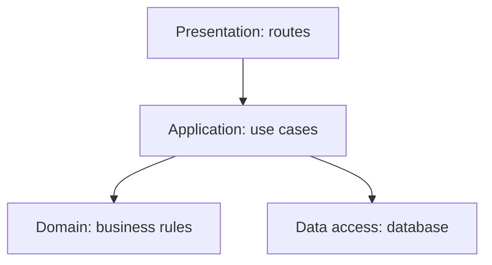
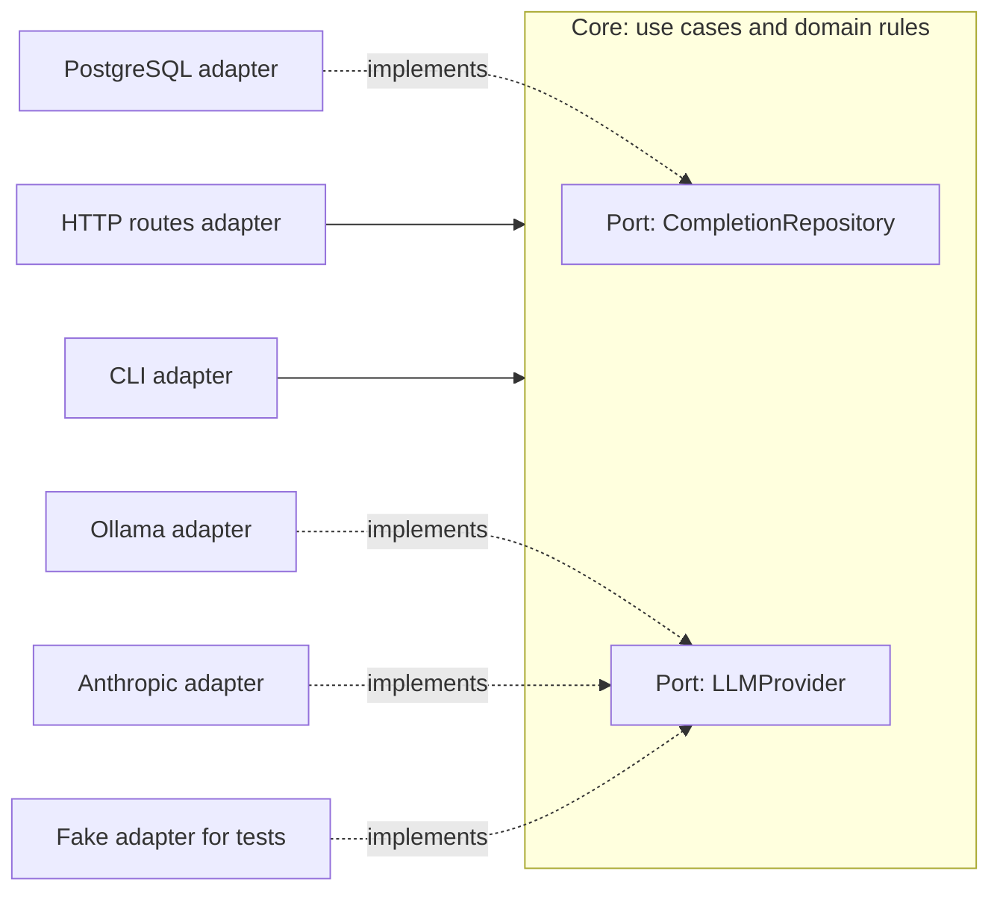

So far in this track you've worked at the level of functions, tests and pull requests. Architecture
zooms out: how the whole application is divided into parts, which parts may depend on which, and
where the boundaries sit. Good architecture is mostly invisible: features are easy to add, tests
are easy to write, and changing the database or the UI framework doesn't mean rewriting
everything. Bad architecture shows up as "we can't change that, everything depends on it". This
session gives you the core vocabulary and patterns.

## What architecture is: the decisions that are hard to change

There's no single agreed definition of software architecture, and Martin Fowler's
[Software Architecture Guide](https://martinfowler.com/architecture/) leans into that. He
highlights two framings, both from Ralph Johnson: architecture is the **shared understanding** that
expert developers have of how the system is designed, and it is **the decisions you wish you
could get right early in a project**. Johnson's punchline: architecture is about the important
stuff, whatever that is. In practice, the important stuff is usually what is **hard to change**
later.

Think of a house. You can repaint walls, change furniture and replace the kitchen taps any time.
Moving the staircase, adding a basement or changing the foundations is a different kind of
decision: expensive, disruptive, and constraining everything built on top. Those are the
architectural decisions.

In software, typical hard-to-change decisions include:

- How the code is split into modules or services, and how they talk to each other.
- The core data model and the main database technology.
- The direction of dependencies: what is allowed to know about what.
- The deployment model: one process, many services, serverless functions.
- Cross-cutting choices: authentication, configuration, error handling, observability.

Fowler's key argument is economic: good internal structure isn't a luxury traded off against
speed. Poor architecture makes every future change slower, so after a few weeks or months a
well-structured codebase delivers features *faster*.

> [!NOTE]
> The [Twelve-Factor App](https://12factor.net/) is a classic checklist of architectural habits for
> web services: one codebase per app, explicit dependencies, **config in environment variables**,
> backing services (databases, queues) treated as **attached resources** swappable by config,
> stateless processes, logs as event streams. This project follows several: the API reads its
> settings from environment variables, and the database and LLM are attached via URLs in config.

> [!TIP]
> A practical way to spot architecture in an existing codebase: ask "what would it cost to change
> X?" for the database, the web framework, the LLM provider. Cheap answers mean good boundaries.

## Layered architecture

The oldest and most common structure is the **layered architecture**. You split code by
technical responsibility, and each layer only depends on the one below it, like floors in a
building where each floor rests on the one beneath.

A typical web backend has three or four layers:

| Layer | Responsibility | Example in a FastAPI app |
|---|---|---|
| **Presentation / API** | Handle HTTP, validate input, shape responses | Route functions, Pydantic request/response models |
| **Application / service** | Coordinate a use case | "Complete a subchapter and return updated progress" |
| **Domain** | Business rules | XP, levels, streaks, badges |
| **Data access / persistence** | Store and load data | SQLAlchemy models, queries, repositories |



Benefits: it's easy to understand, maps onto how most frameworks are organised, and keeps HTTP
details out of business rules. Costs: in a strict layered design, the business logic often ends up
**depending on the database layer**, so you can't test rules without a database, and swapping
storage ripples upwards. And for small features, passing through four layers can feel like
ceremony.

> [!WARNING]
> The most common layering failure is the "fat controller": business rules written directly in
> route handlers, mixed with HTTP and SQL. It works at first, but the rules can't be reused (from a
> CLI or background job, say) or tested without spinning up the whole web stack.

## Hexagonal / ports-and-adapters and clean architecture

**Hexagonal architecture**, also called **ports and adapters** (Alistair Cockburn), fixes the main
weakness of layering by flipping one dependency. Instead of the business logic depending on the
database, *everything depends on the business logic*.

The analogy is a laptop. The core (the laptop) has **ports**: USB-C, HDMI, a headphone jack. The
ports are defined by the laptop. Many different devices can plug in through **adapters**. The
laptop doesn't know or care whether it's connected to a Dell monitor or a projector.

- The **core** (domain + application logic) defines **ports**: interfaces describing what it needs
  ("something that can save completions", "something that can generate text") and what it offers.
- **Adapters** implement those ports for real technologies: a PostgreSQL repository, an HTTP route,
  an Ollama client, an Anthropic client, a fake for tests.



> [!EXAMPLE]
> This repository already uses the idea in its LLM layer: `app/llm.py` defines `LLMProvider` and
> `Embedder` protocols (ports) with Ollama, Anthropic and Fake implementations (adapters). The
> tutor code depends on the protocol, so tests and the end-to-end suite swap in the Fake with a
> config change, and switching between Ollama and Anthropic touches no business logic.

**Clean architecture**, described by Robert C. Martin, is a closely related formulation drawn as
concentric circles: entities in the middle, use cases around them, interface adapters next,
frameworks and drivers on the outside. Its central rule is the **dependency rule**: source-code
dependencies point only *inwards*. Inner circles never import from outer ones.

Benefits of both: business rules testable without databases or web servers, technology choices
deferred and swappable, clear boundaries. Costs: more interfaces and mapping code, which is
overkill for simple CRUD applications. Apply them where the domain logic is valuable and where
you actually expect to swap or fake things.

## Modular monoliths

Layers and hexagons describe how code is organised *technically*. As applications grow, a second
question matters more: how do you organise by **business capability**?

A **modular monolith** is a single deployable application (one process, one database) whose code is
divided into well-separated **modules** along business lines, each with a clear public interface
and private internals. Think of an apartment building: one structure, one foundation, but separate
flats with their own front doors. You don't walk through your neighbour's kitchen to reach yours.

For YouCanDoIt, modules might be: *curriculum* (roadmap parsing, sessions), *progress* (completions,
gamification), *tutor* (RAG, LLM), *news* (feeds, articles). Rules that keep them modular:

- Each module exposes a small public API (functions or a service class); other modules call only
  that, never its internal tables or helpers.
- Modules own their data. Another module doesn't query your tables directly.
- Dependencies between modules are explicit and ideally one-directional; tools like import linters
  can enforce this in CI.

| | Unstructured monolith | Modular monolith | Microservices |
|---|---|---|---|
| Deployment | One unit | One unit | Many units |
| Boundaries | Blurry | Enforced in code | Enforced by the network |
| Operational cost | Low | Low | High |
| Refactoring across boundaries | Easy but chaotic | Easy and deliberate | Hard |

A modular monolith gives you most of the design benefits of services without the operational cost,
and if a module one day needs to become its own service, its boundary is already drawn. You'll
compare these styles properly in Session 2.5.3.

> [!TIP]
> If you can't draw your modules and their allowed dependencies on one page, the boundaries
> probably aren't real yet.

## Practice: draw the architecture of YouCanDoIt with the C4 model

Architecture is shared understanding, and diagrams are one of the best ways to share it. The
[C4 model](https://c4model.com/), created by Simon Brown, describes software at four zoom levels,
like a map app zooming from country to street:

1. **System Context:** the system as one box, with its users and the external systems it talks to.
2. **Containers:** the separately running or deployable units (web app, API, database...) and how
   they communicate. (A C4 "container" is not specifically a Docker container.)
3. **Components:** the major building blocks inside one container.
4. **Code:** classes or functions, usually generated by tools and rarely drawn by hand.

### Step 1: System Context

Draw YouCanDoIt as one box. Add the learner, and the external systems: the web pages and feeds it
reads for sources and news, and the Anthropic API when it's configured. Label each arrow with what
flows across it.

### Step 2: Containers

Open `docker-compose.yml` and `CLAUDE.md`. Draw the containers: the Next.js web app, the FastAPI
API, PostgreSQL with pgvector, Ollama. Label each arrow with protocol and purpose (e.g. "browser
→ web: HTTPS", "web → API: proxies `/api/*`", "API → Ollama: embeddings and chat"). Mark the
read-only mounts of `ROADMAP.md` and `content/` into the API.

### Step 3: Components of the API

Zoom into the API. Using `apps/api/app/`, draw components such as the roadmap parser and sync, the
routes, gamification, the LLM layer, RAG, and the scheduler. Show dependencies between them.

### Step 4: Analyse

On your component diagram, mark: one place that already follows ports-and-adapters (the LLM
layer), one place where business rules sit close to HTTP or SQL, and how you'd group the
components into modules for a modular monolith.

### Step 5: Keep it

Write the diagrams in Mermaid (or a C4 tool) in your notes repo, with a short legend. Every box
needs a name, a type and a one-line responsibility; every arrow a label.

```quiz
{"questions": [
  {"question": "Which of these is most clearly an architectural decision in the 'hard to change' sense?", "options": ["Renaming a local variable", "Choosing how the system is split into services and which database they use", "Changing a button's colour", "Adding a log line"], "answer": 1, "explanation": "Decisions about structure, data storage and communication constrain everything built on top and are costly to reverse."},
  {"question": "In a strict layered architecture, what is a common weakness?", "options": ["Layers can't contain any code", "Business rules often depend on the persistence layer, making them hard to test without a database", "It can't be used with Python", "It requires microservices"], "answer": 1, "explanation": "When the domain depends downwards on data access, testing and swapping storage both get harder. Hexagonal architecture flips that dependency."},
  {"question": "In ports-and-adapters, what is a port?", "options": ["A network port number", "An interface defined by the core describing what it needs or offers", "A Docker container", "A database table"], "answer": 1, "explanation": "Ports are interfaces owned by the core; adapters implement them for specific technologies such as PostgreSQL, HTTP or an LLM provider."},
  {"question": "What does clean architecture's dependency rule say?", "options": ["Dependencies point outwards towards frameworks", "Source-code dependencies point only inwards, towards business rules", "No module may depend on any other", "Every class must have an interface"], "answer": 1, "explanation": "Inner circles (entities, use cases) never know about outer ones (frameworks, databases), which keeps business logic independent."},
  {"question": "How does a modular monolith differ from microservices?", "options": ["It has no boundaries at all", "It's one deployable unit with boundaries enforced in code, rather than many units separated by the network", "It must use several databases", "It can't be tested"], "answer": 1, "explanation": "A modular monolith keeps deployment simple while organising code into well-bounded business modules."}
]}
```
