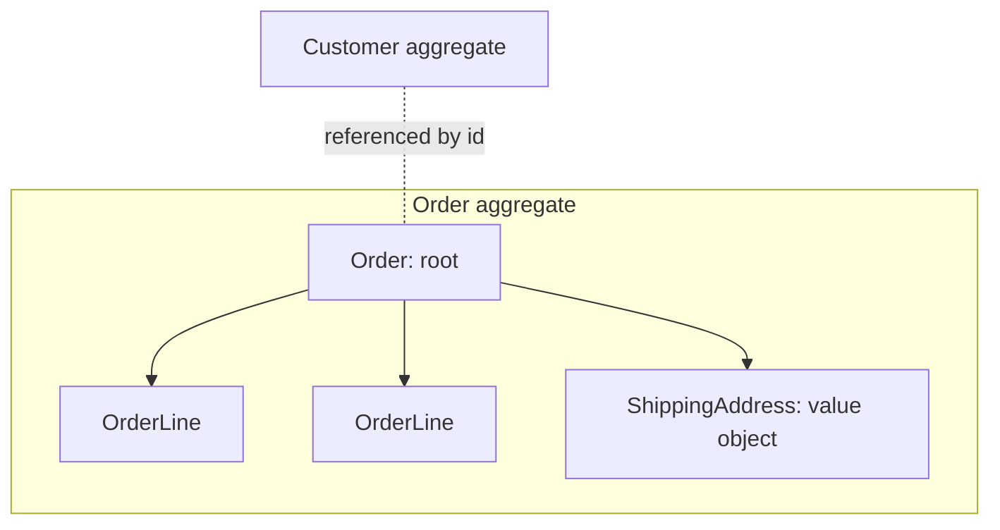
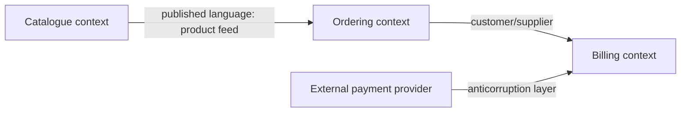

In simple apps, the hard part is the technology. In most business software, the hard part is the
*domain*: insurance rules, logistics, accounting, learning progress. Requirements are full of
words that mean slightly different things to different people, and code written without a clear
model of the domain slowly turns into a tangle of special cases. **Domain-driven design (DDD)**,
introduced by Eric Evans in his 2003 book of the same name, is a set of ideas for keeping code and
domain understanding aligned. This session covers the core building blocks you'll hear about in
architecture discussions and interviews.

## Ubiquitous language

Imagine a hospital where doctors say "admission", nurses say "check-in", the billing department
says "encounter" and the software says `visit_record`. Every conversation needs translation, and
every translation is a chance for a bug.

**Ubiquitous language** is DDD's first and most important idea: developers and domain experts
build and use **one shared vocabulary**, and that vocabulary appears *everywhere*: in
conversations, user stories, documentation, and directly in the code (class names, function names,
database tables). As Martin Fowler summarises in his
[Domain-Driven Design](https://martinfowler.com/bliki/DomainDrivenDesign.html) article, the core of
DDD is a model of the domain expressed in a language shared by the people who understand the
business and the people who build the software.

For this platform, the ubiquitous language includes: *track*, *module*, *session*, *subchapter*,
*completion*, *streak*, *XP*, *level*, *badge*, *source*. Notice how the code follows it:
`sync_roadmap` upserts tracks, modules, sessions and subchapters; gamification computes XP and
streaks from completions. A new developer can talk to the curriculum author without a translation
table.

> [!EXAMPLE]
> A story says "mark a lesson as finished". The code has `Completion` and `Subchapter`. Is a
> "lesson" a session? A subchapter? Someone has to decide, and then *one* word should win
> everywhere. If the domain expert says "subchapter", rename the story, not the code. If the code's
> word is wrong, rename the code.

> [!TIP]
> Listen for friction: when you keep translating between what people say and what the code says,
> or when two people use the same word for different things, you've found a gap in the language.
> Fix it with a short glossary and renames, not with comments.

## Entities, value objects and aggregates

DDD names a few kinds of objects that appear in almost every domain model. Getting them right
makes rules easier to enforce and code easier to reason about.

### Entities

An **entity** is defined by its **identity**, which stays the same while its attributes change.
You are the same person after changing your name, address and haircut; your passport number tracks
you through all of it. In code, entities have an id, and two entities are equal if their ids are
equal.

Examples: a `Learner`, a `Session` (id `2.5.2`), an `Order`.

### Value objects

A **value object** is defined only by its **values** and has no identity. Two €10 notes are
interchangeable; nobody cares *which* one they get. Value objects are usually **immutable**: to
"change" one, you create a new one.

Examples: `Money(amount=10, currency="EUR")`, a `DateRange`, an `EmailAddress`, an `XP` amount.

```python
from dataclasses import dataclass

@dataclass(frozen=True)
class Money:
    amount: int        # in cents, to avoid float rounding
    currency: str

    def add(self, other: "Money") -> "Money":
        if other.currency != self.currency:
            raise ValueError("currency mismatch")
        return Money(self.amount + other.amount, self.currency)
```

Value objects are an excellent cure for the *primitive obsession* smell (Session 2.1.2): instead of
passing `amount: float, currency: str` everywhere and re-validating, you pass one `Money` that is
valid by construction.

### Aggregates

An **aggregate** is a cluster of entities and value objects that must stay **consistent together**,
treated as a single unit for changes. One entity is the **aggregate root**: the only entry point
from outside. Think of a car: you tell the car to brake; you don't reach in and squeeze the brake
pads yourself. The car (root) makes sure all four wheels brake consistently.



Rules of thumb:

- **Change an aggregate only through its root.** `order.add_line(product_id, qty)`, never
  `order.lines.append(...)` from outside. The root enforces invariants like "an order can't exceed
  50 lines" or "a paid order can't be changed".
- **One transaction, one aggregate.** An aggregate is a consistency boundary: everything inside is
  saved together and is always valid. Consistency *between* aggregates can be eventual (Session
  2.5.4).
- **Reference other aggregates by id**, not by holding the object. `Order` stores `customer_id`,
  not a `Customer`.
- **Keep aggregates small.** Big aggregates cause locking conflicts and slow loads.

> [!WARNING]
> Not every class needs to be an entity, a value object or part of an aggregate, and not every app
> needs DDD's tactical patterns. For simple CRUD (forms in, rows out), they add ceremony with
> little benefit. Use them where the business rules are rich and mistakes are costly.

## Bounded contexts and context maps

As a business grows, a single model for everything becomes impossible. The word "customer" means
something different to sales (a lead with a pipeline stage), billing (an account with invoices) and
support (a person with tickets). Forcing one giant `Customer` class to serve all three produces a
class with sixty fields that nobody fully understands.

A **bounded context** is DDD's answer: an explicit boundary inside which one model and one
ubiquitous language apply consistently. Inside the billing context, "customer" means exactly what
billing needs, and nothing else. Different contexts can have different models of "the same" thing,
connected through translations at their boundaries. Countries are a good analogy: each has its own
laws and language, and border crossings have explicit rules for converting between them.

Bounded contexts are also natural boundaries for teams and for code: modules in a modular monolith
(Session 2.5.1) or services in a microservice architecture. The
[microservices.io](https://microservices.io/) pattern catalogue describes "decompose by
subdomain" for exactly this reason.

### Context maps

A **context map** shows the bounded contexts in a system and the relationships between them. Some
common relationship patterns:

| Pattern | Meaning |
|---|---|
| **Shared kernel** | Two contexts share a small, jointly owned part of the model |
| **Customer / supplier** | The downstream context's needs influence the upstream's plans |
| **Conformist** | Downstream simply adopts the upstream's model as is |
| **Anticorruption layer (ACL)** | Downstream translates the upstream's model into its own, protecting itself from it |
| **Open host service / published language** | Upstream offers a well-documented, stable API or format for many consumers |



> [!TIP]
> An anticorruption layer is especially valuable for third-party systems. Wrap the provider's API
> in an adapter that converts its concepts into yours, so their naming and quirks don't leak
> through your codebase. This is the ports-and-adapters idea from Session 2.5.1 applied at a
> context boundary.

## Practice: identify the bounded contexts of an e-learning platform

Take an e-learning platform a bit larger than YouCanDoIt: multiple learners, paid courses,
instructors, certificates, a tutor, and a news feed.

### Step 1: Collect the language

Brainstorm 30–40 domain terms: course, session, lesson, enrolment, learner, instructor, progress,
quiz, attempt, certificate, subscription, invoice, refund, source, article, embedding, streak,
badge... Write a one-line definition for each.

### Step 2: Find the ambiguous words

Circle words that mean different things to different people. "Course" for the curriculum author (a
structured set of sessions), for sales (a product with a price), for the learner (something they
are enrolled in with progress). Each different meaning hints at a different context.

### Step 3: Draw the contexts

Group terms into 4–6 bounded contexts, for example: *Curriculum* (tracks, sessions, lessons),
*Learning progress* (enrolments, completions, gamification), *Assessment* (quizzes, attempts,
certificates), *Billing* (subscriptions, invoices), *Tutor and knowledge* (sources, embeddings,
answers), *News*. Write each context's own definition of the shared words.

### Step 4: Map the relationships

Draw a context map. Which context is upstream of which? Where would you put an anticorruption
layer (hint: the payment provider, the LLM provider)? What does each context need from another,
and could it be just an id?

### Step 5: Find one aggregate

Inside *Learning progress*, choose one aggregate (e.g. `Enrolment` with its completions). Write
its invariants ("a subchapter can be completed once per enrolment", "completions only for sessions
in the enrolled course"), name its root, and list what it references by id. Compare with how
YouCanDoIt stores completions today.

```quiz
{"questions": [
  {"question": "What is the ubiquitous language in DDD?", "options": ["A programming language used by all teams", "A shared vocabulary of developers and domain experts, used consistently in conversation and in code", "English as the only allowed language", "A naming convention for database tables only"], "answer": 1, "explanation": "One shared vocabulary removes translation errors between what the business says and what the code does."},
  {"question": "Which is best modelled as a value object?", "options": ["A learner account", "An order with an order number", "An amount of money in a currency", "A session with id 2.5.2"], "answer": 2, "explanation": "Money is defined only by its values and is interchangeable with any equal amount. The others have identity that persists through change."},
  {"question": "Why should outside code change an aggregate only through its root?", "options": ["For performance reasons only", "So the root can enforce the aggregate's invariants and keep it consistent", "Because Python forbids nested objects", "To avoid writing tests"], "answer": 1, "explanation": "The aggregate root is the guardian of the consistency rules for everything inside the boundary."},
  {"question": "Sales, billing and support all use the word 'customer' but need different data and rules. What does DDD suggest?", "options": ["One shared Customer class with all fields", "Separate bounded contexts, each with its own Customer model, translated at the boundaries", "Ban the word 'customer'", "Store everything as JSON"], "answer": 1, "explanation": "Bounded contexts let each part of the business have a precise model instead of one bloated compromise."},
  {"question": "When integrating with an external payment provider whose concepts differ from yours, which context-map pattern protects your model?", "options": ["Conformist", "Shared kernel", "Anticorruption layer", "Big ball of mud"], "answer": 2, "explanation": "An anticorruption layer translates the external model into your own, so its quirks don't leak into your domain."}
]}
```
