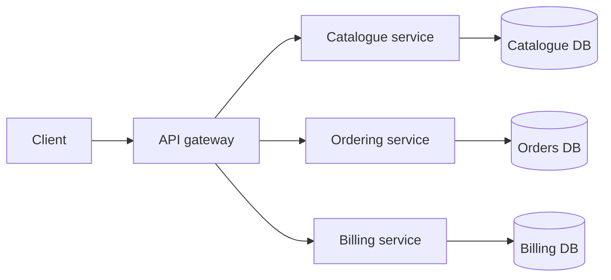
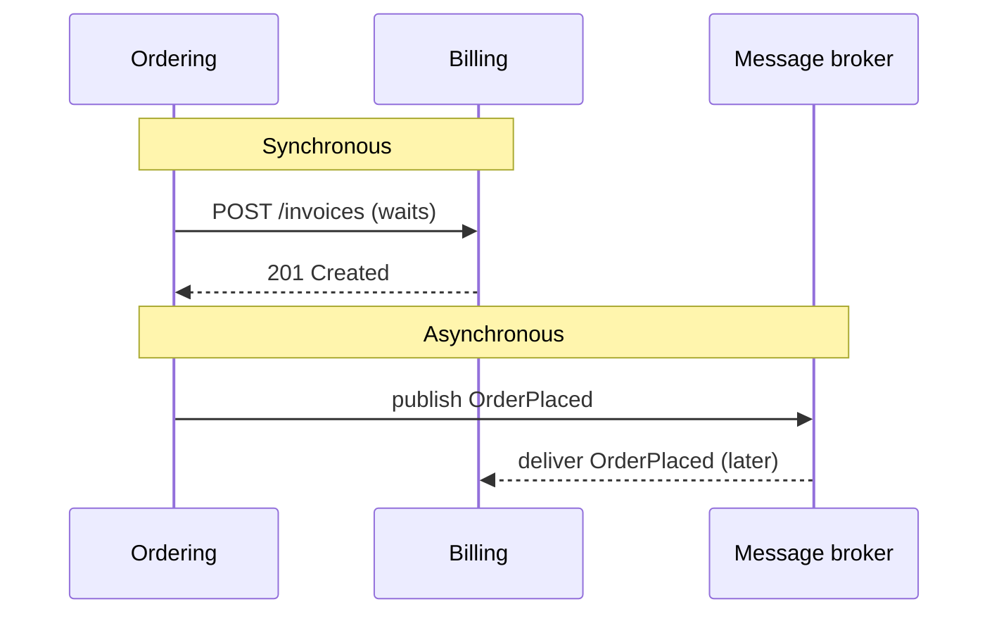

"Should we use microservices?" is one of the most debated questions in software, and job
descriptions are full of the word. The honest senior answer is almost always "it depends", followed
by a clear explanation of *on what*. This session gives you that explanation: why most systems
should start as a monolith, what microservices really buy and cost, how services communicate, and
where serverless fits.

## Monolith first

A **monolith** is an application deployed as a single unit: one codebase, one process (or several
identical copies), usually one database. YouCanDoIt's API is a monolith: one FastAPI app handles
roadmap sync, progress, the tutor and news.

"Monolith" is sometimes used as an insult, but it shouldn't be. A monolith is like a single
well-organised workshop: all your tools are within reach, moving something from one bench to
another is trivial, and there's one door to lock at night.

Martin Fowler's "Monolith First" essay, a companion to the
[Microservices](https://martinfowler.com/articles/microservices.html) article on the same site, runs
like this: almost all successful microservice systems he heard of started as a monolith that grew too
big and was then broken up, while systems built as microservices from scratch often ran into
serious trouble. The reason is boundaries. Splitting into services requires knowing where the
stable boundaries between business capabilities lie, and at the start of a project you usually
don't know yet. Inside a monolith, moving a boundary is a refactoring; between services, it's a
cross-team migration.

**Strengths of a monolith:**

- Simple to develop, run locally, test end-to-end and deploy.
- Function calls instead of network calls: fast, reliable, easy to debug.
- One database means real transactions across the whole domain.
- Refactoring across modules is cheap.

**Where it struggles:**

- Many teams working in one codebase step on each other; deploys need coordination.
- The whole app scales as one unit, even if only one part is under load.
- Without discipline, boundaries erode into a "big ball of mud".

> [!TIP]
> The answer to the last weakness is usually not microservices; it's a **modular monolith**
> (Session 2.5.1). Enforced module boundaries inside one deployable keep the codebase healthy and
> make a later split far easier.

## Microservices: benefits and costs

James Lewis and Martin Fowler's article
[Microservices](https://martinfowler.com/articles/microservices.html) describes the style as
building an application as a suite of small services, each running in its own process,
communicating through lightweight mechanisms (often HTTP), **built around business capabilities**
and **independently deployable**. Each service typically owns its own data. Think of a food court
instead of one restaurant kitchen: separate stalls, each with its own staff, menu and stock, serving
the same customers.



**Benefits:**

| Benefit | What it means in practice |
|---|---|
| **Independent deployment** | A team ships its service without coordinating a release with everyone |
| **Team autonomy** | Teams own a service end to end, matching Conway's law (systems mirror the communication structure of the organisation) |
| **Independent scaling** | Scale only the busy service |
| **Technology freedom** | Each service can choose what fits (use sparingly) |
| **Fault isolation** | A failing recommendation service needn't take down checkout, if designed for it |

**Costs** (Fowler calls the overhead a "microservice premium"):

| Cost | What it means in practice |
|---|---|
| **Distributed system complexity** | Network calls fail, time out, arrive twice or out of order |
| **Data consistency** | No transactions across services; you need eventual consistency and patterns like sagas |
| **Operational overhead** | Many deployments, CI pipelines, dashboards, alerts, on-call rotations |
| **Observability** | One user request crosses many services; you need distributed tracing to debug it |
| **Testing** | End-to-end tests get harder; contract tests (Session 2.2.3) become essential |
| **Refactoring across services** | Moving a boundary means changing APIs, data and multiple deployments |

> [!WARNING]
> The worst outcome is a **distributed monolith**: services that must be deployed together,
> share a database, and call each other synchronously in long chains. You pay every cost of
> microservices and get none of the benefits.

> [!NOTE]
> Microservices are primarily a solution to an **organisational** scaling problem (many teams
> working independently), and secondarily a technical one. A team of five rarely has that problem.

## Service boundaries and communication (sync vs async)

### Drawing boundaries

Good service boundaries follow **business capabilities** and **bounded contexts** (Session 2.5.2),
not technical layers. A "database service" or "validation service" is a red flag: almost every
change will touch it. The [microservices.io](https://microservices.io/) catalogue lists
decomposition patterns such as *decompose by business capability* and *decompose by subdomain*,
plus the *database per service* pattern.

A good boundary has **high cohesion** inside (things that change together live together) and
**loose coupling** outside (a service can change its internals without others noticing).

### Synchronous communication

The caller sends a request and **waits** for the answer: HTTP/REST, gRPC. It's like a phone call.

- Simple, familiar, immediate answer.
- But it couples availability: if Billing is down, Ordering's call fails. Chains multiply the
  problem: if each of five services in a chain is up 99.9% of the time, the chain as a whole is
  up less often than any one of them.
- Needs timeouts, retries with backoff, and circuit breakers to avoid cascading failures.

### Asynchronous communication

The sender publishes a **message or event** to a broker (a queue or log such as RabbitMQ or Kafka)
and moves on; receivers process it when they can. It's like sending a letter or an email.

- Decouples availability: Billing can be down for a minute and catch up later.
- Absorbs load spikes in the queue.
- But: eventual consistency, harder debugging, and you must handle duplicates and ordering.



> [!TIP]
> A reasonable default: use synchronous calls for **queries** that need an answer now ("what's the
> price?"), and asynchronous events for **notifying** others that something happened ("order
> placed"). Session 2.5.4 goes deeper into event-driven design.

## Serverless architectures

**Serverless** means you deploy code or use services without managing servers at all: the cloud
provider runs, scales and patches the infrastructure, and you typically pay per use. The two main
flavours:

- **Functions as a Service (FaaS):** small functions triggered by events (an HTTP request, a file
  upload, a queue message, a schedule). Examples: AWS Lambda, Google Cloud Functions, Azure
  Functions, Cloudflare Workers.
- **Managed backend services ("backend as a service"):** databases, authentication, storage and
  queues you consume through APIs without operating them.

The analogy: owning a car (servers) vs taking a taxi (serverless). The taxi costs nothing when
you don't use it and scales to as many rides as you need, but you can't customise it much, and for
heavy constant use, owning may be cheaper.

| Good fit | Poor fit |
|---|---|
| Spiky or unpredictable traffic | Constant high load, where per-use pricing adds up |
| Event-driven glue: resize an image on upload, process a webhook | Long-running jobs beyond the platform's time limits |
| Scheduled tasks | Latency-critical paths sensitive to **cold starts** (delay when a new instance spins up) |
| Small teams that don't want to run infrastructure | Workloads needing special hardware or local state |

Other costs: **vendor lock-in** (triggers, permissions and services are provider-specific),
harder local development and testing, and distributed-system complexity if you build many small
functions.

> [!NOTE]
> Serverless and microservices are different axes. Serverless is about *who runs the
> infrastructure*; microservices are about *how the application is split*. You can run a monolith
> on a serverless container platform, or microservices on your own servers.

## Practice: write a trade-off analysis for splitting a monolith

Scenario: YouCanDoIt has become a product. Five teams, many thousands of learners. The tutor (RAG +
LLM) is slow and expensive under load; news refresh occasionally spikes CPU; everything else is
light. Someone proposes splitting the API into microservices.

### Step 1: State the problem precisely

What hurts today, measurably? Slow tutor responses, deploy coordination between teams, news jobs
affecting API latency? A split must solve a named problem.

### Step 2: List the options

At least three: (a) stay a monolith and optimise; (b) modular monolith with enforced boundaries and
separate worker processes for background jobs; (c) extract one service (e.g. the tutor); (d) full
microservices.

### Step 3: Compare them

Build a table with rows for each option and columns for: problem solved, team autonomy, operational
cost, data consistency, testing effort, migration risk, and what you'd need to build (gateway,
broker, tracing, CI pipelines).

### Step 4: Choose boundaries

If you extract anything, say exactly what moves, which data it owns, and whether it talks to the
rest synchronously or through events. Use the bounded contexts from Session 2.5.2.

### Step 5: Recommend and record

Write a one-page recommendation and an ADR (Session 2.4.2) with the decision, the alternatives,
and honest consequences. Include a trigger for revisiting it ("revisit if more than three teams
need to deploy the tutor independently").

```quiz
{"questions": [
  {"question": "Why does 'monolith first' recommend starting with a monolith for most new systems?", "options": ["Monoliths are always faster", "Stable service boundaries are hard to know early, and moving boundaries is cheap inside a monolith but expensive between services", "Microservices can't be built with Python", "Monoliths need no tests"], "answer": 1, "explanation": "Early on, domain boundaries are uncertain. A monolith lets you discover them through cheap refactoring before committing them to network boundaries."},
  {"question": "Which situation gives the strongest reason to adopt microservices?", "options": ["A solo developer building an MVP", "Many teams that need to deploy independently and are blocked by coordinating releases of one codebase", "Wanting to try a new programming language", "A small app with low traffic"], "answer": 1, "explanation": "Microservices mainly solve organisational scaling: independent teams deploying independently. Without that need, the costs usually outweigh the benefits."},
  {"question": "Services that share one database, must be deployed together and call each other in long synchronous chains are an example of:", "options": ["A modular monolith", "A distributed monolith", "Serverless architecture", "Event sourcing"], "answer": 1, "explanation": "A distributed monolith pays the costs of distribution without the benefits of independence."},
  {"question": "What is a key trade-off of asynchronous messaging between services compared with synchronous HTTP calls?", "options": ["It couples availability more tightly", "It decouples availability and absorbs spikes, but brings eventual consistency and harder debugging", "It guarantees immediate consistency", "It removes the need for any error handling"], "answer": 1, "explanation": "Async messaging lets services work when others are down, at the price of eventual consistency, duplicates and harder tracing."},
  {"question": "Which workload is the poorest fit for Functions as a Service?", "options": ["Resizing images when they are uploaded", "A nightly scheduled clean-up job", "A constant, high-throughput, latency-critical service with long-running requests", "Processing occasional webhooks"], "answer": 2, "explanation": "Constant heavy load can be expensive on per-use pricing, and long requests and cold starts conflict with FaaS limits and latency needs."}
]}
```
