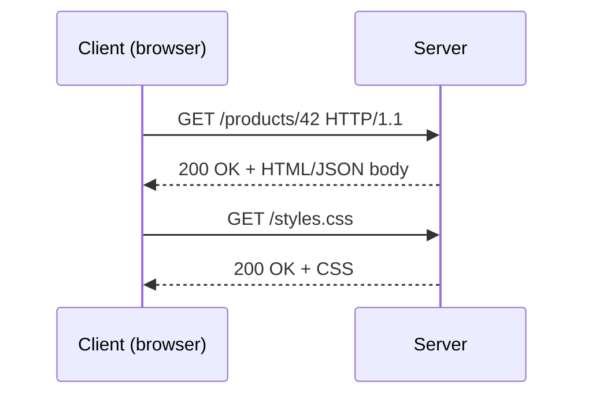
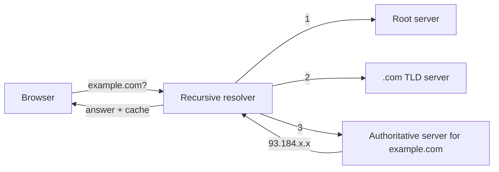
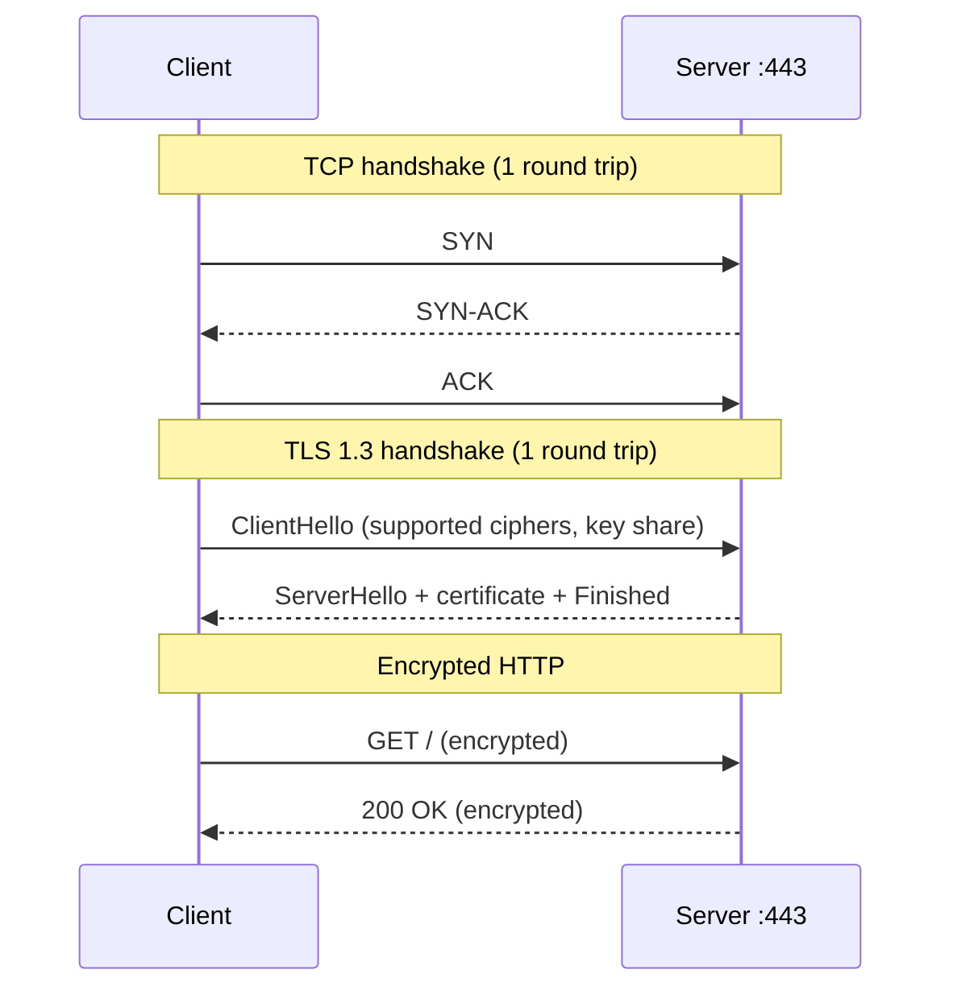

Every backend you will ever build sits at the end of a long journey that starts when someone types
an address and presses Enter. If you understand that journey, debugging stops being guesswork:
"the site is down" turns into "DNS resolves, TCP connects, TLS fails" and you know exactly where to
look. This session walks the whole path, from URL to pixels, and ends with you tracing a real
request yourself.

## Clients, servers and the request/response model

Think of a restaurant. You (the **client**) sit at a table and order from a menu. The kitchen (the
**server**) prepares the dish and sends it back. You never walk into the kitchen, and the kitchen
never comes to your table uninvited. Every exchange starts with your order.

The web works the same way. A **client** is any program that asks for something: a browser, a
mobile app, `curl`, or another backend service. A **server** is a program that listens on a network
address and answers. The conversation follows the **request/response model**: the client sends a
*request* ("give me `/products/42`"), and the server sends back exactly one *response* ("here it is,
status 200" or "not found, status 404").

The language they speak is **HTTP** (HyperText Transfer Protocol). As
[MDN's HTTP guide](https://developer.mozilla.org/en-US/docs/Web/HTTP) explains, HTTP is
*stateless*: each request carries everything the server needs to answer it, and the server doesn't
automatically remember previous requests. Login sessions, shopping carts and "remember me" all have
to be built on top, usually with cookies or tokens.



A single page view is rarely one request. The HTML references stylesheets, scripts, images and
fonts, and the browser fetches each one. A modern page can easily trigger dozens of requests.

> [!NOTE]
> "Server" means two things: the **program** that answers requests (uvicorn running FastAPI) and the
> **machine** it runs on. In conversation the meaning is usually clear from context; in incident
> reports, be precise.

> [!WARNING]
> Clients are untrusted. Anyone can send any request to your server with `curl`, bypassing your
> nice front-end validation. The backend must validate everything it receives.

## DNS resolution

Computers find each other by **IP address** (like `104.16.132.229` or an IPv6 address). Humans
remember names like `example.com`. The **Domain Name System (DNS)** is the phone book that turns
one into the other.

The analogy is asking for directions in an unfamiliar city. You ask a local guide (your
**recursive resolver**, often run by your ISP or a provider like Cloudflare's 1.1.1.1). The guide
doesn't know every address, but knows who to ask: first the **root servers** ("who handles
`.com`?"), then the **TLD servers** for `.com` ("who handles `example.com`?"), then the
**authoritative name server** for `example.com`, which gives the final answer. The
[Cloudflare Learning Center](https://www.cloudflare.com/learning/) has a clear walkthrough of
these steps.



Every answer has a **TTL** (time to live), and caches exist at every level: the browser, the
operating system, the resolver. That is why most lookups take a few milliseconds, and why DNS
changes "take time to propagate": old answers live on in caches until their TTL runs out.

The record types you'll meet most as a backend developer:

| Record | Purpose | Example |
|---|---|---|
| `A` / `AAAA` | Name to IPv4 / IPv6 address | `api.example.com → 203.0.113.10` |
| `CNAME` | Alias to another name | `www → example.com` |
| `MX` | Mail servers for the domain | Used when you send email (Session 3.6.2) |
| `TXT` | Free text, used for verification and SPF/DKIM | `v=spf1 include:...` |

> [!TIP]
> Before a migration, lower the TTL on the records you'll change (say from 1 hour to 5 minutes) a
> day in advance. When you switch, caches expire quickly and rollback is fast.

## TCP/IP and TLS in one picture

Once the browser has an IP address, it needs a reliable pipe to the server. Three layers stack up:

- **IP** (Internet Protocol) moves individual *packets* from one address to another. It's like the
  postal service: best effort, packets may arrive out of order, or not at all.
- **TCP** (Transmission Control Protocol) builds a reliable, ordered byte stream on top of IP. It
  numbers the packets, re-sends lost ones, and puts them back in order. Like a courier who gets a
  signature for every parcel. Before any data flows, TCP performs a **three-way handshake**:
  SYN, SYN-ACK, ACK.
- **TLS** (Transport Layer Security) encrypts that stream so nobody in between can read or alter
  it, and proves the server is who it claims to be via a **certificate** signed by a trusted
  certificate authority. HTTPS is simply HTTP running inside TLS.



Notice the cost: before the first byte of HTTP, you've spent round trips on TCP and TLS. If the
server is 100 ms away, that's a noticeable delay. This is why connection reuse (keep-alive),
CDNs that put servers close to users, and newer protocols like HTTP/3 (Session 3.1.2) matter for
performance.

> [!NOTE]
> A **port** picks which program on a machine gets the connection. HTTP defaults to port 80, HTTPS
> to 443. In development you'll see others: your FastAPI app on 8000, Next.js on 3000.

> [!WARNING]
> "The certificate is invalid" errors are not to be clicked through in production. They mean the
> name doesn't match, the certificate expired, or someone may be intercepting traffic. Fix the
> certificate; never disable verification in your HTTP client code (`verify=False`).

## Browsers, rendering and the backend's role

When the HTML response arrives, the browser starts a pipeline: it **parses HTML** into the DOM
(a tree of elements), **parses CSS** into style rules, combines them, computes **layout** (where
each box goes), **paints** pixels, and runs **JavaScript**, which may change the DOM and trigger
more work. Along the way it discovers more resources (CSS, JS, images) and requests them.

Where does the backend fit? It depends on the architecture:

- **Server-side rendering (SSR):** the backend (or a Next.js server) builds full HTML per request.
  Fast first paint, good for SEO.
- **Single-page app + API:** the server sends a mostly empty HTML shell and a JavaScript bundle;
  the JS then calls a JSON **API** for data. The backend's job is that API.
- **Static + CDN:** pages are built ahead of time and served from a CDN; only dynamic data hits
  the backend.

In this very project, the Next.js app renders pages, and the browser calls `/api/*`, which is
proxied to the FastAPI backend. So FastAPI never sends HTML at all: it sends JSON.

The backend's responsibilities are the same in every case: **authenticate** the caller, **validate**
input, apply **business rules**, talk to the **database**, and return a correct, fast **response**
with the right status code and headers (including caching headers that tell browsers and CDNs what
they may reuse).

> [!EXAMPLE]
> A user opens a product page that feels slow. Using the timeline in dev tools you see: DNS 5 ms,
> TCP+TLS 40 ms, waiting for the server ("time to first byte") 1,800 ms, download 20 ms. The
> network is fine; the backend is slow. Your next step is the API logs and database queries, not
> the CDN.

## Practice: trace a request with curl -v and browser dev tools

You'll follow one request through every stage you just learned. Budget 30–40 minutes.

### Step 1: Resolve the name yourself

```sh
dig +short example.com          # or: nslookup example.com
dig example.com                 # full answer: note the TTL column
```

Run `dig` twice. Did the TTL go down? That's a cache counting down.

### Step 2: Watch the connection with curl

```sh
curl -v https://example.com -o /dev/null
```

Read the output line by line. Lines starting with `*` are curl's notes, `>` is what you sent, `<`
is what came back. Find:

1. `Trying <ip>:443` — the DNS answer and the port.
2. `Connected to` — TCP handshake done.
3. `SSL connection using TLSv1.3` and the certificate `subject` / `expire date` — TLS done.
4. `> GET / HTTP/2` and `> Host: example.com` — your request.
5. `< HTTP/2 200` and response headers like `content-type` and `cache-control`.

### Step 3: Time each stage

```sh
curl -s -o /dev/null -w "dns:%{time_namelookup} connect:%{time_connect} tls:%{time_appconnect} ttfb:%{time_starttransfer} total:%{time_total}\n" https://example.com
```

The numbers are cumulative seconds. Subtract to get each phase. Try a site hosted far away and
compare.

### Step 4: Repeat in the browser

Open dev tools (F12) → **Network** tab, tick "Disable cache", reload a site you use. Click the
first (document) request and open **Timing**. You'll see the same phases: DNS lookup, initial
connection, SSL, waiting (TTFB), content download. Then sort by "Initiator" to see which requests
the HTML itself triggered.

### Step 5: Trace your own backend

If you have this project running, try:

```sh
curl -v http://localhost:8000/health
```

No DNS beyond `localhost`, no TLS (plain `http`), so you'll see the request/response model in its
simplest form. Write three sentences describing what happened at each layer, from memory.

> [!TIP]
> `curl -v` is the single most useful debugging tool in this track. Whenever an API "doesn't
> work", reproduce it with curl first: it removes the browser, the front-end code and CORS from
> the equation.
