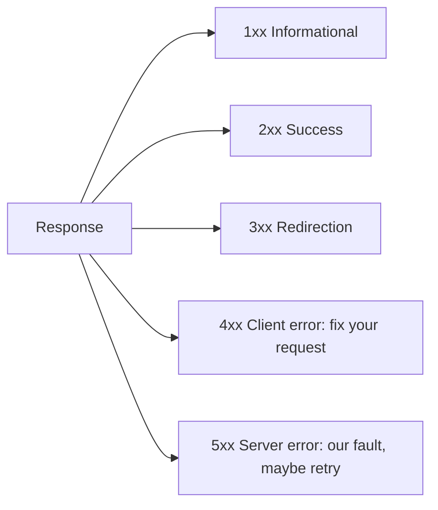
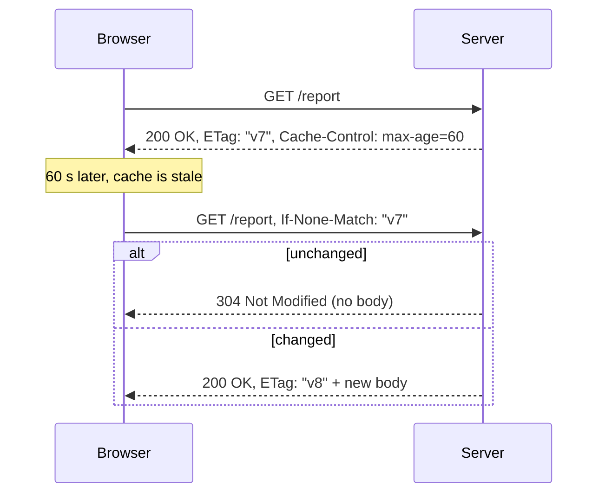
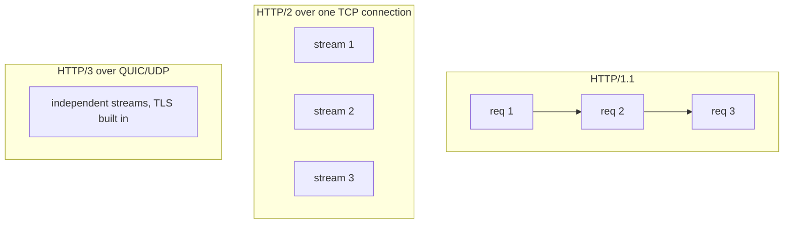

In the last session you saw HTTP as one step in a long journey. Now you zoom in. HTTP is the
contract every API you build will speak, and most real bugs live in its details: a `POST` retried
twice that charged a card twice, a `200` that should have been a `404`, a stale page caused by a
missing cache header, a CORS error that blocks the whole front-end. The authoritative reference is
[RFC 9110 HTTP Semantics](https://www.rfc-editor.org/rfc/rfc9110); the friendlier one is
[MDN — HTTP](https://developer.mozilla.org/en-US/docs/Web/HTTP). This lesson gives you the parts you
will use every week.

## Methods and idempotency

An HTTP **method** is the verb of the request: what you want done to the resource named by the URL.
Think of a library desk. "Show me this book" is different from "add this new book" or "replace this
book's catalogue card", even though they all mention the same shelf.

| Method | Meaning | Safe? | Idempotent? |
|---|---|---|---|
| `GET` | Read a representation | Yes | Yes |
| `HEAD` | Like GET, headers only | Yes | Yes |
| `POST` | Process this (often: create) | No | No |
| `PUT` | Replace the resource with this | No | Yes |
| `PATCH` | Apply a partial change | No | Not guaranteed |
| `DELETE` | Remove the resource | No | Yes |
| `OPTIONS` | What can I do here? (used by CORS) | Yes | Yes |

**Safe** means the request doesn't change server state: a crawler can call it freely.
**Idempotent** means sending it once or ten times leaves the server in the same state. Pressing
an elevator's call button five times still brings one elevator: that's idempotency.

Why care? Networks fail. A client sends a request, the connection drops, and it doesn't know
whether the server processed it. With an idempotent method it can simply retry. With `POST` a
retry might create a second order. RFC 9110 explicitly lets clients and proxies automatically
retry idempotent requests, which is why getting this right isn't academic.

> [!WARNING]
> Never change state on `GET`. Link prefetchers, crawlers and browser previews follow `GET` links
> automatically. A `GET /delete-account?id=5` endpoint will eventually be triggered by something
> that isn't a human.

> [!EXAMPLE]
> `DELETE /todos/7` twice: the first deletes, the second finds nothing (you might return `404`).
> The *response* differs, but the *state* is identical: todo 7 is gone. That's still idempotent.

## Status codes families

The status code is a three-digit summary of what happened. The first digit tells you the
**family**, and clients often react to the family even when they don't know the exact code.



The codes you'll use most:

- **200 OK** (with a body), **201 Created** (plus a `Location` header pointing to the new
  resource), **204 No Content** (success, no body, typical for `DELETE`).
- **301/308** permanent redirect, **302/307** temporary, **304 Not Modified** (the cached copy is
  still good, see below).
- **400 Bad Request** (malformed), **401 Unauthorized** (actually means *unauthenticated*: who are
  you?), **403 Forbidden** (I know who you are, and no), **404 Not Found**, **409 Conflict**
  (state clash, like a duplicate username), **422 Unprocessable Content** (well-formed but
  invalid; FastAPI uses it for validation errors), **429 Too Many Requests**.
- **500 Internal Server Error** (a bug), **502 Bad Gateway** / **504 Gateway Timeout** (a proxy
  couldn't get a good answer from the server behind it), **503 Service Unavailable** (temporarily
  down; this project maps LLM failures to 503).

> [!TIP]
> The 4xx/5xx split matters for monitoring and retries. 4xx means "the client must change something";
> retrying the same request is pointless. 5xx means "try again later might work". Returning 500 for
> bad input pollutes your error dashboards and wakes people up at night.

## Headers, content negotiation and caching (ETag, Cache-Control)

**Headers** are key–value metadata on every request and response: the envelope around the letter.
A few you'll see constantly: `Content-Type` (what format the body is in), `Content-Length`,
`Authorization` (credentials), `User-Agent`, `Accept`.

**Content negotiation** is the client saying what it can handle and the server choosing. A client
sends `Accept: application/json` or `Accept-Language: it, en;q=0.8`; the server picks the best
match and labels its choice with `Content-Type` and `Content-Language`. If it can't satisfy the
request it may answer `406 Not Acceptable`.

**Caching** is where headers save the most time and money. The `Cache-Control` response header tells
browsers and CDNs what they may store and for how long:

- `Cache-Control: max-age=3600` — reuse this for an hour without asking.
- `Cache-Control: no-cache` — you may store it, but check with me before reusing (despite the name).
- `Cache-Control: no-store` — never store it (use for sensitive data).
- `private` vs `public` — only the user's browser may cache vs shared caches like CDNs may too.

When a cached copy expires, the client doesn't have to download it again blindly. It
**revalidates** using an **ETag**, a fingerprint of the content:



A `304` has no body, so you save bandwidth and the server often saves work too.

> [!NOTE]
> ETags also enable safe concurrent updates: a client sends `If-Match: "v7"` with a `PUT`, and the
> server answers `412 Precondition Failed` if someone else changed the resource meanwhile. You'll
> meet this "optimistic concurrency" idea again in Session 3.3.5.

## Cookies, sessions and CORS

HTTP is stateless, so how does a site remember you're logged in? A **cookie** is a small value the
server asks the browser to store (`Set-Cookie`) and send back on every later request to that site
(`Cookie`). It's like a cloakroom ticket: the ticket itself is meaningless, but the server uses it
to find your coat.

A **session** is the server-side record the ticket points to: `session_id=abc123` → "user 42,
logged in at 09:12". The cookie carries only the id. Important cookie attributes:

- `HttpOnly` — JavaScript can't read it, which limits damage from XSS.
- `Secure` — only sent over HTTPS.
- `SameSite=Lax` or `Strict` — not sent on most cross-site requests, which blocks CSRF attacks.
- `Max-Age` / `Expires` — when it dies.

**CORS** (Cross-Origin Resource Sharing) is the one that confuses everyone. Browsers enforce the
**same-origin policy**: JavaScript on `https://app.example.com` may not read responses from
`https://api.other.com` (different origin = different scheme, host or port) unless that server
explicitly allows it with headers like `Access-Control-Allow-Origin: https://app.example.com`. For
non-simple requests (say, `PUT` with JSON), the browser first sends a **preflight** `OPTIONS`
request to ask permission.

> [!WARNING]
> CORS is enforced by the *browser*, for the *browser user's* protection. It is not server
> security: `curl` ignores it completely. And `Access-Control-Allow-Origin: *` combined with
> credentials is refused by browsers for good reason; list the exact origins you trust.

> [!TIP]
> One way to avoid CORS entirely is to serve front-end and API from the same origin. This project
> does it: the browser only calls `/api/*` on the web app, and Next.js proxies to FastAPI.

## HTTP/2 and HTTP/3

The meaning of HTTP (methods, status codes, headers) has stayed stable for decades. What changed
is how messages travel on the wire.

- **HTTP/1.1** sends text messages, one request at a time per connection. Browsers worked around
  that by opening ~6 connections per site, and a slow response blocks the ones queued behind it
  (**head-of-line blocking**).
- **HTTP/2** uses a binary format and **multiplexes** many requests as interleaved streams over
  one TCP connection, and compresses headers. Fewer connections, less waiting.
- **HTTP/3** runs over **QUIC**, built on UDP. It moves reliability and encryption into one
  layer, so connection setup is faster, and a lost packet only stalls its own stream, not all of
  them. It also survives network changes, like walking from Wi-Fi to mobile data.



As a backend developer you rarely implement these yourself: a reverse proxy or CDN in front of
your app (nginx, Caddy, Cloudflare) speaks HTTP/2 and HTTP/3 to browsers and plain HTTP/1.1 to
your app server. Your code sees the same semantics either way.

## Practice: build a tiny HTTP server with the Python standard library

You'll build a server that exercises methods, status codes, ETags and cookies, using only
`http.server`. About 45 minutes.

### Step 1: The skeleton

Create `tiny_server.py`:

```python
import hashlib
import json
from http.server import BaseHTTPRequestHandler, HTTPServer

TODOS = {1: {"id": 1, "title": "Learn HTTP"}}


class Handler(BaseHTTPRequestHandler):
    def send_json(self, status, data, extra_headers=None):
        body = json.dumps(data).encode()
        self.send_response(status)
        self.send_header("Content-Type", "application/json")
        self.send_header("Content-Length", str(len(body)))
        for key, value in (extra_headers or {}).items():
            self.send_header(key, value)
        self.end_headers()
        self.wfile.write(body)

    def do_GET(self):
        if self.path != "/todos":
            return self.send_json(404, {"error": "not found"})
        body = json.dumps(list(TODOS.values())).encode()
        etag = '"' + hashlib.sha256(body).hexdigest()[:16] + '"'
        if self.headers.get("If-None-Match") == etag:
            self.send_response(304)
            self.send_header("ETag", etag)
            return self.end_headers()
        self.send_json(200, list(TODOS.values()),
                       {"ETag": etag, "Cache-Control": "no-cache"})

    def do_POST(self):
        length = int(self.headers.get("Content-Length", 0))
        try:
            data = json.loads(self.rfile.read(length))
            title = data["title"]
        except (ValueError, KeyError):
            return self.send_json(400, {"error": "body must be JSON with a title"})
        new_id = max(TODOS, default=0) + 1
        TODOS[new_id] = {"id": new_id, "title": title}
        self.send_json(201, TODOS[new_id], {"Location": f"/todos/{new_id}"})


HTTPServer(("127.0.0.1", 8080), Handler).serve_forever()
```

Run it with `python tiny_server.py`.

### Step 2: Exercise methods and status codes

```sh
curl -i http://127.0.0.1:8080/todos
curl -i -X POST http://127.0.0.1:8080/todos -d '{"title":"Write tests"}'
curl -i -X POST http://127.0.0.1:8080/todos -d 'not json'
curl -i http://127.0.0.1:8080/nope
curl -i -X DELETE http://127.0.0.1:8080/todos
```

Note the `201` with `Location`, the `400`, the `404`, and what happens with `DELETE` (the base
class answers `501 Not Implemented` because there's no `do_DELETE`). Run the `POST` twice: two
todos appear, because `POST` isn't idempotent.

### Step 3: Revalidate with the ETag

Copy the `ETag` value from the `GET` response and send it back:

```sh
curl -i http://127.0.0.1:8080/todos -H 'If-None-Match: "<paste etag>"'
```

You should get `304` with no body. Add a todo, repeat: now `200` with a new ETag.

### Step 4: Extend it

Add, on your own: a `do_DELETE` for `/todos/<id>` returning `204` (and `404` if missing); a
`Set-Cookie: visits=N; HttpOnly; SameSite=Lax` header that counts visits by reading the `Cookie`
header; and `Content-Type` checking that returns `415 Unsupported Media Type` when a `POST` isn't
JSON. Test each with `curl -i`, then open `http://127.0.0.1:8080/todos` in the browser and inspect
the headers in dev tools.

> [!NOTE]
> `http.server` is for learning only: the Python docs warn it isn't meant for production. Next
> session you'll design a proper API, and then build it with FastAPI.
