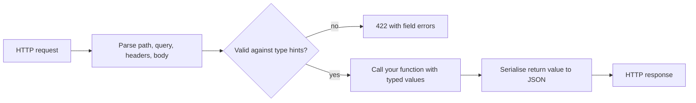
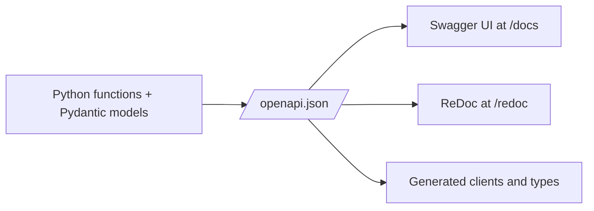

Last session you designed a to-do API on paper. Now you build it. FastAPI is the framework behind
this very platform's backend, and it's popular for a simple reason: you write ordinary Python
functions with type hints, and FastAPI turns those hints into request parsing, validation, error
messages and live documentation. The [FastAPI Tutorial](https://fastapi.tiangolo.com/tutorial/)
and the [Pydantic docs](https://pydantic.dev/docs/validation/latest/get-started/) are excellent; this
lesson gives you the mental model so you know *why* each piece works.

## Path operations, parameters and request bodies

In FastAPI vocabulary, a **path operation** is the pair "HTTP method + path", like `GET /todos/{id}`,
and the Python function that handles it is the **path operation function**. You register one with a
decorator:

```python
from fastapi import FastAPI

app = FastAPI(title="Todo API")


@app.get("/todos/{todo_id}")
async def get_todo(todo_id: int):
    return {"id": todo_id, "title": "Learn FastAPI"}
```

Run it with `uvicorn main:app --reload` (or `fastapi dev main.py` with the FastAPI CLI installed)
and open `http://127.0.0.1:8000/todos/3`.

The magic is in the signature. FastAPI reads each parameter and decides where its value comes from:

- **Path parameters**: the name appears in the path (`{todo_id}`). The type hint `int` means
  FastAPI converts `"3"` to `3`, and rejects `/todos/abc` with a clear `422` error.
- **Query parameters**: any other simple-typed parameter (`int`, `str`, `bool`…). A default value
  makes it optional: `done: bool | None = None` reads `?done=true`.
- **Request body**: a parameter typed as a Pydantic model is read from the JSON body.

```python
from typing import Annotated
from fastapi import Query


@app.get("/todos")
async def list_todos(
    done: bool | None = None,
    page_size: Annotated[int, Query(ge=1, le=100)] = 20,
):
    ...
```

`Annotated[int, Query(ge=1, le=100)]` adds validation metadata: `page_size=500` is rejected before
your code runs. That's the server-side cap from Session 3.2.1, in one line. The same pattern
works for every source: `Path(ge=1)` for path parameters, `Header()` for headers such as an
`Idempotency-Key`, `Cookie()` for cookies.

> [!WARNING]
> Order matters. FastAPI matches routes in the order you declare them, so if `GET /todos/{todo_id}`
> comes before `GET /todos/stats`, a request for `/todos/stats` tries to parse `"stats"` as an
> `int` and fails with 422. Declare fixed paths before parameterised ones.



> [!NOTE]
> `async def` vs `def`: use `async def` when the function awaits async I/O (an async database
> driver, `httpx.AsyncClient`). Use plain `def` when you call blocking libraries; FastAPI runs those
> in a thread pool so they don't freeze the server. Calling blocking code *inside* `async def` is
> the mistake to avoid.

## Pydantic models for input and output

**Pydantic** is a validation library: you describe the shape of data as a class with type hints,
and Pydantic checks and converts incoming data to match. Think of it as a customs officer at the
border of your app: everything entering is inspected, and anything inside can be trusted to have
the declared shape.

```python
from datetime import date, datetime
from pydantic import BaseModel, Field


class TodoCreate(BaseModel):
    title: str = Field(min_length=1, max_length=200)
    due_date: date | None = None


class TodoUpdate(BaseModel):
    title: str | None = Field(default=None, min_length=1, max_length=200)
    done: bool | None = None
    due_date: date | None = None


class Todo(BaseModel):
    id: int
    title: str
    done: bool
    due_date: date | None
    created_at: datetime
```

Use it for **input** by typing a parameter, and for **output** with `response_model` (or a return
type annotation):

```python
@app.post("/todos", response_model=Todo, status_code=201)
async def create_todo(payload: TodoCreate) -> Todo:
    ...
```

The separate input and output models matter. `TodoCreate` has no `id` or `created_at`, so a client
can't set them; `Todo` defines exactly what leaves the server. If your internal object has an
`owner_password_hash` field, the response model filters it out because it isn't declared. This is
the "separate input and output schemas" idea from your OpenAPI design, enforced by code.

> [!TIP]
> For `PATCH`, use `payload.model_dump(exclude_unset=True)` to get only the fields the client
> actually sent. That distinguishes "set `due_date` to null" from "didn't mention `due_date`".

> [!WARNING]
> Pydantic converts compatible values by default ("lax mode"): the string `"5"` becomes `5` for an
> `int` field. That's usually helpful for query strings, but surprising in JSON bodies. If you need
> exact types, Pydantic supports strict mode per field or per model.

## Automatic OpenAPI docs

Because FastAPI knows every path, parameter and model from your code, it generates the
**OpenAPI** document for free (this is the "code-first" approach from Session 3.2.1). Start the app
and visit:

- `/docs` — Swagger UI: interactive docs where you can "Try it out" and send real requests.
- `/redoc` — ReDoc: a cleaner, read-only layout.
- `/openapi.json` — the raw spec that tools consume.



This project relies on the last arrow: `npm run gen:api` reads the API's OpenAPI and regenerates
`lib/api-types.ts`, so the front-end's types always match the backend's response models.

You improve the docs by adding information you'd want anyway: `summary` and `description` on
decorators, `Field(description=..., examples=[...])` on model fields, `tags=["todos"]` to group
endpoints, and `responses={404: {"description": "Not found"}}` to document error codes.

> [!NOTE]
> The docs are only as accurate as your annotations. An endpoint that returns a plain `dict` with
> no response model shows up with an unhelpful schema. Typing your outputs pays off twice: in
> validation and in documentation.

## Error handling and status codes

The happy path returns your model with a `200` (or the `status_code` you set). For expected errors,
raise `HTTPException`:

```python
from fastapi import HTTPException


@app.get("/todos/{todo_id}", response_model=Todo)
async def get_todo(todo_id: int) -> Todo:
    todo = TODOS.get(todo_id)
    if todo is None:
        raise HTTPException(status_code=404, detail="Todo not found")
    return todo
```

FastAPI turns it into a JSON response: `{"detail": "Todo not found"}` with status 404. Validation
failures automatically return `422` with a list of errors pointing at the exact field, location and
reason, so you don't write that code yourself.

For **domain errors** that can be raised from deep in your code, register an exception handler
once instead of catching everywhere:

```python
from fastapi import Request
from fastapi.responses import JSONResponse


class TodoLimitReached(Exception):
    pass


@app.exception_handler(TodoLimitReached)
async def limit_handler(request: Request, exc: TodoLimitReached):
    return JSONResponse(status_code=409, content={"detail": "Todo limit reached"})
```

This is exactly how this project's `main.py` maps `LLMError` to `503`: business code raises a
meaningful exception, and one handler translates it to HTTP.

> [!WARNING]
> Unhandled exceptions become `500 Internal Server Error`. Never put raw exception messages or stack
> traces in responses: they leak internals like file paths and SQL. Log the details server-side
> and return a generic message.

## Practice: implement the to-do API in FastAPI

You'll implement the core of the contract you designed in Session 3.2.1, with an in-memory store
(the database comes in Session 3.4.1). Plan 60–90 minutes.

### Step 1: Set up

```sh
mkdir todo-api && cd todo-api
python -m venv .venv && source .venv/bin/activate
pip install "fastapi[standard]"
```

### Step 2: Models and store

Create `main.py` with the three models above, an `app = FastAPI(title="Todo API")`, a dict
`TODOS: dict[int, Todo] = {}` and a counter for ids.

### Step 3: The five operations

Implement (you'll need `from datetime import UTC` and `from fastapi import Response` at the
top):

```python
NEXT_ID = 1


@app.post("/todos", response_model=Todo, status_code=201)
async def create_todo(payload: TodoCreate, response: Response) -> Todo:
    global NEXT_ID
    todo = Todo(id=NEXT_ID, done=False, created_at=datetime.now(UTC), **payload.model_dump())
    TODOS[todo.id] = todo
    NEXT_ID += 1
    response.headers["Location"] = f"/todos/{todo.id}"
    return todo
```

Then write yourself: `GET /todos` (filter by `done`, cap `page_size` at 100), `GET /todos/{id}`
(404 if missing), `PATCH /todos/{id}` (apply `model_dump(exclude_unset=True)` with
`todo.model_copy(update=...)`), and `DELETE /todos/{id}` returning `status_code=204` with no
body.

### Step 4: Try it in the docs

Run `fastapi dev main.py`, open `http://127.0.0.1:8000/docs` and use "Try it out" for each
operation. Deliberately send bad data: an empty title, `page_size=1000`, `/todos/abc`. Read the
422 bodies and notice that you wrote no validation code.

### Step 5: Compare with your contract

Download `/openapi.json` and compare it with your hand-written `todo-api.yaml`. List the
differences: missing error responses, missing descriptions, different field names. Fix the code
(`responses=`, `summary=`, `Field(description=)`) until the generated spec says what you designed.

### Step 6: Script a smoke test

Write the same checks as a short shell script so you can rerun them after every change:

```sh
curl -s -X POST localhost:8000/todos -H 'Content-Type: application/json' \
  -d '{"title":"Read the FastAPI tutorial"}' -i | head -1   # expect 201
curl -s localhost:8000/todos/999 -o /dev/null -w "%{http_code}\n"   # expect 404
curl -s "localhost:8000/todos?page_size=1000" -o /dev/null -w "%{http_code}\n"   # expect 422
```

Next session you'll replace this with proper automated tests using FastAPI's `TestClient`.

> [!EXAMPLE]
> A typical gap: your design said `DELETE` returns `404` for unknown ids, but the generated spec
> only lists `204` and `422`. Adding `responses={404: {"description": "Todo not found"}}` to the
> decorator closes it.
