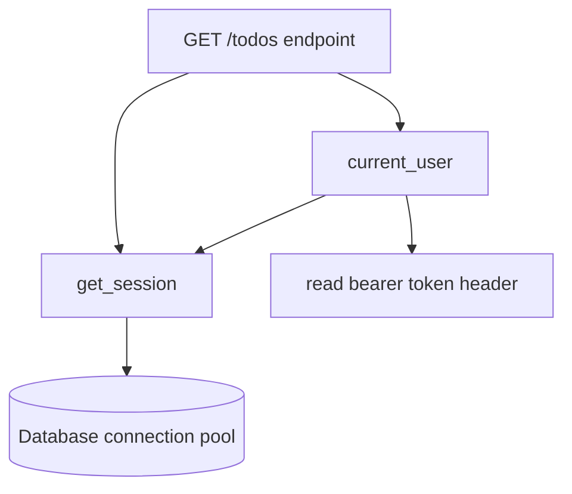

A single `main.py` with five endpoints is a great start, and a terrible place to stay. Real APIs
have dozens of routes, need a database connection per request, read secrets from the environment,
run code at startup, and must be tested automatically before every deploy. This session covers the
FastAPI features that make a codebase grow without turning into spaghetti, plus the
[Twelve-Factor App](https://12factor.net/) principles behind good configuration. Everything here
appears in this project's own `apps/api`, so you can read working examples alongside the
[FastAPI docs](https://fastapi.tiangolo.com/).

## Dependency injection with Depends

Imagine a restaurant kitchen. A cook doesn't go out and buy ingredients for each dish: they declare
"this recipe needs eggs and flour", and someone else makes sure those are on the counter. That's
**dependency injection (DI)**: a function declares what it needs, and the framework provides it.

In FastAPI, a **dependency** is any callable, and you request it with `Depends`:

```python
from typing import Annotated
from fastapi import Depends, FastAPI, Query

app = FastAPI()


def pagination(page_size: Annotated[int, Query(ge=1, le=100)] = 20, page_token: str | None = None):
    return {"page_size": page_size, "page_token": page_token}


Page = Annotated[dict, Depends(pagination)]


@app.get("/todos")
async def list_todos(page: Page):
    ...
```

FastAPI calls `pagination` for each request, with its own parameters parsed from the query string,
and passes the result in. Every list endpoint now shares the same rules, and the docs show the
parameters correctly.

Dependencies can depend on other dependencies, and can use `yield` to run **cleanup** after the
response. That's the standard pattern for a database session:

```python
async def get_session():
    async with SessionLocal() as session:
        yield session  # endpoint runs here; the session closes afterwards
```



FastAPI resolves the graph once per request: if both `current_user` and the endpoint depend on
`get_session`, they get the *same* session (dependencies are cached within a request).

> [!TIP]
> The biggest payoff is testing. `app.dependency_overrides[get_session] = fake_session` swaps a
> dependency for the whole app, so tests can use a test database or a fake user without touching
> endpoint code.

## Routers and project structure

`APIRouter` is a mini-app: you declare path operations on it, then mount it on the main app with a
prefix and tags. It's how you split by feature.

```python
# app/routes/todos.py
from fastapi import APIRouter

router = APIRouter(prefix="/todos", tags=["todos"])


@router.get("")
async def list_todos(): ...
```

```python
# app/main.py
from app.routes import todos

app.include_router(todos.router)
```

A structure that scales well, close to this project's `apps/api`:

```text
app/
  main.py          # create app, include routers, exception handlers, lifespan
  config.py        # settings
  db.py            # engine, session factory, get_session dependency
  models.py        # SQLAlchemy tables
  routes/
    todos.py       # HTTP layer: parse, call logic, return response models
    lists.py
  services/        # business logic, no FastAPI imports (optional at first)
tests/
  conftest.py
  test_todos.py
```

The guiding rule: **routes stay thin**. They translate HTTP into a function call and the result
back into HTTP. Business rules ("a list can hold at most 500 todos") live in plain functions you
can test without HTTP at all.

> [!NOTE]
> Routers can carry shared dependencies:
> `APIRouter(prefix="/admin", dependencies=[Depends(require_admin)])` protects every route in that
> file with one line, so nobody can forget the check on a new endpoint.

## Middleware, CORS and lifespan events

**Middleware** wraps every request and response, like airport security that every passenger passes
through regardless of destination. Use it for cross-cutting concerns: request ids, timing, logging,
compression.

```python
import time, uuid
from fastapi import Request


@app.middleware("http")
async def add_request_id(request: Request, call_next):
    request_id = str(uuid.uuid4())
    start = time.perf_counter()
    response = await call_next(request)
    response.headers["X-Request-ID"] = request_id
    response.headers["X-Process-Time"] = f"{time.perf_counter() - start:.4f}"
    return response
```


**CORS** (Session 3.1.2) is handled by a built-in middleware:

```python
from fastapi.middleware.cors import CORSMiddleware

app.add_middleware(
    CORSMiddleware,
    allow_origins=["https://app.example.com"],
    allow_credentials=True,
    allow_methods=["*"],
    allow_headers=["*"],
)
```

**Lifespan events** run code once at startup and once at shutdown: open a connection pool, load a
model, start a scheduler, then close things cleanly. FastAPI uses an async context manager:

```python
from contextlib import asynccontextmanager


@asynccontextmanager
async def lifespan(app: FastAPI):
    await sync_data()           # startup
    yield
    await engine.dispose()      # shutdown


app = FastAPI(lifespan=lifespan)
```

This project's `main.py` does exactly this: on startup it syncs `ROADMAP.md` into the database and
starts the APScheduler jobs.

> [!WARNING]
> If startup code raises, the app won't start. That's often what you want (the roadmap validator
> here stops the API on a malformed file), but slow or flaky startup work, like waiting for a model
> download, should run in the background instead of blocking.

## Background tasks and settings management

**Background tasks** run after the response has been sent. The user gets a fast `201`, and the
"send a welcome email" work happens afterwards:

```python
from fastapi import BackgroundTasks


@router.post("/signup", status_code=201)
async def signup(payload: SignupIn, tasks: BackgroundTasks):
    user = await create_user(payload)
    tasks.add_task(send_welcome_email, user.email)
    return user
```

They run in the same process, so they're lost if the server restarts and there's no retry. For
anything that must happen reliably, use a real queue with workers (Session 3.5.3).

**Settings management** follows the Twelve-Factor rule: *store config in the environment*. The
same code runs in development, CI and production; only environment variables differ. Secrets never
live in the repository. `pydantic-settings` reads env vars into a typed, validated object:

```python
from pydantic_settings import BaseSettings, SettingsConfigDict


class Settings(BaseSettings):
    model_config = SettingsConfigDict(env_file=".env")
    database_url: str
    cors_origins: list[str] = ["http://localhost:3000"]
    debug: bool = False


settings = Settings()
```

A missing `DATABASE_URL` fails loudly at startup instead of mysteriously at the first query.

> [!NOTE]
> This project's `app/config.py` creates settings *at import time*. That's why `tests/conftest.py`
> sets environment variables before importing `app`: by the time the import runs, it's too late to
> change them. A common alternative is a cached `get_settings()` dependency you can override.

## Testing FastAPI apps

FastAPI's `TestClient` (built on `httpx`) calls your app in-process: no server, no network, real
HTTP semantics.

```python
from fastapi.testclient import TestClient
from app.main import app

client = TestClient(app)


def test_create_and_get_todo():
    created = client.post("/todos", json={"title": "Write tests"})
    assert created.status_code == 201
    todo_id = created.json()["id"]
    assert client.get(f"/todos/{todo_id}").json()["title"] == "Write tests"


def test_rejects_empty_title():
    assert client.post("/todos", json={"title": ""}).status_code == 422
```

What makes tests reliable:

- **Isolate state.** Each test starts from a known state: a fresh test database, a transaction
  rolled back after each test, or an in-memory store reset by a fixture.
- **Override dependencies** for things you don't want to hit for real: the current user, external
  APIs, LLMs. This project uses a fake LLM provider in tests for deterministic output.
- **Test behaviour, not implementation.** Assert status codes and response bodies, like a real
  client would.
- **Use `async` tests** with `httpx.AsyncClient` and `ASGITransport` when the code under test is
  async and you need an event loop shared with fixtures, as this project's suite does.

## Practice: add auth-ready dependencies and tests to the to-do API

Take your to-do API from Session 3.2.2 and restructure it. Plan about 90 minutes.

### Step 1: Restructure into a package

Move code into `app/main.py`, `app/config.py`, `app/routes/todos.py` and `app/models.py`
(Pydantic models for now). `main.py` should only create the app and include routers. Run the app
and confirm `/docs` still works.

### Step 2: Settings

Create `Settings` with `api_tokens: dict[str, str] = {}` (token → username) and
`cors_origins: list[str]`. Put dev values in `.env` and add `.env` to `.gitignore`.

### Step 3: An auth-ready dependency

```python
from fastapi import Header, HTTPException


async def current_user(authorization: Annotated[str | None, Header()] = None) -> str:
    if not authorization or not authorization.startswith("Bearer "):
        raise HTTPException(401, "Missing token", headers={"WWW-Authenticate": "Bearer"})
    user = settings.api_tokens.get(authorization.removeprefix("Bearer "))
    if user is None:
        raise HTTPException(401, "Invalid token")
    return user


CurrentUser = Annotated[str, Depends(current_user)]
```

Store an `owner` on each todo, filter lists by it, and return `404` when someone requests a todo
they don't own (the BOLA check from Session 3.2.1). Later you can swap the token lookup for real
JWT validation without touching endpoints: that's what "auth-ready" means.

### Step 4: Middleware and lifespan

Add the request-id middleware, `CORSMiddleware` from settings, and a lifespan that seeds one demo
todo at startup.

### Step 5: Tests

Create `tests/test_todos.py` with a fixture that resets the store and sets
`app.dependency_overrides[current_user] = lambda: "alice"`. Write tests for: create returns `201`
and a `Location` header; empty title returns `422`; missing token returns `401` (clear the
override in that test); Bob gets `404` on Alice's todo; `page_size=1000` returns `422`. Run
`pytest -q` until green.

> [!EXAMPLE]
> The ownership test: override `current_user` to return `"alice"`, create a todo, then switch the
> override to `"bob"` and assert `client.get(f"/todos/{todo_id}").status_code == 404`.
