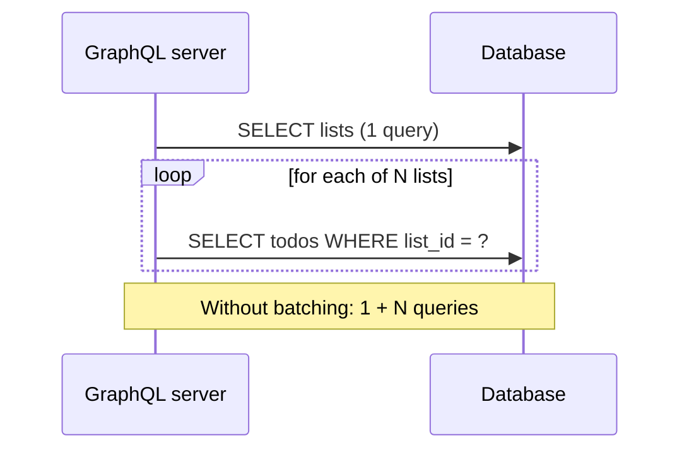
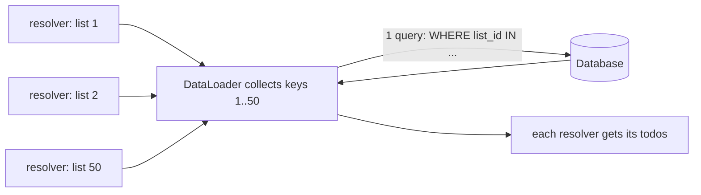

REST gives every resource its own URL and lets the server decide what each response contains.
That works beautifully until a mobile screen needs a user, their five latest lists, and the three
open todos in each, and you either make eleven requests or build a custom endpoint for that one
screen. **GraphQL** flips the arrangement: the server publishes a typed schema of everything it can
provide, and the client sends one query describing exactly the shape it wants. This session
follows [GraphQL Learn](https://graphql.org/learn/), the official introduction, and ends with a
GraphQL version of your to-do API.

## Schemas, queries and mutations

Think of REST as a set-menu restaurant: each dish (endpoint) comes as the kitchen designed it.
GraphQL is a buffet with a labelled map: the **schema** lists every dish and how they connect, and
you fill your plate with exactly what you want in one trip.

The **schema** is written in the GraphQL Schema Definition Language (SDL). It defines **types**,
their **fields**, and the entry points:

```graphql
type Todo {
  id: ID!
  title: String!
  done: Boolean!
  list: TodoList!
}

type TodoList {
  id: ID!
  name: String!
  todos(done: Boolean): [Todo!]!
}

type Query {
  lists: [TodoList!]!
  todo(id: ID!): Todo
}

type Mutation {
  addTodo(listId: ID!, title: String!): Todo!
  completeTodo(id: ID!): Todo
}
```

`!` means non-null; `[Todo!]!` is a non-null list of non-null todos. Fields can take **arguments**,
like `todos(done: Boolean)`. The special `Query` type holds read entry points; `Mutation` holds
writes.

A **query** asks for a tree of fields, and the response mirrors its shape exactly:

```graphql
query OpenTodos {
  lists {
    name
    todos(done: false) {
      id
      title
    }
  }
}
```

```json
{"data": {"lists": [{"name": "Work", "todos": [{"id": "7", "title": "Ship v2"}]}]}}
```

No over-fetching (fields you didn't ask for aren't sent) and no under-fetching (related data comes
in the same round trip). A **mutation** looks the same but changes data, and also returns a
selection, so the client gets the updated object back immediately:

```graphql
mutation {
  completeTodo(id: "7") { id done }
}
```

> [!NOTE]
> GraphQL usually runs over a single HTTP endpoint, typically `POST /graphql`, with the query in a
> JSON body. Pass user input through **variables** (`query ($id: ID!) { todo(id: $id) { title } }`
> with `{"variables": {"id": "7"}}`) rather than building query strings by hand, just as you'd use
> parameters in SQL.

> [!TIP]
> Because the schema is typed and **introspectable** (clients can query the schema itself), tools
> like GraphiQL give you autocomplete and inline docs for free, similar to Swagger UI for OpenAPI.

## Resolvers and the N+1 problem (DataLoader)

The schema says *what* exists; **resolvers** say *how* to fetch it. Each field has a resolver: a
function that receives the parent object and the field's arguments and returns the value. The
server walks the query tree and calls resolvers level by level.

That design hides a trap. For the `OpenTodos` query above:

1. `Query.lists` runs once: `SELECT * FROM lists` → 50 lists.
2. `TodoList.todos` runs **once per list**: 50 separate `SELECT * FROM todos WHERE list_id = ?`.

That's 1 + N queries, the **N+1 problem**. With nested levels it multiplies, and a harmless-looking
query hammers the database.



The standard fix is a **DataLoader**. Instead of fetching immediately, each resolver says "I'll
need the todos for list 3" and gets back a promise. The DataLoader waits until the current tick of
resolvers has finished, collects all the requested keys, and makes **one** batched call:
`SELECT * FROM todos WHERE list_id IN (1, 2, …, 50)`. It then hands each resolver its slice. It also
caches by key within the request, so the same list asked for twice is fetched once.



> [!WARNING]
> Create DataLoaders **per request**, never globally. A global loader's cache would serve one user's
> data to another and never see updates.

You'll meet the same N+1 problem in ORMs (Session 3.4.1), where the fix is eager loading. The
lesson is general: whenever code fetches related data inside a loop, count the queries.

## REST vs GraphQL trade-offs

Neither wins everywhere. A fair comparison:

| Concern | REST | GraphQL |
|---|---|---|
| Fetching shape | Fixed per endpoint; over/under-fetching common | Client picks fields; one round trip for nested data |
| HTTP caching | Natural: `GET` URLs + `Cache-Control`/`ETag` | Harder: mostly `POST` to one URL; needs client-side or persisted-query caching |
| Errors | Status codes per request | Usually `200` with an `errors` array; partial success possible |
| Evolution | Versioning (`/v2`) | Add fields freely, deprecate old ones with `@deprecated` |
| Server cost control | Each endpoint is predictable | Clients can craft expensive deep queries; needs depth/complexity limits |
| Tooling | OpenAPI, curl, any HTTP client | Strong typed tooling, but a GraphQL client helps |
| File uploads, streaming | Straightforward | Awkward; often done outside GraphQL |

GraphQL tends to shine when **many different clients** (web, iOS, Android, partners) need different
views of richly connected data, and when front-end teams want to iterate without waiting for new
endpoints. REST tends to shine for **public APIs**, simple CRUD, heavy HTTP caching, and teams
that want the least moving parts.

> [!EXAMPLE]
> A social app's feed screen needs posts, authors, like counts and the first two comments. In REST
> that's either many requests or a bespoke `/feed-screen` endpoint. In GraphQL it's one query, and
> when the screen changes, only the query changes. Meanwhile a payments webhook API stays REST:
> simple, cacheable, and every partner already has an HTTP client.

> [!WARNING]
> A public GraphQL endpoint lets anyone write queries like
> `lists { todos { list { todos { list { … } } } } }`. Always set a maximum query depth and
> complexity, paginate list fields, and rate-limit, or one request can take down the database.

## Practice: expose the to-do model through GraphQL

You'll add a GraphQL endpoint next to your FastAPI REST routes using
Strawberry, a Python GraphQL library that builds the schema from type-hinted classes. About 60–90 minutes.

### Step 1: Install and define types

```sh
pip install "strawberry-graphql[fastapi]"
```

```python
# app/graphql_api.py
import strawberry
from strawberry.dataloader import DataLoader
from strawberry.fastapi import GraphQLRouter

LISTS = {1: {"id": 1, "name": "Work"}, 2: {"id": 2, "name": "Home"}}
TODOS = {
    1: {"id": 1, "list_id": 1, "title": "Ship v2", "done": False},
    2: {"id": 2, "list_id": 2, "title": "Buy milk", "done": True},
}


async def load_todos_by_list(list_ids: list[int]) -> list[list["Todo"]]:
    print(f"batched fetch for lists {list_ids}")  # one call per request, not per list
    return [[Todo(**t) for t in TODOS.values() if t["list_id"] == lid] for lid in list_ids]


@strawberry.type
class Todo:
    id: int
    list_id: strawberry.Private[int]
    title: str
    done: bool


@strawberry.type
class TodoList:
    id: int
    name: str

    @strawberry.field
    async def todos(self, info: strawberry.Info, done: bool | None = None) -> list[Todo]:
        items = await info.context["todo_loader"].load(self.id)
        return [t for t in items if done is None or t.done == done]
```

`strawberry.Private` keeps `list_id` available in Python without exposing it in the schema.

### Step 2: Query, mutation and context

```python
@strawberry.type
class Query:
    @strawberry.field
    def lists(self) -> list[TodoList]:
        return [TodoList(**l) for l in LISTS.values()]


@strawberry.type
class Mutation:
    @strawberry.mutation
    def add_todo(self, list_id: int, title: str) -> Todo:
        new_id = max(TODOS) + 1
        TODOS[new_id] = {"id": new_id, "list_id": list_id, "title": title, "done": False}
        return Todo(**TODOS[new_id])


async def get_context():
    return {"todo_loader": DataLoader(load_fn=load_todos_by_list)}  # new loader per request


schema = strawberry.Schema(query=Query, mutation=Mutation)
graphql_router = GraphQLRouter(schema, context_getter=get_context)
```

In `main.py`: `app.include_router(graphql_router, prefix="/graphql")`.

### Step 3: Explore in GraphiQL

Run the app and open `http://127.0.0.1:8000/graphql`. Strawberry serves the GraphiQL explorer.
Run the `OpenTodos` query (Strawberry converts `add_todo` to `addTodo` in the schema). Check the
server log: the "batched fetch" line should print **once** with both list ids.

### Step 4: Break it on purpose

Replace the loader call with a direct loop over `TODOS` inside the resolver and add a print. Add
20 lists to `LISTS` and rerun the query: count the prints. That's N+1 made visible. Restore the
DataLoader.

### Step 5: Compare with REST

Write the same "lists with open todos" request against your REST API from Session 3.2.2. Count
requests and bytes for each. Then write three sentences: which one would you choose for this app,
and why?
