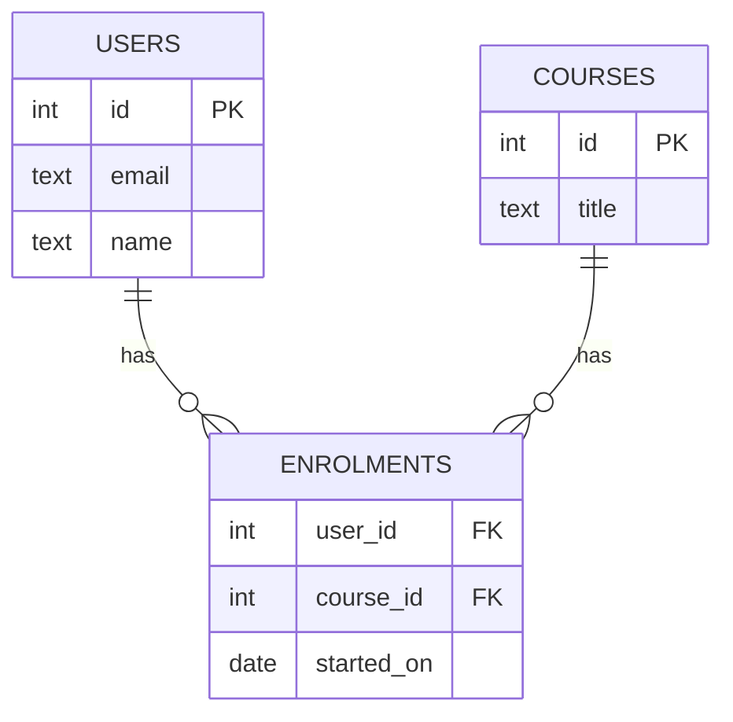
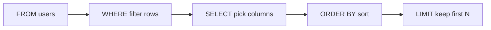

Almost every backend you will work on stores its important data in a relational database, and SQL
is the language you use to talk to it. SQL is over fifty years old and still everywhere because the
idea underneath it is simple and powerful: keep data in tables, describe *what* you want, and let
the database figure out *how* to get it. This session gives you the mental model and the core
statements; the next sessions build joins, design and performance on top of it.

## Tables, rows, keys and the relational model

Picture a well-organised spreadsheet workbook. Each sheet holds one kind of thing (users, courses,
enrolments), each row is one of those things, and each column is one property with a fixed type. A
relational database is that idea made rigorous.

- A **table** (formally a *relation*) stores one kind of entity, such as `users`.
- A **row** (a *tuple*) is one entity: one specific user.
- A **column** (an *attribute*) has a name and a data type: `email TEXT`, `created_at TIMESTAMPTZ`.
- The **schema** is the set of table definitions: names, columns, types and rules.

Two kinds of key tie everything together. A **primary key** uniquely identifies each row of a table,
usually an `id` column. A **foreign key** is a column whose value must match a primary key in
another table, which is how rows *relate*: an `enrolments.user_id` points to `users.id`.



The **relational model**, proposed by Edgar F. Codd in 1970, adds a crucial idea: you work on whole
sets of rows with declarative statements. You do not write a loop that walks a file; you write
"give me the emails of users who enrolled this month", and the database's **query planner** chooses
indexes, join order and algorithms. That separation of *what* from *how* is why the same SQL keeps
working as a table grows from a hundred rows to a hundred million.

Here is how you create tables in PostgreSQL, the database this course uses (see the
[PostgreSQL Tutorial](https://www.postgresql.org/docs/current/tutorial.html)):

```sql
CREATE TABLE users (
  id         BIGSERIAL PRIMARY KEY,
  email      TEXT NOT NULL UNIQUE,
  name       TEXT NOT NULL,
  country    TEXT,
  created_at TIMESTAMPTZ NOT NULL DEFAULT now()
);

CREATE TABLE courses (
  id    BIGSERIAL PRIMARY KEY,
  title TEXT NOT NULL,
  price NUMERIC(8, 2) NOT NULL CHECK (price >= 0)
);
```

> [!NOTE]
> Rows in a table have **no inherent order**. If you do not ask for an order with `ORDER BY`, the
> database may return rows in whatever order is cheapest, and that order can change between runs.

> [!TIP]
> Constraints such as `NOT NULL`, `UNIQUE` and `CHECK` are free bug prevention. Application code
> has many entry points and can be bypassed; the database sees every write.

## SELECT, WHERE, ORDER BY, LIMIT

Reading data is the job of `SELECT`. Think of it as a pipeline of filters applied to a table: pick
the table, keep the rows you want, sort them, keep the first few, and choose which columns to show.

```sql
SELECT name, email
FROM users
WHERE country = 'IT' AND created_at >= '2026-01-01'
ORDER BY created_at DESC
LIMIT 10;
```

Read it like a sentence: from `users`, keep Italian users who signed up this year, newest first, the
first ten, showing name and email. Note the *logical* order in which the database evaluates the
clauses is different from the order you type them:



This explains a common surprise: you cannot use a column alias defined in `SELECT` inside `WHERE`,
because `WHERE` runs first. You can use it in `ORDER BY`, which runs after.

Useful pieces for `WHERE`:

| Operator | Example | Meaning |
|---|---|---|
| `=`, `<>`, `<`, `>=` | `price >= 20` | Comparison |
| `AND`, `OR`, `NOT` | `a AND (b OR c)` | Combine conditions; use brackets |
| `IN` | `country IN ('IT', 'FR')` | Matches any in a list |
| `BETWEEN` | `price BETWEEN 10 AND 20` | Inclusive range |
| `LIKE` / `ILIKE` | `email ILIKE '%@gmail.com'` | Pattern (`%` = any text); `ILIKE` ignores case |
| `IS NULL` | `country IS NULL` | Missing value (see below) |

`LIMIT` is often paired with `OFFSET` for paging (`LIMIT 10 OFFSET 20` is page three). `DISTINCT`
removes duplicate result rows: `SELECT DISTINCT country FROM users`.

> [!WARNING]
> Avoid `SELECT *` in application code. It fetches columns you do not need, breaks silently when
> someone adds a large column, and hides which data your code actually depends on. It is fine for
> exploring in a terminal.

## INSERT, UPDATE, DELETE

Writing data uses three statements. They look simple, and they are, which is exactly what makes them
dangerous when written carelessly.

**INSERT** adds rows. Always list the columns, so the statement keeps working if the table gains a
column:

```sql
INSERT INTO users (email, name, country)
VALUES ('ada@example.com', 'Ada', 'GB'),
       ('linus@example.com', 'Linus', 'FI')
RETURNING id, created_at;
```

`RETURNING` is a PostgreSQL feature that hands back generated values, like the new `id`, without a
second query.

**UPDATE** changes existing rows that match a condition:

```sql
UPDATE courses
SET price = price * 0.9
WHERE id = 42;
```

**DELETE** removes rows that match a condition:

```sql
DELETE FROM users
WHERE email = 'linus@example.com';
```

> [!WARNING]
> An `UPDATE` or `DELETE` **without a `WHERE` clause affects every row in the table**. Before
> running one by hand, write it as a `SELECT` with the same `WHERE` first, check the rows it
> returns, then change `SELECT` to `DELETE`. Even better, run it inside a transaction (`BEGIN;`
> ... `ROLLBACK;` or `COMMIT;`) so you can undo a mistake.

> [!NOTE]
> In application code, never build SQL by pasting user input into a string. Use parameters
> (`WHERE email = %s` with the value passed separately). String-building is how **SQL injection**
> happens; parameters keep data as data.

Constraints work here too: inserting a second user with the same email fails with a unique
violation, and deleting a user who still has enrolments fails if the foreign key does not allow it.
That error is a feature. It is the database refusing to store data that breaks your rules.

## NULL and three-valued logic

`NULL` means "unknown" or "missing", not zero and not an empty string. Imagine a form where the user
skipped the "country" field. We don't know their country. That uncertainty leaks into every
comparison: is an unknown country equal to `'IT'`? The honest answer is "unknown", and SQL agrees.

So SQL uses **three-valued logic**: a condition can be `TRUE`, `FALSE` or `UNKNOWN`. Any comparison
with `NULL` gives `UNKNOWN`, even `NULL = NULL`. And `WHERE` keeps a row **only when the condition is
TRUE**, so rows that evaluate to `UNKNOWN` silently disappear.

```sql
-- Suppose 3 users: country 'IT', 'FR' and NULL.
SELECT count(*) FROM users WHERE country = 'IT';    -- 1
SELECT count(*) FROM users WHERE country <> 'IT';   -- 1, not 2! The NULL row is UNKNOWN
SELECT count(*) FROM users WHERE country IS NULL;   -- 1
SELECT count(*) FROM users WHERE country IS DISTINCT FROM 'IT';  -- 2
```

The truth tables for `AND` and `OR` follow common sense: `FALSE AND UNKNOWN` is `FALSE` (one false
is enough), `TRUE OR UNKNOWN` is `TRUE` (one true is enough), and the rest stay `UNKNOWN`.

| a | b | a AND b | a OR b |
|---|---|---|---|
| TRUE | UNKNOWN | UNKNOWN | TRUE |
| FALSE | UNKNOWN | FALSE | UNKNOWN |
| UNKNOWN | UNKNOWN | UNKNOWN | UNKNOWN |

Practical rules:

- Test for missing values with `IS NULL` / `IS NOT NULL`, never `= NULL`.
- Use `COALESCE(country, 'unknown')` to substitute a default when displaying or grouping.
- Watch `NOT IN` with a subquery: if the list contains a single `NULL`, `x NOT IN (...)` can never
  be `TRUE`, and the query returns nothing.
- Aggregates such as `count(country)` and `avg(price)` skip `NULL`s; `count(*)` counts rows.

> [!EXAMPLE]
> A support team reports "the inactive-users report is missing people". The query was
> `WHERE status <> 'active'`. Users created before the `status` column existed have `NULL` there,
> so they are neither equal nor unequal to `'active'`, and vanish. Fix: `WHERE status IS DISTINCT
> FROM 'active'`, and consider making the column `NOT NULL` with a default.

## Practice: complete SQLBolt

[SQLBolt](https://sqlbolt.com/) is a free, browser-based set of interactive lessons. Each one
explains a concept and gives you exercises against a small table, checking your answers instantly.
Plan two sittings of about 45 minutes.

### Step 1: Do lessons 1–5 (SELECT basics)

Lessons 1 to 5 cover `SELECT`, `WHERE` with numbers and text, and `ORDER BY` / `LIMIT` / `OFFSET`.
For every exercise, **write the query before looking at any hint**. If you get stuck, reread the
lesson text, not the solution.

### Step 2: Do the review lesson and the NULL lesson

After the first review exercise, jump to the lesson on `NULL` values and redo the four examples from
this session's three-valued-logic section in your head before checking.

### Step 3: Do the write lessons

Complete the lessons on inserting, updating and deleting rows, and on creating and altering tables.
For every `UPDATE` and `DELETE`, first write the matching `SELECT` to see which rows you will touch.

### Step 4: Repeat locally in PostgreSQL

Interactive sites hide the setup. Run a local database once so it is not mysterious:

```sh
docker run --name pg -e POSTGRES_PASSWORD=pw -p 5432:5432 -d postgres:16
docker exec -it pg psql -U postgres
```

Inside `psql`, paste the `users` and `courses` tables from this lesson, insert five users (one with
a `NULL` country), and write queries to: list users by newest first; find Gmail users
case-insensitively; count users per non-null country; and raise all course prices by 5%.

### Step 5: Retrieval check the next day

Close everything and write, from memory, an example of each statement (`SELECT` with all four
clauses, `INSERT ... RETURNING`, `UPDATE`, `DELETE`) and one sentence explaining why
`WHERE country <> 'IT'` can miss rows.

> [!TIP]
> Keep your queries in a `sql-notes.md` file. A personal library of queries you wrote yourself is
> far more useful in a month than bookmarks of queries someone else wrote.
