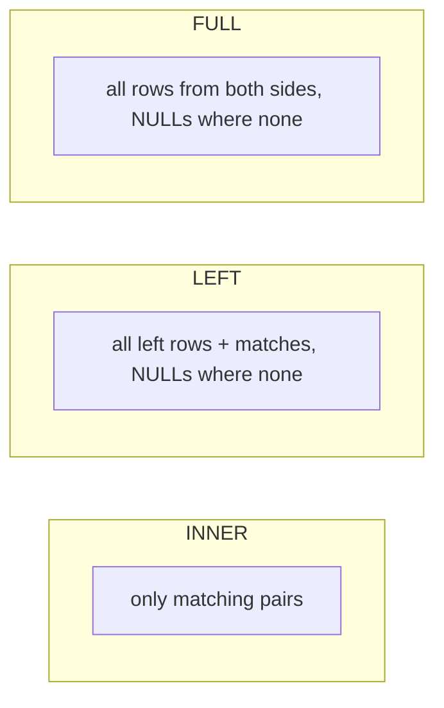

Basic SQL answers questions about one table. Real questions cross tables and summarise: "which
courses earned the most revenue last quarter?", "what share of users finished their first lesson
within a week?", "what is each user's running total of XP?". This session covers the four tools
that turn SQL from a lookup language into an analysis language: joins, aggregation, subqueries and
CTEs, and window functions. Once these click, you can answer most business questions without
exporting anything to a spreadsheet.

We will use this small schema throughout:

```sql
users       (id, name, country, referred_by, created_at)  -- referred_by → users.id
courses     (id, title, price)
enrolments  (user_id, course_id, enrolled_at, completed_at)
```

## Joins: inner, left, full, self

A **join** combines rows from two tables based on a matching condition. Picture two stacks of index
cards, one for users and one for enrolments. A join lays out every pair of cards whose `user_id`
matches, side by side. The flavours differ only in what happens to cards that find no partner.

**INNER JOIN** keeps only matching pairs. Users with no enrolments disappear; so do enrolments whose
user was deleted.

```sql
SELECT u.name, c.title, e.enrolled_at
FROM enrolments e
JOIN users   u ON u.id = e.user_id
JOIN courses c ON c.id = e.course_id;
```

**LEFT JOIN** keeps *every* row from the left table, and fills the right side with `NULL` where there
is no match. It is the tool for "including those with none":

```sql
-- Every user and how many courses they are in, including zero
SELECT u.name, count(e.course_id) AS courses
FROM users u
LEFT JOIN enrolments e ON e.user_id = u.id
GROUP BY u.id, u.name;
```

A classic pattern built on it is the **anti-join**: "users who never enrolled" is a `LEFT JOIN`
followed by `WHERE e.user_id IS NULL`.

**FULL OUTER JOIN** keeps unmatched rows from *both* sides. It is rarer, useful for reconciliation:
comparing yesterday's export with today's and finding rows that exist in only one.

A **self join** joins a table to itself under two aliases. With `referred_by`, you can list each
user next to the person who referred them:

```sql
SELECT u.name AS user_name, r.name AS referrer
FROM users u
LEFT JOIN users r ON r.id = u.referred_by;
```



> [!WARNING]
> A filter on the right table in `WHERE` silently turns a `LEFT JOIN` into an inner join, because
> the `NULL` rows fail the condition. To keep users without matching enrolments, put the filter in
> the `ON` clause: `LEFT JOIN enrolments e ON e.user_id = u.id AND e.enrolled_at >= '2026-01-01'`.

> [!TIP]
> Before trusting a join, check row counts. If joining users to enrolments gives more rows than
> enrolments, your `ON` condition is matching too much, and every sum built on it will be wrong.

## GROUP BY, HAVING and aggregate functions

**Aggregate functions** collapse many rows into one value: `count`, `sum`, `avg`, `min`, `max`.
On their own they summarise the whole result. With **GROUP BY**, they summarise per group, like a
pivot table: sort the cards into piles by a key, then compute one number per pile.

```sql
SELECT c.title,
       count(*)                     AS enrolments,
       count(e.completed_at)        AS completions,
       round(avg(c.price), 2)       AS avg_price
FROM enrolments e
JOIN courses c ON c.id = e.course_id
GROUP BY c.title
ORDER BY enrolments DESC;
```

The rule to remember: every column in `SELECT` must either be inside an aggregate or listed in
`GROUP BY`. Otherwise the database would not know which of the many rows in a pile to show.

**HAVING** filters *groups*, after aggregation, while `WHERE` filters *rows*, before it. The full
logical order is:


```sql
-- Countries with more than 50 users who joined this year
SELECT country, count(*) AS n
FROM users
WHERE created_at >= '2026-01-01'   -- row filter
GROUP BY country
HAVING count(*) > 50               -- group filter
ORDER BY n DESC;
```

PostgreSQL also offers `FILTER` for conditional aggregates, which is cleaner than `CASE` tricks:
`count(*) FILTER (WHERE completed_at IS NOT NULL) AS finished`. See the
[PostgreSQL docs](https://www.postgresql.org/docs/current/) on aggregate expressions.

> [!NOTE]
> `count(*)` counts rows; `count(column)` counts non-NULL values in that column. That difference is
> how `count(e.course_id)` in a `LEFT JOIN` correctly returns 0 for users with no enrolments.

## Subqueries and common table expressions

A **subquery** is a query inside another query. It can produce a single value, a list, or a whole
table:

```sql
-- Courses priced above the average price (scalar subquery)
SELECT title, price
FROM courses
WHERE price > (SELECT avg(price) FROM courses);

-- Users who enrolled in any course costing over 100 (EXISTS)
SELECT u.name
FROM users u
WHERE EXISTS (
  SELECT 1 FROM enrolments e
  JOIN courses c ON c.id = e.course_id
  WHERE e.user_id = u.id AND c.price > 100
);
```

The second one is a **correlated subquery**: it refers to `u` from the outer query, so conceptually
it runs once per user. `EXISTS` is often the clearest way to say "has at least one", and it is
`NULL`-safe in a way `NOT IN` is not.

Nested subqueries get hard to read quickly. A **common table expression (CTE)**, written with `WITH`,
lets you name an intermediate result and use it like a table. Think of CTEs as the variables of SQL:
you build the answer in readable steps.

```sql
WITH course_revenue AS (
  SELECT c.id, c.title, sum(c.price) AS revenue
  FROM enrolments e
  JOIN courses c ON c.id = e.course_id
  WHERE e.enrolled_at >= date_trunc('quarter', now()) - interval '3 months'
    AND e.enrolled_at <  date_trunc('quarter', now())
  GROUP BY c.id, c.title
),
ranked AS (
  SELECT *, revenue / sum(revenue) OVER () AS share
  FROM course_revenue
)
SELECT title, revenue, round(share * 100, 1) AS pct
FROM ranked
ORDER BY revenue DESC
LIMIT 5;
```

CTEs can also be **recursive** (`WITH RECURSIVE`), which lets you walk hierarchies such as the
referral tree or a category tree of arbitrary depth.

> [!TIP]
> Write analytical queries one CTE at a time, running each step with a `SELECT * FROM step LIMIT 20`
> before adding the next. It is the SQL equivalent of printing intermediate values while debugging.

## Window functions

Aggregation with `GROUP BY` collapses rows. Sometimes you want the summary **and** the detail at the
same time: each enrolment *and* the user's running count, each course *and* its rank. That is what
**window functions** do. They compute a value over a "window" of related rows, but every original
row stays in the output.

The syntax is a function followed by `OVER (...)`:

- `PARTITION BY` splits rows into groups (like `GROUP BY`, without collapsing).
- `ORDER BY` inside `OVER` sets the order within each partition.
- An optional frame (`ROWS BETWEEN 6 PRECEDING AND CURRENT ROW`) limits which rows count.

```sql
SELECT user_id,
       course_id,
       enrolled_at,
       row_number() OVER (PARTITION BY user_id ORDER BY enrolled_at) AS nth_course,
       count(*)     OVER (PARTITION BY user_id)                      AS total_courses,
       lag(enrolled_at) OVER (PARTITION BY user_id ORDER BY enrolled_at) AS previous_enrolment
FROM enrolments;
```

Useful families:

| Function | Answers |
|---|---|
| `row_number()`, `rank()`, `dense_rank()` | Position in a partition (top-N per group, deduplication) |
| `sum()`/`avg()` with `ORDER BY` | Running totals and moving averages |
| `lag()`, `lead()` | The previous or next row's value (time between events) |
| `first_value()`, `ntile(4)` | First item, quartiles |

A classic: "each user's first course". With `row_number()` in a CTE, then `WHERE nth_course = 1`.
Window functions run after `WHERE`/`GROUP BY`/`HAVING`, so you cannot filter on them directly; wrap
them in a CTE or subquery first.

> [!EXAMPLE]
> Daily signups with a 7-day moving average:
>
> ```sql
> WITH daily AS (
>   SELECT created_at::date AS day, count(*) AS signups
>   FROM users GROUP BY 1
> )
> SELECT day, signups,
>        round(avg(signups) OVER (ORDER BY day ROWS BETWEEN 6 PRECEDING AND CURRENT ROW), 1) AS avg_7d
> FROM daily ORDER BY day;
> ```

## Practice: answer ten business questions on a sample database

Load a realistic dataset and answer questions a product manager would ask. Allow two hours, split
over two days.

### Step 1: Get a sample database

The PostgreSQL community "dvdrental" sample (a DVD rental shop with customers, films, rentals and
payments) is widely used for practice; alternatively, create the three tables above and generate
data with `generate_series`:

```sql
INSERT INTO users (name, country, referred_by)
SELECT 'user' || g, (ARRAY['IT','FR','DE','ES',NULL])[1 + g % 5], NULLIF(g / 3, 0)
FROM generate_series(1, 2000) AS g;
```

Run it in a local PostgreSQL container (`docker run -e POSTGRES_PASSWORD=pw -p 5432:5432 postgres:16`).

### Step 2: Answer the questions

Write one query per question, using a CTE wherever the query has more than one logical step:

1. How many users per country, including users with no country (show it as `'unknown'`)?
2. Which users have never enrolled in anything? (anti-join)
3. Top 5 courses by number of enrolments.
4. Courses with more than 20 enrolments and a completion rate below 50%. (`HAVING`)
5. For each user, who referred them? (self join)
6. Revenue per course for the last full month.
7. Each user's first course. (`row_number()`)
8. Average days between a user's consecutive enrolments. (`lag()`)
9. Daily signups with a 7-day moving average.
10. The top 3 courses by revenue *in each country*. (`rank()` with `PARTITION BY`)

### Step 3: Check your work

For each answer, sanity-check with a second, simpler query: does the per-country count sum to the
total number of users? Does the anti-join count plus the "has enrolled" count equal all users?

> [!TIP]
> Interleave: do the questions in the order given, not grouped by technique. Recognising which tool
> a question needs is the real skill.

### Step 4: Save and review

Save the ten queries with the question as a comment above each. In three days, redo questions 2, 7
and 10 from memory.
