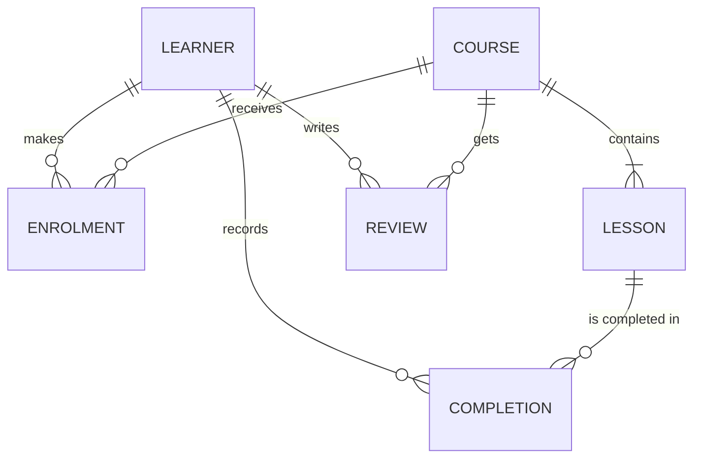
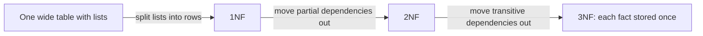

Writing queries is the visible part of working with databases. Designing the tables those queries
run against is the part that decides whether the next five years are pleasant or painful. A good
schema makes wrong data impossible to store and right questions easy to ask; a bad one spreads the
same fact across many places until they disagree. This session teaches you to go from a paragraph
of requirements to a clean, normalised schema, and to know when breaking the rules is the right call.

## Entity–relationship modelling

Before writing `CREATE TABLE`, you draw. An **entity–relationship (ER) model** is a map of the
*things* your system cares about and how they connect, independent of any database. Architects
sketch floor plans before pouring concrete for the same reason: moving a wall on paper is free.

The vocabulary:

- An **entity** is a kind of thing with its own identity: `User`, `Course`, `Lesson`.
- An **attribute** is a property of an entity: a user's `email`, a course's `title`.
- A **relationship** is how entities connect: a user *enrols in* a course.
- **Cardinality** says how many: one-to-one, one-to-many, or many-to-many.

A practical trick for finding entities: underline the **nouns** in the requirements, and the
**verbs** between them become candidate relationships. Then ask, for every relationship, the two
cardinality questions: "can one A have many B?" and "can one B have many A?".

> [!EXAMPLE]
> Requirements: "A learner enrols in courses. A course has ordered lessons. Learners complete
> lessons and can leave one review per course."
>
> - Nouns: learner, course, lesson, review. Verbs: enrols in, has, completes, leaves.
> - Learner–course: a learner takes many courses, a course has many learners → **many-to-many**.
> - Course–lesson: a course has many lessons, a lesson belongs to one course → **one-to-many**.
> - Learner–lesson (completes): **many-to-many**.
> - Review: belongs to one learner and one course, at most one per pair.



Turning the diagram into tables follows three rules:

1. Each entity becomes a table.
2. A **one-to-many** relationship becomes a foreign key on the "many" side (`lessons.course_id`).
3. A **many-to-many** relationship becomes its own **junction table** holding two foreign keys
   (`enrolments(learner_id, course_id)`). Junction tables often grow attributes of their own, such as
   `enrolled_at`, which is a hint they are real entities.

> [!TIP]
> Name the relationship, not just the tables. "Enrolment" is clearer than "learner_course", and the
> moment you name it you will usually think of attributes it needs (date, status, price paid).

## Primary and foreign keys, constraints

Keys and constraints are how you teach the database your business rules so it can enforce them on
every write, from every service, forever.

A **primary key** uniquely identifies a row and never changes. You can choose a **natural key** (a
value with real-world meaning, like an ISO country code) or a **surrogate key** (a generated value
with no meaning, like `BIGINT GENERATED ALWAYS AS IDENTITY` or a UUID). Most application tables use
surrogate keys, because real-world identifiers change: people change email addresses, and companies
change tax numbers.

A **foreign key** ensures a reference points to a row that exists, and decides what happens when the
referenced row is deleted: `ON DELETE CASCADE` (delete children too), `RESTRICT` (refuse), or
`SET NULL`.

Other constraints, documented in the [PostgreSQL docs](https://www.postgresql.org/docs/current/):

| Constraint | Rule it enforces | Example |
|---|---|---|
| `NOT NULL` | Value is required | `email TEXT NOT NULL` |
| `UNIQUE` | No duplicates (single or multi-column) | `UNIQUE (learner_id, course_id)` |
| `CHECK` | Arbitrary condition per row | `CHECK (rating BETWEEN 1 AND 5)` |
| `FOREIGN KEY` | Reference must exist | `REFERENCES courses(id)` |
| `EXCLUDE` | No overlapping rows (PostgreSQL) | No double-booked time ranges |

```sql
CREATE TABLE reviews (
  id          BIGINT GENERATED ALWAYS AS IDENTITY PRIMARY KEY,
  learner_id  BIGINT NOT NULL REFERENCES learners(id) ON DELETE CASCADE,
  course_id   BIGINT NOT NULL REFERENCES courses(id)  ON DELETE CASCADE,
  rating      SMALLINT NOT NULL CHECK (rating BETWEEN 1 AND 5),
  body        TEXT,
  created_at  TIMESTAMPTZ NOT NULL DEFAULT now(),
  UNIQUE (learner_id, course_id)   -- "one review per course"
);
```

The `UNIQUE (learner_id, course_id)` line is the requirement "one review per course" written in a
form the database can enforce. Without it, the rule lives only in application code, and the first
double-click on "Submit" breaks it.

> [!WARNING]
> "We'll validate it in the app" is the most common source of dirty data. Two concurrent requests
> can both pass an application check before either writes. A database constraint is checked
> atomically at write time, so it cannot be raced.

## Normal forms (1NF–3NF) and when to denormalise

**Normalisation** is a set of rules for removing redundancy so each fact is stored exactly once. The
analogy: a company address book. If the office address is copied onto every employee's card, moving
office means updating a hundred cards, and missing one leaves the book contradicting itself. Store
the address once, on an "office" card, and point to it.

Redundancy causes three **anomalies**:

- **Update anomaly**: the same fact in many rows, updated in some but not others.
- **Insert anomaly**: you cannot record a fact without an unrelated one (no course without a learner).
- **Delete anomaly**: deleting one fact destroys another (removing the last enrolment loses the course).

Here is a badly designed table, and how each normal form fixes it:

| learner_email | learner_name | course_title | course_price | lessons_done |
|---|---|---|---|---|
| ada@x.io | Ada | SQL Basics | 20 | 1.1, 1.2, 1.3 |
| ada@x.io | Ada | Python | 30 | 2.1 |
| bob@x.io | Bob | SQL Basics | 20 | 1.1 |

**First normal form (1NF)**: every column holds a single, atomic value, and there are no repeating
groups. `lessons_done` holds a list, so it violates 1NF. Fix: a separate `completions` table with one
row per learner and lesson. Lists in a column cannot be indexed, constrained or joined cleanly.

**Second normal form (2NF)**: in 1NF, and every non-key column depends on the *whole* key, not part of
it. If the key of the table is `(learner_email, course_title)`, then `learner_name` depends only on
`learner_email`, and `course_price` only on `course_title`. Fix: move them to `learners` and
`courses` tables.

**Third normal form (3NF)**: in 2NF, and no non-key column depends on another non-key column
(**no transitive dependencies**). If `courses` stored `teacher_id` *and* `teacher_email`, the email
depends on `teacher_id`, not on the course. Fix: a `teachers` table.

A memorable summary: every non-key attribute must depend on *the key, the whole key, and nothing but
the key*.



### When to denormalise

Normalisation optimises for correct writes. Sometimes reads matter more, and you deliberately store a
derived or duplicated value: a `comment_count` on posts, a copy of the price paid on an order line,
or a reporting table rebuilt nightly. Rules for doing it safely:

- **Normalise first, denormalise with evidence.** Measure a real slow query before adding redundancy.
- **Keep one source of truth.** The duplicate is a cache; know how it is rebuilt.
- **Some duplication is really history.** `order_lines.unit_price` is not redundant with
  `products.price`: it records what was true when the order was placed, which is a different fact.

> [!NOTE]
> This very platform computes XP, levels and streaks from the completions table instead of storing
> them. That is normalisation in action: derived values cannot drift from the facts they come from.
> The [CMU 15-445 Database Systems](https://15445.courses.cs.cmu.edu/) course covers the formal
> theory of functional dependencies if you want to go deeper.

## Practice: design the schema of a learning platform

Design the database for a simplified version of the platform you are using. Allow about 90 minutes.

### Step 1: Read the requirements

- Learners sign up with an email and a display name.
- The curriculum has tracks; tracks contain modules; modules contain sessions; sessions contain
  ordered subchapters.
- Each session has one or more source links (title and URL).
- Learners mark subchapters complete, at most once each, with a timestamp.
- Learners can bookmark sessions.
- Learners can leave one rating (1–5) and an optional comment per session.

### Step 2: Draw the ER diagram

List nouns and verbs, decide every cardinality, and draw the diagram (paper, or a Mermaid
`erDiagram`). Mark which relationships need a junction table.

### Step 3: Write the DDL

Write `CREATE TABLE` statements for PostgreSQL with primary keys, foreign keys with a deliberate
`ON DELETE` choice, and every constraint you can justify from the requirements: `UNIQUE` for "at most
once" and "one per", `CHECK` for the rating, `NOT NULL` for required fields. Store the subchapter
position as a column with `UNIQUE (session_id, position)`.

### Step 4: Check normal forms

For each table, ask the three questions: any lists in a column (1NF)? Any column depending on part of
a composite key (2NF)? Any column depending on another non-key column (3NF)? Fix what you find.

### Step 5: Test with queries

Load a few rows and write three queries: a learner's percentage complete per track, the five
highest-rated sessions with at least three ratings, and a learner's bookmarks with session titles.
If a query is awkward, that is feedback on the design.

> [!TIP]
> Compare your design with this project's real schema in `apps/api/alembic/versions`. Note one thing
> it does differently and write down why you think it made that choice.
