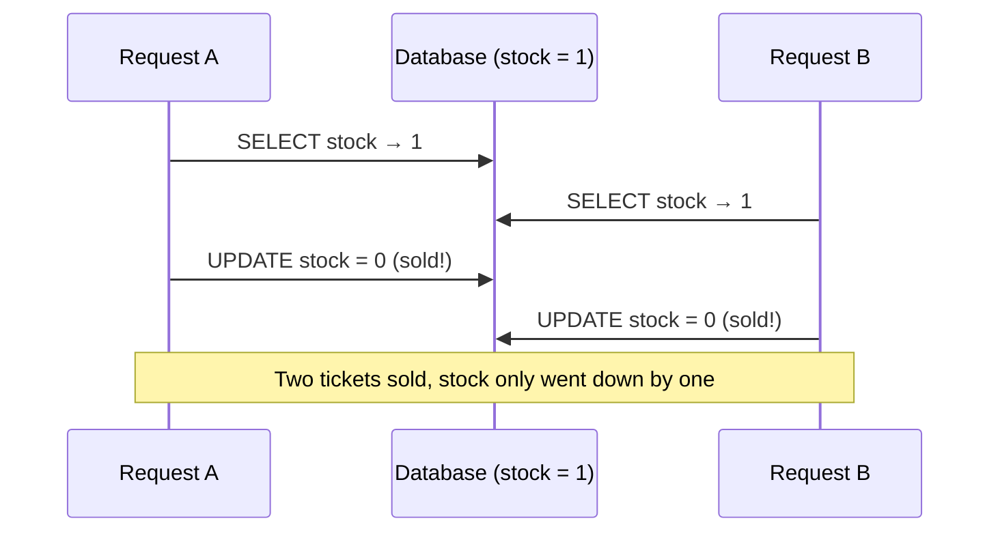
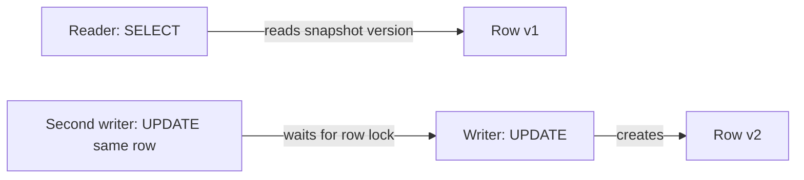

Your API does not run one request at a time. Two users buy the last ticket in the same millisecond,
two browser tabs save the same document, a background job updates a balance while a user withdraws
from it. Each piece of code looks correct alone, and the data still ends up wrong. Bugs like these
are rare in development, common in production, and very hard to reproduce. This session gives you
the vocabulary and the tools that databases provide to keep data correct when many things happen at
once.

## ACID properties

A **transaction** groups several statements into one unit of work. The classic example is a bank
transfer: subtract 100 from Alice, add 100 to Bob. Either both happen or neither does; the money must
never vanish halfway.

```sql
BEGIN;
UPDATE accounts SET balance = balance - 100 WHERE id = 'alice';
UPDATE accounts SET balance = balance + 100 WHERE id = 'bob';
COMMIT;   -- or ROLLBACK; to undo everything since BEGIN
```

The guarantees a transaction gives are summarised as **ACID**:

- **Atomicity**: all or nothing. If the server crashes after the first `UPDATE`, the database rolls
  it back on recovery. Think of a vending machine: you either get the snack and lose the coin, or
  keep the coin.
- **Consistency**: a transaction moves the database from one valid state to another, respecting
  every constraint (`CHECK (balance >= 0)`, foreign keys). If a constraint fails, the whole
  transaction fails.
- **Isolation**: concurrent transactions do not see each other's half-finished work. How *much*
  isolation you get is configurable, and that is the subject of the next section.
- **Durability**: once `COMMIT` returns, the data survives a crash. PostgreSQL achieves this by
  writing changes to the **write-ahead log (WAL)** on disk before reporting success.

> [!NOTE]
> The "C" is partly your job. The database enforces the constraints you declare; it cannot know a
> business rule you never wrote down. Declaring constraints (from the database design session) is
> how you make consistency real.

> [!TIP]
> In application code, keep transactions **short**. Never hold a transaction open while waiting for
> a user, an HTTP call to another service, or an email to send. Open transactions hold locks and
> keep old row versions alive.

## Isolation levels and anomalies (dirty read, lost update, phantom)

Perfect isolation would mean every transaction behaves as if it ran alone, one after another. That
is called **serializable**, and it costs performance, so databases offer weaker levels that allow
some **anomalies** in exchange for more concurrency. To choose a level, you need to know the
anomalies.

**Dirty read**: transaction A reads data that B has written but not yet committed. If B rolls back, A
acted on data that never existed.

**Non-repeatable read**: A reads a row, B updates and commits it, A reads it again and gets a
different value within the same transaction.

**Phantom read**: A runs `SELECT count(*) WHERE course_id = 5`, B inserts a new matching row and
commits, A runs the same query again and sees an extra "phantom" row.

**Lost update**: A and B both read a value, both compute a new value from it, and both write. The
second write silently overwrites the first. This is the most common real bug:



The SQL standard defines four isolation levels. PostgreSQL implements them as follows (see
[PostgreSQL docs — Concurrency Control](https://www.postgresql.org/docs/current/mvcc.html)):

| Level | Dirty read | Non-repeatable read | Phantom read | Notes in PostgreSQL |
|---|---|---|---|---|
| Read uncommitted | Not possible | Possible | Possible | Behaves like Read committed |
| **Read committed** (default) | Not possible | Possible | Possible | Each statement sees data committed before it started |
| Repeatable read | Not possible | Not possible | Not possible | One snapshot for the whole transaction; conflicting updates raise an error |
| Serializable | Not possible | Not possible | Not possible | Also detects write skew; transactions may fail and must be retried |

```sql
BEGIN ISOLATION LEVEL REPEATABLE READ;
-- ...
COMMIT;
```

> [!WARNING]
> At the default **Read committed** level, the read-then-write pattern in the diagram above *is* a
> lost update. "We use transactions" does not protect you on its own. You need one of the techniques
> in the last two sections, or a stricter isolation level with retries.

## Locks and MVCC in PostgreSQL

How does PostgreSQL let readers and writers work at the same time? With **MVCC**, multi-version
concurrency control. Instead of overwriting a row in place, an `UPDATE` writes a *new version* of the
row and marks the old one as expired. Each transaction gets a **snapshot** that says which versions
it may see.

The analogy is a shared document with full version history: when you open it, you see a consistent
version, even if someone else is mid-edit. Your reading does not block their writing, and their
writing does not block your reading. The PostgreSQL docs summarise it as *readers never block
writers, and writers never block readers*.

Old versions that no snapshot can see any more are cleaned up later by **VACUUM** (usually the
autovacuum background process). Very long transactions prevent that cleanup, which is another reason
to keep them short.

MVCC does not remove **locks**; it just keeps them away from plain reads. Writers still lock what they
change:

- Two transactions updating the **same row**: the second waits until the first commits or rolls
  back. At Read committed, it then re-checks its `WHERE` against the newest version and proceeds.
- `SELECT ... FOR UPDATE` takes the same row lock *while reading*, so you can read-then-write safely.
- Schema changes like `ALTER TABLE` take strong table-level locks, which is why migrations need care.
- If A waits for B while B waits for A, that is a **deadlock**. PostgreSQL detects it and aborts one
  transaction with an error; the application must retry. Locking rows in a consistent order (for
  example, by id) avoids most deadlocks.



> [!NOTE]
> The [CMU 15-445 Database Systems](https://15445.courses.cs.cmu.edu/) lectures on concurrency
> control and MVCC show how these mechanisms are built inside a database engine, if you want the
> view from underneath.

## Optimistic vs pessimistic concurrency

There are two broad strategies for preventing lost updates in application code.

**Pessimistic concurrency** assumes conflicts are likely, so it locks first. It is like putting
your name on a library book before reading it: nobody else can take it until you are done.

```sql
BEGIN;
SELECT stock FROM tickets WHERE id = 7 FOR UPDATE;   -- others wait here
-- application checks stock > 0
UPDATE tickets SET stock = stock - 1 WHERE id = 7;
COMMIT;
```

**Optimistic concurrency** assumes conflicts are rare, so it does not lock; it *detects* a conflict at
write time and fails. It is like editing a wiki page: when you save, the wiki checks whether someone
else saved in the meantime, and if so it asks you to merge. The usual implementation is a **version
column**:

```sql
-- Read: SELECT id, title, version FROM documents WHERE id = 1;   → version = 4
UPDATE documents
SET title = 'New title', version = version + 1
WHERE id = 1 AND version = 4;
-- 1 row updated → success. 0 rows updated → someone else won; reload and retry or report 409 Conflict.
```

Often you can avoid both by making the database do the read-and-write in **one atomic statement**:

```sql
UPDATE tickets SET stock = stock - 1 WHERE id = 7 AND stock > 0 RETURNING stock;
```

If no row comes back, the ticket was sold out. No race is possible because there is no gap between
reading and writing.

| Strategy | Best when | Cost |
|---|---|---|
| Atomic single statement | The change can be expressed in SQL | Limited to simple logic |
| Pessimistic (`FOR UPDATE`) | Conflicts are frequent; retries are expensive | Waiting, risk of deadlocks |
| Optimistic (version column) | Conflicts are rare; long user "think time" (edit forms) | Must handle failures and retries |
| Serializable isolation | Complex invariants across many rows | Serialization failures; always retry |

> [!EXAMPLE]
> An edit form for a course description: a user may keep the form open for ten minutes. Holding a
> lock that long would be terrible, so this is a job for optimistic concurrency. The form carries
> the `version`, and the API answers `409 Conflict` if it changed, letting the user review the other
> edit.

## Practice: reproduce and fix a lost-update bug

You will cause a lost update on purpose with two `psql` sessions, then fix it three ways. Allow
about 60 minutes.

### Step 1: Set up

```sh
docker run --name pg -e POSTGRES_PASSWORD=pw -p 5432:5432 -d postgres:16
```

Open **two terminals**, and in each run `docker exec -it pg psql -U postgres`. In one of them:

```sql
CREATE TABLE counters (id INT PRIMARY KEY, value INT NOT NULL);
INSERT INTO counters VALUES (1, 10);
```

### Step 2: Reproduce the bug

Run these steps, alternating terminals exactly in this order:

| Step | Terminal A | Terminal B |
|---|---|---|
| 1 | `BEGIN;` | |
| 2 | `SELECT value FROM counters WHERE id = 1;` → 10 | |
| 3 | | `BEGIN;` |
| 4 | | `SELECT value FROM counters WHERE id = 1;` → 10 |
| 5 | `UPDATE counters SET value = 11 WHERE id = 1;` | |
| 6 | `COMMIT;` | |
| 7 | | `UPDATE counters SET value = 11 WHERE id = 1;` |
| 8 | | `COMMIT;` |

Each session "added one", yet `SELECT value` now shows 11, not 12. That is a lost update: the
application computed the new value from a stale read.

### Step 3: Fix 1, the atomic statement

Reset to 10 and repeat with `UPDATE counters SET value = value + 1 WHERE id = 1;` in both sessions.
Notice terminal B *waits* at step 7 until A commits, then applies its increment to the new value.
Result: 12.

### Step 4: Fix 2, pessimistic locking

Reset and repeat the original steps, but use `SELECT ... FOR UPDATE` at steps 2 and 4. Terminal B
blocks at step 4 until A commits, then reads 11, and writes 12.

### Step 5: Fix 3, repeatable read

Reset and run both transactions with `BEGIN ISOLATION LEVEL REPEATABLE READ;`. At step 7, terminal B
gets an error: `could not serialize access due to concurrent update`. The bug is now detected rather
than silent; the application would retry the whole transaction.

### Step 6: Write it down

In your notes, write three sentences: which fix you would use for a page-view counter, for a ticket
sale, and for an edit form, and why.
