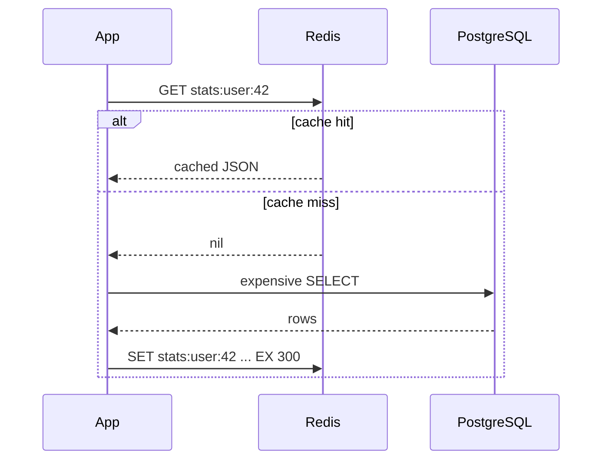

Some answers are expensive to compute and cheap to remember. A dashboard that aggregates a million
rows, a call to a slow third-party API, a rendered leaderboard: if a thousand users ask for the same
thing within a minute, recomputing it a thousand times is waste. A **cache** keeps a copy of the
answer somewhere fast so the next request can skip the expensive work. This session teaches the
caching patterns you will meet in every backend, how to keep cached data from going stale, and how
to use [Redis](https://redis.io/docs/latest/) for caching, rate limiting and sessions.

## Cache-aside, write-through and write-behind

Think of a chef with a small fridge next to the stove and a big walk-in cold room down the
corridor. The fridge is fast to reach but small; the cold room has everything but takes a walk.
Caching patterns are rules for when the chef checks the fridge, and who restocks it.

**Cache-aside** (also called *lazy loading*) is the most common pattern. The application is in
charge:

1. Look for the key in the cache.
2. **Hit**: return the cached value.
3. **Miss**: read from the database, store the result in the cache with an expiry, return it.



Only data that is actually requested gets cached, and if Redis goes down, the app still works
(slowly) by reading the database.

**Write-through**: every write goes to the cache *and* the database at the same time. Reads almost
always hit, and the cache is never stale for those keys, but every write pays the cost of two
stores, and you cache data nobody may ever read.

**Write-behind** (or *write-back*): writes go to the cache only, and the cache flushes them to the
database later, often in batches. Writes are very fast, but if the cache crashes before flushing,
those writes are lost. Use it only for data you can afford to lose or rebuild, such as view
counters.

| Pattern | Read path | Write path | Main risk |
|---|---|---|---|
| Cache-aside | App checks cache, falls back to DB | App writes DB, deletes/updates cache | Stale data until expiry or invalidation |
| Write-through | Almost always a hit | Cache and DB together | Slower writes, caching unused data |
| Write-behind | Hit | Cache now, DB later | Data loss on cache failure |

> [!TIP]
> Default to cache-aside with a TTL. It's the simplest, it fails safely, and it's what most
> "add caching to this endpoint" tasks really mean.

## TTLs, eviction and invalidation

There is an old joke that the two hard problems in computing are naming things and cache
invalidation. The problem is real: a cache is a copy, and copies go out of date.

**TTL (time to live)** is your safety net. Every cached key gets an expiry (`SET key value EX 300`),
so even if you forget to invalidate it, it fixes itself within five minutes. Choose the TTL from
the question "how stale can this be before a user notices or cares?" A leaderboard can be a minute
old; an account balance cannot be cached carelessly at all.

**Eviction** is what Redis does when it runs out of memory. You configure a `maxmemory` limit and a
`maxmemory-policy`:

- `noeviction`: refuse new writes when full (the default; good when Redis is a primary store, bad
  for a cache).
- `allkeys-lru`: evict the least recently used keys. The usual choice for a pure cache.
- `allkeys-lfu`: evict the least *frequently* used keys.
- `volatile-lru` / `volatile-ttl`: only evict keys that have an expiry set.

**Invalidation** means removing or updating the cached copy when the source changes. With
cache-aside, the safest order is: **update the database, then delete the cache key**. The next read
misses and reloads fresh data.

> [!WARNING]
> Prefer *deleting* the key over *writing* the new value into the cache on update. If two requests
> update the same record concurrently, their cache writes can land in the wrong order and leave an
> old value cached until the TTL expires. A delete can't go stale in that way.

> [!NOTE]
> A **cache stampede** happens when a popular key expires and hundreds of requests miss at the same
> moment, all hitting the database together. Mitigations: add random jitter to TTLs, or let only
> one request recompute the value (using a short lock key set with `SET lock:key 1 NX EX 10`)
> while others briefly wait or serve the old value.

## Redis data structures beyond strings

Using Redis only as `GET`/`SET` of JSON strings is like using a Swiss Army knife only as a knife.
Redis has several data types, each with atomic server-side operations, which means you often don't
need to read, modify and write back:

| Type | What it is | Example use | Key commands |
|---|---|---|---|
| String | Bytes, text or a number | Cached JSON, counters | `SET`, `GET`, `INCR`, `EXPIRE` |
| Hash | A small map of field → value | A user profile, a session | `HSET`, `HGET`, `HGETALL` |
| List | Ordered list, push/pop at both ends | Recent activity feed, simple queue | `LPUSH`, `LRANGE`, `LTRIM` |
| Set | Unordered unique members | Tags, "who is online" | `SADD`, `SISMEMBER`, `SINTER` |
| Sorted set | Unique members each with a score, kept sorted | Leaderboards, time windows | `ZADD`, `ZRANGE`, `ZREMRANGEBYSCORE` |
| Stream | Append-only log with consumer groups | Event pipelines | `XADD`, `XREADGROUP` |

> [!EXAMPLE]
> An XP leaderboard for this platform in two commands. `ZINCRBY leaderboard 50 user:42` adds 50 XP
> to user 42, atomically. `ZRANGE leaderboard 0 9 REV WITHSCORES` returns the top ten. No `SELECT
> ... ORDER BY` over the whole users table on every page view.

> [!TIP]
> [Redis University](https://university.redis.io/) has free courses on these data structures. It's
> worth an hour: knowing that a sorted set exists turns many "hard" features into a few lines.

## Rate limiting and sessions with Redis

Two jobs that almost every API needs, and that Redis makes simple because it's shared by all your
app instances and its operations are atomic.

**Rate limiting** protects your API from abuse and runaway clients: "at most 100 requests per
minute per API key". The simplest version is a **fixed window** counter:

```python
import time
import redis.asyncio as redis

r = redis.from_url("redis://localhost:6379")

async def allow(api_key: str, limit: int = 100) -> bool:
    window = int(time.time() // 60)                # current minute
    key = f"rate:{api_key}:{window}"
    count = await r.incr(key)                       # atomic, even with 10 app servers
    if count == 1:
        await r.expire(key, 60)
    return count <= limit
```

A fixed window lets a client send 100 requests at 12:00:59 and another 100 at 12:01:00. A
**sliding window** fixes that using a sorted set of request timestamps: remove entries older than 60
seconds (`ZREMRANGEBYSCORE`), count the rest (`ZCARD`), and add the new one (`ZADD`).

**Sessions**: when a user logs in, store their session data in a Redis hash under a random session
id, with a TTL, and give the browser only the id in a cookie. Any app instance can look it up, and
logging out (or forcing a logout) is a single `DEL`.

```sh
HSET session:7b1c user_id 42 role learner
EXPIRE session:7b1c 86400
```

> [!WARNING]
> If Redis holds sessions and it restarts without persistence, everyone is logged out. Decide
> consciously: enable persistence (RDB snapshots or AOF), or accept that a restart means re-login.

## Practice: cache an expensive endpoint and measure the speed-up

Use your to-do API. You'll add a deliberately slow stats endpoint, cache it, and prove the gain
with numbers.

### Step 1: Run Redis and install the client

```sh
docker run -d --name todo-redis -p 6379:6379 redis:7
pip install redis
```

### Step 2: Add an expensive endpoint

```python
import asyncio

@app.get("/stats")
async def stats(db: DB):
    await asyncio.sleep(1)  # simulate a heavy aggregation
    total = await db.scalar(select(func.count()).select_from(Task))
    done = await db.scalar(select(func.count()).where(Task.done))
    return {"total": total, "done": done}
```

### Step 3: Measure the baseline

```sh
time curl -s localhost:8000/stats
# or, for many requests:
for i in $(seq 10); do curl -s -o /dev/null -w "%{time_total}\n" localhost:8000/stats; done
```

Write down the numbers: around one second each.

### Step 4: Add cache-aside

```python
import json
import redis.asyncio as redis

cache = redis.from_url("redis://localhost:6379", decode_responses=True)
STATS_KEY = "stats:v1"

@app.get("/stats")
async def stats(db: DB):
    if (cached := await cache.get(STATS_KEY)) is not None:
        return json.loads(cached)
    await asyncio.sleep(1)
    total = await db.scalar(select(func.count()).select_from(Task))
    done = await db.scalar(select(func.count()).where(Task.done))
    result = {"total": total, "done": done}
    await cache.set(STATS_KEY, json.dumps(result), ex=60)
    return result
```

### Step 5: Invalidate on writes

In the create, update and delete task endpoints, after `await db.commit()`, add
`await cache.delete(STATS_KEY)`. Create a task and confirm `/stats` shows the new total
immediately, not after 60 seconds.

### Step 6: Measure again and write it up

Run the same loop. The first request is ~1 s (miss), the rest should be a few milliseconds. Record
the hit/miss timings in a small table, then watch Redis live with `docker exec -it todo-redis
redis-cli MONITOR` while you hit the endpoint.

> [!EXAMPLE]
> Stretch goals: add the fixed-window rate limiter above as a FastAPI dependency and return `429
> Too Many Requests` when exceeded; then stop Redis and make sure `/stats` still works (catch the
> connection error and fall back to the database).
