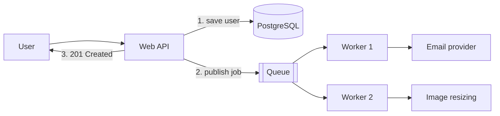
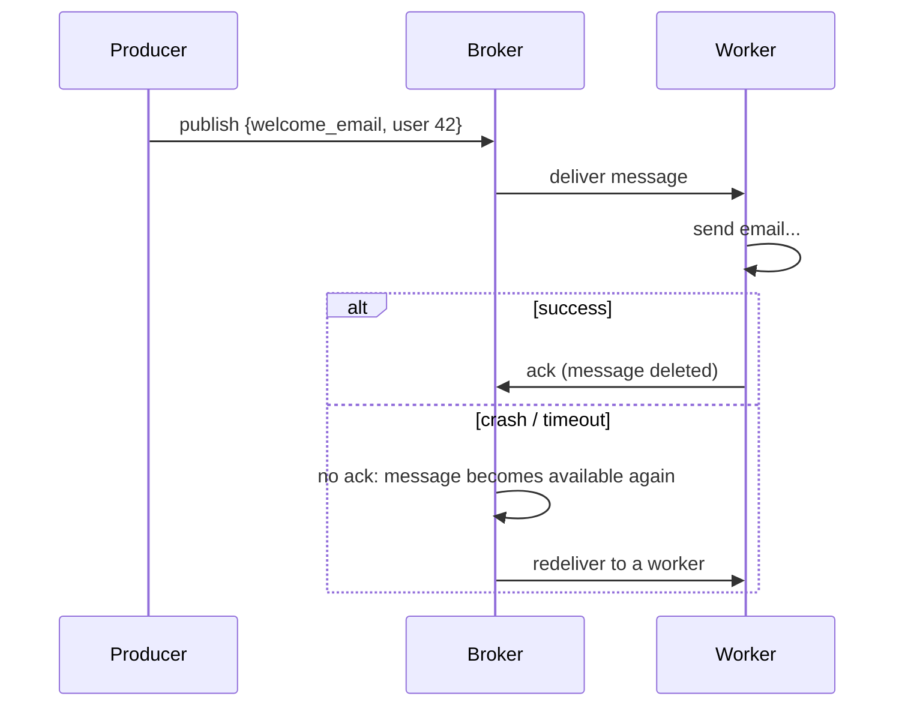
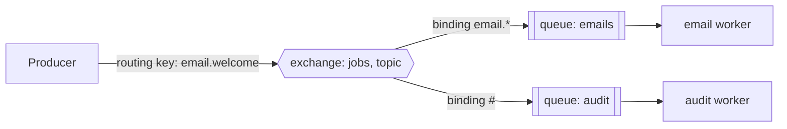

When a user signs up, your API might need to save the user, send a welcome email, resize their
avatar and notify an analytics service. If the request waits for all of that, the user stares at a
spinner, and if the email provider is down, sign-up fails. The fix is to do the essential part now
and hand the rest to a **background worker** through a **message queue**. This session explains how
queues work, how they recover from failures, and how to use them from Python with RabbitMQ, Celery
and RQ.

## Why asynchronous processing

Think of a busy restaurant. The waiter takes your order, writes it on a ticket, pins it on the
kitchen rail and moves to the next table. The waiter doesn't stand in the kitchen while your pasta
cooks. The ticket rail is a **queue**, the cooks are **workers**, and the waiter is your web
request.

Moving work out of the request gives you four things:

- **Fast responses.** The request returns as soon as the job is queued, in milliseconds.
- **Resilience.** If the email provider is down for ten minutes, jobs wait in the queue and are
  retried later. Sign-up keeps working.
- **Load smoothing.** A spike of 10,000 sign-ups doesn't need 10,000 simultaneous email
  connections; workers chew through the queue at a steady pace.
- **Independent scaling.** Add more workers when the queue grows, without adding web servers.



> [!NOTE]
> Rule of thumb: anything that is slow, talks to an unreliable external service, or doesn't need to
> finish before the user sees a response is a candidate for a background job. Emails, image and
> video processing, PDF generation, webhooks, and AI calls that take more than a couple of seconds.

> [!WARNING]
> Background jobs change your product's behaviour: the user gets "we'll email you shortly", not
> "email sent". Make sure the UI tells the truth, and that anything the user needs right away is
> done in the request.

## Queues, workers, acknowledgements and retries

The pieces of every queue system:

- A **producer** publishes a **message** (a small payload describing the job, e.g.
  `{"type": "welcome_email", "user_id": 42}`).
- A **broker** (RabbitMQ, Redis, Amazon SQS) stores messages in a **queue** until someone takes
  them.
- A **consumer**, or **worker**, takes a message, does the work, and reports back.

The reporting back is the key reliability idea. When a worker receives a message, the broker doesn't
delete it yet. It waits for an **acknowledgement (ack)**. If the worker crashes mid-job (the
container is killed, the machine reboots), no ack arrives, and the broker gives the message to
another worker. A worker can also **nack** (negative-acknowledge) a message to say "I failed,
requeue it or reject it".



This gives **at-least-once delivery**: every message is processed *at least* once, but sometimes
*more* than once (the worker sent the email and crashed just before acking). Keep that in mind; the
last section shows how to live with it.

**Retries** handle temporary failures: a timeout, a 503 from a provider. Retry with **exponential
backoff** (wait 1 s, 2 s, 4 s, 8 s…) plus some random jitter, so a recovering service isn't hit by
every retry at the same instant. Cap the number of attempts; after that, the job needs a human.

> [!TIP]
> Distinguish **transient** errors (timeouts, rate limits: retry) from **permanent** ones (invalid
> email address, missing user: don't retry, record the failure). Retrying a permanent error five
> times just delays the inevitable.

## RabbitMQ basics

[RabbitMQ](https://www.rabbitmq.com/tutorials) is a widely used open-source message broker that
speaks the AMQP protocol. Its model has one more piece than "a queue": producers don't publish to
queues directly, they publish to an **exchange**, which routes messages to queues according to
**bindings**.

| Exchange type | Routing rule | Use |
|---|---|---|
| Direct | Message routing key must equal the binding key | Send `email` jobs to the email queue |
| Fanout | Copy to every bound queue, ignore the key | Broadcast "user signed up" to several services |
| Topic | Pattern match on dotted keys (`user.*`, `order.#`) | Selective subscriptions |



Two settings matter in every real deployment:

- **Durable queues and persistent messages**, so messages survive a broker restart.
- **Prefetch** (`basic_qos(prefetch_count=...)`): how many unacknowledged messages one worker may
  hold at once. With a prefetch of 1, a slow job doesn't hoard a pile of messages that other idle
  workers could be processing.

> [!NOTE]
> The [RabbitMQ tutorials](https://www.rabbitmq.com/tutorials) build these ideas one at a time
> (hello world, work queues, publish/subscribe, routing, topics) with short Python examples. Doing
> the first three takes about an hour and makes everything above concrete.

## Celery and RQ in Python

You rarely talk to the broker by hand in an application. Python has task libraries that turn a
normal function into a background job.

**[Celery](https://docs.celeryq.dev/en/stable/)** is the most established. It supports RabbitMQ and
Redis as brokers, retries, scheduled (periodic) tasks, and result storage.

```python
# tasks.py
from celery import Celery

app = Celery("todo", broker="pyamqp://guest@localhost//")

@app.task(bind=True, autoretry_for=(ConnectionError,), retry_backoff=True, max_retries=5)
def send_welcome_email(self, user_id: int) -> None:
    user = load_user(user_id)
    send_email(to=user.email, subject="Welcome!", body="...")
```

```python
# in the API
send_welcome_email.delay(user.id)   # returns immediately; a worker runs it
```

```sh
celery -A tasks worker --loglevel=INFO
```

**RQ (Redis Queue)** is much smaller: Redis only, a few concepts, easy to read. Great for small apps
or when you already run Redis.

```python
from redis import Redis
from rq import Queue

q = Queue(connection=Redis())
q.enqueue(send_welcome_email, user.id)
```

```sh
rq worker
```

| | Celery | RQ |
|---|---|---|
| Brokers | RabbitMQ, Redis, others | Redis only |
| Features | Retries, schedules, routing, workflows | Simple jobs, retries, basic scheduling |
| Learning curve | Steeper, many settings | Gentle |

> [!WARNING]
> Pass **ids**, not objects, to tasks: `send_welcome_email.delay(user.id)`, not
> `.delay(user)`. The message is serialised and may run minutes later; the worker should load the
> current data from the database, not a stale snapshot. And commit the database transaction
> *before* enqueuing, or the worker may look for a user that doesn't exist yet.

## Idempotent consumers and dead-letter queues

Because delivery is at-least-once, your worker will occasionally receive the same message twice.
The answer is to make consumers **idempotent**: processing a message twice has the same effect as
processing it once. Like pressing a lift button: pressing it again doesn't call a second lift.

Common techniques:

- **Natural idempotency.** "Set task 7 to done" is safe to repeat; "add 10 XP" is not.
- **Dedup records.** Give every message a unique id. Before doing the work, insert the id into a
  `processed_messages` table with a unique constraint; if the insert fails, it's a duplicate, skip.
- **Idempotency keys at providers.** Many payment and email APIs accept a key so they ignore
  duplicate requests themselves.

```python
@app.task
def award_xp(message_id: str, user_id: int, amount: int) -> None:
    with Session(engine) as db, db.begin():
        inserted = db.execute(
            insert(ProcessedMessage).values(id=message_id).on_conflict_do_nothing()
        ).rowcount
        if inserted == 0:
            return  # already processed
        db.execute(update(User).where(User.id == user_id).values(xp=User.xp + amount))
```

(`insert` here is `sqlalchemy.dialects.postgresql.insert`, which adds `on_conflict_do_nothing`.)
Both statements run in one transaction: either the message is recorded *and* the XP added, or
neither.

A **dead-letter queue (DLQ)** catches messages that keep failing. After the maximum number of
retries, or when a message is rejected as unprocessable (a *poison message*), it's moved to a
separate queue instead of retrying forever or being silently dropped. In RabbitMQ you set this up
with the `x-dead-letter-exchange` queue argument. Someone then inspects the DLQ, fixes the bug or the
data, and replays the messages.

> [!TIP]
> Alert on DLQ size. A dead-letter queue that nobody watches is just a slower way of losing data.

## Practice: send emails from a background worker

Add a welcome email to your to-do API's user sign-up, sent by a Celery worker, with a local fake
SMTP server so nothing reaches real inboxes.

### Step 1: Run the infrastructure

```sh
docker run -d --name rabbit -p 5672:5672 -p 15672:15672 rabbitmq:3-management
docker run -d --name mailpit -p 1025:1025 -p 8025:8025 axllent/mailpit
pip install celery
```

RabbitMQ's management UI is at `http://localhost:15672` (guest/guest); Mailpit, which catches every
email sent to port 1025, shows them at `http://localhost:8025`.

### Step 2: Write the task

```python
# app/tasks.py
import smtplib
from email.message import EmailMessage
from celery import Celery

celery_app = Celery("todo", broker="pyamqp://guest@localhost//")

@celery_app.task(autoretry_for=(OSError,), retry_backoff=True, max_retries=5, acks_late=True)
def send_welcome_email(email: str) -> None:
    msg = EmailMessage()
    msg["From"] = "hello@todo.local"
    msg["To"] = email
    msg["Subject"] = "Welcome to your to-do list"
    msg.set_content("Thanks for signing up!")
    with smtplib.SMTP("localhost", 1025) as smtp:
        smtp.send_message(msg)
```

`acks_late=True` acknowledges only after the task finishes, so a crash mid-task means redelivery.

### Step 3: Enqueue from the API

In `POST /users`, after `await db.commit()`, call `send_welcome_email.delay(user.email)`, and return
`201` right away.

### Step 4: Run the worker and test

```sh
celery -A app.tasks worker --loglevel=INFO
```

Create a user through `/docs`. The response is instant; a moment later the worker logs the task and
the email appears in Mailpit.

### Step 5: Break it on purpose

1. Stop the worker, create three users, and watch the queue depth grow in the RabbitMQ UI. Start the
   worker again: the backlog drains.
2. Stop Mailpit, create a user, and watch the retries with growing delays in the worker log. Start
   Mailpit before the retries run out: the email arrives.

> [!EXAMPLE]
> Write down, in two sentences each, what happened in both experiments and which concept explains
> it (durable queue, acknowledgements, retries with backoff). That's your study note for this
> session.
