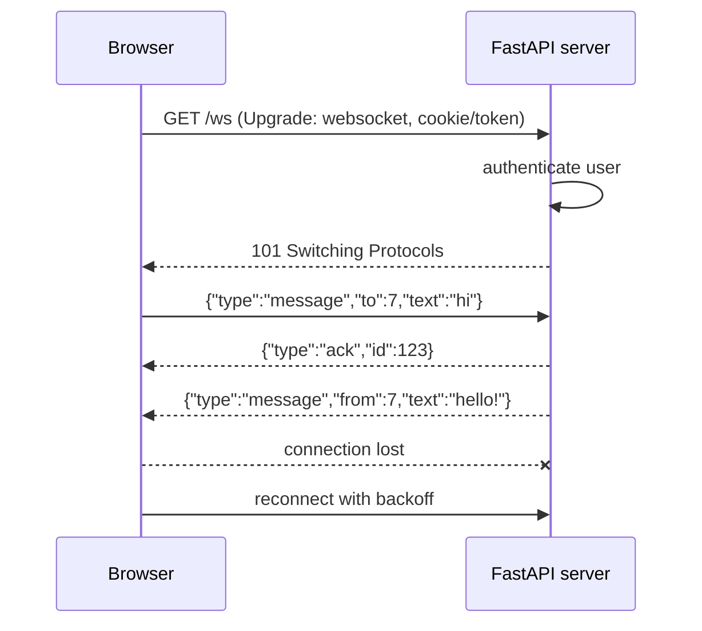
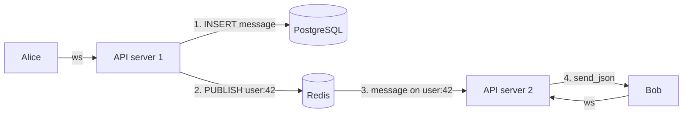

A private chat looks like the simplest feature in the world: two people, a text box, a list of
messages. Underneath, it touches almost everything you have learned in this track: long-lived
connections, authentication, a database, a message broker and a little bit of distributed systems
thinking. This session builds a one-to-one chat step by step, and each section adds one of the
pieces real products like WhatsApp or Slack need.

## WebSocket connection lifecycle and authentication

HTTP is a phone call where you can only ask one question and hang up. To receive new messages you
would have to call again and again (polling). A **WebSocket** is a phone line that stays open:
after one HTTP request "upgrades" the connection, both sides can send messages whenever they want,
for as long as the line stays up.

The lifecycle has four phases:

1. **Handshake.** The browser sends a normal HTTP `GET` with `Upgrade: websocket`. The server
   answers `101 Switching Protocols`. From now on the TCP connection speaks the WebSocket
   protocol, not HTTP.
2. **Open.** Both sides can send text or binary frames. In the browser, the
   [WebSocket API](https://developer.mozilla.org/en-US/docs/Web/API/WebSockets_API) gives you
   `onopen`, `onmessage`, `onclose` and `onerror` events plus a `send()` method.
3. **Messages.** Your application defines its own little protocol on top, usually JSON objects
   with a `type` field: `{"type": "message", "to": 7, "text": "hi"}`.
4. **Close.** Either side sends a close frame with a code (1000 = normal). Networks also drop
   connections silently: phones go into tunnels, laptops sleep. Your client must reconnect, and
   your server must clean up.



In FastAPI, a WebSocket endpoint is declared with `@app.websocket` and you call `accept()`,
`receive_text()` / `receive_json()` and `send_json()` on it, as shown in the
[FastAPI WebSockets](https://fastapi.tiangolo.com/advanced/websockets/) guide. A disconnect raises
`WebSocketDisconnect`, which is where cleanup goes.

### Authenticating a socket

Authentication is the part beginners skip, and in a *private* chat it is the whole point. Two
facts shape the design:

- **The browser WebSocket API cannot set custom headers**, so you cannot send
  `Authorization: Bearer ...` the way `fetch` does.
- **Cookies are sent with the handshake** if the socket is on the same site.

So the common options are: rely on the session cookie (same-site), pass a short-lived token in
the query string (`/ws?token=...`), or send the token as the first message and refuse everything
else until it arrives. Authenticate *before* or immediately after `accept()`, and close with a
policy-violation code (1008) if it fails.

```python
from fastapi import FastAPI, WebSocket, WebSocketDisconnect, status

app = FastAPI()

@app.websocket("/ws")
async def chat(ws: WebSocket, token: str | None = None):
    user = verify_token(token)  # your auth function; returns None if invalid
    if user is None:
        await ws.close(code=status.WS_1008_POLICY_VIOLATION)
        return
    await ws.accept()
    try:
        while True:
            data = await ws.receive_json()
            await handle(user, data)
    except WebSocketDisconnect:
        pass  # mark offline, unregister the connection
```

> [!WARNING]
> Tokens in query strings can end up in server and proxy logs. Use short-lived, single-purpose
> tokens (issued by an authenticated HTTP endpoint just before connecting), never the user's
> long-lived session token.

> [!WARNING]
> Check the `Origin` header during the handshake when you rely on cookies. Otherwise any website
> the user visits can open a socket to your server with their cookies attached
> (cross-site WebSocket hijacking).

## Message persistence and history

A WebSocket only delivers to people who are connected *right now*. If Bob is offline when Alice
writes, the message must still be waiting for him tomorrow. So the rule is: **the database is the
source of truth, the socket is just the delivery van**.

A minimal schema for one-to-one chat:

```sql
CREATE TABLE conversations (
  id          bigserial PRIMARY KEY,
  user_a      int NOT NULL REFERENCES users(id),
  user_b      int NOT NULL REFERENCES users(id),
  CHECK (user_a < user_b),          -- one row per pair, in a fixed order
  UNIQUE (user_a, user_b)
);

CREATE TABLE messages (
  id               bigserial PRIMARY KEY,
  conversation_id  bigint NOT NULL REFERENCES conversations(id),
  sender_id        int NOT NULL REFERENCES users(id),
  body             text NOT NULL CHECK (length(body) <= 4000),
  created_at       timestamptz NOT NULL DEFAULT now()
);
CREATE INDEX ON messages (conversation_id, id);
```

The `CHECK (user_a < user_b)` trick means Alice–Bob and Bob–Alice are the same row, so you never
get two conversations for the same pair.

The flow for sending is **persist, then deliver**: insert the message, get its id, then push it to
the recipient's socket (if any) and acknowledge to the sender with the id. If delivery fails, the
message is safe in the table.

**History** is loaded over plain HTTP, not the socket: `GET /conversations/12/messages?before=900`
returns the 50 messages older than id 900. This is **keyset pagination**, using the indexed id as
a cursor, which stays fast however long the conversation grows (unlike `OFFSET 10000`).

> [!TIP]
> On reconnect, the client asks for "everything after the last id I have"
> (`?after=1234`). This one query fixes every message missed while the connection was down,
> without any special retry logic.

> [!NOTE]
> Clients should send a client-generated id (a UUID) with each message. If the network drops
> after the server saved it but before the ack arrived, the client resends, and the server can
> detect the duplicate with a unique constraint on that id. This is an **idempotency key**.

## Fan-out with Redis pub/sub

On your laptop, there is one API process, and it keeps a dictionary `user_id -> websocket`.
Sending to Bob is `connections[bob_id].send_json(...)`. In production you run several processes
or containers behind a load balancer. Alice may be connected to server 1 and Bob to server 2.
Server 1's dictionary has no idea Bob exists.

You need a way for servers to talk to each other. **Redis pub/sub** is the simplest: a server
**publishes** a message to a named channel, and every server **subscribed** to that channel
receives it instantly. As described in the [Redis docs](https://redis.io/docs/latest/), pub/sub
is fire-and-forget: messages go only to subscribers connected at that moment and are not stored.
That is fine here, because the database already stores them.



A common pattern is one channel per user, `user:<id>`. Each server subscribes to the channels of
the users connected to it, and unsubscribes when they leave. To send to Bob, any server just
publishes to `user:bob_id`, without knowing where Bob is.

> [!WARNING]
> Pub/sub gives no delivery guarantee. If server 2 restarts at the wrong moment, Bob misses the
> live push. That is acceptable only because the client re-syncs from the database with
> `?after=<last id>` on reconnect. Never use pub/sub as your only copy of a message.

## Read receipts and presence

### Read receipts

"Seen" ticks are just more data. The cheapest model stores, per conversation and per user, the id
of the last message they have read:

```sql
CREATE TABLE conversation_reads (
  conversation_id  bigint NOT NULL REFERENCES conversations(id),
  user_id          int NOT NULL REFERENCES users(id),
  last_read_id     bigint NOT NULL,
  PRIMARY KEY (conversation_id, user_id)
);
```

When Bob's screen shows messages up to id 950, his client sends `{"type": "read", "upTo": 950}`.
The server upserts the row (only moving forward, never back) and publishes a `read` event to
Alice. Unread count is then `count(*) WHERE id > last_read_id AND sender_id <> me`. One row per
person per conversation, instead of one row per message, keeps the table tiny.

### Presence

Presence ("online", "last seen 5 minutes ago") is harder than it looks, because disconnects are
often silent. Two tools help:

- **Heartbeats.** The client sends a ping every ~25 seconds. If the server hears nothing for
  ~60 seconds, it treats the user as gone.
- **Expiring keys.** On each heartbeat, the server sets `presence:<user_id>` in Redis with a TTL
  of 60 seconds. If the key exists, the user is online. When it expires, they are offline, even
  if no server ever noticed the disconnect.

A user can have several tabs or devices, so "online" means "at least one live connection". The
TTL key handles that naturally, because any connection refreshes it.

> [!TIP]
> Only send presence changes to people who care (the open conversation's other participant), and
> debounce flapping connections. Broadcasting every heartbeat to every contact is how chat
> servers melt.

## Practice: private chat between two users

Build a working one-to-one chat with FastAPI, in-memory connections first, then Redis fan-out.

### Step 1: Minimal server

Create `chat.py`:

```python
from fastapi import FastAPI, WebSocket, WebSocketDisconnect, status

app = FastAPI()
connections: dict[str, WebSocket] = {}
history: list[dict] = []  # shortcut: in-memory, replaced by PostgreSQL in step 4

@app.websocket("/ws/{user}")
async def ws(socket: WebSocket, user: str, token: str = ""):
    if token != f"secret-{user}":  # toy auth, replace with a real token check
        await socket.close(code=status.WS_1008_POLICY_VIOLATION)
        return
    await socket.accept()
    connections[user] = socket
    try:
        while True:
            data = await socket.receive_json()
            msg = {"id": len(history) + 1, "from": user, "to": data["to"], "text": data["text"]}
            history.append(msg)
            await socket.send_json({"type": "ack", "id": msg["id"]})
            if peer := connections.get(data["to"]):
                await peer.send_json({"type": "message", **msg})
    except WebSocketDisconnect:
        connections.pop(user, None)
```

Run it with `uvicorn chat:app --reload`.

### Step 2: Two clients

Open two browser tabs on any page, open the dev tools console in each, and connect:

```js
// tab 1
const ws = new WebSocket("ws://localhost:8000/ws/alice?token=secret-alice");
ws.onmessage = (e) => console.log(JSON.parse(e.data));
// tab 2: same with bob / secret-bob
```

From Alice's tab, run `ws.send(JSON.stringify({to: "bob", text: "hi"}))` and watch it appear in
Bob's console. Try a wrong token and confirm the connection is refused.

### Step 3: History endpoint

Add `GET /messages?user=alice&peer=bob&after=0` returning messages between the two with
`id > after`. Disconnect Bob, send three messages from Alice, reconnect Bob and fetch history:
nothing is lost.

### Step 4: Persist in PostgreSQL

Replace the `history` list with the `conversations` and `messages` tables from this lesson.
Insert first, then ack and deliver.

### Step 5: Two servers and Redis

Start Redis (`docker run -p 6379:6379 redis`), run two uvicorn processes on ports 8000 and 8001,
connect Alice to one and Bob to the other. It breaks. Now, on connect, subscribe to
`user:<name>` with `redis.asyncio` and forward incoming pub/sub messages to the socket; on send,
`PUBLISH user:<to>` instead of looking up `connections`. It works again.

### Step 6: Receipts and presence

Add a `read` message type that updates `last_read_id`, and a heartbeat that sets
`presence:<user>` with a 60-second TTL. Show "online" in the console when the key exists.

> [!EXAMPLE]
> Self-check: close Bob's laptop lid (or kill his tab) and see how long it takes for him to show
> as offline. It should be about one TTL, not "forever".
