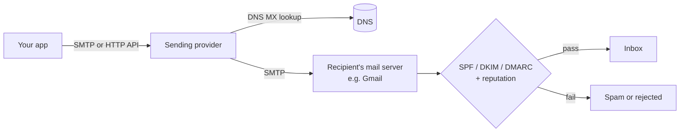
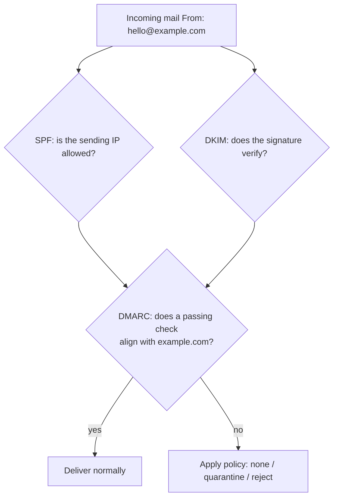

"Reset your password", "Your order has shipped", "You kept a 7-day streak!": these are
**transactional** and **notification** emails, triggered by something a user did or by a
schedule. They look trivial to send, and that is the trap. An email that lands in spam, arrives
twice, or keeps coming after someone clicked "unsubscribe" damages trust far more than a missing
feature. This session covers how email actually travels, how to build it well, how to make
providers trust you, and how to send it reliably from background jobs.

## SMTP and transactional email providers

Email is old: its core protocol, **SMTP** (Simple Mail Transfer Protocol), dates from the early
1980s. Think of it as the postal system. Your application hands a letter to a post office (an
SMTP server), which looks up the recipient's local post office (the domain's **MX record** in
DNS) and delivers it there. The recipient's mail provider then decides whether it goes to the
inbox, the spam folder, or nowhere.



Python ships everything you need to build and send a message. The
[email package](https://docs.python.org/3/library/email.html) builds the message (headers, plain
text, HTML, attachments) with `email.message.EmailMessage`, and `smtplib` talks SMTP:

```python
import smtplib
from email.message import EmailMessage

msg = EmailMessage()
msg["Subject"] = "Your weekly progress"
msg["From"] = "YouCanDoIt <hello@example.com>"
msg["To"] = "learner@example.org"
msg.set_content("Plain-text version for clients that don't render HTML.")
msg.add_alternative("<p>You completed <b>5</b> subchapters this week.</p>", subtype="html")

with smtplib.SMTP("smtp.example.com", 587) as smtp:
    smtp.starttls()
    smtp.login("user", "password")
    smtp.send_message(msg)
```

So why do almost all companies use a **transactional email provider** (Amazon SES, Postmark,
SendGrid, Mailgun, Resend and others) instead of running their own mail server? Because sending
is easy, but *being delivered* is hard. Providers bring:

- **Reputation.** Inbox providers judge senders by their IP and domain history. A brand-new
  server IP is a stranger; a provider's well-managed IPs are known.
- **Bounce and complaint handling.** They tell you (via webhooks) when an address does not exist
  or a user clicked "report spam", so you stop sending to them.
- **HTTP APIs and analytics.** Delivered, opened, bounced: visible per message.

> [!NOTE]
> **Transactional** emails are triggered by a user's action and expected (receipts, password
> resets). **Marketing** or bulk emails go to many people at once (newsletters, weekly digests).
> Many providers recommend separate streams or subdomains for each, so a badly received newsletter
> doesn't hurt your password resets.

> [!TIP]
> In development, never send real emails. Run a local catcher such as Mailpit or MailHog in
> Docker: it accepts SMTP on a local port and shows every message in a web UI.

## Templates and personalisation

Building HTML in f-strings gets ugly fast, and it is dangerous: if a user's name is
`<script>...`, you have injected HTML into an email. Use a **template engine** like Jinja2, with
autoescaping on, and keep each email as a pair of templates: `weekly.html` and `weekly.txt`.

```python
from jinja2 import Environment, FileSystemLoader, select_autoescape

env = Environment(loader=FileSystemLoader("templates"), autoescape=select_autoescape(["html"]))

def render(name: str, **ctx) -> tuple[str, str]:
    return env.get_template(f"{name}.txt").render(**ctx), env.get_template(f"{name}.html").render(**ctx)
```

**Personalisation** is more than "Hi {{ name }}". A good progress email uses the reader's data to
say something true and useful: what they finished, what is next, their streak. A few rules:

- **Always send a plain-text part** alongside HTML. Some clients and screen readers prefer it,
  and a missing text part is a mild spam signal.
- **Email HTML is stuck in the past.** Many clients ignore external CSS and modern layout.
  Use simple, single-column layouts with inline styles, and test in several clients.
- **Handle empty states.** A learner who did nothing this week should get an encouraging nudge
  (or no email), not "You completed 0 subchapters".
- **Localise dates and time zones.** "Sunday 07:00" should be the user's Sunday.

> [!WARNING]
> Never put secrets or long-lived login links in emails. Password-reset links should carry a
> single-use token that expires quickly, because emails get forwarded, archived and scanned.

## Deliverability: SPF, DKIM, DMARC

Anyone can write `From: ceo@yourbank.com` on an email, just as anyone can write any return
address on an envelope. Three DNS-based standards let receivers check whether a message really
comes from the domain it claims. As the
[Cloudflare Learning article on DMARC](https://www.cloudflare.com/learning/dns/dns-records/dns-dmarc-record/)
explains, they work together:

- **SPF** (Sender Policy Framework): a DNS TXT record on your domain listing which servers are
  allowed to send mail for it. "Letters from us only come from these post offices."
- **DKIM** (DomainKeys Identified Mail): your sending server signs each message with a private
  key; the public key is published in DNS. The receiver verifies the signature, proving the
  message was not altered and was authorised by the domain. "This seal can only be made with our
  stamp."
- **DMARC** (Domain-based Message Authentication, Reporting and Conformance): a TXT record at
  `_dmarc.yourdomain` telling receivers what to do when SPF and DKIM checks fail or don't
  *align* with the visible `From` domain (`p=none`, `p=quarantine` or `p=reject`), and where to
  send aggregate reports (`rua=`).

```text
example.com.                  TXT  "v=spf1 include:_spf.provider.example ~all"
s1._domainkey.example.com.    TXT  "v=DKIM1; k=rsa; p=MIIBIjANBgkqh..."
_dmarc.example.com.           TXT  "v=DMARC1; p=none; rua=mailto:dmarc@example.com"
```



> [!TIP]
> Roll out DMARC gradually: start with `p=none` and read the reports to find every legitimate
> sender (your app, your newsletter tool, your helpdesk). Only then move to `quarantine` and
> finally `reject`.

Authentication is necessary but not sufficient. Reputation also depends on behaviour: low bounce
rates (stop sending to addresses that hard-bounce), low spam complaints, consistent volume, and
content people actually want. Large mailbox providers have tightened their requirements for bulk
senders in recent years, so treat SPF, DKIM, DMARC and easy unsubscribing as the baseline, not
extras.

## Scheduling, retries and unsubscribe compliance

### Send from a background job

Never send email inside the HTTP request that triggered it. SMTP calls can take seconds or time
out, and the user should not wait for them, nor see an error because a provider hiccupped. Put
the email on a queue and let a worker send it. With
[Celery](https://docs.celeryq.dev/en/stable/), a task can retry itself automatically with
exponential backoff:

```python
from celery import Celery

app = Celery("mail", broker="redis://localhost:6379/0")

@app.task(bind=True, autoretry_for=(OSError,), retry_backoff=True, max_retries=5)
def send_weekly(self, user_id: int, week: str):
    if already_sent(user_id, week):   # idempotency: retries must not send twice
        return
    msg = build_weekly_email(user_id, week)
    deliver(msg)
    mark_sent(user_id, week)
```

### Scheduling

Recurring emails need a scheduler: **Celery beat**, cron, or (as in this platform) APScheduler
inside the API's lifespan. The scheduler should only *enqueue* one task per user; workers do the
actual sending. That keeps a slow provider from blocking the scheduler, and lets you spread the
load.

> [!WARNING]
> Retries plus a crash between "sent" and "mark as sent" can still produce a duplicate. Record a
> unique key such as `(user_id, 'weekly', '2026-W42')` in a `sent_emails` table and check it
> before sending. A duplicate weekly digest is annoying; a duplicate payment receipt causes
> support tickets.

### Unsubscribe compliance

Notification and marketing emails must let people opt out, and laws such as GDPR in the EU and
CAN-SPAM in the US set rules on consent and opt-out. In practice:

- **Every non-essential email carries an unsubscribe link** that works without logging in, via a
  signed token in the URL.
- **Add the `List-Unsubscribe` header** (and `List-Unsubscribe-Post` for one-click), so mail
  clients can show their own unsubscribe button.
- **Honour it immediately** and store preferences per category ("weekly progress": off,
  "security alerts": on). Security and account emails are transactional and keep going.
- **Check preferences at send time**, inside the worker, not only when the job was scheduled.

## Practice: weekly progress email for YouCanDoIt

Build a weekly progress email end to end, locally, with no real emails sent.

### Step 1: Run a mail catcher

```sh
docker run -d --name mailpit -p 1025:1025 -p 8025:8025 axllent/mailpit
```

SMTP is now on `localhost:1025` and the inbox UI on `http://localhost:8025`.

### Step 2: Decide the content

Write down what a learner should see: subchapters completed this week, XP gained, current
streak, and the next session to study. In this platform, all of that is derived from the
completions table (gamification is computed, not stored), so a single query per user gives you
the numbers.

### Step 3: Templates

Create `templates/weekly.txt` and `templates/weekly.html` with Jinja2. Include an empty-state
branch (``) and an unsubscribe link `{{ unsubscribe_url }}`.

### Step 4: The sender

```python
import hmac, hashlib, smtplib
from email.message import EmailMessage

SECRET = b"change-me"

def unsubscribe_url(user_id: int) -> str:
    sig = hmac.new(SECRET, str(user_id).encode(), hashlib.sha256).hexdigest()
    return f"http://localhost:3000/unsubscribe?u={user_id}&s={sig}"

def send(to: str, subject: str, text: str, html: str, unsub: str) -> None:
    msg = EmailMessage()
    msg["Subject"], msg["From"], msg["To"] = subject, "YouCanDoIt <hello@localhost>", to
    msg["List-Unsubscribe"] = f"<{unsub}>"
    msg.set_content(text)
    msg.add_alternative(html, subtype="html")
    with smtplib.SMTP("localhost", 1025) as smtp:
        smtp.send_message(msg)
```

Verify the signature with `hmac.compare_digest` in the unsubscribe endpoint.

### Step 5: Schedule and protect against duplicates

Add a `sent_emails(user_id, kind, period)` table with a unique constraint, enqueue one job per
opted-in user every Sunday at 18:00 Europe/Rome, and in the job skip users who already have a row
for this ISO week or have unsubscribed.

### Step 6: Test it

Run the job twice by hand. Mailpit should show exactly one email per user. Open it, check the
plain-text tab, click the unsubscribe link, run the job again for next week and confirm that user
receives nothing.

> [!EXAMPLE]
> Stretch goal: write a pytest test that renders the template for a user with zero completions
> and asserts the empty-state sentence appears and "0 subchapters" does not.
