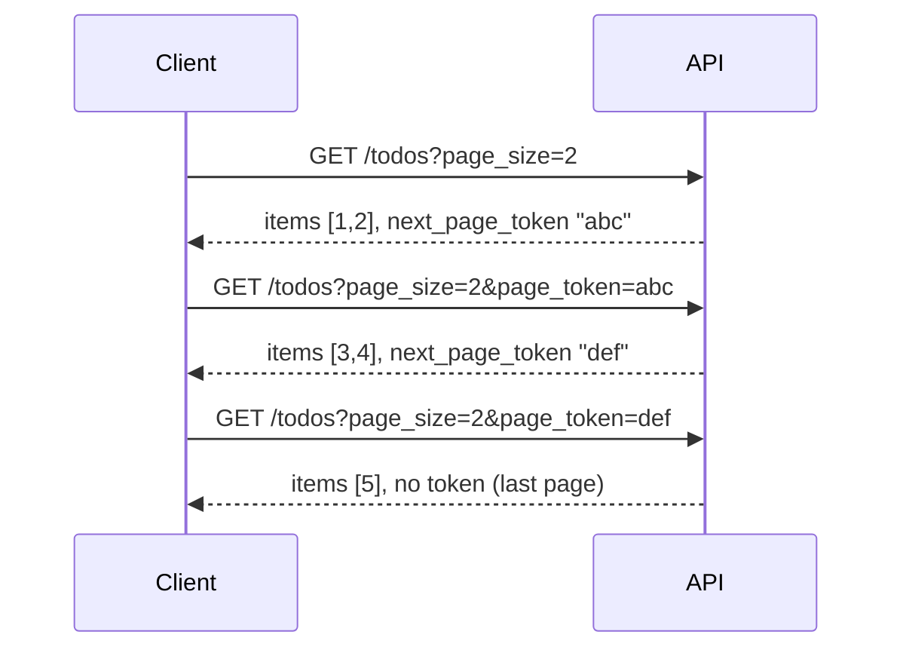
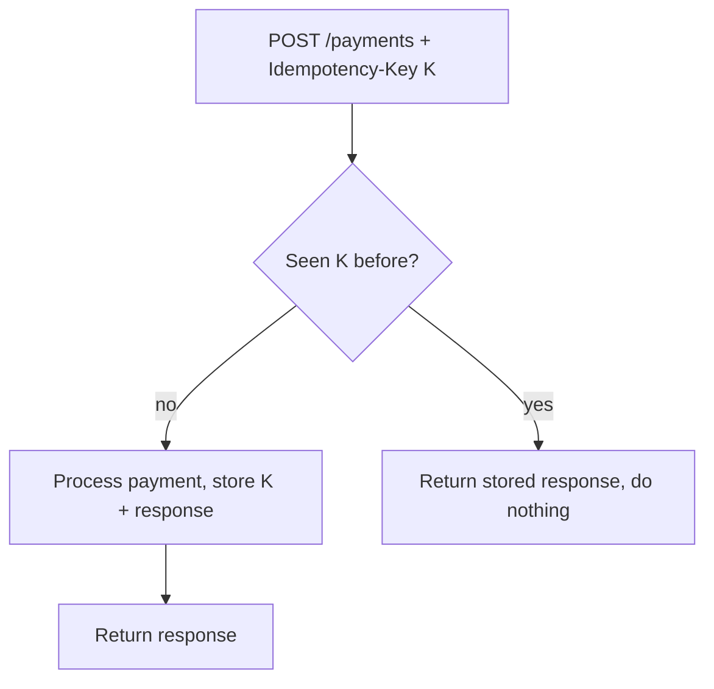

An API is a promise. Once other teams, mobile apps or paying customers depend on it, every name,
status code and field becomes hard to change. Good API design is mostly about making that promise
*consistent* and *predictable*, so a developer who has used one endpoint can guess how the next one
works. This session distils the conventions from the
[Google API Design Guide](https://cloud.google.com/apis/design), the
[OpenAPI Specification](https://spec.openapis.org/oas/latest.html) and the
[OWASP API Security Top 10](https://owasp.org/API-Security/), and ends with you writing a real API
contract.

## Resources, URIs and representations

REST (REpresentational State Transfer) organises an API around **resources**: the *nouns* of your
domain. A to-do app has `lists`, `todos`, `users`. Instead of inventing a new verb per action
(`/createTodo`, `/getAllTodosForList`), you expose a small set of standard methods on those nouns.
Google's guide calls this "resource-oriented design": a few resource types, many of them, and the
same handful of methods on each.

Think of a filing cabinet. Drawers are **collections** (`/todos`), folders are individual
**resources** (`/todos/42`), and you can nest them when ownership is real
(`/lists/3/todos`). The HTTP method says what you're doing:

| Action | Request | Typical success |
|---|---|---|
| List | `GET /lists/3/todos` | `200` + array |
| Get one | `GET /todos/42` | `200` |
| Create | `POST /lists/3/todos` | `201` + `Location` |
| Replace | `PUT /todos/42` | `200` |
| Partial update | `PATCH /todos/42` | `200` |
| Delete | `DELETE /todos/42` | `204` |

URI conventions that keep things predictable:

- **Plural nouns** for collections: `/todos`, not `/todo` or `/getTodos`.
- **Lowercase, hyphenated** paths: `/reading-lists`.
- **Stable, opaque ids** in paths: `/todos/42` or `/todos/01HZX…`, never the title.
- **Shallow nesting**: one level (`/lists/3/todos`) is fine; `/users/1/lists/3/todos/42/tags` is
  painful. Once a resource has a global id, address it directly.

A **representation** is the format in which a resource is sent: usually JSON. The resource is the
idea ("todo 42"); the JSON document is one representation of it. Pick one naming style for fields
(`snake_case` or `camelCase`) and never mix them.

> [!TIP]
> Some actions don't map to CRUD: "archive this list", "send this invoice". Google's guide calls
> these **custom methods** and uses a colon: `POST /lists/3:archive`. Many APIs use a sub-resource
> instead: `POST /lists/3/archive`. Either is fine; consistency is what matters.

## Error format and status codes

Errors are part of your API, not an afterthought. A client should be able to handle every error
the same way: read the status code, then a predictable JSON body.

A good error body tells the *machine* what happened (a stable code) and the *human* how to fix it
(a message), and points at the offending fields. The standard shape is
**Problem Details** (RFC 9457), with `Content-Type: application/problem+json`:

```json
{
  "type": "https://api.example.com/errors/validation",
  "title": "Invalid request",
  "status": 422,
  "detail": "The todo could not be created.",
  "errors": [{"field": "due_date", "message": "must be in the future"}]
}
```

Status code choices for a REST API, building on Session 3.1.2:

- `400` malformed request, `422` well-formed but invalid fields.
- `401` not authenticated, `403` authenticated but not allowed.
- `404` doesn't exist *or* the caller may not know it exists.
- `409` conflict with current state (duplicate, version mismatch).
- `429` rate-limited, with a `Retry-After` header.
- `500` your bug; never leak stack traces in the body.

> [!WARNING]
> OWASP's #1 API risk is **Broken Object Level Authorization**: `GET /todos/42` returns todo 42 even
> though it belongs to another user, because the code checked "is logged in" but not "owns this
> object". Every endpoint that takes an id must check ownership. Returning `404` rather than `403`
> for other people's objects also avoids revealing that they exist.

## Pagination, filtering and sorting

Never return an unbounded list. Today there are 20 todos; next year a power user has 80,000 and
your endpoint times out. Every list endpoint should be paginated from day one, because adding it
later is a breaking change.

There are two main styles:

- **Offset pagination**: `GET /todos?limit=20&offset=40`. Easy to understand and lets users jump to
  page 7. But it gets slow on large tables (the database still walks the skipped rows), and if
  rows are inserted while you page, you see duplicates or miss items.
- **Cursor (token) pagination**: the response includes an opaque `next_page_token`; the client
  sends it back to get the next page. The token usually encodes "the last item I gave you", so the
  query is "items after this one" which stays fast and stable. Google's guide recommends this
  style.



**Filtering** and **sorting** use query parameters on the collection:
`GET /todos?status=open&due_before=2026-11-01&sort=-due_date`. Whitelist which fields can be
filtered and sorted (each needs an index, Session 3.3.4), and cap `page_size` on the server, say at
100, whatever the client asks for. OWASP lists "Unrestricted Resource Consumption" in its Top 10
for exactly this reason.

## Versioning, idempotency keys and rate limiting

**Versioning.** Some changes are *backwards compatible*: adding an optional field or a new endpoint.
Others *break* clients: renaming or removing a field, changing a type, making an optional field
required. Breaking changes need a new major version. The most common approach is a version in the
path (`/v1/todos`, `/v2/todos`); alternatives are a header or media type. Path versioning is the
most visible and easiest to route. Rule of thumb: evolve within a version by only *adding*, and
keep the old version running until clients have migrated.

**Idempotency keys.** Session 3.1.2 showed that `POST` isn't idempotent, so retrying "create
payment" after a timeout risks charging twice. The fix: the client generates a unique key and
sends it as a header, `Idempotency-Key: 8e03…`. The server stores the key with the result of the
first request; if the same key arrives again, it returns the stored result instead of acting again.



**Rate limiting** protects your service from abuse and from accidental floods (a buggy client in a
retry loop). Limit per API key or user, e.g. 100 requests per minute, and when exceeded answer `429`
with `Retry-After`. Many APIs also send headers showing the remaining quota. You'll implement one
with Redis in Session 3.5.2.

> [!EXAMPLE]
> A mobile app creates an order, the network drops, and the app retries with the same
> `Idempotency-Key`. The server sees the key, returns the original `201` and the same order id.
> The customer gets one order, not two.

## OpenAPI as the contract

The **OpenAPI Specification** is a standard, machine-readable format (YAML or JSON) that describes
an HTTP API: its paths, methods, parameters, request bodies, responses and schemas. It's the
blueprint of a house, written before or alongside the building, that everyone (front-end, back-end,
QA, partners) can read.

Why it matters:

- **Design first.** Teams can review and agree on the contract before writing code.
- **Docs for free.** Tools like Swagger UI render it as interactive documentation.
- **Code generation.** Clients and types can be generated. This project does exactly that:
  FastAPI emits OpenAPI, and `openapi-typescript` turns it into `lib/api-types.ts` for the web app.
- **Testing.** Contract tests check that responses match the schema.

A minimal fragment:

```yaml
openapi: 3.1.0
info: {title: Todo API, version: 1.0.0}
paths:
  /v1/todos/{todo_id}:
    get:
      parameters:
        - {name: todo_id, in: path, required: true, schema: {type: integer}}
      responses:
        "200":
          description: The todo
          content:
            application/json:
              schema: {$ref: "#/components/schemas/Todo"}
        "404": {description: Not found}
components:
  schemas:
    Todo:
      type: object
      required: [id, title, done]
      properties:
        id: {type: integer}
        title: {type: string, maxLength: 200}
        done: {type: boolean}
```

> [!NOTE]
> Two approaches coexist. **Design-first**: write the OpenAPI file, then implement it. **Code-first**:
> write the code and generate the spec (FastAPI does this, next session). Code-first is faster for
> small teams; design-first shines when several teams depend on the contract.

## Practice: design the API for a to-do app in OpenAPI

You'll write `todo-api.yaml`, a complete contract you'll implement in the next two sessions. Plan
about an hour.

### Step 1: List resources and operations

On paper: resources are `lists` and `todos`. Write the table of operations: list/create/get/update/
delete for both, plus `POST /v1/todos/{id}:complete` (or a `PATCH` setting `done`). Decide now:
`snake_case` fields, path versioning, cursor pagination.

### Step 2: Define the schemas

Under `components/schemas`, define `Todo` (id, list_id, title, done, due_date nullable,
created_at), `TodoCreate` (only the fields a client may send: title required, due_date optional),
`TodoUpdate` (all optional, for `PATCH`), `TodoPage` (`items` + `next_page_token`) and `Problem`
(the error shape above). Separating input from output schemas stops clients from setting `id` or
`created_at`.

### Step 3: Write the paths

For each operation write parameters, request body, and *every* response: success codes plus `404`,
`422` and `429` using `$ref: "#/components/schemas/Problem"`. Add `page_size` (max 100),
`page_token`, `done` and `sort` query parameters on the list endpoint. Declare an
`Idempotency-Key` header on `POST` operations.

### Step 4: Add security

Add a `components/securitySchemes` bearer token and apply it globally. In each description for an
id-based endpoint, write "returns 404 if the todo doesn't belong to the caller", so the BOLA check
from OWASP is part of the contract.

### Step 5: Validate and preview

Paste the file into the Swagger Editor (editor.swagger.io) or run a linter such as
`npx @redocly/cli lint todo-api.yaml`. Fix every error, then read the rendered docs as if you were
a front-end developer. Can you guess every endpoint's behaviour without asking? If not, improve the
descriptions.

> [!TIP]
> Keep this file. In Session 3.2.2 you'll implement it with FastAPI and compare the generated spec
> with your hand-written one: the differences are a great review exercise.

```quiz
{"questions": [
  {"question": "Which endpoint design best follows resource-oriented REST conventions for marking a todo as done?", "options": ["POST /markTodoAsDone?id=42", "GET /todos/42/done", "PATCH /todos/42 with {\"done\": true}", "POST /api/doTodoAction with {\"action\": \"done\", \"id\": 42}"], "answer": 2, "explanation": "It addresses the resource by its URI and uses a standard method to partially update it. GET must not change state, and verb-style URLs break predictability."},
  {"question": "Why prefer cursor pagination over offset pagination for a large, frequently updated collection?", "options": ["It stays fast on deep pages and doesn't skip or duplicate items when rows are inserted", "It lets users jump to any page number", "It needs no database index", "Offset pagination is not allowed by HTTP"], "answer": 0, "explanation": "A cursor means 'items after this one', which uses an index efficiently and isn't shifted by inserts. Offsets get slower and drift as data changes."},
  {"question": "Which change to /v1/todos is backwards compatible and can ship without a new version?", "options": ["Renaming title to name", "Adding a new optional field priority to responses", "Making due_date required on create", "Changing id from integer to string"], "answer": 1, "explanation": "Well-behaved clients ignore unknown fields, so adding optional fields is safe. The others break existing clients."},
  {"question": "A logged-in user requests GET /todos/42, which belongs to someone else, and receives it. Which OWASP API risk is this?", "options": ["Unrestricted resource consumption", "Missing rate limiting", "Server-side request forgery", "Broken object level authorization"], "answer": 3, "explanation": "The API checked authentication but not whether the caller is allowed to access this specific object."},
  {"question": "What does an Idempotency-Key header let a server do?", "options": ["Encrypt the request body", "Recognise a retried POST and return the original result instead of acting twice", "Skip authentication", "Cache GET responses in the browser"], "answer": 1, "explanation": "The server stores the key with the first outcome; repeats with the same key get the stored response, so retries are safe."}
]}
```
