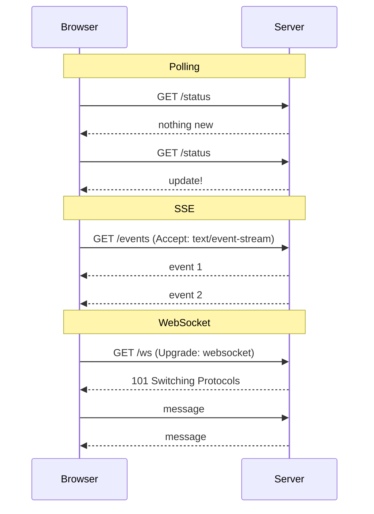
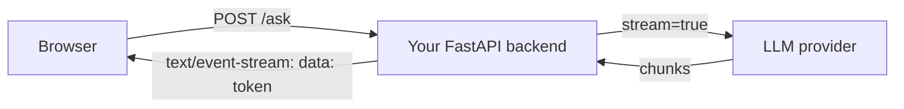

Plain HTTP is a conversation where only the client may speak first: it asks, the server answers,
and the line goes quiet. That is perfect for "give me the user's profile", but awkward for "tell me
the moment a new chat message arrives" or "show the AI's answer word by word as it is generated".
This session covers the tools backend developers reach for when request/response is not enough:
polling, server-sent events (SSE), WebSockets, and, for service-to-service calls, gRPC. The goal is
not to memorise APIs but to pick the right tool for each job and know what each one costs.

## Polling vs server-sent events vs WebSockets

Imagine waiting for a parcel. You can walk to the front door every five minutes to check
(**polling**), you can ask the courier to text you updates as the parcel moves (**server-sent
events**), or you can keep an open phone line with the courier where either of you can talk at any
moment (**WebSockets**). All three get you the parcel; they differ in effort, cost and how
interactive the conversation is.

### Polling

**Short polling** is the simplest option: the client sends a normal HTTP request on a timer, for
example `GET /jobs/42` every two seconds, and the server answers with the current state. It works
everywhere, through every proxy and firewall, and needs no special server support. The costs are
latency (an update waits until the next poll) and waste (most requests return "nothing new").

**Long polling** is a smarter variant: the server holds the request open until there *is* something
new (or a timeout passes), then answers, and the client immediately asks again. Latency drops, but
each update still pays for a full request and you tie up a connection per waiting client.

### Server-sent events

**SSE** keeps one HTTP response open and lets the server push a stream of text events down it. The
response has the content type `text/event-stream`, and each event is a few lines of text ending in a
blank line:

```text
event: progress
data: {"percent": 40}

data: plain message with no event name

```

In the browser, the built-in `EventSource` object opens the stream, parses events and *reconnects
automatically* if the connection drops. SSE is one-way (server to client) and text-only, which
sounds limiting but covers a huge number of real cases: notifications, dashboards, job progress, and
AI responses. Because it is plain HTTP, it plays well with existing authentication, load balancers
and HTTP/2.

### WebSockets

A **WebSocket** starts life as an HTTP request with an `Upgrade: websocket` header. If the server
agrees, it answers `101 Switching Protocols` and the TCP connection becomes a full-duplex channel:
both sides can send messages (text or binary) at any time, with very little framing overhead. The
browser API is `WebSocket`, with `send()` and an `onmessage` handler, as documented on
[MDN — WebSockets API](https://developer.mozilla.org/en-US/docs/Web/API/WebSockets_API).

WebSockets shine when the *client* also talks a lot: chat, multiplayer games, collaborative editors.
The price is that you leave the comfortable world of HTTP semantics. There are no status codes per
message, no caching, no automatic reconnection, and every open socket is a stateful connection your
servers must hold, which complicates scaling and deployments.



| | Polling | SSE | WebSockets |
|---|---|---|---|
| Direction | Client asks | Server → client | Both ways |
| Transport | Normal HTTP | One long HTTP response | Upgraded TCP connection |
| Reconnect | N/A | Built into `EventSource` | You write it |
| Data | Any | UTF-8 text | Text or binary |
| Best for | Rare updates, simplicity | Feeds, progress, LLM tokens | Chat, games, collaboration |

> [!TIP]
> Start from the simplest option that meets the requirement. If updates are rare and a few seconds
> of delay is fine, polling is honest, cacheable and boring. If only the server pushes, choose SSE.
> Reach for WebSockets when the client needs to send frequent messages over the same channel.

> [!WARNING]
> Long-lived connections (SSE and WebSockets) need care at the edges: proxies with short idle
> timeouts, response buffering in reverse proxies such as nginx, and per-connection memory on the
> server. Send periodic heartbeat comments or pings to keep idle connections alive.

## Streaming LLM responses with SSE

When you use a chatbot, the answer appears token by token rather than after a ten-second blank
pause. Most LLM APIs, including the providers this platform uses, offer a streaming mode, and the
standard way to deliver that stream to a browser is SSE. The reason is a perfect fit: generation is
one-way (model to user), it is text, and it ends naturally when the answer is complete.

The flow has three hops. The browser asks your backend for an answer; your backend calls the LLM
provider with streaming enabled; and as each chunk arrives, your backend forwards it as an SSE event.



In FastAPI, a `StreamingResponse` wraps a generator. Each `yield` is written to the client as soon
as it is produced:

```python
import json
from fastapi import FastAPI
from fastapi.responses import StreamingResponse

app = FastAPI()

async def fake_llm(prompt: str):
    for word in f"You asked: {prompt}. Here is a streamed answer.".split():
        yield word + " "

@app.get("/ask")
async def ask(q: str):
    async def events():
        async for token in fake_llm(q):
            yield f"data: {json.dumps({'token': token})}\n\n"
        yield "event: done\ndata: {}\n\n"
    return StreamingResponse(events(), media_type="text/event-stream")
```

A few practical details make the difference between a demo and a feature:

- **Encode each chunk as JSON.** A raw token may contain a newline, which would break the SSE
  framing. JSON-encoding it keeps every `data:` line intact.
- **Send an explicit end event** (`event: done`) so the client knows to close the stream instead of
  letting `EventSource` reconnect and ask again.
- **Handle cancellation.** If the user closes the tab, stop calling the LLM. You pay per token.
- **Disable buffering** in any proxy in front of the API, or the "stream" arrives all at once.

> [!NOTE]
> `EventSource` only supports `GET` and cannot set custom headers. When you need to `POST` a long
> prompt or send an `Authorization` header, read the stream with `fetch()` and a `ReadableStream`
> reader instead; the wire format is still `text/event-stream`.

> [!EXAMPLE]
> The tutor on this platform is a good case study: the question goes up once, the answer comes down
> as many small pieces, and the client never needs to talk mid-answer. That is the SSE shape. A
> WebSocket would work too, but you would be paying for a two-way channel you never use.

## gRPC and Protocol Buffers

So far the client was a browser. Inside a backend, services also call each other, often thousands of
times per second. For that traffic many teams use **gRPC**, an RPC (remote procedure call)
framework: instead of thinking "send a `POST` to `/orders`", you call `orders.CreateOrder(request)`
as if it were a local function, and gRPC handles the network.

The contract is written in **Protocol Buffers** ("protobuf"), a language-neutral schema format.
From one `.proto` file, the protobuf compiler generates typed client and server code for many
languages, so a Python service and a Java service share the exact same message definitions:

```protobuf
syntax = "proto3";

service Todos {
  rpc GetTodo (GetTodoRequest) returns (Todo);
  rpc WatchTodos (WatchRequest) returns (stream Todo);
}

message GetTodoRequest { int64 id = 1; }
message WatchRequest {}
message Todo {
  int64 id = 1;
  string title = 2;
  bool done = 3;
}
```

The numbers (`= 1`, `= 2`) are field tags. Messages are encoded in a compact binary format using
those tags rather than field names, which makes them smaller and faster to parse than JSON. It also
gives a clear rule for evolving the schema: add new fields with new numbers, never reuse an old one.

gRPC runs over HTTP/2 and supports four call styles, as described in the
[gRPC docs](https://grpc.io/docs/): unary (one request, one response), server streaming (like
`WatchTodos` above), client streaming, and bidirectional streaming.

> [!WARNING]
> Browsers cannot speak native gRPC directly, because they do not expose the low-level HTTP/2
> features it relies on. Public browser-facing APIs usually stay REST/JSON (plus SSE or WebSockets),
> while gRPC lives between services, or behind a gateway such as gRPC-Web.

| Use | Good choice |
|---|---|
| Public API for third parties | REST + JSON, documented with OpenAPI |
| Browser needs live updates from server | SSE |
| Browser and server chat both ways | WebSockets |
| High-volume internal service calls, many languages | gRPC + protobuf |

## Practice: stream progress updates to a browser with SSE

You will build a fake "long job" that reports its progress to a web page in real time. It takes
about 30 minutes and needs only Python and a browser.

### Step 1: Set up the project

```sh
mkdir sse-demo && cd sse-demo
python -m venv .venv && source .venv/bin/activate
pip install "fastapi[standard]"
```

### Step 2: Write the streaming endpoint

Create `main.py`:

```python
import asyncio
import json
from fastapi import FastAPI, Request
from fastapi.responses import HTMLResponse, StreamingResponse

app = FastAPI()

@app.get("/jobs/{job_id}/events")
async def job_events(job_id: int, request: Request):
    async def events():
        for percent in range(0, 101, 10):
            if await request.is_disconnected():
                return  # browser left: stop working
            payload = json.dumps({"job": job_id, "percent": percent})
            yield f"event: progress\ndata: {payload}\n\n"
            await asyncio.sleep(0.5)
        yield "event: done\ndata: {}\n\n"

    return StreamingResponse(
        events(),
        media_type="text/event-stream",
        headers={"Cache-Control": "no-cache"},
    )
```

### Step 3: Write the page

Add a route that serves a tiny HTML page:

```python
PAGE = """
<progress id="bar" max="100" value="0"></progress> <span id="label">0%</span>
<script>
  const es = new EventSource("/jobs/1/events");
  es.addEventListener("progress", (e) => {
    const { percent } = JSON.parse(e.data);
    document.getElementById("bar").value = percent;
    document.getElementById("label").textContent = percent + "%";
  });
  es.addEventListener("done", () => es.close());
</script>
"""

@app.get("/", response_class=HTMLResponse)
async def index():
    return PAGE
```

### Step 4: Run and observe

Run `fastapi dev main.py` and open `http://127.0.0.1:8000/`. The bar should fill in ten steps. Then
look at the raw stream from a terminal:

```sh
curl -N http://127.0.0.1:8000/jobs/1/events
```

The `-N` flag disables curl's buffering so you see each event the moment it arrives. In the browser
dev tools, the Network tab shows the request with type `eventsource` and an "EventStream" panel that
lists every event.

### Step 5: Break it on purpose

1. Remove the `done` listener and reload. What happens when the stream ends? (Hint: `EventSource`
   reconnects and the job starts again from 0%.)
2. Stop the server halfway through, then restart it. Watch the browser reconnect on its own.
3. Close the tab mid-job and confirm, with a `print` inside the loop, that the server stops.

> [!TIP]
> Stretch goal: add an `id:` line to each event. On reconnect, the browser sends a `Last-Event-ID`
> header, which your endpoint could use to resume from the right percent instead of restarting.

```quiz
{"questions": [
  {"question": "A dashboard shows sales totals that change a few times per minute; users never send data back through it. Which option fits best?", "options": ["WebSockets, because they are the fastest", "Server-sent events, because updates only flow from server to client", "gRPC from the browser", "Opening a new TCP connection for each update"], "answer": 1, "explanation": "One-way, text updates are exactly what SSE is for, with automatic reconnection and plain HTTP semantics. WebSockets would add a two-way channel you never use."},
  {"question": "Why is SSE a natural fit for streaming LLM answers to a browser?", "options": ["It is the only protocol that supports JSON", "LLM providers forbid WebSockets", "The answer flows one way as text and ends when generation finishes", "SSE responses are cached by the browser"], "answer": 2, "explanation": "Token streaming is one-directional, text-based and finite, which matches SSE's model. The client sends its question once, in the initial request."},
  {"question": "In a protobuf message, why must you never reuse a field number that was removed?", "options": ["Field numbers identify fields in the binary encoding, so old data or old clients would misread the new field", "The compiler limits you to ten numbers", "Reusing numbers makes messages larger", "gRPC requires numbers to be in alphabetical order"], "answer": 0, "explanation": "Protobuf encodes fields by tag number, not name. Reusing a tag would make old messages decode into the wrong field."},
  {"question": "Your SSE progress endpoint works locally but in production the browser receives all events at once at the end. What is the most likely cause?", "options": ["The browser does not support EventSource", "Too many events per second", "SSE only works over HTTP/1.0", "A reverse proxy is buffering the response before forwarding it"], "answer": 3, "explanation": "Proxies like nginx buffer responses by default. Streaming responses need buffering disabled, otherwise the client only sees data when the response completes."},
  {"question": "Which is a real cost of choosing WebSockets over SSE?", "options": ["WebSockets cannot send text", "You must handle reconnection and per-message semantics yourself, and hold stateful connections", "WebSockets only work with gRPC", "WebSockets require polling as a fallback in every browser"], "answer": 1, "explanation": "WebSockets leave HTTP semantics behind: no built-in reconnect, no status codes per message, and long-lived state that complicates scaling."}
]}
```
